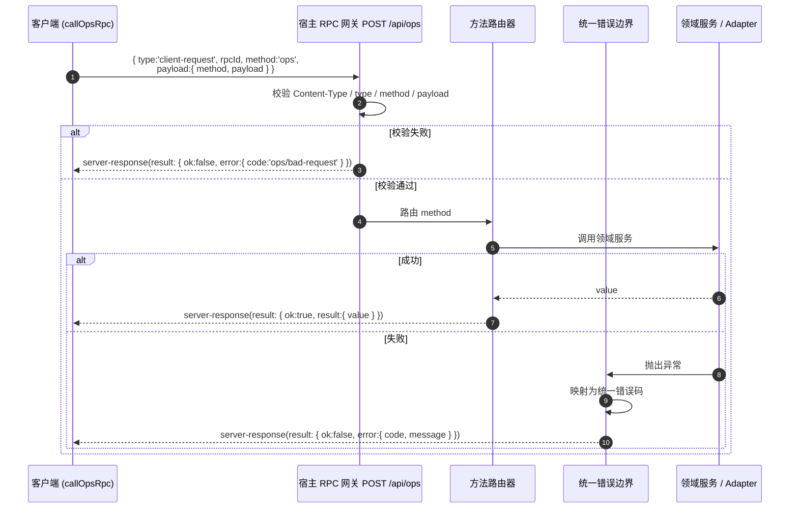

# API 策略与接口契约 (API Strategy)

> **Metadata**
> - **Source**: `.context/architecture/source/technical_architecture.md`（TAD v1.4.5 §2.2、§3）
> - **Generated At**: `2026-10-16 09:44`
> - **Updated At**: `2026-10-17 13:53`
> - **Generator**: `Context-Agent v1.0`

> ⚠️ 本文是源文档 §3 的**结构化总结**。契约的**权威定义在 `src/ops-rpc.ts` + `src/types.ts`**（criterion §7.1，手写 TS 契约）。
> 若本文与源文档或 `../criterion.md` 冲突，**以它们为准**。

---

> **MVP 裁决说明（2026-10-16）**：生成只保存本地、显式沉淀与取消草稿历史是本轮目标契约；本轮未改代码，尚未核查运行时是否已对齐。既有方法实现基线不能代替此项核查。

## 1. 传输与协议

### 1.1 协议形态

| 项 | 值 |
|----|-----|
| **URL 路由** | `POST /api/ops` |
| **协议类型** | **自研 RPC 信封**（非 REST / OpenAPI / gRPC） |
| **鉴权** | 插件**进程内**调用，**无额外鉴权头** |
| **传输形态** | DSH connection 包装 |

### 1.2 信封契约

```typescript
interface RpcEnvelopeRequest {
  method: string
  params?: Record<string, unknown>
}

interface RpcEnvelopeResponse<T = unknown> {
  ok: boolean
  result?: { value: T }
  error?: { code: string; message: string; details?: unknown }
}
```

### ⚠️ 实现口径（与文档差异，**以 criterion §5.4 为准**）

> 实际传输为 DSH connection 包装：
> - 客户端发 `{ type: 'client-request', rpcId, method: 'ops', payload: { method, payload } }`
> - 宿主回 `{ type: 'server-response', rpcId, result }`，其中 `result` 为上方信封
> - **方法入参字段名实现为 `payload`**（源文档 §2.2 写作 `params`）

网关强制校验：`Content-Type: application/json`、`type === 'client-request'`、`method === 'ops'`、
且 **`payload` 必须存在**。



---

## 2. 响应格式规范

### 2.1 成功响应

```typescript
interface RpcEnvelopeResponse<T> {
  ok: true
  result: { value: T }
}
```

### 2.2 统一错误响应

```typescript
interface RpcEnvelopeResponse {
  ok: false
  error: {
    code: string          // 机器可读错误码，如 'ops/bad-request'
    message: string       // 用户可读错误信息
    details?: unknown     // 可选：内部/开发调试信息
  }
}
```

### 2.3 错误码清单

| 错误码 | 触发条件 | 所属方法 |
|--------|---------|---------|
| `ops/bad-request` | 网关信封校验失败（Content-Type / type / method / payload） | 全部 |
| `ops/internal-error` | 未归类内部错误（**不应**用于可恢复的存储错误） | 全部 |
| `drafts/published-requires-url` | `drafts.save` 传入 `status: 'published'` | `drafts.save` |
| `drafts/invalid-published-url` | 回填 URL 不是合法 `http(s)`（须用 **URL 解析器**校验） | `drafts.updatePublishUrl` |
| `drafts/unknown-channel` | 回填 `platform` 不属于该草稿的 `channelVariants`（**不写盘、不递增版本**） | `drafts.updatePublishUrl` |
| `drafts/storage-unavailable` | 目录不可写或创建失败（**统一 RPC 错误边界**映射，覆盖**所有**写入口） | 全部写入口 |
| `config/invalid-drafts-dir` | `config.save` 前置目录准备/可写性校验失败 | `config.save` |
| `calendar/invalid-transition` | 越级 / 回退 / 经本接口写 `published` | `calendar.updateStatus` |
| `tools/disabled` | 工具在白名单中为 `enabled === false`（**宿主侧**强制） | `tools.executeSandbox` |
| `browser/capability-disabled` | BrowserOS 工具存在但能力开关关闭（§3.12） | BrowserOS 调用统一入口 |
| `browser/tool-unavailable` | BrowserOS 工具未暴露（连接未提供） | BrowserOS 调用统一入口 |
| `browser/not-connected` | BrowserOS 未连接 / 未接入 | BrowserOS 调用统一入口 |
| `ops/unknown-method` | 方法名未登记（网关方法路由兜底） | 全部 |
| `ops/not-found` | 按 ID 未找到草稿 | `drafts.get` |
| `ops/concurrency-conflict` | `expectedVersion` 与当前版本不一致（乐观锁冲突，附 `currentVersion`） | `drafts.save` |
| `ops/draft-not-found` | 指定草稿不存在 | `workbench.prefillDraft` |
| `ops/platform-unsupported` | 指定平台无适配器 | `workbench.prefillDraft` |
| `ops/variant-not-found` | 草稿缺少该平台的 `channelVariants` | `workbench.prefillDraft` |
| `ops/material-incomplete` | 变体缺少必要标题 / 正文（简介）物料 | `workbench.prefillDraft` |
| `ops/prefill-failed` | 平台适配器预填执行失败（**如实返回，不虚报成功**） | `workbench.prefillDraft` |

> **清单口径说明**：上表为**契约码全集**，含两类来源 —— ① 契约定义的错误码（含 `calendar/invalid-transition`、`tools/disabled` 等**尚未实现方法**的预留码，见 `risks_and_debt.md` TD-001）；② 当前实现基线（`src/ops-rpc.ts`，criterion §7.1 权威契约）已抛出的错误码。`ops/unknown-method`、`ops/not-found`、`ops/concurrency-conflict`、`ops/draft-not-found`、`ops/platform-unsupported`、`ops/variant-not-found`、`ops/material-incomplete`、`ops/prefill-failed` 属第 ② 类，此前本清单曾遗漏，现已补齐。

### 2.4 HTTP 状态码映射

**N/A – 源文档未提供**（自研信封以 `ok` / `error.code` 表达结果，未定义 HTTP 状态码语义）。

---

## 3. 方法契约目录

### 3.1 工作台类 `workbench.*`

#### `workbench.overview` `[Phase 0 首版]`

> ✅ **实现状态（2026-10-20）**：本节契约已由 `fix-overview-metrics-null-semantics` 在
> `src/ops-rpc.ts` + `src/analytics/overview-aggregator.ts` 落地 —— 响应已含
> `measuredPlatforms` / `unmeasuredPlatforms` / `totalEngagements` / `totalFavorites` /
> `comparison` / `weeklyPipeline`，且「部分缺失 → `null`」与「真实 `0` 参与求和」判定已生效
> （`risks_and_debt.md` TD-007 已关闭）。
>
> ⚠️ **窗口真实性说明**：`windowStart` / `windowEnd` 表达**请求窗口**，本身不证明数值属于该窗口。
> 当前采集侧页面口径为「累计 / 昨日数据」（B站累计播放、抖音按作品累加、视频号昨日增量），
> **无法证实属于请求窗口**，故 `live` 采集结果的贡献按设计保持未知（`null`），
> 真实环境下汇总值可能为「暂无数据」。采集侧窗口化解析能力的补齐不在该提案范围。

**请求**

```typescript
interface WorkbenchOverviewRequest {
  metricsWindow?: '7d' | '30d'   // 默认 '7d'，决定采集口径与环比基准
}
```

**响应要点**

| 字段 | 类型 | 说明 |
|------|------|------|
| `overviewMetrics.totalImpressions` | `number \| null` | 全网图文/推文曝光阅读 |
| `overviewMetrics.totalPlays` | `number \| null` | 全网视频播放量 |
| `overviewMetrics.totalEngagements` | `number \| null` | 点赞+评论+转发+收藏（**任一为 null 则整体 null**） |
| `overviewMetrics.weeklyPipeline` | `{ total, completed, byStatus }` | 本周排期进度（`prefilled + published` 为完成） |
| `overviewMetrics.measuredPlatforms` | `PlatformId[]` | 本窗口**成功采集**的平台 |
| `overviewMetrics.unmeasuredPlatforms` | `PlatformId[]` | 采集失败 / 不支持的平台 |
| `overviewMetrics.comparison` | `{ period, *DeltaPercent }` | 环比（`period` 无历史时为 `null`） |
| `statuses` | `Array<{ id, state, isReady, loginUrl?, ... }>` | 平台就绪状态（`state === 'authenticated'` 才算 ready；`loginUrl` 供 needs_login 时「去登录 ↗」） |
| `calendarItems` / `trends` / `feedbackItems` | — | 聚合数据 |
| `injoysConnected` | `boolean` | Injoys 连通性 |

**指标口径（本区块为权威定义）**

> 解决「采集时刻 ≠ 指标所属周期」的歧义。

| 概念 | 定义 |
|------|------|
| **窗口** | `metricsWindow` 指定的时间跨度，统计**该窗口内新增**的曝光/播放/互动（**增量口径，非历史总量**） |
| **采集时刻** | `capturedAt` 表示数据**抓取时间**，与窗口是**两个独立概念**，不得互相替代 |
| **缺失语义** | 任一平台采集失败或平台不支持该指标时，该平台贡献为「未知」 |

**部分缺失汇总规则（服务端强制口径）**

> 核心原则：**绝不用不完整的数据冒充全网总量**。

1. 设应采平台集合为 `P`（`totalChannelsCount` 对应平台），成功采集集合为 `measuredPlatforms`；
2. `measuredPlatforms == P` → 汇总值为各平台之和，正常给出数字；
3. `measuredPlatforms ⊂ P`（部分缺失）→ 汇总值为 **`null`**，**不得**只汇总已成功平台后当成全网总量；同时必须填充 `measuredPlatforms` / `unmeasuredPlatforms`；
4. **零值 vs 缺失**：平台真实返回 `0` 时作为**有效值 0** 计入求和（`0` 与 `null` 语义**严格区分**）；只有「采集失败 / 平台不支持」才是 `null`；
5. `totalEngagements` 在点赞、评论、转发、收藏四项中**任一为 `null` 时为 `null`**。

**环比基准来源**

- 基准取自本地**历史指标快照**：每次采集成功后按 `(platform, capturedAt)` 追加写入 `$DSH_HOME/growth-studio/metrics/{YYYY-MM-DD}.json`；
- `comparison.period` 表示用于对比的**上一个等长窗口**；
- 历史快照不足以覆盖完整上一个窗口 → 对应 delta 为 **`null`**，**不得**用不完整历史算近似百分比；
- 因此环比是**基于本地留存的次级指标**；首次使用时全部 delta 为 `null` 属**预期行为，不是缺陷**。

---

#### `workbench.generateCalendar` `[Phase 0 首版]`

**持久化职责**：生成的排期行落盘至 `$DSH_HOME/growth-studio/calendar/{id}.json`（与草稿库同级）。
**本地为排期黄金主数据源**，Injoys Spreadsheet 是**单向导出目标**。

```typescript
interface GenerateCalendarRequest {
  period: 'week' | 'month'
  focusVersion?: string
  platforms?: PlatformId[]
  exportToSheet?: boolean   // 默认 false：导出应为用户显式确认的动作
}

interface GenerateCalendarResponse {
  period: string
  totalItems: number
  items: CalendarItem[]
  sheetExported: boolean
  exportError?: string      // 导出失败原因；未导出或成功时为 undefined
}
```

---

#### `workbench.exportCalendar` `[Phase 0 首版]`

```typescript
interface ExportCalendarRequest {
  period: 'week' | 'month'
  itemIds?: string[]        // 缺省导出该周期全部
}
// → { exportedCount, skippedCount, sheetExported }
```

> **幂等规则**：以 `CalendarItem.externalRowId` 为准做**更新而非重复插入**；导出成功后本地回写 `externalRowId`。
> 因此重复导出同一周期为**幂等**操作，不产生重复行。

---

#### `workbench.importCalendar` `[Phase 0 首版]`

```typescript
interface ImportCalendarRequest {
  period?: 'week' | 'month' | 'all'   // 默认 'all'
}

interface ImportCalendarResponse {
  importedCount: number
  updatedCount: number
  skippedCount: number
  conflicts: Array<{ externalRowId: string; reason: string }>
}
```

**冲突与重复导入规则（明确定义）**

1. 远端行携带 `externalRowId` 且本地已存在同 ID → **更新**该本地项（`updatedCount`），**不新增行**；
2. 远端行无 `externalRowId` → 按 `(date, platform, topic)` 三元组匹配；命中则更新，未命中则新增并补写 `externalRowId`；
3. 远端行与本地项在 `date`/`platform` 上冲突但 `topic` 不同 → 视为**不同排期项**，新增并记入 `conflicts` 供用户核对；
4. 导入**不覆盖**本地已 `prefilled` / `published` 的项的状态与 `publishedUrl`（**本地状态优先**，避免抹掉真实发布结果）；
5. 导入过程失败时**不回滚已成功项**，如实返回已导入计数与错误，**不谎报全量成功**。

---

#### `workbench.generateArticleDraft` `[Phase 0 首版]`

```typescript
interface GenerateArticleRequest {
  topic: string
  targetPlatform: 'wechat_mp' | 'product_hunt'
  tone?: 'technical' | 'viral' | 'concise'
}

interface GenerateArticleResponse {
  id: string
  title: string
  digest: string
  contentMarkdown: string
  wordCount: number
  draftSaved: boolean
  injoysDocId?: string
}
```

> **MVP 写入边界**：本请求只保存本地，不创建或更新 Injoys 文档；知识库可读取。请求开始时捕获草稿目录，等待知识库后仍写入该目录。可选 `injoysDocId` 仅保留兼容形状，不因生成而创建或填充。

---

#### `workbench.generateVideoMeta` `[Phase 0 首版]`

```typescript
interface GenerateVideoMetaRequest {
  topic: string
  platform: 'bilibili' | 'douyin' | 'youtube' | 'wechat_channels'
  mediaPath?: string      // 本地成片路径；B站预填需实际上传
  partition?: string      // B站分区（如 '科技/数码'），仅 bilibili 有效
}

interface GenerateVideoMetaResponse {
  id: string
  draftSaved: boolean
  titleCandidates: Array<{ title: string; angle: string; estimatedCtr: string }>  // 数量恒为 3
  description: string
  tags: string[]
  partition?: string
  coverPromptSuggestion: string
  injoysDocId?: string
}
```

**关键约束**

- **生成只保存本地**；不自动创建或更新 Injoys 文档，可选 `injoysDocId` 不构成写入授权。
- **`titleCandidates` 数量恒为 3** —— UI 依赖此固定数量，**不得返回其他个数**；
- **草稿关联规则**：视频生成与图文生成**行为一致** —— 响应必须返回 `id` 与 `draftSaved`，表明物料已自动落盘为 `ContentDraft`（`channelVariants[platform].kind === 'video'`）；
- `draftSaved: true` 表示已成功落盘；`draftSaved: false` 表示**物料已生成但尚未落盘**（供前端重试），**不得谎报已保存**；
- ⛔ **落盘失败（存储类）不返回成功信封**：目录不可写等写盘错误须在**统一 RPC 错误边界**返回 `drafts/storage-unavailable`（§3.7 / 源文档 §3.10.4），**不得**以 `{ ok:true, draftSaved:false }` 包装存储错误；
- **分区字段映射**：`partition` 存入 `channelVariants[].partition`，预填时经 Adapter 映射到平台控件；平台不支持分区时该字段为 `undefined`，预填流程**跳过该项而不报错**。

---

#### `workbench.sinkToInjoysDoc` `[Phase 0 首版]`

> 对应 PRD §5.4.3 的「💾 沉淀至 Injoys 知识文档」操作条。
> 该动作**独立于自动存盘**：自动存盘只写本地草稿库，本接口才写入 Injoys。
> **必须由用户点击沉淀操作或明确要求写入 Injoys 才触发**；生成、预览、本地保存与自动同步配置均不能替代这次要求。该请求从开始时捕获目录，贯穿读取、远端调用和 `injoysDocId` 回写。
> 链路：宿主 → `InjoysClient` → `document.create`。

```typescript
interface SinkToInjoysDocRequest {
  draftId: string
  platform?: PlatformId   // 缺省沉淀全部渠道变体
  title?: string          // 缺省使用草稿标题
}

interface SinkToInjoysDocResponse {
  success: boolean
  injoysDocId?: string
  docUrl?: string
  message: string
}
```

**语义与约束**

- 成功后把 `injoysDocId` 回写至本地草稿（`ContentDraft.injoysDocId`）；
- Injoys 未配置或调用失败时返回 `success: false` 与**真实错误信息**，**不得**谎报成功，也**不得**静默写本地假 ID；
- 重复沉淀同一草稿为**幂等**：已存在 `injoysDocId` 时默认**更新**该文档而非新建，避免产生多份重复知识文档。

---

#### `workbench.prefillDraft` `[Phase 0: 公号+B站]`

```typescript
interface PrefillDraftRequest {
  draftId: string
  platform: PlatformId
}

interface PrefillDraftResponse {
  success: boolean
  platform: PlatformId
  draftId: string
  draftUrl: string              // 平台后台草稿直达链接
  message: string
  requiresUserAction?: boolean
}
```

> ⚠️ **跨 `await` 复合 RPC 的目录固定**：本方法会「读草稿 → 调用平台 Adapter → 回写预填结果」，
> 中间可能等待很久。必须在**请求开始时**捕获存储目录并贯穿全程，
> 否则外部调用期间的配置切换会把结果写进**另一个库的同 ID 草稿**。
> **客户端不得自行指定任意路径。**
>
> 其对应的工具封装 `ops_push_drafts` 为**预填**语义，止步于平台原生「保存为草稿」。

---

### 3.2 草稿类 `drafts.*`

#### `drafts.list` / `drafts.get`

```typescript
// drafts.list 请求: {}
// → { drafts: ContentDraft[] }
// drafts.get  请求: { id: string }
// → { draft: ContentDraft }
```

---

#### `drafts.save`（创建或更新草稿，版本自增）

```typescript
interface SaveDraftRequest {
  draft: {
    id?: string
    title: string
    topic: string
    targetAudience?: string
    channelVariants: Array<{
      platform: PlatformId
      kind: 'article' | 'video' | 'post'
      title: string
      body: string
      tags: string[]
      mediaPaths?: string[]
      coverPath?: string
      partition?: string
    }>
    status?: 'draft' | 'ready_for_review' | 'prefilled'
    // ⛔ 本入口不接受 'published'
    injoysDocId?: string
    // 注意：`version` 为服务端治理字段（新建置 1、更新自增 1），请求方可传但会被忽略
  }
  /**
   * 乐观锁期望版本（**顶层字段，与 `draft` 同级**，不是 `draft.version`）。
   * - 可省略：省略时不校验版本，直接写入并自增 `version`；
   * - 传入时必须等于磁盘当前 `version`（草稿不存在时视为 `0`），否则拒绝。
   */
  expectedVersion?: number
}
// → { draft: ContentDraft }   // 成功时返回自增后的 `version`
```

**版本冲突响应（服务端强制）**

- `expectedVersion` 与当前版本不一致（或草稿不存在而 `expectedVersion !== 0`）时，返回
  `{ ok: false, error: { code: 'ops/concurrency-conflict', message, details: { currentVersion, expectedVersion } } }`；
- 调用方应据 `details.currentVersion` 重新拉取草稿、合并后再以新版本重试，**不得覆盖式盲写**；
- 字段位置、可选性与冲突载荷的**权威形状**以 criterion §7.1 的 TS 契约（`src/ops-rpc.ts` + `src/types.ts`）为准。

> **来源说明**：源文档 TAD §3.2.3 已包含 `expectedVersion`（可选乐观锁字段）与 `ops/concurrency-conflict` 冲突响应载荷（TAD v1.4.x 补齐）；本资产与源文档已一致。字段位置、可选性与冲突载荷的**权威形状**仍以 criterion §7.1 的 TS 契约（`src/ops-rpc.ts` + `src/types.ts`）为准。

**`published` 守卫（服务端强制）**

- 传入 `status: 'published'` 时，服务端**必须拒绝**并返回 `{ ok: false, error: { code: 'drafts/published-requires-url' } }`；
- **唯一可写入 `published` 的入口是 `drafts.updatePublishUrl`**；
- **理由**：`published` 代表「已在平台真实发布」，其**唯一可信证据**是用户回填的真实 URL。若允许通用保存入口直接写 `published`，则发布闭环可被绕过，**状态会失去真实性**；
  > ⚠️ **保证边界**：该证据来自**用户声明**；契约可校验 **URL 格式 / 渠道归属 / 全渠道完整性**，
  > 但**不能**证明发布确已发生 —— ⛔ 不得把"格式合法"当作"已核实发布"。
- 该守卫是**服务端**职责，**不得**仅依赖客户端不传该值。

**其他服务端治理规则**

- `publishedUrls` 为**服务端治理字段** —— 本入口必须**忽略**调用方传入的该字段，不得让其伪造发布凭据；
- **状态优先级**：① 全部渠道有效回填 → `published`；② 部分回填 → **固定 `prefilled`**，普通保存**不得**降级为 `draft`；③ 无发布凭据 → 才可写入请求的编辑态；
- **渠道集合变化后必须重算状态**（已发布草稿新增未回填渠道须回退为 `prefilled`），且须在**同一写锁内**维持该不变量。

---

#### `drafts.delete`

```typescript
// 请求: { id: string }
// → { success: boolean }
```

> **MVP 删除语义**：删除当前 `{id}.json`，`success:true` 表示当前草稿已清除；不创建或管理历史快照，不承诺旧历史文件清理或远端联动删除。

---

#### `drafts.updatePublishUrl`（人工发布后回填 URL 闭环）

```typescript
interface UpdatePublishUrlRequest {
  draftId: string
  platform: PlatformId
  publishedUrl: string
}

interface UpdatePublishUrlResponse {
  draft: ContentDraft
  publishedChannels: number   // 已回填渠道数
  totalChannels: number       // 该草稿的渠道总数
  allPublished: boolean       // status === 'published' 的判定依据
}
```

**校验（服务端强制）**

- `publishedUrl` 必须为合法 `http(s)://` URL，否则 `drafts/invalid-published-url`（**须用 URL 解析器校验，禁止宽松正则**）；
- `platform` 必须存在于该草稿的 `channelVariants` 中，否则 `drafts/unknown-channel`（**不写盘、不递增版本**）。

**部分发布时整体状态规则（已裁决）**

回填是**按渠道**累加写入 `publishedUrls[platform]`，而 `ContentDraft.status` 是**整体**状态：

1. 只有当草稿的**全部** `channelVariants` 渠道都已回填 URL 时，`status` 才推进为 `published`；
2. 仅部分渠道回填时，`status` **保持 `prefilled`**，已发布渠道明细由 `publishedUrls` 键集合体现；
3. **不引入** `partially_published` 中间态（避免状态枚举膨胀）；UI 用「已发布 1/2 渠道」这类由 `publishedChannels` / `totalChannels` 派生的文案展示；
4. 判定依据恒为「`publishedUrls` 覆盖全部渠道」，**不依赖**调用顺序或次数；
5. **状态优先级**（对普通编辑入口同样生效）见 `drafts.save`；
6. 删除或替换渠道后，不再对应任何当前渠道的 URL 会被剪除（**孤儿清理**），因此移除渠道不会让草稿凭残留 URL 继续维持「已发布」假象。

---

#### 草稿历史接口（MVP 不提供）

`drafts.listVersions`、`drafts.getVersion`、`drafts.restoreVersion` 不在 MVP 范围内，原请求、响应及 `drafts/version-not-found` 不作为首版契约。
MVP 通过 `drafts.get` / `drafts.save` 查看与覆盖当前内容，`version` / `expectedVersion` 仅用于并发控制。
历史功能如需引入须另行提案。存储规则见 `data_architecture.md` §MVP 单份草稿存储设计。

---

### 3.3 排期类 `calendar.*`

#### `calendar.list`

```typescript
interface CalendarListRequest {
  period?: 'week' | 'month' | 'all'   // 默认 'week'
  platform?: PlatformId
  status?: ItemStatus
}
// → { items: CalendarItem[] }  按 date 升序
```

#### `calendar.updateStatus`

```typescript
interface CalendarUpdateStatusRequest {
  itemId: string
  status: ItemStatus
}
// → { item: CalendarItem }
```

**约束（服务端强制校验）**

- 只允许 PRD §5.3.1 的**前向**推进（`planned` → `drafting` → `draft_ready` → `prefilled` → `published`），**禁止回退**；
- **`published` 不可经本接口写入**，只能由 `drafts.updatePublishUrl` 的回填闭环推进；
- 越级或非法流转返回 `calendar/invalid-transition`。

---

### 3.4 浏览器类 `browser.*`

#### `browser.sessions` `[Phase 0 首版]`

```typescript
interface BrowserSessionsResponse {
  statuses: Array<{
    platform: PlatformId
    state: SessionState      // 'unknown' | 'needs_login' | 'authenticated' | 'no_publish_permission'
    isReady: boolean
    accountName?: string
    loginUrl?: string        // 登录入口外链；needs_login 时供「去登录 ↗」（PRD §5.2.1 / §六.3）
    lastCheckedAt: string
    message: string
  }>
}
```

> 实现返回额外含 `reuseHostBrowserProfile`（criterion §5.4）。

#### `browser.login.*` `[Phase 2 愿景 / 需 PoC 验证]`

- `browser.login.startQr`（启动扫码登录并提取二维码 Base64）
- `browser.login.pollQr`（轮询扫码状态）
- `browser.login.openHeadful`（拉起 BrowserOS 可视前台认证窗）
- `browser.login.cancel`（取消登录会话）

> ⚠️ 上述为 Phase 2 计划的**前台交互窗与二维码推流**设计，**需依赖 BrowserOS CDP 高级 API 验证**。
> **Phase 0 阶段工作台采用引导用户在当前 BrowserOS 实例中直接扫码登录。**

---

### 3.5 AI 工具中枢与沙箱 `tools.*` `[Phase 0 首版]`

> 工具治理的最小可实施契约。
> **核心原则：沙箱执行必须与服务端白名单同源校验，前端传入的工具名一律不可信。**

```typescript
interface OpsToolDescriptor {
  name: string                 // 如 'ops_draft_article'
  description: string
  category: 'planning' | 'creative' | 'publishing' | 'analytics' | 'system'
  driver: 'native' | 'injoys' | 'browseros'
  paramsSchema: Record<string, unknown>   // 供沙箱渲染表单
  enabled: boolean             // 当前白名单开关状态
  dangerous: boolean           // Phase 0 恒为 false，因发布工具已移除
}
```

| 方法 | 请求 | 响应 |
|------|------|------|
| `tools.catalog` | — | `{ tools: OpsToolDescriptor[] }` |
| `tools.toggle` | `{ name, enabled }` | `{ tool: OpsToolDescriptor }` |
| `tools.executeSandbox` | `{ name, params, dryRun? }` | `{ ok, result?, error?, durationMs, logs? }` |
| `tools.telemetry` | `{ limit? }` | `{ entries: Array<{ toolName, startedAt, durationMs, ok, errorCode? }> }` |

**约束**

- **启停状态持久化**到本地配置，重启后保持；
- **白名单强制校验在宿主侧**：`enabled === false` 的工具必须拒绝执行并返回 `tools/disabled`，**不得**依赖前端隐藏按钮；
- `ops_publish_now` 等**发布类工具不存在于 catalog**，因此**无法构造调用**；
- 失败必须返回真实错误与 `durationMs`，**不得**以成功形状返回失败结果；
- 遥测记录用于性能审计，**必须脱敏**（**不得**记录令牌、Cookie 或完整正文）。

---

### 3.6 配置类 `config.*` / `injoys.*` `[Phase 0 首版]`

#### 配置结构契约

```typescript
interface OpsConfig {
  defaultProduct: string
  tone: 'technical' | 'viral' | 'concise'
  injoys: {
    endpoint: string
    token: string     // ⛔ 无内置默认值；仅来自用户配置或 INJOYS_MCP_TOKEN
  }
  draftsDir: string   // 缺省 $DSH_HOME/growth-studio/drafts/
  reuseHostBrowserProfile: boolean   // ⛔ 待废弃（§5.1.3 Cookie 探测偏差）
  autoSyncToInjoys: boolean
  browserosCapabilities?: Partial<Record<string, boolean>>  // 能力开关（默认八项，见 §3.12）
}
```

#### `config.get`

> **契约形态（重要）**：配置字段**平铺**在 `result.value` 上，并附环境变量回退标记。

```typescript
interface ConfigGetValue extends OpsConfig {
  hasEnvEndpoint: boolean
  hasEnvToken: boolean
}
```

- 早期草案曾写作 `{ config: OpsConfig; ... }` 的**嵌套形态，从未实现**；因其会破坏既有客户端读取，现统一以**平铺为正式契约**；
- 若未来要改为嵌套，属**破坏性变更**，须走**版本化迁移方案**（新旧字段并存至少一个版本）并同步更新客户端后，方可移除旧字段；
- **令牌返回策略**：当前返回明文 `token`（用于表单回填与显隐切换）。该接口**仅面向本机受信任的 DSH 客户端**（客户端运行在渲染进程，与宿主非同进程），不作为对外网络端点；该例外由 `criterion §3.4`「令牌返回边界」授权，**并同样覆盖本节的 `config.save` 响应体**（其返回完整 `OpsConfig`，含 `token`）。若未来 RPC 可被非本机访问，**必须先**改为「只回 `hasToken: boolean`，明文另走回填专用通道」；
- 草稿库的「当前生效目录」由本接口返回，UI 据此展示实际存储位置。

#### `config.save`

```typescript
// 参数: Partial<OpsConfig>
// → { success: boolean; config: OpsConfig }
```

- 持久化后**实时热更新**运行中的 `InjoysClient`（`endpoint` / `token`），**无需重启**；
- **响应体含明文 `token`**：`config` 为完整 `OpsConfig`，适用 `criterion §3.4`「令牌返回边界」的本机回填例外（与 `config.get` 同一授权），**不得**向本机 DSH 客户端之外回传；
- 保存 `injoys` 配置后须清理**按目标隔离的缓存**，避免跨服务状态污染；
- 修改 `draftsDir` 后**立即生效**，无需重启（详见 §3.7）；
- **改目录前必须校验**：先创建目标目录**并验证其确实可写**（创建并删除唯一命名的探测文件），失败时**拒绝保存并返回 `config/invalid-drafts-dir`**。**不得**先返回成功、再让后续 `drafts.save` 以 `ENOENT` 失败。

#### `injoys.test`

```typescript
// → { connected: boolean; latencyMs: number; documentCount: number | null; message: string }
```

- 执行 `knowledge.list` 探活并返回延迟与文档数（`documentCount` 为文档数；未配置令牌或探活失败时为 `null`，不得按 0 伪造）；
- **未配置令牌**时**不得发出请求并谎报「认证失败」**，须返回明确的「尚未配置令牌」提示。

---

### 3.7 `draftsDir` 变更语义（关键契约）

- `config.save` 修改 `draftsDir` 后**立即生效**，新建 / 读取草稿均使用新目录；
- **保存前必须准备并校验目标目录**（见 `config.save`）。仅检查「目录存在」是**不够**的：**已存在但只读的目录**会让 `mkdir` 成功却在首次写入时失败；
- **目录必须在单次操作内固定，且覆盖复合 RPC**：一次草稿操作（加锁 → 读取 → 版本校验 → 临时文件 → rename）必须始终针对**同一个**目录。若中途发生配置切换，本次操作**继续使用原目录**，切换只对**新发起**的操作生效（否则会出现「从 A 库读取、写入 B 库」并覆盖 B 库同 ID 草稿）；
- **写锁按绝对文件路径**而不是 ID 归属，使不同库中的同 ID 草稿互不阻塞、互不覆盖；
- **跨 `await` 的复合请求同样适用**（如 `workbench.prefillDraft`）。**贯穿范围包括「请求内的每一次落盘」**（如用户明确触发的 `workbench.sinkToInjoysDoc` 读取后回写；生成本身只写本地）；
- **这是确定行为，不是异常**（已裁决）：在途操作写入原目录属于**预期语义**，**不引入** `dirChangedDuringSave` 之类的告警标记，也不在响应中把它当错误上报；
- **配置页切换提示文案**（实现时照此展示，须同时覆盖三件事实）：
  > 新目录对后续操作生效；正在进行的保存仍写入原目录。旧草稿不会自动迁移。
- **已存在于旧目录的草稿不做自动迁移**（避免大目录复制与部分失败风险）；
- **写入失败必须如实抛错，且错误码统一**：目录不可写或创建失败返回 `drafts/storage-unavailable`，**不得**吞掉异常后谎报保存成功。该映射须在**统一 RPC 错误边界**完成，使 `drafts.save`、`drafts.updatePublishUrl`、预填回写等**所有写入口**返回同一错误码，而不是让部分入口漏出 `ops/internal-error`；
- 配置前置校验失败仍**单独使用** `config/invalid-drafts-dir`；
- **未来可选增强（本轮不实现）**：若需帮助用户定位某次保存**实际落到哪里**，优先在写入类响应中返回本次真实使用的 `storageDirectory`（字符串），而**不是**布尔标记 —— 它同时覆盖「目录已切换」与「目录未变」两种情形。该字段属**契约变更**，须先更新本节与 `src/types.ts` 再实现。

---

### 3.8 周期性巡检注册 `ops_setup_schedule` `[Phase 0 首版]`

```typescript
interface SetupScheduleParams {
  actionType: 'weekly_review' | 'publish_calendar' | 'metrics_inspection'
  title?: string
  cronExpression?: string   // 缺省 '0 9 * * 1'（每周一 09:00）
  timeZone?: string         // 缺省 'Asia/Shanghai'
}
```

> **调用形态**：宿主内**工具调用**，**非** `POST /api/ops` 的 RPC 方法 ——
> 它需要 DSH 自动化任务系统的宿主能力，与工作台配置接口**不属于同一调用面**。

**约束**

- 注册失败**必须如实返回错误**，**不得**谎报已注册；
- 该能力与「Phase 0 禁止后台定时轮询」**不冲突**：前者是 DSH 宿主的任务调度（到点唤起会话），后者禁止的是工作台为刷新大盘而**自建常驻连接或轮询**。二者**不可混为一谈**；
- 巡检任务自身的执行仍受「仅预填、不自动发布」铁律约束。

---

### 3.9 BrowserOS 能力管理 `browseros.capabilities` `[Phase 0 首版]`

> 对应源文档 TAD §3.12。能力开关只决定「哪些 BrowserOS 底层工具可调用」，**不等于**允许自动发布或外传 Cookie。

```typescript
interface BrowserOsCapabilityDescriptor {
  name: string               // 实际暴露的工具名（未暴露不列出、不承诺）
  description: string        // 现有元数据能提供的描述；无则空串，不伪造
  enabled: boolean           // 用户开关（默认值解析见源文档 TAD §3.12.2）
}

// browseros.capabilities（只读）
// → { capabilities: BrowserOsCapabilityDescriptor[]; connected: boolean }
```

- 默认八项（默认启用集，非上限）：`tabs / navigate / snapshot / act / read / grep / wait / upload`；其余实际暴露工具默认关闭、可手动开启；不存在永久禁用项（`shell`/`cmd` 若暴露同样由用户管理）。
- 工具清单**以实时连接为准**：连接当前未提供的工具**不列出**（消失的工具就消失了），不保留历史/配置工具行，不伪造、不承诺支持（MVP 简化）。
- 配置读写走 `config.save`（`OpsConfig.browserosCapabilities`，见 §3.6）；本接口**不承接写操作**。
- 错误码：`browser/capability-disabled`（工具存在但开关关）、`browser/tool-unavailable`（工具未暴露）、`browser/not-connected`（未连接）。
- 统一执行检查：所有 BrowserOS 调用必经 `BrowserOsMcpClient.callTool` 单一入口，Adapter 禁止绕过；经 `ops_*` 调用时「运营工具开关 + 引擎能力开关」**两层同时满足**。
- 热更新：保存后对后续新发起调用生效；在途单次调用不中断；复合操作中未发出的后续调用按最新配置检查。

> **实现状态**：`browseros.capabilities` 为**文档契约**，`src/` 当前无此方法，**未实现**（见 §4「已定义但尚未实现」清单与 `risks_and_debt.md` TD-001）。

---

### 3.10 `ops_*` 工具 ↔ RPC 方法映射（追溯关系）

> 对应源文档 TAD §3.13。`ops_*` 是 AI 调用入口，RPC 是客户端调用入口；可共享领域服务、不必互相调用。
> 「领域服务 / 外部依赖 / 主数据位置」三列为**目标口径**，不代表当前实现已具备；现状以「当前实现差距」为准。
> **引用体系**：本表「对应 RPC」列的 `§x.y` 均指**本文件（api_strategy.md）**的章节号（如 §3.1 工作台类、§3.3 排期类、§3.4 浏览器类），非源文档 TAD 编号。

| 工具（AI 入口） | 对应 RPC | 目标领域服务 | 目标外部依赖 | 目标主数据 | 当前实现差距 | 阶段 |
|---|---|---|---|---|---|---|
| `ops_plan_calendar` | `workbench.generateCalendar`（§3.1） | CalendarEngine | Injoys 读取/显式导出 | 本地 calendar | RPC 未实现 | Phase 0 |
| `ops_discover_trends` | 无 | TrendsDiscoverer | 真实搜索 | — | 本地固定模板，未接搜索 | Phase 0 原型 |
| `ops_keyword_research` | 无 | — | — | — | 未注册、无实现 | 未定 |
| `ops_draft_article` | `workbench.generateArticleDraft`（§3.1） | ContentStudioEngine | Injoys 读取 | 本地 drafts | 无条件写 Injoys（TD-008） | Phase 0 |
| `ops_draft_video_meta` | `workbench.generateVideoMeta`（§3.1） | ContentStudioEngine | — | 本地 drafts | 工具无条件写 Injoys（TD-008）；RPC 只存本地 | Phase 0 |
| `ops_draft_launch_kit` | 无 | OverseasManager | Injoys 读取 | 本地草稿 | 无条件 saveLaunchKitDocument | Phase 2 |
| `ops_generate_hooks` | 无 | ContentStudioEngine | — | 本地草稿 | 未注册、无实现 | 未定 |
| `ops_push_drafts` | `workbench.prefillDraft`（§3.1，单草稿） | BrowserDriver/Adapter | BrowserOS | 平台草稿箱 | 批量入口无 RPC | Phase 0 |
| `ops_fetch_metrics` | 与 `workbench.overview` 共用采集 | MetricsCollector | BrowserOS | 本地 metrics | overview 缺部分缺失汇总（TD-007） | Phase 0 |
| `ops_generate_review` | 无 | ReviewReporter | Injoys 读取 | 本地指标快照 | 假编号回退（TD-009） | Phase 1 |
| `ops_fetch_comments` | 无 | CommentsCrawler | BrowserOS | — | 无 RPC | Phase 1 |
| `ops_extract_feedback` | 无 | IssueExtractor | Injoys 需求池 | — | 无 RPC | Phase 1 |
| `ops_setup_schedule` | 无（宿主工具） | schedule-bridge | DSH 自动化任务中心 | — | 工具调用面 | Phase 0 |
| `ops_inspect_sessions` | `browser.sessions`（§3.4） | SessionGuard | BrowserOS | — | 工具名未注册；RPC 已实现（含 Cookie 探测偏差） | Phase 0 |

> **口径**：`目标外部依赖` 仅表示调用/读取的外部能力，**不代表主数据位置，也不代表自动写入授权**（Injoys 写入须显式触发）。

---

## 4. 方法实现状态

> 依据 criterion §5.4 的当前实现基线。**本文档定义 ≠ 已实现**。

### 已在 `src/ops-rpc.ts` 登记（实现基线）

| 分类 | 方法 |
|------|------|
| 工作台 | `workbench.overview`（⚠️ **部分实现**，见下）、`workbench.generateArticleDraft`、`workbench.generateVideoMeta`、`workbench.prefillDraft` |
| 草稿 | `drafts.list`、`drafts.get`、`drafts.save`、`drafts.delete`、`drafts.updatePublishUrl` |
| 浏览器 | `browser.sessions`（额外含 `reuseHostBrowserProfile`） |
| 配置 | `config.get`、`config.save`、`injoys.test` |

> ⚠️ **「已登记」≠「字段级已实现」**：`workbench.overview` 的方法已注册（路由可达、§3.1 契约已定义），
> 但其**响应字段与 §3.1 契约不一致**，尤其**未实现部分缺失汇总语义**。
> 该差异属**实现待补**（见 `risks_and_debt.md` TD-001 / TD-007），非本文档错误 ——
> 本文档 §3.1 忠实于源文档契约，代码侧须按 SSoT-first 补齐。**不得据本节认为汇总语义已生效。**

### 已定义但**尚未实现**（新增须先补契约再实现）

- `workbench.generateCalendar`、`calendar.list`、`calendar.updateStatus`、`workbench.exportCalendar`、`workbench.importCalendar`
- `workbench.sinkToInjoysDoc`
- `tools.catalog`、`tools.toggle`、`tools.executeSandbox`、`tools.telemetry`
- `browseros.capabilities`（BrowserOS 能力管理，§3.9；`src/` 无此方法）
- `browser.login.startQr` / `pollQr` / `openHeadful` / `cancel`（Phase 2 愿景，**需 BrowserOS CDP PoC 验证**）

> **客户端当前仅接入** `config.get`、`config.save`、`injoys.test`、`browser.sessions`；
> 工作台 / 草稿类方法**待客户端 UI 接入**。

---

## 5. 安全规范

### 5.1 Token / 认证

- **认证方式**：Injoys `Authorization: Bearer {token}`；宿主 RPC 进程内无鉴权头；
- **Token 来源**：⛔ **无内置默认值**，仅用户配置或 `INJOYS_MCP_ENDPOINT` / `INJOYS_MCP_TOKEN` 环境变量回退；
- **Token 生命周期**：N/A – 源文档未定义过期 / 刷新 / 撤销策略（长期令牌，用户手工管理）；
- **权限模型**：无 RBAC/ABAC；以**能力边界**替代（见 `security_policy.md`）。

### 5.2 请求安全

- **传输安全**：HTTPS 强制（远端调用）；宿主内 RPC 为进程内 / 本机；
- **CORS**：N/A – 非浏览器跨域端点；
- **限流 / 防刷**：N/A – 单用户本机；但**同一卡片的并发刷新须做 in-flight 去重**（源文档 §5.5）。

### 5.3 数据安全

- **敏感字段**：Injoys 令牌、平台账号名、完整正文 —— 遥测**必须脱敏**，不得记录令牌 / Cookie / 完整正文；
- **存储加密**：N/A – 源文档未提供；依赖**文件系统权限仅限当前操作系统用户**；
- **审计日志**：`tools.telemetry` 记录工具执行（工具名 / 时间 / 耗时 / 成败 / 错误码），**须脱敏**；保留时长 N/A – 源文档未提供。

### 5.4 自定义安全条目

| 条目 | 内容 |
|------|------|
| **无发布能力** | `ops_publish_now` 已彻底移除，**不存在于 catalog**，无法构造调用 |
| **发布守卫** | `published` 仅经 `drafts.updatePublishUrl` + 合法 `http(s)` URL 写入 |
| **全渠道不变量** | 全部渠道回填才整体 `published`；部分回填固定 `prefilled`；渠道变化须重算 |
| **服务端治理字段** | `publishedUrls` 由服务端管理，`drafts.save` 必须忽略调用方传入值 |
| **会话零外发** | Cookie 不出本地沙箱，不上报任何第三方 |
| **工具白名单宿主侧强制** | 不依赖前端隐藏按钮 |

---

## 🔗 相关文档

| 文档 | 关系 |
|------|------|
| `security_policy.md` | 守卫的完整安全语义 |
| `data_architecture.md` | 实体模型与状态映射 |
| `runtime_view.md` | 关键场景时序图 |
| `container_component_view.md` | 调用方与实现方的容器/组件归属 |
| `../criterion.md` §5、§7 | **契约权威来源** |
| `source/technical_architecture.md` §3 | **源文档（冲突时以此为准）** |

---

## AI 引用指南

当 AI 生成接口相关代码时：
1. 新增 / 修改方法前，先按 criterion §6 的 **SSoT-first** 顺序更新 `src/types.ts` → `src/ops-rpc.ts`
2. 所有方法返回统一信封 `{ ok, result?, error? }`；失败**如实**抛错误码
3. 错误码必须使用上方清单中的既有值，不得自造语义相近的新码
4. `published` 状态**只**能经 `drafts.updatePublishUrl` 写入，且须用 **URL 解析器**校验
5. 涉及写盘的逻辑一律经**统一 RPC 错误边界**映射为 `drafts/storage-unavailable`
6. 不得实现任何形式的正式发布方法
