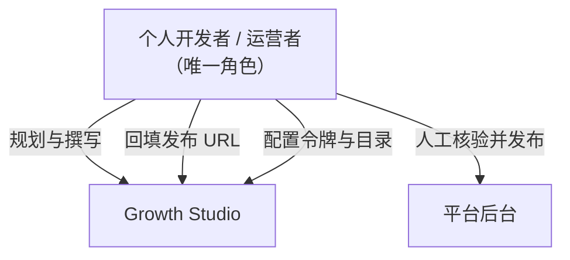

# 架构约束 (Constraints)

> **Metadata**
> - **Source**: `.context/architecture/source/technical_architecture.md`（TAD v1.4.5）
> - **Generated At**: `2026-10-16 09:44`
> - **Updated At**: `2026-10-17 08:51`
> - **Generator**: `Context-Agent v1.0`

> ⚠️ **约束的权威来源是 `.context/criterion.md`**。本文为其结构化摘录与背景说明。
> 若冲突，**以 criterion.md 为准**。

---

## 🔧 技术约束

| 约束 | 描述 | 原因 |
|------|------|------|
| **运行形态** | 宿主内 Cordis 插件，**无独立服务端**、**无网络监听端口** | DSH Desktop 插件模型；criterion §3.4 |
| **编程语言** | 宿主侧 **TypeScript**；客户端 **JavaScript (ESM)** | 客户端为 DSH Desktop 渲染层 JS bundle；宿主侧类型经 `src/types.ts` 共享，客户端按信封运行时消费，不共享 TS 类型 |
| **微内核** | **Cordis 4.x**（`@deepseek-ai/cordis` `^4.0.2`） | 宿主插件容器 |
| **UI 框架** | **React 18** + esbuild 打包 | criterion §3.1 |
| **数据层** | **禁止数据库 / ORM / Schema 迁移** —— 本地 JSON 文件 | 个人开发者单机场景；criterion §7.3 |
| **RPC 协议** | **自研信封** `POST /api/ops`，**非** REST / OpenAPI / gRPC | 非 schema 驱动，无跨语言外部消费方，Codegen 无收益 |
| **BrowserOS 能力开关** | 复用现有工具清单；默认八项 `tabs/navigate/snapshot/act/read/grep/wait/upload`，其余实际暴露工具默认关闭、可手动开启；`shell`/`cmd` 若暴露同样由用户管理 | 最小权限；criterion §4 / TAD §3.12 |
| **会话模型** | **统一 BrowserOS 实例**；禁止探取日用 Chrome Cookie 库 | 实例一致性 + WAL 完整性 + 隐私 |
| **刷新机制** | 手动触发 + 局部替换 + in-flight 去重；**禁止 WebSocket / SSE / 后台轮询** | 避免宿主内常驻连接 |
| **样式方案** | 必须使用 DSH 设计令牌 `var(--dsw-alias-*)` | 主题一致性；criterion §3.1 |

### ⛔ 绝对禁止的技术引入

| 禁止项 | 依据 |
|--------|------|
| 任何形式的**正式发布**工具 / 能力（`ops_publish_now` 或等价物） | criterion §4；架构铁律 |
| 绕过 `callOpsRpc` **直连** Injoys / BrowserOS 或任何外部服务 | criterion §3.1 |
| 绕过 `config-store` / `draft-store` **直接操作文件** | criterion §3.5 |
| 硬编码密钥 / 令牌 / 敏感配置 | criterion §4 |
| 内置全局通用 Master Key 或任何形式的通用凭据 | criterion §3.2 |
| 客户端硬编码背景 / 边框 / 文字色值 | criterion §3.1 |
| 在**通用流程**中写平台分支（须收敛到 Adapter 层） | criterion §3.2 |
| 客户端承载**核心业务规则**（状态机、权限判定） | criterion §3.1 |
| 伪造 / 硬编码指标数据；缺失值按 0 计算 | criterion §4 |

---

## 🏢 组织约束

| 约束 | 描述 | 影响 |
|------|------|------|
| **团队规模** | **个人开发者**（单人项目） | 架构收敛为轻量单机；不做多租户与复杂隔离 |
| **交付阶段** | Phase 0 → Phase 1 → Phase 2（→ Phase 3 演进） | 功能按阶段裁剪；Phase 0 只做核心闭环 |
| **运营场景** | 个人开发者**多产品推广** | 产品切换**仅切换生成上下文**，不做数据隔离 |
| **阶段规划** | Phase 0：核心闭环；Phase 1：舆情提炼；Phase 2：技能工坊 + 出海策略 + 浏览器登录端点 | 未到阶段的能力**不提前实现** |
| **交付时间 / 预算 / 时区协作** | N/A – 源文档未提供 | — |

> **组织约束的架构含义**：单人项目 → 优先「本地优先、零运维、无服务端」；
> 因此**所有**数据落 `$DSH_HOME`，所有密钥由用户自备，所有能力单机可跑。

---

## ⚖️ 合规约束

| 法规 / 标准 | 状态 |
|------------|------|
| GDPR / PCI-DSS / 等保三级 | **未在源文档中声明** —— N/A – 源文档未提供 |
| **行业法规** | N/A – 源文档未提供 |

### 实际遵循的隐私承诺（源自架构决策，**非**法规驱动）

| 承诺 | 落地方式 | 权威来源 |
|------|---------|---------|
| **会话数据零外发** | Cookie 不出本地沙箱，不上报任何第三方 | 架构 §六.2；criterion §4 |
| **仅存在性探测** | 会话探测只做状态判定，**不导出 Cookie 内容** | 架构 §5.1.1 |
| **数据最小化** | 不读取日用 Chrome 的 Cookie 库；不拷贝 SQLite | 架构 §5.1.1 |
| **本地优先** | 草稿 / 排期 / 指标 / 配置全部落本机 | 架构 §5.3 |
| **日志脱敏** | 日志与遥测不得记录令牌、Cookie、完整正文 | criterion §4 |
| **用户知情** | 目录切换提示须覆盖三件事实 | 架构 §3.10.4 |
| **数据可删除** | `drafts.delete` 删除当前草稿；MVP 不创建或管理历史快照 | 架构 §4.4 |

---

## 📏 技术标准

| 标准 | 描述 |
|------|------|
| **契约载体** | **手写 TypeScript**（`src/types.ts` + `src/ops-rpc.ts`）；**无 Codegen** |
| **RPC 信封** | `{ ok, result?, error? }`（criterion §5.2 / §5.3） |
| **错误码** | `{domain}/{kebab-case-reason}`，如 `drafts/published-requires-url` |
| **SSoT-first 顺序** | 类型契约 → 宿主 RPC 方法契约 → Adapter / 领域服务 → 客户端 UI 与测试 |
| **类型检查** | `pnpm typecheck`（`tsc -p tsconfig.json --noEmit`） |
| **测试** | `pnpm test`（vitest）；测试隔离须在**模块作用域**生效 |
| **模块系统** | ESM（`"type": "module"`） |
| **Node 版本** | `^22.19.0 \|\| >=24.0.0` |
| **代码风格 / Git 分支 / 提交规范** | N/A – 源文档未提供 |

---

## 🔄 契约先行约束 (SSoT)

```
类型契约（src/types.ts，如有变更）
    ↓
宿主 RPC 方法契约（src/ops-rpc.ts）
    ↓
Adapter / 领域服务实现
    ↓
客户端 UI 与测试
```

| 层 | 判定 | 工具 |
|----|------|------|
| 数据层 | 未启用 | — |
| **API 层** | **启用（工具 = 手写）** | `pnpm typecheck` + `pnpm test`；生成命令 = 无（自研信封无 schema 源，客户端为 JS 不共享类型） |
| IPC 层 | 未启用（无 IPC 边界） | — |
| 共享层 | 未启用 | — |

> **规则**：契约变更后必须执行该层「生成命令」并使用生成产物；
> 业务代码**禁止**手写与契约等价的类型 / DTO（有明确注释的「非契约扩展字段」除外）。

---

## 🎯 架构铁律（最高优先级约束）

> 以下四条是整个架构的**不可协商底线**，任何提案与实现都不得违反。

| # | 铁律 | 契约级保障 |
|---|------|-----------|
| **1** | **始终仅预填草稿，严禁自动确认发布** | `ops_publish_now` 彻底移除（**不存在于 catalog**）；预填止步于平台原生「保存为草稿」 |
| **2** | **`published` 只能由真实 URL 回填推进** | `drafts.save` 拒绝 `published`；URL 须经**解析器**校验；多渠道仅在**全部渠道**回填后才整体 `published` |
| **3** | **绝不用不完整数据冒充全网总量** | 部分缺失 → 汇总 `null`；零值 `0` 与缺失 `null` **严格区分** |
| **4** | **会话数据零外发** | Cookie 不出本地沙箱；不读取日用 Chrome 的 Cookie 库 |

### 铁律 1 的实现要点（源文档 §5.2.1）

1. **移除 `ops_publish_now`**：从**所有**工具白名单、RPC 端点和文档中**彻底删除**；
2. **预填止步于草稿**：
   - 微信公众号：填标题 / 作者 / 正文富文本，点击平台原生「保存为草稿」按键；
   - B站创作者中心：填标题 / 简介 / 标签 / 分区，保存草稿；
3. **人工确认与回填闭环**：返回草稿直达链接 → 用户在浏览器完成核验并发布 → 用户回填 URL → 草稿状态推进为 `published`；
4. **闭环的契约守卫（不可省略）**：见铁律 2。

### 铁律 2 的守卫清单

| 守卫 | 内容 |
|------|------|
| `drafts.save` 拒绝 `published` | 返回 `drafts/published-requires-url` |
| URL 合法性 | **须用 URL 解析器校验**，禁止宽松正则 |
| 渠道成员校验 | 不属于 `channelVariants` → `drafts/unknown-channel`，**不写盘、不递增版本** |
| 全渠道不变量 | 部分回填固定 `prefilled`；渠道集合变化须**在同一写锁内**重算 |
| 服务端治理字段 | `drafts.save` 必须**忽略**调用方传入的 `publishedUrls` |
| 校验位置 | **宿主侧**，**不依赖**客户端自觉 |

### 铁律 3 的口径规则

1. 设应采平台集合 `P`，成功采集集合 `measuredPlatforms`；
2. `measuredPlatforms == P` → 正常给出汇总数字；
3. `measuredPlatforms ⊂ P` → 汇总值为 **`null`**，并填充 `measuredPlatforms` / `unmeasuredPlatforms`；
4. 平台真实返回 `0` → **有效值 0** 参与求和；
5. `totalEngagements` 在点赞 / 评论 / 转发 / 收藏**任一为 `null` 时为 `null`**；
6. 环比历史不足 → delta 为 `null`，**不得**用不完整历史算近似百分比。

---

## 👥 团队拓扑

**N/A – 源文档未提供**（单人项目，无团队结构）。



---

## 🔗 相关文档

| 文档 | 关系 |
|------|------|
| `tech_stack.md` | 技术栈的 MUST / MUST NOT 明细 |
| `security_policy.md` | 安全约束的完整语义 |
| `adr_*.md` | 各项约束背后的决策记录 |
| `../criterion.md` | **约束权威来源** |
| `source/technical_architecture.md` | **源文档（冲突时以此为准）** |

---

## AI 引用指南

当 AI 创建提案或实现功能时：
1. **首先**逐条核对本文「架构铁律」四条 —— 违反即提案不通过
2. 检查「⛔ 绝对禁止的技术引入」清单
3. 技术选型须符合 `tech_stack.md` 的 MUST / MUST NOT
4. 契约变更须走 SSoT-first 顺序，**不得**跳步直接实现
5. 约束冲突时，一律以 `../criterion.md` 为准
