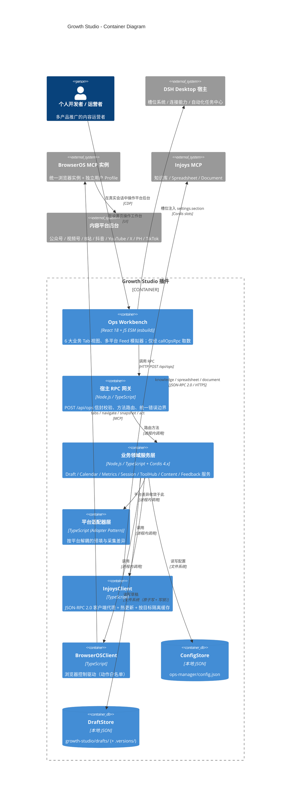
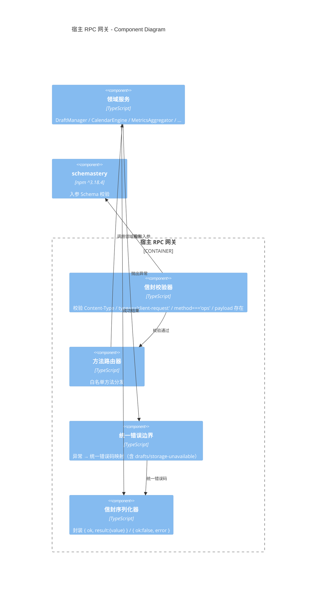
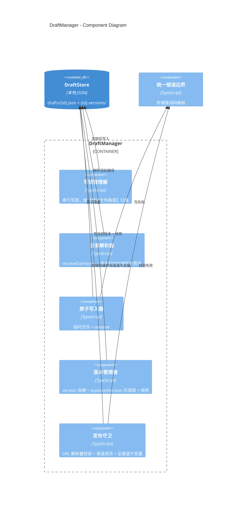
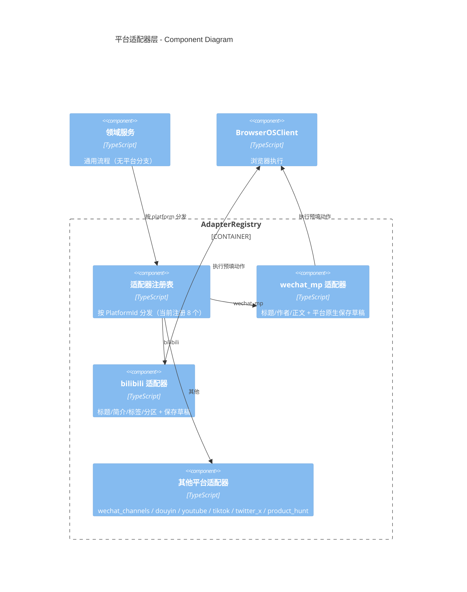

# 容器与组件视图 (Container and Component View)

> **Metadata**
> - **Source**: `.context/architecture/source/technical_architecture.md`（TAD v1.2.0 §1.1、§2、§3）
> - **Generated At**: `2026-10-16 09:44`
> - **Generator**: `Context-Agent v1.0`

> ⚠️ 本项目的「容器」不是 Docker 容器，而是 **C4 语义下的运行时单元**（客户端 / 宿主进程 / 外部服务 / 本地存储）。

---

## 🏗️ 容器视图 (C4 Level 2)

---

## 📦 容器清单

| 容器 | 技术栈 | 职责 | 位置 |
|------|--------|------|------|
| **Ops Workbench** | React 18 + JS ESM + esbuild | 6 大 Tab：驾驶舱 / 排期日历 / 创作室 / AI工具中枢 / 舆情复盘 / 引擎配置；多平台 Feed 模拟器 | `plugin-src/client/` |
| **宿主 RPC 网关** | Node.js / TypeScript | `POST /api/ops`；信封校验（`Content-Type` / `type` / `method` / `payload`）；方法路由；**统一错误边界** | `src/ops-rpc.ts` |
| **业务领域服务层** | Node.js / TypeScript + Cordis 4.x | 领域逻辑；平台分支**禁止**出现在此层 | `src/` |
| **平台适配器层** | TypeScript | 按平台解耦（8 个已注册适配器） | `src/adapters/` |
| **InjoysClient** | TypeScript | JSON-RPC 2.0 / HTTP；热更新（`updateConfig`）；按目标隔离缓存 | `src/injoys/` |
| **BrowserOSClient** | TypeScript | 会话哨兵与浏览器驱动；动作白名单 | `src/browser/` |
| **ConfigStore** | 本地 JSON | 配置读写；`resolveDshHome` 路径解析 | `src/config-store.ts` |
| **DraftStore** | 本地 JSON | 草稿持久化；原子写 + 串行写锁 + 版本快照 | `src/`（草稿治理） |

> **端口**：本插件**不监听任何网络端口**。`POST /api/ops` 由 DSH 宿主提供。

---

## 🔧 组件视图 (C4 Level 3)

### 3.1 宿主 RPC 网关（`src/ops-rpc.ts`）

| 组件 | 职责 | 接口 |
|------|------|------|
| **信封校验器** | 网关入站强校验 | `POST /api/ops` |
| **方法路由器** | 方法名 → 领域服务 | 进程内调用 |
| **统一错误边界** | 异常 → 统一错误码（**所有写入口**一致返回 `drafts/storage-unavailable`） | 进程内调用 |
| **信封序列化器** | 统一成功 / 失败信封 | 进程内调用 |

> **统一错误边界的必要性**：防止部分入口漏出 `ops/internal-error`，
> 否则调用方**无法一致识别**可恢复的存储错误。

---

### 3.2 草稿治理服务（`DraftManager`）

| 组件 | 职责 | 关键约束 |
|------|------|---------|
| **写锁管理器** | 并发控制 | 锁按**绝对文件路径**归属 → 不同库同 ID 草稿互不阻塞、互不覆盖 |
| **目录解析器** | 路径解析与固定 | 请求开始时捕获，**贯穿每一次落盘**（含跨 `await` 复合 RPC） |
| **原子写入器** | 可靠落盘 | 临时文件 + `rename`；写前**准备并验证可写** |
| **版本管理器** | 版本与快照 | 当前版本与快照在**同一串行写锁内**完成 |
| **发布守卫** | 状态真实性 | URL 解析器校验；渠道成员校验；**全渠道不变量在同一写锁内维持** |

---

### 3.3 平台适配器层（`src/adapters/`）

> ⚠️ `xiaohongshu` **已列入 `PlatformId` 但尚未注册适配器**。

**适配器层的存在理由**：criterion §3.2 硬约束 —— **平台差异一律收敛到 Adapter 层，禁止在通用流程中写平台分支。**

---

## 🔗 接口规范

| 服务 | 规范类型 | 链接 |
|------|---------|------|
| 宿主 RPC | **手写 TypeScript 契约**（非 OpenAPI） | `src/ops-rpc.ts` + `src/types.ts` |
| 客户端消费方 | 手写 JS | `plugin-src/management-rpc.mjs`、`plugin-src/client/ops-page.js` |
| Injoys | JSON-RPC 2.0 | 源文档 §3.10、§5.3 |
| BrowserOS | MCP 动作白名单 | `tabs` / `navigate` / `snapshot` / `act` |
| 领域类型 | TypeScript 权威定义 | `src/types.ts`（criterion §5.5） |

> **无 OpenAPI / gRPC / TypeSpec**：项目为同进程同语言，Codegen 无收益（criterion §7.2）。

---

## 🧩 分层依赖规则

| 规则 | 内容 |
|------|------|
| ✅ 允许 | 客户端视图层 → 宿主 RPC 网关层 → 业务领域服务层 → 外部 MCP 集成层 → 本地持久化基础设施层 |
| ⛔ 禁止 | 客户端**绕过 `callOpsRpc`** 直连 Injoys / BrowserOS 或任何外部服务 |
| ⛔ 禁止 | 客户端承载**核心业务规则**（状态机、权限判定须在宿主侧） |
| ⛔ 禁止 | 在**通用流程**中写平台分支（必须收敛到 Adapter 层） |
| ⛔ 禁止 | 绕过 `config-store` / `draft-store` 模块直接操作配置文件或草稿文件 |
| ⛔ 禁止 | 引入外部常驻服务端或额外网络监听端口 |

---

## 🔗 相关文档

| 文档 | 关系 |
|------|------|
| `system_design.md` | 分层架构全景与部署拓扑 |
| `api_strategy.md` | 网关与方法的接口契约 |
| `data_architecture.md` | DraftStore / ConfigStore 的数据模型 |
| `runtime_view.md` | 组件间的运行时交互时序 |
| `tech_stack.md` | 各组件的技术栈与约束 |
| `source/technical_architecture.md` §1.1、§2 | **源文档（冲突时以此为准）** |

---

## AI 引用指南

当 AI 生成架构相关代码时：
1. 新增平台支持 = 新增 Adapter，**不得**在通用流程中加 `if (platform === ...)`
2. 客户端一切数据获取经 `callOpsRpc`，**禁止**直连外部服务
3. 存储访问经 `config-store` / `draft-store` 模块，**禁止**直接读写文件
4. 状态机与权限判定必须放在**宿主侧**
5. 异常统一经**统一错误边界**映射，不得让写入口漏出 `ops/internal-error`
