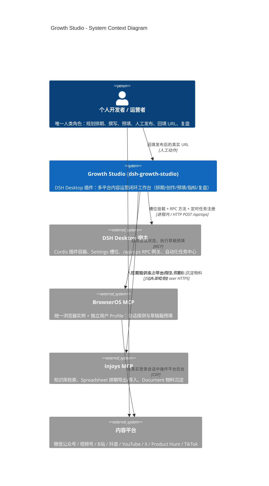
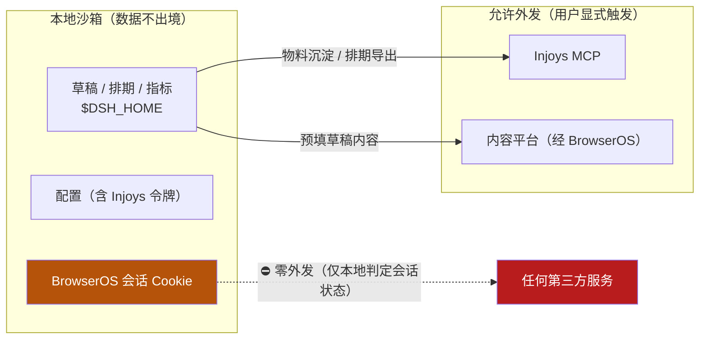

# 上下文视图 (Context View)

> **Metadata**
> - **Source**: `.context/architecture/source/technical_architecture.md`（TAD v1.2.0 §1.1、§5.1、§5.3）
> - **Generated At**: `2026-10-16 09:44`
> - **Generator**: `Context-Agent v1.0`

---

## 🗺️ 业务上下文 (C4 System Context)

---

## 👤 参与者

| 参与者 | 类型 | 描述 |
|--------|------|------|
| **个人开发者 / 运营者** | 人员 | **唯一人类角色**。规划排期、触发创作、触发预填、**在平台后台人工完成最终发布**、回填发布 URL、查看复盘 |
| **AI 代理（DSH 会话）** | 系统 | 经工具调用驱动**生成 / 排期 / 预填 / 采集 / 复盘**能力（`ops_plan_calendar` / `ops_draft_article` / `ops_push_drafts` 等）；**不参与最终发布**。受「仅预填、不自动发布」铁律约束 —— 发布类工具不存在于 catalog，AI 无法构造该调用 |
| ~~管理员 / 审计员~~ | — | **N/A – 源文档未提供**（单用户桌面场景，无多角色模型） |

> ⚠️ **参与者设计要点**：**最终发布动作不属于本系统，也不由 AI 代执行** ——
> 它由**人类用户**在平台后台**人工点击**完成。AI 的能力边界是**生成、预填与提示**，
> ⛔ **不得**以任何形式（包括"在人的指导下"）点击平台最终发布 / 群发按钮。
> 系统只负责**预填**并回传草稿直达链接。

---

## 🔗 外部系统

| 系统 | 用途 | 数据流向 | 协议 |
|------|------|---------|------|
| **DSH Desktop 宿主** | 插件容器、Settings 槽位（`id: 'ops'`, `order: 60`）、RPC 网关、自动化任务中心 | 双向 | Cordis 模块加载 + `HTTP POST /api/ops` + 宿主工具调用 |
| **BrowserOS MCP** | 统一浏览器实例：会话探测、草稿箱预填 | 出站（控制） | MCP（CDP / Playwright） |
| **Injoys MCP** | 知识库检索、Spreadsheet 导出/导入、Document 沉淀 | **双向**（读知识库 / 写表格与文档） | JSON-RPC 2.0 / HTTPS + Bearer |
| **内容平台后台** | 草稿箱终点（预填目标） | 出站（经 BrowserOS） | CDP |
| **本地文件系统 `$DSH_HOME`** | 配置 / 草稿 / 排期 / 指标持久化 | 双向 | 文件系统 |

### 外部系统的边界语义

| 系统 | 关键约束 |
|------|---------|
| **BrowserOS** | 动作白名单仅 `tabs / navigate / snapshot / act`；**禁用 shell/cmd**；会话数据**零外发** |
| **Injoys** | 须校验 HTTP 状态码与 `result.isError`；令牌**无内置默认值**；未配置令牌时**不得谎报「认证失败」** |
| **DSH 宿主** | RPC 网关强制校验信封；`ops_setup_schedule` 走**宿主工具调用**而非 RPC 方法 |
| **内容平台** | 预填**止步于平台原生「保存为草稿」**；⛔ 不得触发或越过正式发布 |

---

## 📦 范围定义

### In-Scope（本系统负责）

- **排期规划**：生成周/月排期，本地为黄金主数据源；单向导出/导入 Injoys Spreadsheet
- **内容创作**：公众号图文（标题/摘要/正文 Markdown）；视频元数据（3 套标题候选、简介、标签、分区、封面建议）
- **草稿治理**：本地 CRUD、版本快照与恢复、发布 URL 回填闭环
- **草稿预填**：经 BrowserOS 将草稿填入平台草稿箱（公号 + B站），回传直达链接
- **会话探测**：统一 BrowserOS 实例的会话四态判定
- **指标聚合**：跨平台采集、可空语义汇总、环比走势
- **舆情提炼**：评论抓取与需求聚类（Phase 1）
- **AI 工具治理**：工具目录、白名单开关、沙箱执行与遥测
- **周期巡检注册**：向 DSH 自动化任务中心注册定时任务

### Out-of-Scope（本系统不负责）

| 不负责项 | 归属 / 原因 |
|---------|-----------|
| **最终发布动作** | 平台后台人工执行 —— **架构铁律**；`ops_publish_now` 已彻底移除，**不得以任何形式重新引入** |
| 用户账号体系 / 登录 | DSH 宿主与平台自身承载；本插件无注册/登录/OAuth/JWT |
| 数据库 / Schema / 迁移 | 本地 JSON 持久化即契约（criterion §7.3 判定数据层未启用） |
| 多产品**数据隔离** | 已裁决：产品切换**仅切换生成上下文**（`system_design.md` §产品切换语义） |
| 实时双向同步 | Phase 0 为本地主数据 + 单向导出；双向演进属 **Phase 3** |
| 实时推送大盘 | Phase 0 **禁止** WebSocket / SSE / 后台定时轮询 |
| Cookie 探取日用 Chrome | **已被否决**（实例不一致 / WAL 不完整 / 隐私落差） |
| 服务端部署 / K8s / CDN | 本项目为宿主内单机插件，无独立服务端 |
| Phase 2 技能工坊与出海策略 | 规划中（`SkillEngine` / `OverseasStrategyManager`），**非 Phase 0 范围** |

---

## 🔌 技术上下文

| 外部系统 | 传输协议 | 数据格式 | 交互模式 |
|---------|---------|---------|---------|
| DSH 宿主（RPC） | HTTP POST `/api/ops`（进程内 / 本机） | JSON 自研信封 | **同步调用** |
| DSH 宿主（槽位） | Cordis `slots` 注入 | JS 模块（`window.__ModuleLoader__.load`） | 启动期挂载 |
| DSH 宿主（自动化任务） | 宿主内工具调用 | 结构化参数 | 注册即返回（**到点唤醒会话**，非轮询） |
| BrowserOS MCP | MCP | 结构化动作 / 页面快照 | **同步调用** |
| Injoys MCP | JSON-RPC 2.0 over HTTPS | JSON（`Authorization: Bearer`） | **同步调用** |
| 内容平台后台 | CDP（经 BrowserOS） | DOM 操作 | 同步操作，**止于保存草稿** |
| 本地文件系统 | 文件读写 | JSON（`rename` 原子写） | 同步 + 串行写锁 |

### 明确的"不采用"清单

| 技术 | 状态 | 理由 |
|------|------|------|
| WebSocket / SSE | ⛔ **Phase 0 禁止** | 避免宿主内进程引入常驻连接与额外资源占用 |
| 后台定时轮询（工作台刷新） | ⛔ **Phase 0 禁止** | 刷新由用户手动触发 + 局部替换 + in-flight 去重 |
| REST / OpenAPI / gRPC | ⛔ 不采用 | 项目内自研 RPC 信封，无跨语言消费方 |
| 数据库 / ORM | ⛔ 不采用 | 本地 JSON 即契约 |
| 外部常驻服务端 / 监听端口 | ⛔ 禁止 | 插件为宿主内进程 |

> ⚠️ **注意区分**：「Phase 0 禁止后台定时轮询」与 `ops_setup_schedule` **不冲突** ——
> 前者禁止的是**工作台为刷新大盘而自建常驻连接或轮询**；
> 后者是 **DSH 宿主的任务调度**（到点唤起会话）。二者**不可混为一谈**。

---

## 🔐 数据流向与隐私边界

| 数据类别 | 是否离开本机 | 说明 |
|---------|:-----------:|------|
| **草稿内容** | ✅ 用户显式触发时 | 预填至平台、可选沉淀至 Injoys |
| **排期数据** | ✅ 用户显式触发时 | 单向导出至 Injoys Spreadsheet |
| **指标数据** | ❌ | 仅本地留存与聚合 |
| **Injoys 令牌** | ✅（仅至 Injoys） | HTTPS + Bearer；日志与遥测**必须脱敏** |
| **BrowserOS Cookie / 会话** | ⛔ **绝不** | 仅在本地沙箱用于会话状态判定 |

---

## 🔗 相关文档

| 文档 | 关系 |
|------|------|
| `system_design.md` | 系统概述、边界与部署拓扑 |
| `security_policy.md` | 隐私边界与安全守卫的完整语义 |
| `container_component_view.md` | 容器/组件内部结构 |
| `adr_001_unified_browseros_session.md` | 统一浏览器实例决策 |
| `../criterion.md` §4 | **约束权威来源** |
| `source/technical_architecture.md` §1.1、§5.1 | **源文档（冲突时以此为准）** |

---

## AI 引用指南

当 AI 界定系统边界时：
1. **任何**新增能力都不得越过「仅预填、不自动发布」边界
2. 系统数据**只允许**流向 Injoys（用户显式触发）与平台后台（预填）
3. **会话 Cookie 永不外发**；不得读取日用 Chrome 的 Cookie 库
4. 不得引入 WebSocket / SSE / 后台轮询 / 数据库 / 外部服务端
5. 多产品数据隔离属 Out-of-Scope —— 产品切换只影响**生成上下文**
