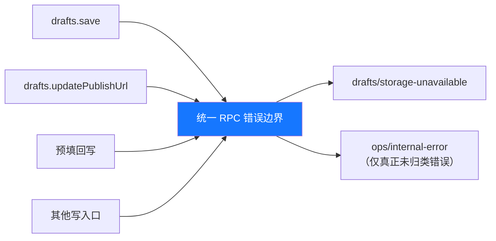

# 跨切面概念 (Cross-cutting Concepts)

> **Metadata**
> - **Source**: `.context/architecture/source/technical_architecture.md`（TAD v1.4.5 §3.9、§5.5、§六）
> - **Generated At**: `2026-10-16 09:44`
> - **Generator**: `Context-Agent v1.0`

> 源文档未定义完整的可观测性体系（无 Prometheus / Jaeger / 日志级别规范）。
> 本文**只记录有依据的内容**，其余如实标注 `N/A – 源文档未提供`。

---

## ❌ 错误处理 (Error Handling)

### 统一错误结构（RPC 信封）

```typescript
interface RpcEnvelopeResponse<T = unknown> {
  ok: boolean
  result?: { value: T }
  error?: {
    code: string          // 机器可读错误码，如 'ops/bad-request'
    message: string       // 用户可读错误信息
    details?: unknown     // 可选：内部/开发调试信息
  }
}
```

### 错误码与错误边界

| 错误码 | 语义 | 映射位置 |
|--------|------|---------|
| `ops/bad-request` | 网关信封校验失败 | 网关校验器 |
| `ops/internal-error` | 未归类内部错误 | 兜底 |
| `drafts/published-requires-url` | `drafts.save` 传入 `published` | 发布守卫 |
| `drafts/invalid-published-url` | URL 非法 | 发布守卫 |
| `drafts/unknown-channel` | 渠道不属于该草稿 | 发布守卫 |
| `drafts/storage-unavailable` | 目录不可写 / 创建失败 / 配置文件写盘失败 | **统一 RPC 错误边界** |
| `config/invalid-drafts-dir` | 前置目录校验失败 | 配置服务（**单独使用**） |
| `calendar/invalid-transition` | 越级 / 回退 / 写 `published` | 排期服务 |
| `tools/disabled` | 工具被白名单禁用 | 工具沙箱 |
| `browser/capability-disabled` | BrowserOS 工具存在但能力开关关闭 | BrowserOS 调用统一入口 |
| `browser/tool-unavailable` | BrowserOS 工具未暴露 | BrowserOS 调用统一入口 |
| `browser/not-connected` | BrowserOS 未连接 / 未接入 | BrowserOS 调用统一入口 |
| `ops/unknown-method` | 方法名未登记 | 方法路由 |
| `ops/not-found` | 按 ID 未找到草稿 | `drafts.get` |
| `ops/concurrency-conflict` | 乐观锁版本冲突 | `drafts.save` |
| `ops/draft-not-found` | 指定草稿不存在 | `workbench.prefillDraft` |
| `ops/platform-unsupported` | 指定平台无适配器 | `workbench.prefillDraft` |
| `ops/variant-not-found` | 草稿缺少该平台变体 | `workbench.prefillDraft` |
| `ops/material-incomplete` | 变体缺少必要物料 | `workbench.prefillDraft` |
| `ops/prefill-failed` | 平台适配器预填执行失败 | `workbench.prefillDraft` |

> 后 8 个为当前实现基线（`src/ops-rpc.ts`）已抛出、原清单遗漏的错误码；`calendar/invalid-transition` / `tools/disabled` 为尚未实现方法的契约预留码。完整口径见 `api_strategy.md` §2.3。

### ⚠️ 统一错误边界的强制要求（关键设计）

> **该映射须在「统一 RPC 错误边界」完成**，使 `drafts.save`、`drafts.updatePublishUrl`、
> 预填回写等**所有写入口**返回同一错误码，
> 而不是让部分入口漏出 `ops/internal-error`
> —— 否则调用方**无法一致识别可恢复的存储错误**。



### 错误处理原则

| 原则 | 内容 |
|------|------|
| **不吞没** | 错误不得吞没，如实抛出（criterion §3.2） |
| **不谎报** | 失败**不得**以成功形状返回；无客户端或执行失败时**严禁**返回成功 |
| **不伪造** | 不得静默写本地假 ID（如假的 `injoysDocId`） |
| **不回滚已成功项** | 批量导入部分失败时，如实返回已成功计数与错误，**不谎报全量成功** |
| **前置校验优先** | `config.save` 须先校验目录可写，**不得**先报成功、再让后续 `drafts.save` 以 `ENOENT` 失败 |
| **可恢复性可识别** | 存储类错误统一错误码，使调用方可一致识别并提示用户切换目录 |

### 重试策略

**N/A – 源文档未提供**（未定义指数退避 / 熔断 / 重试次数）。

> 唯一相关的约束是**并发去重**（见下文「刷新与并发」），而非重试。

### 熔断器配置

**N/A – 源文档未提供**（无服务网格 / 无熔断语义）。

---

## 📊 可观测性 (Observability)

### 日志规范

**N/A – 源文档未提供**（未定义结构化日志格式与日志级别）。

**已明确的一条硬约束**：

> 日志**必须脱敏**（criterion §4）—— 不得记录令牌、Cookie 或完整正文。

### 遥测 (Telemetry)

本项目的「可观测性」载体是 **工具执行遥测**（`tools.telemetry`）：

```typescript
interface TelemetryEntry {
  toolName: string
  startedAt: string
  durationMs: number
  ok: boolean
  errorCode?: string
}
```

| 要求 | 内容 |
|------|------|
| **用途** | 性能审计（工具执行耗时与成败） |
| **脱敏** | ⛔ **必须脱敏** —— 不得记录令牌、Cookie 或完整正文 |
| **耗时** | `tools.executeSandbox` 必须返回**真实** `durationMs` |
| **保留期** | N/A – 源文档未提供 |

### 指标监控 (RED Method)

**N/A – 源文档未提供**（无 Prometheus / 指标端点）。

> ⚠️ 注意区分：本项目中的「指标」（`PlatformMetrics`）指**内容平台的运营数据**，
> 而非系统可观测性指标（Rate / Errors / Duration）。

### 分布式追踪

**N/A – 源文档未提供**（无 OpenTelemetry / Jaeger / trace_id）。

> 本项目为单进程插件，无分布式调用链。

---

## 💾 缓存策略 (Caching)

源文档仅定义**一处**明确的缓存语义：

| 缓存 | 场景 | 失效策略 |
|------|------|---------|
| **InjoysClient 的按目标隔离缓存** | 缓存 `knowledge.list` 等调用结果 | **保存 `injoys` 配置后须清理**，避免跨服务状态污染 |

> **设计要点**：缓存的隔离维度是**「目标 endpoint」**，而非全局。
> 因此当用户切换 Injoys endpoint 时，必须清理旧目标对应的缓存，
> 否则会把**旧服务的数据当作新服务的返回**。

**缓存穿透 / 击穿 / 雪崩防护**：**N/A – 源文档未提供**（无分布式缓存）。
**CDN 缓存**：**N/A – 源文档未提供**。

---

## 🔄 并发与刷新策略 (Concurrency & Refresh)

> 对应 PRD §六「数据卡片支持即时刷新，无需强制重载页面」。

| 策略 | 内容 |
|------|------|
| **手动触发** | 刷新由用户在卡片/驾驶舱上**手动触发**对应 RPC 调用（如 `workbench.overview`、`browser.sessions`、`injoys.test`） |
| **局部替换** | 前端仅做**局部状态替换**，**不整页重载** |
| **不引入持久连接** | Phase 0 **不使用** WebSocket / SSE，也**不做**后台定时轮询 |
| **单飞约束（in-flight 合并）** | 同一张卡片的并发刷新请求应做**去重**，避免用户连点导致会话探测与指标采集重复执行 |
| **远期演进** | 若后续确需准实时大盘，须**先**在架构文档中补充连接生命周期、断线重连与令牌校验方案，再行实施 |

### 写入并发控制

| 机制 | 规则 |
|------|------|
| **串行写锁** | 同一草稿的写操作串行化 |
| **锁归属** | 按**绝对文件路径**归属 → 不同库同 ID 草稿互不阻塞、互不覆盖；`local-fs.ts` 的 `createFileWriteLocks()` 每次返回独立锁集，由 store 实例持有，保持原实例级语义，不提供跨实例 / 跨进程互斥 |
| **乐观锁** | `version` 自增 + `expectedVersion` 校验 |
| **原子写** | `local-fs.ts` 的 `writeJsonAtomic()` 写同目录随机后缀临时文件再 `rename`；文件以 `0o600`、目录以 `0o700` 创建（实际受 umask 收紧），既有对象残留见 `security_policy.md`「存储层加密」；封装抛原始 fs 错误，草稿侧包装 `DraftStorageError`、配置侧由 `config.save` RPC 包装，统一 RPC 边界映射保持不变 |
| **目录固定** | 单次操作内固定，**覆盖跨 `await` 的复合 RPC** 与**请求内每一次落盘** |
| **全渠道不变量** | 渠道集合变化须在**同一写锁内**重算状态 |

---

## 🔐 配置与密钥管理

| 类型 | 存储位置 | 更新方式 |
|------|---------|---------|
| **应用配置（`OpsConfig`）** | `$DSH_HOME/ops-manager/config.json` | **热更新**（预检通过后、配置写盘前生效，无需重启；写失败不回滚，非空字段一致性边界见 `api_strategy.md` §3.6） |
| **BrowserOS 能力开关（`browserosCapabilities`）** | 同上（可选字段） | 默认八项；用户显式保存优先、重启不重置；缺失时按默认集合解析 |
| **Injoys 令牌** | 同上（⛔ **无内置默认值**） | 用户配置或环境变量 `INJOYS_MCP_TOKEN` 回退 |
| **Injoys 端点** | 同上 | 用户配置或环境变量 `INJOYS_MCP_ENDPOINT` 回退 |
| **草稿目录** | 同上（`draftsDir`） | 改后**立即生效**；改动前须**校验可写** |
| **平台凭证 / Cookie** | **不在本插件** | 由 BrowserOS 独立实例 Profile 持有 |

### 配置管理的硬约束

| 约束 | 内容 |
|------|------|
| **禁止硬编码** | 禁止硬编码密钥 / 令牌 / 敏感配置 |
| **无内置默认** | ⛔ 令牌**无内置默认值**；不得内置全局通用 Master Key 或任何形式的通用凭据 |
| **热更新** | `draftsDir` 预检通过后、配置写盘前传给 `InjoysClient`（`updateConfig`），无需重启；失败不回滚已合并内存，一致性保证仅适用于非空字段（见 `api_strategy.md` §3.6） |
| **缓存隔离** | 保存 `injoys` 配置后须清理**按目标隔离的缓存** |
| **目录前置校验** | 改 `draftsDir` 必须先创建 + **验证可写**（唯一命名探测文件），失败拒绝保存 |
| **路径解析统一** | 一律经 `resolveDshHome`（`profileContext.home` → `DSH_HOME` → `~/.dsh` 回退） |
| **访问路径统一** | 禁止绕过 `config-store` / `draft-store` 模块直接操作文件 |
| **令牌返回边界** | `config.get` 返回明文令牌的前提是「**仅在宿主内 RPC** 暴露」；若未来可被非本机访问，**必须先**改为只回 `hasToken: boolean` |

---

## 📨 事件规范 (Event Standards)

**N/A – 源文档未提供**（无事件总线 / 消息队列 / 领域事件）。

本项目的「事件」仅为**状态流转**，由接口调用同步驱动，而非发布/订阅：

| 流转 | 触发方式 |
|------|---------|
| `planned` → `drafting` | 用户进入创作室撰写 |
| `drafting` → `draft_ready` | 物料生成并落盘 |
| `draft_ready` → `prefilled` | 至少一个渠道预填成功 |
| `prefilled` → `published` | **全部渠道**回填有效 URL（仅经 `drafts.updatePublishUrl`） |

> **注意**：`prefilled` → `published` 之间的「人工核验并发布」是**人工动作**（在平台后台完成），
> 系统**不为此设独立状态**；系统可观测的唯一信号是用户回填的发布 URL。

---

## 📅 定时任务与调度

| 项 | 内容 |
|----|------|
| **能力** | `ops_setup_schedule` → 向 DSH 自动化任务中心注册周期巡检 |
| **调用形态** | **宿主内工具调用**，**非** `POST /api/ops` 的 RPC 方法 |
| **任务类型** | `weekly_review`（周复盘）/ `publish_calendar`（发版排期）/ `metrics_inspection`（日常指标监测） |
| **默认 Cron** | `0 9 * * 1`（每周一 09:00） |
| **默认时区** | `Asia/Shanghai` |
| **行为** | 到点**唤醒会话**执行对应巡检动作 |
| **约束** | 注册失败必须**如实返回错误**，不得谎报已注册；巡检任务执行仍受「仅预填、不自动发布」铁律约束 |

### ⚠️ 与「禁止后台轮询」的区别（易混淆点）

| 项 | `ops_setup_schedule` | Phase 0 禁止的后台轮询 |
|----|---------------------|----------------------|
| **形态** | DSH 宿主的**任务调度** | 工作台**自建**常驻连接或轮询 |
| **行为** | 到点**唤起会话** | 常驻进程持续拉取 |
| **目的** | 周期性运营巡检 | 刷新大盘 |
| **结论** | ✅ **允许** | ⛔ **禁止** |

> 二者**不可混为一谈**。

---

## 🎨 设计令牌对齐 (Design Tokens)

工作台样式深度适配 DSH 主题系统，**避免硬编码色值**：

| 层级 | 令牌 |
|------|------|
| **背景** | `var(--dsw-alias-bg-layer-1)`（页面底色）、`var(--dsw-alias-bg-layer-2)`（卡片底色）、`var(--dsw-alias-bg-layer-3)`（输入框底色） |
| **边框** | `var(--dsw-alias-border-l1)`、`var(--dsw-alias-border-l2)` |
| **文字阶梯** | `var(--dsw-alias-label-primary)`、`var(--dsw-alias-label-secondary)`、`var(--dsw-alias-label-tertiary)` |

**交互点缀色（令牌化的唯一例外，架构文档 §5.4 权威取值）**：

| 语义 | 色值 |
|------|------|
| 主操作蓝 | `#1677ff` |
| 安全绿 | `#15803d` |
| 告警橙 | `#b45309` |
| 活力紫 | `#7c3aed` |

> 上述四色为**交互点缀色**（按钮、状态强调、图标着色）的权威取值，PRD §六「视觉基调」与本表对齐。
> 客户端**MUST NOT** 硬编码背景 / 边框 / 文字色值。

---

## 🧪 测试隔离 (Test Isolation)

> 一项容易踩坑的跨切面约束。

| 要求 | 内容 |
|------|------|
| **根因** | `ConfigStore` 经 `resolveDshHome` **回退到真实主目录**；测试直接 `new ConfigStore(undefined, …)` 并调用 `save()` 会**改写用户真实配置** |
| **隔离时机** | 必须在**测试文件被导入 / 收集之前**生效 —— `tests/setup-isolation.ts` 在**模块作用域**赋值 |
| **⛔ 禁止** | **不得**放在 `beforeAll` —— 钩子在收集之后才运行，用例在 describe 作用域捕获的仍是**未隔离值**，`afterEach` 恢复它会把真实目录**带回来** |
| **用例要求** | 每个会写配置的用例使用**独立 `DSH_HOME`** 或显式 `profileContext.home` |
| **防回归** | 外层**哨兵 spec** |

---

## 🔗 相关文档

| 文档 | 关系 |
|------|------|
| `api_strategy.md` | 错误码清单与信封契约 |
| `security_policy.md` | 脱敏与令牌管理规则 |
| `runtime_view.md` | 异常与恢复场景 |
| `tech_stack.md` | 配置与持久化的 MUST/MUST NOT |
| `risks_and_debt.md` | 相关风险条目（RISK-005、RISK-010、RISK-011） |

---

## AI 引用指南

当 AI 实现跨切面逻辑时：
1. 异常统一经**统一 RPC 错误边界**映射；存储错误一律 `drafts/storage-unavailable`
2. 失败**绝不**以成功形状返回；**不得**吞异常
3. 日志与遥测**必须脱敏** —— 不记录令牌、Cookie、完整正文
4. 刷新为**手动触发 + 局部替换 + in-flight 去重**；**禁止** WebSocket / SSE / 后台轮询
5. 配置变更须**热更新**；改 `draftsDir` 前**必须先校验可写**
6. 客户端颜色一律走 `var(--dsw-alias-*)` 令牌（点缀色除外）
7. 测试隔离必须在**模块作用域**生效，**不得**放 `beforeAll`
