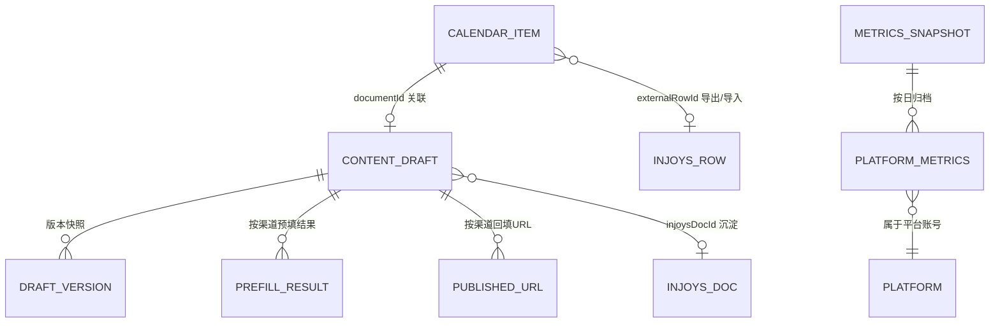
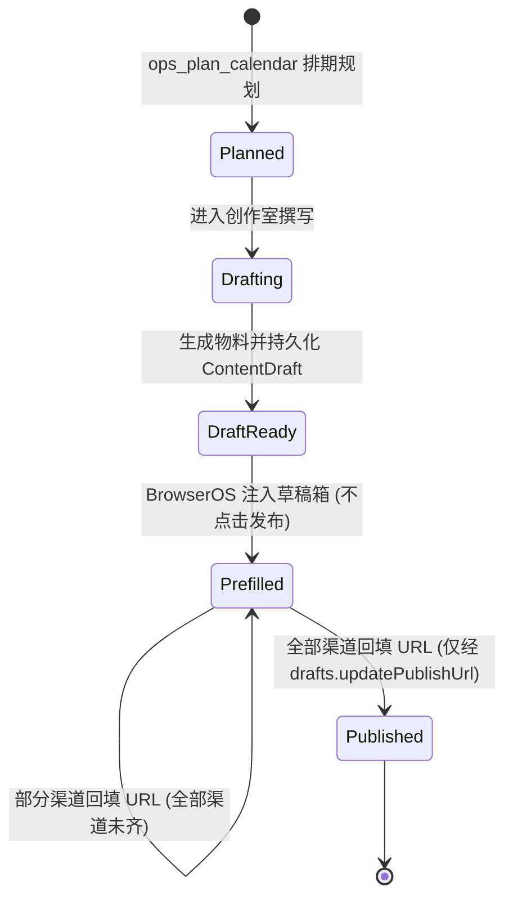

# 数据架构 (Data Architecture)

> **Metadata**
> - **Source**: `.context/architecture/source/technical_architecture.md`（TAD v1.2.0 §4、§5.3）
> - **Generated At**: `2026-10-16 09:44`
> - **Generator**: `Context-Agent v1.0`

> ⚠️ **权威定义在 `src/types.ts`**（criterion §5.5）。若本文与源文档冲突，**以源文档为准**。
> **本项目无数据库** —— 数据层未启用（criterion §7.3），持久化为本地 JSON 文件。

---

## 📊 数据模型分层

> 无关系型数据库，故本节为**领域实体模型**而非 DB Schema 分层。

### 概念数据模型



### 核心实体

| 实体 | 描述 | 关系 |
|------|------|------|
| **`CalendarItem`** | 排期项（本地持久化单一排期行） | `documentId` → `ContentDraft`（可空）；`externalRowId` ↔ Injoys 表格行 |
| **`ContentDraft`** | 本地持久化草稿实体 | 1:N 版本快照；按渠道持有 `prefillResults` / `publishedUrls` |
| **`PlatformMetrics`** | 跨平台真实指标（**可空语义**） | 属于平台账号，**全局共享**（不随产品切换） |
| **`OpsConfig`** | 插件配置 | 独立于业务实体 |

---

## 📋 逻辑数据模型

### `CalendarItem`

```typescript
export interface CalendarItem {
  id: string                    // 唯一排期项标识
  date: string                  // 计划发布日期 YYYY-MM-DD
  platform: PlatformId
  kind: ContentKind
  topic: string                 // 选题 / 主题
  targetAudience?: string
  status: ItemStatus            // 五态
  documentId?: string           // 关联的 ContentDraft.id（未开始撰写时为空）
  mediaPath?: string            // 本地视频 / 图片绝对路径
  draftUrl?: string             // 平台后台草稿直达链接（预填成功后写入）
  publishedUrl?: string         // 人工发布后回填的平台真实 URL
  externalRowId?: string        // 外部来源行标识（Injoys 表格导入去重）
  createdAt: string
  updatedAt: string
}
```

| 字段 | 类型 | 约束 | 描述 |
|------|------|------|------|
| `id` | `string` | PK | 唯一排期项标识 |
| `date` | `string` | 必填 | 计划发布日期 `YYYY-MM-DD` |
| `platform` | `PlatformId` | 必填 | 目标平台 |
| `kind` | `ContentKind` | 必填 | `article` / `video` / `post` |
| `topic` | `string` | 必填 | 选题 / 主题 |
| `status` | `ItemStatus` | 必填 | **五态**，见下方状态机 |
| `documentId` | `string?` | FK(ContentDraft) | **是草稿 ID，不是 Injoys 文档 ID** |
| `externalRowId` | `string?` | 幂等键 | 导出成功后回写；导入时用于去重 |

---

### `ContentDraft`

```typescript
export interface ContentDraft {
  id: string
  title: string
  topic: string
  targetAudience?: string
  channelVariants: Array<{
    platform: PlatformId
    kind: ContentKind
    title: string
    body: string
    tags: string[]
    mediaPaths?: string[]
    coverPath?: string
    partition?: string       // 平台分区（如 B站 科技/数码）
  }>
  status: 'draft' | 'ready_for_review' | 'prefilled' | 'published'
  version: number
  injoysDocId?: string
  prefillResults?: Partial<Record<PlatformId, { draftId?: string; draftUrl?: string; prefilledAt: string }>>
  publishedUrls?: Partial<Record<PlatformId, string>>   // ⚠️ 服务端治理字段
  createdAt: string
  updatedAt: string
}
```

| 字段 | 约束 | 描述 |
|------|------|------|
| `status` | 四态 | **与 `ItemStatus` 是两套不同枚举**，须经映射表转换 |
| `version` | 自增 | **只表示当前版本号，不等于保存了历史内容**（历史需独立快照） |
| `injoysDocId` | 回写 | 经 `workbench.sinkToInjoysDoc` 成功后写入 |
| `prefillResults` | 按渠道 | 预填成功后写入（`draftUrl` 用于回传直达链接） |
| `publishedUrls` | **服务端治理** | 通用保存入口（`drafts.save`）必须**忽略**调用方传入的该字段 |

---

### `PlatformMetrics`

```typescript
export interface PlatformMetrics {
  platform: PlatformId
  capturedAt: string       // 数据抓取时刻（≠ 指标所属周期）
  windowStart: string      // 本指标所属统计窗口（闭区间，ISO 8601）
  windowEnd: string
  impressions: number | null   // 曝光/阅读人次（图文主要指标），窗口内增量
  plays: number | null         // 播放人次（视频主要指标），窗口内增量
  likes: number | null
  comments: number | null
  shares: number | null
  favorites?: number | null
  followerDelta?: number | null
  topPostTitle?: string
  views: number            // 兼容性字段: impressions ?? plays ?? 0
}
```

> ⚠️ **`windowStart` / `windowEnd` 状态说明（源文档先有、实现待补）**：
> 这两个字段由**源文档 §4.1 定义**（用于表达「采集时刻 ≠ 指标所属周期」），
> 但 **`src/types.ts` 的 `PlatformMetrics` 当前尚无这两个字段**，criterion §5.5 也未列出。
> 因此本节所示类型是**源文档契约**，**不等于当前代码状态**。
> 实现补齐须走 **SSoT-first**：先改 `src/types.ts`，再改 `src/ops-rpc.ts` 与 `src/analytics/`。
> 与下方 `PlatformId` 口径注同类处理：**文档如实标注差异，不假装代码已具备**。

> ⚠️ **`views` 使用警告**：其表达式在缺失时**会产出 0**，与「不可按 0 伪造缺失值」冲突。
> `views` **仅供向后兼容，不得作为缺失指标的真实值** —— 业务逻辑须消费 `impressions` / `plays` 并处理 `null`。

---

### 枚举类型

```typescript
export type PlatformId =
  | 'wechat_mp' | 'wechat_channels' | 'bilibili' | 'douyin'
  | 'youtube' | 'twitter_x' | 'product_hunt' | 'tiktok'

export type ContentKind = 'article' | 'video' | 'post'

export type ItemStatus =
  | 'planned' | 'drafting' | 'draft_ready' | 'prefilled' | 'published'

export type SessionState =
  | 'unknown' | 'needs_login' | 'authenticated' | 'no_publish_permission'
```

> ⚠️ **`PlatformId` 口径差异**：源文档 §4.1 列出 8 个值，而 criterion §5.5（权威）列出 **9 个** —— 多出 `xiaohongshu`。
> **以 criterion 为准**：`xiaohongshu` 已列入 `PlatformId` 但**尚未注册适配器**（`AdapterRegistry` 当前注册 8 个）。

---

## 🔄 状态机与映射

### `ItemStatus` 生命周期（排期项）



- **核验不是状态**：`prefilled` → `published` 之间的「人工核验并发布」是**人工动作**（在平台后台完成），系统**不为此设独立状态**；系统可观测的**唯一信号**是用户回填的发布 URL；
- **终态**：`published` 为当前 Phase 0 的终态。**归档不在 Phase 0 范围内**，若引入须先更新 PRD；
- **只允许前向推进**，禁止回退（`calendar.updateStatus` 强制校验）。

### 状态枚举映射表（两套枚举，**不可互换**）

> ⚠️ `draft_ready` 与 `ready_for_review` **语义等价但命名不同**，属两套枚举的历史差异。
> 二者**不得**在代码或接口中**直接互换赋值**，必须经本表映射。**新增状态时必须同时更新本表。**

| `CalendarItem.status` | 触发来源 | 对应 `ContentDraft.status` |
| :--- | :--- | :--- |
| `planned` | 排期创建 | 无草稿（`documentId` 为空） |
| `drafting` | 用户在创作室开始撰写 | `draft` |
| `draft_ready` | 物料生成并落盘 | `ready_for_review` |
| `prefilled` | 至少一个渠道预填成功 | `prefilled` |
| `published` | **全部渠道**回填发布 URL | `published` |

### `ContentDraft.status` 判定优先级（服务端强制）

状态按下列顺序判定，**前面的分支优先**：

| 优先级 | 条件 | 结果 |
|:------:|------|------|
| ① | 全部渠道有效回填 | `published` |
| ② | 存在有效回填但未齐全 | **固定 `prefilled`**（普通保存**不得**降级为 `draft`） |
| ③ | 完全没有发布凭据 | 使用调用方请求的编辑态 |

> **全渠道不变量**：渠道集合变化后**必须重算状态**（已发布草稿新增未回填渠道须回退为 `prefilled`），
> 且须在**同一写锁内**维持该不变量。渠道删除后须**剪除孤儿 URL**。
> **不引入** `partially_published` 中间态。

---

## 🗄️ 物理数据模型（文件布局）

### 本地数据布局

```text
$DSH_HOME/
├── ops-manager/
│   └── config.json                    # OpsConfig（§3.10）
└── growth-studio/
    ├── drafts/
    │   ├── {draftId}.json             # ContentDraft 当前版本
    │   └── {draftId}.versions/        # 版本快照
    │       ├── v1.json
    │       ├── v2.json
    │       └── ...
    ├── calendar/
    │   └── {itemId}.json              # CalendarItem 排期项
    └── metrics/
        └── {YYYY-MM-DD}.json          # 指标历史快照（供环比计算）
```

| 路径 | 实体 | 说明 |
|------|------|------|
| `ops-manager/config.json` | `OpsConfig` | 配置；`draftsDir` 可被用户改写 |
| `growth-studio/drafts/{id}.json` | `ContentDraft` | 当前版本（含 `version` 字段，读路径不变） |
| `growth-studio/drafts/{id}.versions/v{n}.json` | 版本快照 | 完整 `ContentDraft` 快照 |
| `growth-studio/calendar/{id}.json` | `CalendarItem` | **排期黄金主数据源** |
| `growth-studio/metrics/{YYYY-MM-DD}.json` | `PlatformMetrics[]` | 按 `(platform, capturedAt)` 追加 |

> ⚠️ `{id}.versions/` 为**目录**，不参与 `drafts.list` 的 `.json` 收集
> （`list` 只扫描目录下的**文件**，实现时须避免把版本子目录误当作草稿项）。

### 版本快照存储设计 (Version Snapshot Storage)

| 设计要点 | 规则 |
|---------|------|
| **写入时机** | `drafts.save` 每次成功写入新版本时，**同时**将该版本完整 `ContentDraft` 写入 `{id}.versions/v{version}.json`。当前版本文件与快照在**同一串行写锁内**完成，避免「版本号已增但快照缺失」 |
| **原子性** | 快照同样采用「**临时文件 + rename**」写入，与当前版本文件保持一致的原子保证 |
| **保留策略** | Phase 0 **保留全部版本**（个人开发者场景单草稿版本量有限），**不自动淘汰**。若后续需要上限，应先在 PRD 定义保留条数与用户可见的淘汰提示 |
| **读取路径** | `drafts.get` 语义不变（返回当前版本），历史读取走 `drafts.getVersion`，二者互不影响 → 本设计**向后兼容** |
| **删除语义** | `drafts.delete` **级联删除** `{id}.json` 与整个 `{id}.versions/` 目录 |
| **一致性校验** | `drafts.listVersions` 的版本号集合应等于 `v{n}.json` 文件集合；若当前版本号高于最大快照号（历史数据由旧版本代码写入），应**如实返回已有快照**并给出可用版本列表，**不得伪造缺失版本** |

### 索引设计

**N/A – 源文档未提供**（无数据库、无索引概念）。文件系统上的等效定位方式：

| 查找需求 | 定位方式 |
|---------|---------|
| 按草稿 ID | 直接文件名 `{id}.json` |
| 版本快照 | 子目录 `{id}.versions/v{n}.json` |
| 排期按日期 / 平台 / 状态 | **扫描 + 过滤**（`calendar.list` 的参数过滤），无索引 |
| 指标按日 | 文件名 `{YYYY-MM-DD}.json` |

### 分区策略

| 数据 | 分区方式 | 保留期 |
|------|---------|--------|
| 指标快照 | **按日分文件** | N/A – 源文档未提供淘汰策略 |
| 草稿版本 | 按 ID 分子目录 | Phase 0 **全部保留** |

---

## 🔄 一致性模型

| 数据存储 | 一致性级别 | 适用场景 |
|---------|-----------|---------|
| 草稿库（本地 JSON） | **单机强一致** | 临时文件 + `rename` 原子写 + 串行写锁 + `expectedVersion` 乐观锁 |
| 排期库（本地 JSON） | **单机强一致** | 同上 |
| 指标历史（本地 JSON） | 追加写 | 按 `(platform, capturedAt)` 追加，供环比 |
| 配置（本地 JSON） | 单机强一致 | `config.save` 后热更新 |
| **Injoys Spreadsheet** | **最终一致** | 单向导出（以 `externalRowId` 幂等）；导入本地状态优先 |
| **Injoys Document** | 最终一致 | 幂等更新（已有 `injoysDocId` 时更新而非新建） |

### 并发与竞态控制

| 机制 | 规则 |
|------|------|
| **原子写** | 临时文件 + `rename` |
| **串行写锁** | 同一草稿的写操作串行化；**锁按绝对文件路径**归属，使不同库同 ID 草稿互不阻塞、互不覆盖 |
| **乐观锁** | `version` 自增 + `expectedVersion` 校验 |
| **目录固定** | 一次操作（加锁 → 读取 → 版本校验 → 临时文件 → rename）始终针对**同一目录**；配置热切换只对**新发起**操作生效；跨 `await` 的复合 RPC 在**请求开始时**捕获目录并贯穿（含请求内每一次落盘） |
| **全渠道不变量** | 渠道集合变化须在**同一写锁内**重算状态 |

---

## 📦 数据字典

| 字段名 | 数据类型 | 允许值 | 业务定义 | 所有者 |
|--------|---------|--------|---------|--------|
| `ItemStatus` | ENUM | `planned`, `drafting`, `draft_ready`, `prefilled`, `published` | 排期项生命周期（**五态**） | 排期（Calendar） |
| `ContentDraft.status` | ENUM | `draft`, `ready_for_review`, `prefilled`, `published` | 草稿整体状态（**四态**） | 草稿（Draft） |
| `SessionState` | ENUM | `unknown`, `needs_login`, `authenticated`, `no_publish_permission` | BrowserOS 平台会话状态 | 会话（SessionGuard） |
| `ContentKind` | ENUM | `article`, `video`, `post` | 内容形态 | 内容（Content Studio） |
| `PlatformId` | ENUM | 9 值（见上） | 平台标识 | 平台适配器 |
| `publishedUrls` | MAP | `Partial<Record<PlatformId, string>>` | 渠道发布凭据（**服务端治理**） | 草稿（Draft） |
| `externalRowId` | STRING | — | Injoys 表格行幂等键 | 排期（Calendar） |

### 已移除 / 禁止重新引入的枚举值

| 值 | 原枚举 | 裁决 | 替代手段 |
|----|--------|------|---------|
| `approved` | `ItemStatus` | **已于 2026-10-15 移除** | 原「人工核验」意图由 Human-in-the-Loop 铁律 + 发布 URL 回填守卫承担（**核验是动作，不是状态**） |
| `archived` | `ItemStatus` | **已于 2026-10-15 移除** | 原「归档留存」意图由发布后指标采集与 `drafts.delete` 承担（Phase 0 不做独立归档态） |
| `partially_published` | `ContentDraft.status` | **不引入** | 由 `publishedChannels` / `totalChannels` 派生文案展示（避免状态枚举膨胀） |

> ⛔ 上述三值**不得重新引入**。若未来确需归档，须先在 PRD §5.3 定义触发条件、保留策略与 UI 展示，
> 再**同步**本枚举与状态机。

---

## 🔐 数据治理

| 策略 | 描述 |
|------|------|
| **所有权** | 单一开发者；数据全部落本机 `$DSH_HOME` |
| **保留策略** | 草稿版本 **Phase 0 全部保留**；指标快照保留期 N/A – 源文档未提供 |
| **归档策略** | N/A – 源文档未提供（Phase 0 无归档态） |
| **删除权** | `drafts.delete` 级联删除草稿与**全部版本快照**；旧目录草稿**不做自动迁移**，由用户自行处置 |
| **产品切换** | `defaultProduct` **仅切换生成上下文**，**不做数据隔离**；`ContentDraft` / `CalendarItem` **不新增 `productId`** |
| **数据源归属** | 本地为**黄金主数据源**；Injoys Spreadsheet / Document 为**导出目标**（单向） |
| **文件权限** | 系统文件权限**仅限当前操作系统用户** |
| **路径解析** | 统一经 `resolveDshHome`（`profileContext.home` → `DSH_HOME` → `~/.dsh` 回退） |

### 产品切换语义（已裁决）

| 维度 | 是否随产品切换 | 说明 |
| :--- | :---: | :--- |
| Injoys 知识库检索范围 | ✅ 切换 | 按 `defaultProduct` 检索对应产品的卖点/调性/Changelog |
| AI 生成上下文与默认产品名 | ✅ 切换 | 生成物料的身份与口吻随之变化 |
| 指标（`PlatformMetrics`） | ❌ 不切换 | 指标属于**平台账号**而非产品，全局共享 |
| 排期（`CalendarItem`） | ❌ 不切换 | 与草稿同为全局工作区 |
| 草稿库（`ContentDraft`） | ❌ 不切换 | 草稿已通过 `topic`/`title` 表达其所属产品 |
| 会话状态（`SessionState`） | ❌ 不切换 | 会话属于 BrowserOS 实例与平台账号，与产品无关 |

> **理由**：本项目定位为**个人开发者多产品推广**的轻量场景，产品切换的核心痛点是
> 「生成时用错产品的卖点与口吻」，而**非数据越权隔离**。引入强制隔离会显著增加目录与同步复杂度而无对应收益。
> **若未来需要数据隔离**，须先在 PRD 定义多产品数据模型与切换后的数据可见性规则，再扩展本表与实体。

---

## 🔗 相关文档

| 文档 | 关系 |
|------|------|
| `api_strategy.md` | 操作这些实体的 RPC 方法与错误码 |
| `runtime_view.md` | 状态流转与场景时序 |
| `system_design.md` | 数据存储总览与组件归属 |
| `adr_004_local_primary_injoys_export.md` | 本地主数据决策 |
| `adr_005_five_state_lifecycle.md` | 五态收敛决策 |
| `adr_006_product_switch_context_only.md` | 产品切换语义决策 |
| `adr_008_version_snapshot_storage.md` | 版本快照决策 |
| `../criterion.md` §5.5、§7.3 | **权威定义** |

---

## AI 引用指南

当 AI 生成数据相关代码时：
1. 实体类型**必须**以 `src/types.ts` 为准，**禁止**手写等价 DTO
2. **两套状态枚举不可互换** —— 必须经上方映射表转换；新增状态须同步更新映射表
3. 指标缺失必须为 `null`；**不得消费 `views`** 作为真实缺失指标的值
4. `publishedUrls` 是**服务端治理字段**，通用保存入口必须忽略调用方传入值
5. 涉及写盘必须：原子写 + 串行写锁 + **目录在操作内固定** + 写前验证可写
6. `drafts.delete` 须级联删除版本快照目录
