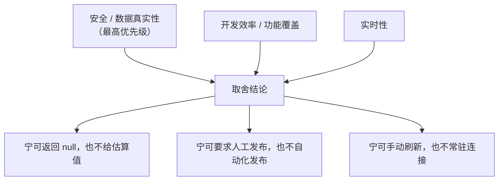

# 介绍与目标 (Introduction and Goals)

> **Metadata**
> - **Source**: `.context/architecture/source/technical_architecture.md`（TAD v1.4.4）+ PRD 基线 v1.2.2
> - **Generated At**: `2026-10-16 09:44`
> - **Updated At**: `2026-10-17 08:51`
> - **Generator**: `Context-Agent v1.0`

---

## 📌 业务驱动力

### 解决什么业务问题？

个人开发者在推广自己的产品时，需要在**多个平台**（微信公众号、视频号、B站、抖音、YouTube、X、Product Hunt、TikTok）之间反复切换完成同一套动作：想选题 → 写文案 → 做视频元数据 → 逐个登录后台粘贴 → 手动发布 → 再逐个平台抄数据做复盘。

这套流程存在三个核心痛点：

| 痛点 | 具体表现 |
|------|---------|
| **上下文反复切换** | 8 个平台后台 + 8 套数据看板，信息分散在不同标签页，无法形成全局视图 |
| **重复劳动密集** | 同一份内容要按平台改标题、改标签、改简介，逐字粘贴 |
| **复盘数据靠手抄** | 阅读 / 播放 / 互动分散在各平台，环比与爆款率靠人工统计，易错且滞后 |

### 创造什么业务价值？

`dsh-growth-studio` 把这些动作收敛进 **DSH Desktop 客户端的一个设置页**，提供"排期 → 创作 → 预填 → 人工发布 → 指标复盘"的闭环工作台：

- **一处规划**：排期日历统一管理多渠道发布节奏（PRD §5.1.2「6 / 7 篇」进度口径）；
- **AI 生成**：结合产品知识库生成公众号图文与视频元数据（3 套标题候选）；
- **自动预填**：经 BrowserOS 把草稿填入平台草稿箱，**把人从"复制粘贴"中解放出来**；
- **统一复盘**：跨平台指标聚合、可空语义汇总、环比走势，直接产出复盘结论。

### 替代什么现有方案？

| 被替代的方案 | 缺陷 |
|------------|------|
| **纯手工多平台操作** | 逐平台登录、逐字粘贴、手抄数据 |
| **第三方多平台发布工具** | 多为 SaaS，需上传内容与账号凭证到第三方；**存在自动群发风险**；不集成个人产品知识库 |
| **单纯的内容生成 AI 工具** | 只管生成不管分发，仍要手工搬运与统计 |

> **本项目的差异化定位**：**本地优先 + 人机协同** ——
> AI 负责生成与预填，**最终发布永远由人完成**；数据全部落本机 `$DSH_HOME`，会话 Cookie 零外发。

---

## 🎯 质量目标 (Top 5)

> ⚠️ 源文档**未给出** SLA / P99 / QPS 等对外服务型量化 NFR —— 本项目为**宿主内单用户进程**，非网络服务。
> 下方量化指标取自架构文档中**可验证的约束**，而非编造的服务等级数字。

| 优先级 | 质量属性 | 目标描述 | 验证方式 |
|:------:|--------|---------|---------|
| **1** | **安全（发布防误触）** | 彻底消除 AI 幻觉引发的不可控群发风险 | 发布类工具在 catalog 中**恒不存在**；`ops_publish_now` 不得以任何形式重新引入 |
| **2** | **数据真实性** | 绝不用不完整数据冒充全网总量，绝不伪造状态 | 采集失败 / 不支持 → `null`；应采平台未全成功 → 汇总 `null`；`published` 仅由真实 URL 回填推进 |
| **3** | **隐私** | 会话数据零外发 | Cookie 不出本地沙箱；**0 次**第三方上报；不读取日用 Chrome Cookie 库 |
| **4** | **数据可靠性** | 写入不丢、不跨库污染、错误可识别 | 原子写 + 串行写锁 + 目录在操作内固定；写盘失败统一 `drafts/storage-unavailable` |
| **5** | **可用性（轻量）** | 局部刷新，无需整页重载 | 手动触发 + in-flight 去重；**无** WebSocket / SSE / 后台轮询 |

### 目标之间的张力与取舍

> **一致的取舍取向**：当"功能顺畅"与"数据/行为可信"冲突时，**一律选择可信**。
> 这条取向贯穿 `null` 语义、发布守卫、目录固定等全部设计。

---

## 📊 质量场景

### 场景 1: 误发布防护（最高优先级场景）

| 属性 | 值 |
|------|-----|
| **刺激源** | AI 幻觉 / 用户误操作 / 恶意构造调用 |
| **刺激** | 尝试调用正式发布工具 |
| **环境** | 工作台正常运行，工具白名单已加载 |
| **制品** | AI 工具中枢（`tools.catalog` / `tools.executeSandbox`） |
| **响应** | 发布类工具**不存在于 catalog**，因此**无法构造调用**；预填流程止步于平台原生「保存为草稿」 |
| **响应度量** | 发布类工具数 = **0**（恒）；预填后草稿箱就绪但**未发布**；人工核验步骤不可绕过 |

### 场景 2: 假发布防护（状态真实性）

| 属性 | 值 |
|------|-----|
| **刺激源** | 通用保存入口 / 客户端传参 |
| **刺激** | `drafts.save` 传入 `status: 'published'` |
| **环境** | 草稿存在，渠道未全部回填 URL |
| **制品** | `DraftManager` 发布守卫 |
| **响应** | 服务端**拒绝**并返回 `drafts/published-requires-url`；状态不被推进 |
| **响应度量** | **100%** 拒绝，**不依赖**客户端自觉；`publishedUrls` 不被调用方伪造 |

### 场景 3: 指标缺口透明化

| 属性 | 值 |
|------|-----|
| **刺激源** | 平台采集失败（未登录 / 页面结构变化 / 不支持该指标） |
| **刺激** | `workbench.overview` 采集 2 个应采平台，其中 1 个失败 |
| **环境** | 驾驶舱刷新 |
| **制品** | `MetricsAggregator` + 驾驶舱指标卡 |
| **响应** | 汇总值为 `null`；填充 `measuredPlatforms` / `unmeasuredPlatforms`；UI 标注覆盖范围 |
| **响应度量** | **不出现**「只汇总成功平台」的数字；真实 `0` 仍作为有效值参与求和 |

### 场景 4: 配置切换期间的数据一致性

| 属性 | 值 |
|------|-----|
| **刺激源** | 用户在复合 RPC 执行期间修改 `draftsDir` |
| **刺激** | `config.save { draftsDir }` 在 `workbench.prefillDraft` 等待平台 Adapter 时生效 |
| **环境** | 在途草稿操作已捕获原目录 |
| **制品** | `DraftManager` 目录解析器 + 统一写锁 |
| **响应** | 在途操作**继续写原目录**；仅新发起的操作使用新目录；写锁按**绝对路径**归属 |
| **响应度量** | **不出现**「读 A 库写 B 库」；**不出现**跨库同 ID 副本；在途写原目录是**预期语义**而非错误 |

### 场景 5: 不可写目录的前置拦截

| 属性 | 值 |
|------|-----|
| **刺激源** | 用户指定一个已存在但**只读**的目录 |
| **刺激** | `config.save { draftsDir }` |
| **环境** | 目录存在但不可写 |
| **制品** | `ConfigStore` 前置校验 |
| **响应** | 创建并删除**唯一命名探测文件**校验可写性 → 失败则**拒绝保存** |
| **响应度量** | 返回 `config/invalid-drafts-dir`；**不出现**「先报成功、后续 `drafts.save` 以 `ENOENT` 失败」 |

### 场景 6: 会话状态真实性

| 属性 | 值 |
|------|-----|
| **刺激源** | 平台会话失效 / 探测不确定 |
| **刺激** | `browser.sessions` 探测 |
| **环境** | BrowserOS 统一实例 |
| **制品** | `SessionGuard` |
| **响应** | 严格返回四态之一；不确定时返回 `unknown`（**不猜测**） |
| **响应度量** | **不出现**「工作台显示就绪但实际未登录」的假阳性；四态**严禁退化为 boolean** |

---

## 👥 利益相关者矩阵

| 角色 | 关注点 | 推荐阅读章节 |
|------|--------|-------------|
| **个人开发者（项目所有者）** | 发布安全、数据可信、使用成本 | `constraints.md` §架构铁律、`security_policy.md` |
| **项目维护者（未来的自己 / 协作者）** | 分层边界、契约先行、易改 | `system_design.md`、`container_component_view.md`、`api_strategy.md` |
| **安全审查者** | 数据流向、凭证管理、外发边界 | `security_policy.md`、`context_view.md` §数据流向与隐私边界 |
| **运营使用者** | 指标口径、复盘可用性、缓存语义 | `runtime_view.md` §场景 5、`data_architecture.md` |
| **新接手开发者** | 系统全貌、快速上手路径 | `system_design.md` §系统概述、`.context/AGENTS.md` |

---

## 📐 范围与阶段

| 阶段 | 范围 | 状态 |
|------|------|------|
| **Phase 0** | 核心闭环：排期 / 创作 / 预填（公号 + B站）/ 指标聚合 / 工具中枢 / 配置 / 巡检注册 | 基线定义 |
| **Phase 1** | 舆情需求提炼（`FeedbackIntelligence`：评论爬取 + 需求聚类） | 规划中 |
| **Phase 2** | 场景技能工坊（`SkillEngine`）、出海增长与时区引擎（`OverseasStrategyManager`）、浏览器交互式登录端点（**需 CDP PoC 验证**） | 规划中 |
| **Phase 3** | Injoys **双向同步**演进（行级 ID 映射表 + 时间戳版本 + LWW + 冲突行拆分标记） | 远期 |

> **阶段约束**：未到阶段的能力**不提前实现**。
> 排期导出 Phase 0 为**单向**（本地主数据 → Injoys），**不做**复杂的实时双向冲突解决，以避免数据覆盖。

---

## 🔗 相关文档

| 文档 | 关系 |
|------|------|
| `system_design.md` | 系统概述的完整展开与部署拓扑 |
| `context_view.md` | 系统边界与外部依赖 |
| `constraints.md` | 架构铁律与绝对禁止项 |
| `security_policy.md` | 最高优先级质量目标的实现契约 |
| `data_architecture.md` | 数据真实性的口径与模型 |
| `../domain/` | 产品需求与用户旅程（业务侧视角） |
| `source/technical_architecture.md` | **源文档（冲突时以此为准）** |

---

## AI 引用指南

当 AI 进行架构规划时：
1. 牢记**取舍取向**：功能顺畅与行为可信冲突时，一律选择可信
2. 优先满足 Top 5 质量目标，尤其**发布安全**与**数据真实性**
3. 新功能须对照五条「质量场景」检查是否引入回归
4. 未到阶段的能力**不提前实现**；跨阶段引入须先更新 PRD 与架构文档
