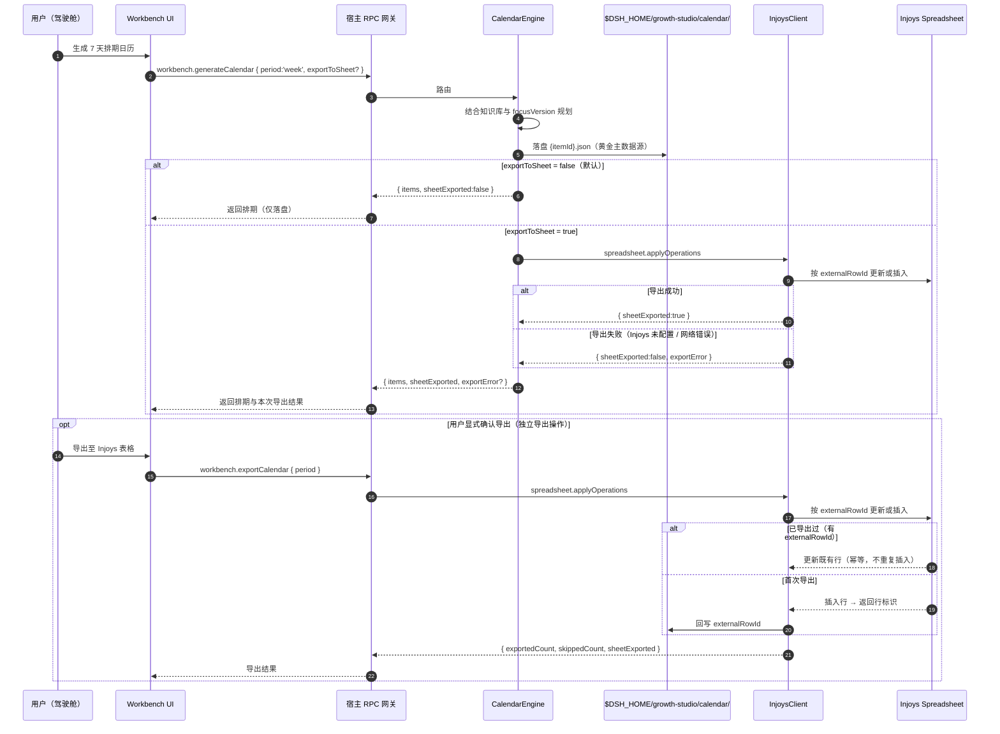
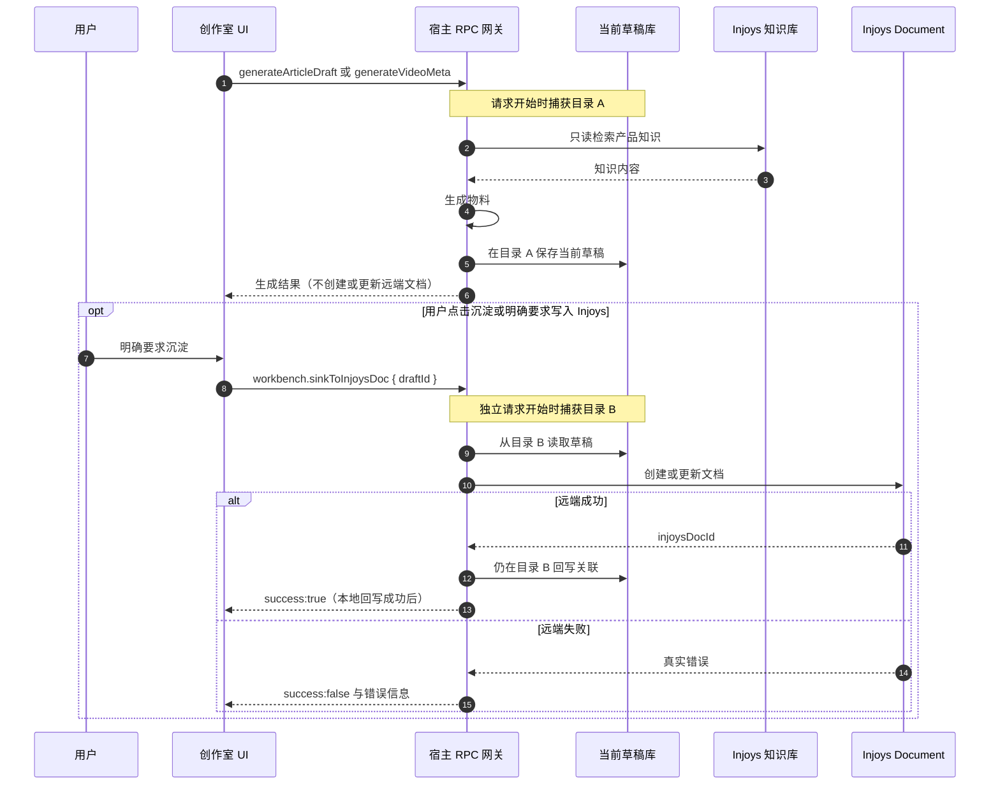
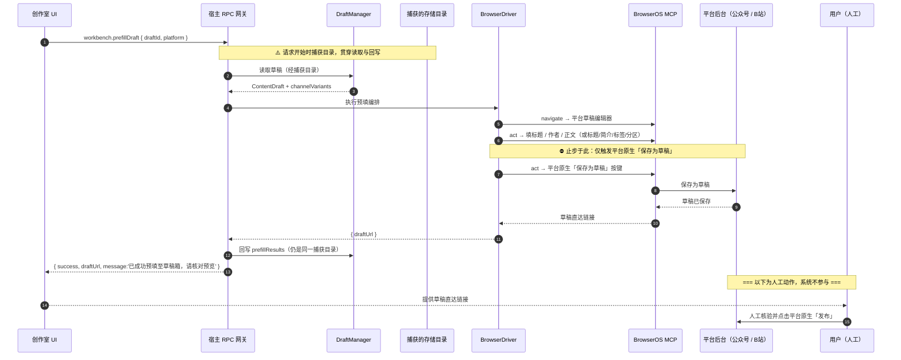
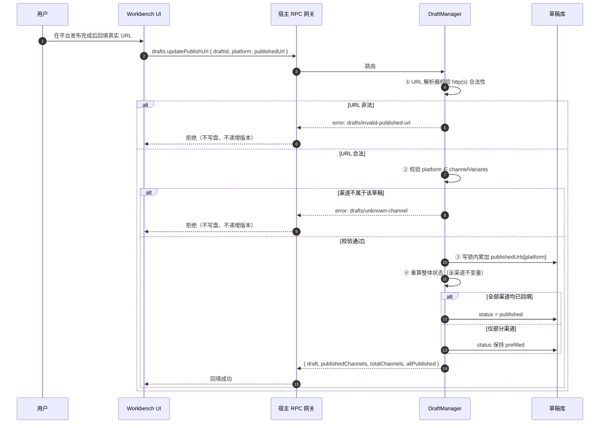
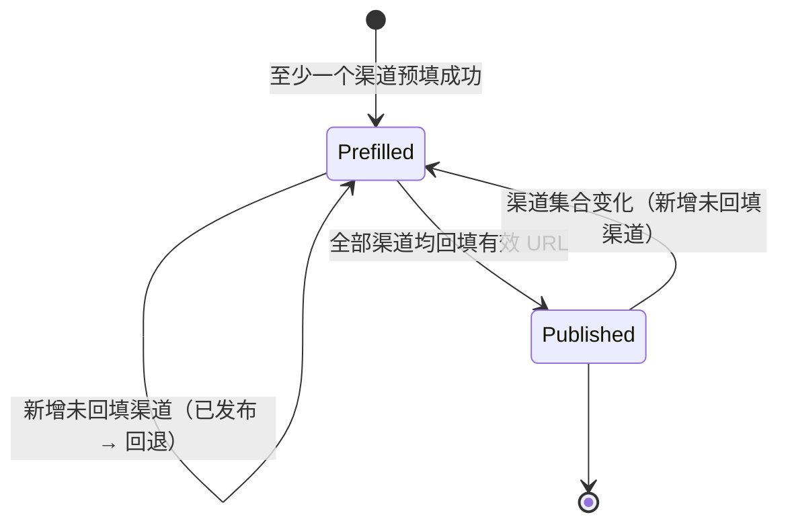
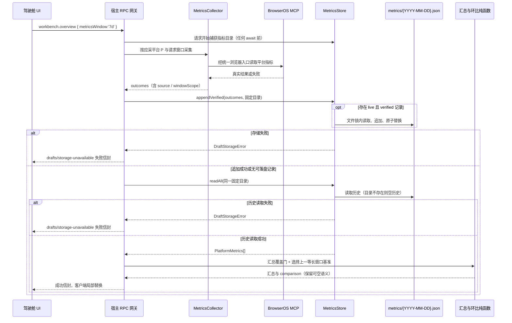
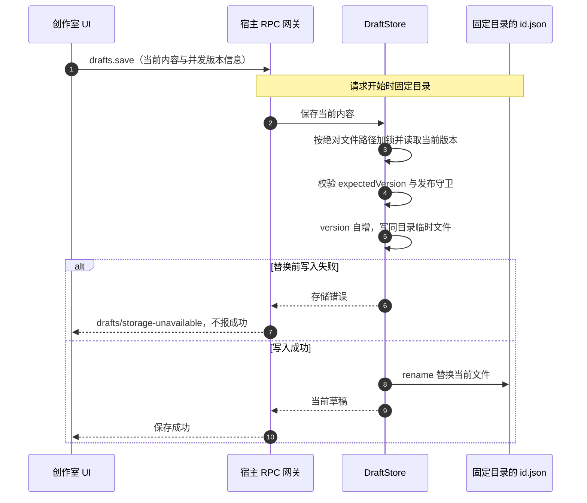
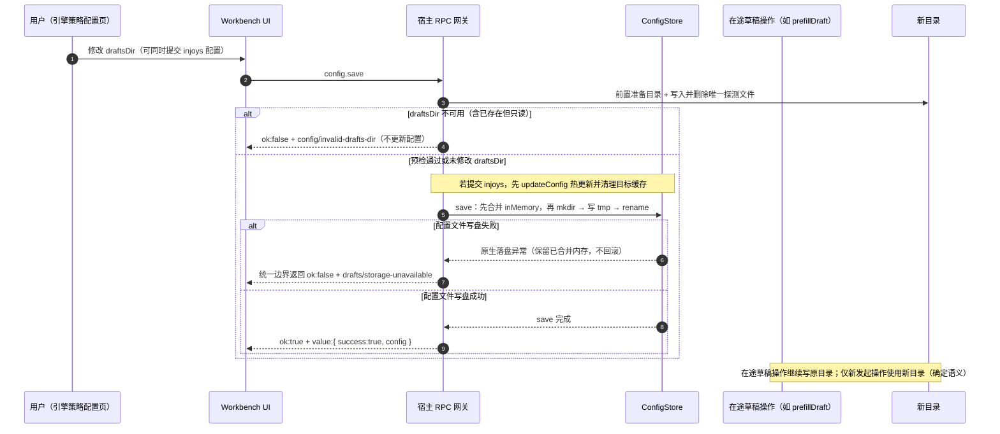
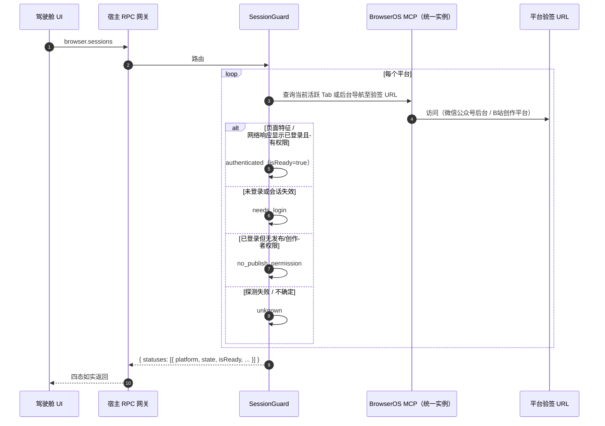

# 运行时视图 (Runtime View)

> **Metadata**
> - **Source**: `.context/architecture/source/technical_architecture.md`（TAD v1.4.5 §3、§4.2、§5）
> - **Generated At**: `2026-10-16 09:44`
> - **Generator**: `Context-Agent v1.0`
> - **Last Synced At**: `2026-10-21T16:05:57+08:00`
> - **Sync Authority**: `openspec/changes/archive/2026-10-21-fix-unauthorized-injoys-doc-write/`（第二次同步校正）

---

## 🎯 场景选择原则

仅记录具有**架构显著性**的运行时场景：

- 核心业务链路（排期 → 创作 → 预填 → 发布 → 复盘）
- 复杂交互逻辑（跨进程 / 跨 `await` 的复合 RPC）
- 异常与恢复流程（采集失败、存储不可用）
- **契约守卫的关键路径**（发布 URL 回填闭环）

---

## 📊 场景 1: 排期生成与单向导出

**对应接口**：`workbench.generateCalendar` / `workbench.exportCalendar`

### 关键决策点

| 步骤 | 决策 | 失败处理 |
|------|------|---------|
| 4 | 本地落盘为**黄金主数据源** | 落盘失败 → 如实抛错，不谎报成功 |
| 7 | `exportToSheet` **默认 false** | 默认仅落盘；**true 时生成后立即导出**，成功返回 `sheetExported:true`、失败返回 `sheetExported:false` + 真实 `exportError`（不谎报导出成功）。独立 `exportCalendar` 仍为用户显式导出操作 |
| 11 | 幂等判定依据 `externalRowId` | 存在则更新而非重复插入 |
| — | Injoys 未配置 / 网络错误 | 返回 `exportError` 与 `sheetExported: false`，**不谎报** |

---

## 📊 场景 2: 内容生成只存本地，用户明确触发后沉淀

**对应接口**：`workbench.generateArticleDraft` / `workbench.generateVideoMeta`；独立的 `workbench.sinkToInjoysDoc`

> **实现范围**：生成阶段的未授权文档写入已由 `fix-unauthorized-injoys-doc-write` 移除。下图是目标时序，不代表当前 UI 已接入；沉淀 opt 分支须待 Phase 2 的宿主接口与 Phase 3 的界面。现有 U2 只证明 RPC 图文在知识库等待期间切库仍写起始目录；工具图文 / 视频的请求级目录固定仍属既有未覆盖面。复盘只生成并返回，Launch 不新增草稿持久化；二者不纳入图中的本地草稿存盘承诺。

### 关键决策点

- 生成、预览、本地保存和自动同步配置均不授权写入 Injoys 文档；知识库读取仍可用于生成。
- 两个请求分别捕获自己的目录，配置切换可能使 A 与 B 不同；找不到目标草稿时如实失败，禁止跨库猜测或搜索后回写。
- 沉淀请求贯穿读草稿、等待远端与回写。远端成功但本地回写失败时，统一返回 `drafts/storage-unavailable`，不得谎报沉淀闭环已完成；不因此改变本地生成的保存结果。
- 视频元数据仍返回 `id` / `draftSaved`，`titleCandidates` 数量恒为 3；未成功落盘不得报已保存。

---

## 📊 场景 3: 草稿预填（跨 await 复合 RPC + Human-in-the-Loop 边界）

**对应接口**：`workbench.prefillDraft`（客户端工具封装 `ops_push_drafts`）

### 关键决策点

| 步骤 | 决策 | 失败处理 |
|------|------|---------|
| Note | **目录在请求开始时捕获**（本 RPC 会等待 Adapter 很久） | 中间配置切换**不得**把结果写进另一个库的同 ID 草稿 |
| 8 | 分区字段映射：`partition` → 平台控件 | **平台不支持分区时跳过该项而不报错** |
| 11 | **止步于平台原生「保存为草稿」** | ⛔ 不得触发或越过正式发布步骤 |
| 16 | 回写预填结果 | 写盘失败 → `drafts/storage-unavailable`（统一错误边界） |
| Note | 人工发布**完全在系统之外** | 系统唯一可观测信号是随后的 URL 回填 |

---

## 📊 场景 4: 发布 URL 回填闭环（**契约守卫的核心路径**）

**对应接口**：`drafts.updatePublishUrl`

### 关键决策点

| 步骤 | 决策 | 失败处理 |
|------|------|---------|
| ① | **须用 URL 解析器校验**，禁止宽松正则 | `drafts/invalid-published-url` |
| ② | 渠道成员校验 | `drafts/unknown-channel`，**不写盘、不递增版本** |
| ③ | 回填是**按渠道**累加写入 | 写盘失败 → `drafts/storage-unavailable` |
| ④ | `ContentDraft.status` 是**整体**状态 | 判定依据恒为「`publishedUrls` 覆盖全部渠道」，**不依赖**调用顺序或次数 |
| — | **不引入** `partially_published` | UI 用 `publishedChannels` / `totalChannels` 派生文案 |

### 全渠道不变量（须在同一写锁内维持）

**孤儿清理**：删除或替换渠道后，不再对应任何当前渠道的 URL 会被**剪除**，
因此移除渠道**不会**让草稿凭残留 URL 继续维持「已发布」假象。

**为什么阻挡 `drafts.save` 写 `published`**

> `published` 代表「已在平台真实发布」，其**唯一可信证据**是用户回填的真实 URL。
> ⚠️ **保证边界**：证据来自**用户声明**；契约校验的是 **URL 格式 / 渠道归属 / 全渠道完整性**，
> **不能**证明发布确已发生 —— ⛔ 不得把"格式合法"当作"已核实发布"。
> 若允许通用保存入口直接写 `published`，则发布闭环可被绕过，**状态会失去真实性**。
> 该守卫是**服务端**职责，**不得**仅依赖客户端不传该值。

---

## 📊 场景 5: 指标采集与环比计算（**可空语义**）

**对应接口**：`workbench.overview` / `ops_fetch_metrics`

> **目标流程与当前实现边界**：`fix-overview-metrics-null-semantics` 已落地宿主 `workbench.overview` 的字段与汇总判定；`feat-storage-metrics-snapshot` 已落地图中的追加/读取快照步骤（`src/storage/metrics-store.ts` + `src/analytics/metrics-comparison.ts`）。覆盖数组按应采集合内“抓取成功且窗口可证实”计算。`source: 'live'` 而 `windowScope: 'unverified'` 的原始数值保留，但不进入窗口汇总，也**不写入**指标历史快照。
> 当前生产 `live` 均为 `unverified`，故生产上仍无快照、`comparison` 五键仍为 `null`，直至采集侧能产出 `verified` 窗口增量。`weeklyPipeline` 只从既有 Injoys 列表派生本周计数；本地排期接入和驾驶舱 UI 分别由 `feat-calendar-generate-list`、`feat-client-dashboard` 承接。规范见 `openspec/specs/workbench-overview/spec.md`。

### 关键决策点

- 真实 `0` 是有效值；抓取成功但窗口不可证实的结果不进入周期汇总、不写快照。
- 平台覆盖不足时汇总为 `null`，填充覆盖数组；互动分项任一汇总未知则互动为 `null`。
- 任一应采平台缺少上一等长窗口基准时，`comparison.period` 与四个 delta 全 `null`。候选按 UTC 起止日期 / 长度匹配，取距预期末端最近者，并列取采集时间最新者。
- `period` 有值不保证每个 delta 都可用：当前值 / 基准未知仍为 `null`；基准与当前均为零时为 0%，基准零且当前非零时为 `null`。
- `ops_fetch_metrics` 共用采集与追加路径，但不执行 overview 的历史读取和环比计算。存储失败不回滚已发生的采集，整体调用如实报错。
- 首次使用无历史是正常情况；同一卡片并发刷新须做 in-flight 去重。图中 UI 是目标交互，不表示驾驶舱 UI 已验收。

---

## 📊 场景 6: 当前草稿的单文件原子保存

**对应接口**：`drafts.get` / `drafts.save` / `drafts.delete`

### 关键决策点

- MVP 只保留 `{id}.json` 当前内容；无草稿历史目录、历史列表或恢复接口。
- `version` / `expectedVersion` 是并发控制，不是历史留存；用户保存成功后无法通过产品回看旧内容。
- 替换前写入失败不覆盖当前文件；仍保留固定目录、串行写锁和统一存储错误边界。
- 不再引入当前草稿与历史快照的双文件提交。指标历史快照不受影响。
- 删除只针对当前草稿；不自动清理用户可能已有的历史文件。

---

## 📊 场景 7: `draftsDir` 切换与在途操作

**对应接口**：`config.save` / 所有写入口

### 关键决策点

| 步骤 | 决策 | 失败处理 |
|------|------|---------|
| 前置预检 | **仅检查「目录存在」不够** | 已存在但只读的目录会让 `mkdir` 成功却在首次写入时失败 |
| 前置预检 | 校验方式 | 在目标目录创建并删除一个**唯一命名**的探测文件 |
| 预检失败 | 失败**拒绝保存** | 返回 `config/invalid-drafts-dir`；**不得**先返回成功、再让 `drafts.save` 以 `ENOENT` 失败 |
| 在途操作 | 在途操作写原目录是**确定行为** | **不引入** `dirChangedDuringSave` 告警标记，不当作错误上报 |
| — | 配置页提示文案（须覆盖三件事实） | 「新目录对后续操作生效；正在进行的保存仍写入原目录。旧草稿不会自动迁移。」 |
| — | 旧目录草稿 | **不做自动迁移**（避免大目录复制与部分失败风险） |

### 目录固定范围（易错点）

> **贯穿范围包括「请求内的每一次落盘」**。
> 反例：用户明确触发的 `workbench.sinkToInjoysDoc` 先读草稿，等待远端写入后再回写 `injoysDocId`；
> 若回写前重新解析目录，会将关联写入另一个库的同 ID 草稿。生成接口本身仅保存本地，不含该远端写入步骤。

---

## 📊 场景 8: 统一 BrowserOS 实例的会话探测

**对应接口**：`browser.sessions`

### 关键决策点

| 步骤 | 决策 | 失败处理 |
|------|------|---------|
| 4 | **统一实例绑定** | 登录态探测、草稿箱预填与大屏指标采集由**同一个** BrowserOS MCP 实例调度 |
| 5 | **轻量探测**（存在性 / 状态判定） | 不导出 Cookie 内容 |
| 6-9 | **四态流转** | 严格返回四态，**严禁退化为 boolean，杜绝假阳性** |
| — | UI 表现 | 未登录平台一律提供 `去登录 ↗` 快捷外链；`unknown` 时引导用户在当前 BrowserOS 实例中直接扫码登录 |

### 原方案缺陷（已被否决）

| # | 问题 | 后果 |
|---|------|------|
| 1 | **实例不一致** | 日用 Chrome 与 BrowserOS MCP 是完全不同的浏览器环境与用户目录；在 Chrome 探测到 Cookie **根本不能保证** BrowserOS 执行预填时已登录 → 工作台呈现「就绪」**假象** |
| 2 | **SQLite WAL 不完整** | 直接复制 `Cookies` 主文件未同步 `Cookies-wal` / `Cookies-shm`；Chrome 处于活跃写状态时容易**漏检最新 Cookie** |
| 3 | **隐私与安全** | 拷贝并挂载整个 SQLite 库会使**所有个人 Cookie 进入内存**，与「仅存在性探测」的隐私承诺存在落差 |

---

## ⚠️ 异常与恢复

| 异常场景 | 触发条件 | 恢复策略 |
|---------|---------|---------|
| **草稿目录不可写** | 目录只读 / 创建失败 | 统一错误边界返回 `drafts/storage-unavailable`（**所有写入口一致**）；**不吞异常、不谎报成功** |
| **`config.save` 目标目录不可用** | 已存在但只读 / 无法创建 | 前置探测文件校验失败 → **拒绝保存** `config/invalid-drafts-dir` |
| **配置文件自身写盘失败** | `$DSH_HOME/ops-manager/` 目录不可写 / 路径被普通文件占用 / tmp 写入或 rename 失败 | `ConfigStore.save()` 落盘异常**如实抛出**，经**统一 RPC 错误边界**映射为 `drafts/storage-unavailable`（`details.dir` 指向 `ops-manager` 配置目录）；`error.message` 为面向用户的中文说明、不拼接 `errno`/调用栈；**不得**吞异常后谎报保存成功。热更新在写盘**之前**完成，失败时不回滚已合并的内存态（非空字段与 `InjoysClient` 一致） |
| **配置在操作中途切换** | 用户在复合 RPC 期间改 `draftsDir` | 在途操作**继续写原目录**（确定语义）；新操作才用新目录 |
| **Injoys 未配置** | 无令牌 | `injoys.test` 返回「尚未配置令牌」提示，**不得**发出请求并谎报「认证失败」 |
| **Injoys 沉淀失败** | 网络 / 服务错误 | `sinkToInjoysDoc` 返回 `success:false` 与真实错误；**不得**谎报成功或写本地假 ID |
| **平台采集失败** | 页面结构变化 / 未登录 | 该平台指标为 `null`；汇总为 `null` 并填充 `unmeasuredPlatforms` |
| **排期导入部分失败** | 远端行冲突 / 网络错误 | **不回滚已成功项**，如实返回已导入计数与 `conflicts`，**不谎报全量成功** |
| **工具被禁用** | `enabled === false` | 宿主侧拒绝并返回 `tools/disabled`；**不得**依赖前端隐藏按钮 |
| **草稿旧内容不可回看** | 当前内容已保存并覆盖 | MVP 不提供历史查看与恢复；不得把并发版本号当作历史可用的保证 |
| **会话状态不确定** | 探测失败 | 返回 `unknown`（**不猜测**），UI 引导用户手工登录 |
| **并发刷新** | 用户连点同一卡片 | in-flight 合并去重，避免会话探测与指标采集重复执行 |

---

## 🔗 相关文档

| 文档 | 关系 |
|------|------|
| `api_strategy.md` | 场景涉及的接口契约与错误码 |
| `data_architecture.md` | 状态机与持久化布局 |
| `security_policy.md` | 场景中的契约守卫语义 |
| `container_component_view.md` | 场景参与者的组件归属 |
| `risks_and_debt.md` | 异常场景对应的风险条目 |
| `source/technical_architecture.md` | **源文档（冲突时以此为准）** |

---

## AI 引用指南

当 AI 实现运行时逻辑时：
1. 涉及**跨 `await`** 的复合 RPC，必须在**请求开始时**捕获存储目录并贯穿**每一次落盘**
2. 预填流程**止步于平台原生「保存为草稿」**，绝不可越过发布步骤
3. `published` 状态只能经 `drafts.updatePublishUrl` 推进，且须在**同一写锁内**维护全渠道不变量
4. 指标缺失一律 `null`；真实 `0` 是有效值；历史不足时 delta 为 `null`
5. 写盘失败统一经**统一 RPC 错误边界**映射为 `drafts/storage-unavailable`
6. 会话状态必须四态返回，**严禁退化为 boolean**
7. 目录切换期间的在途操作写原目录是**预期语义**，不得作为错误上报
