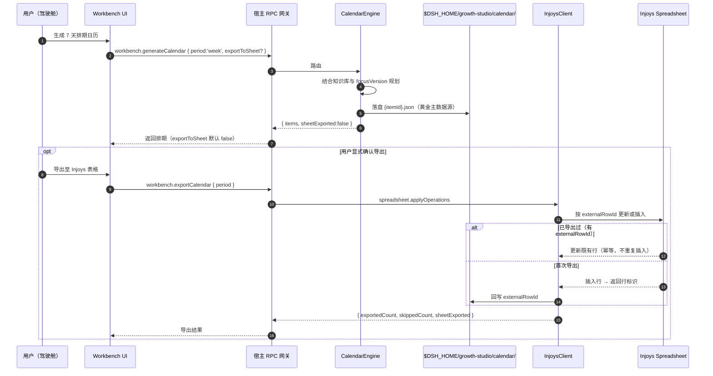
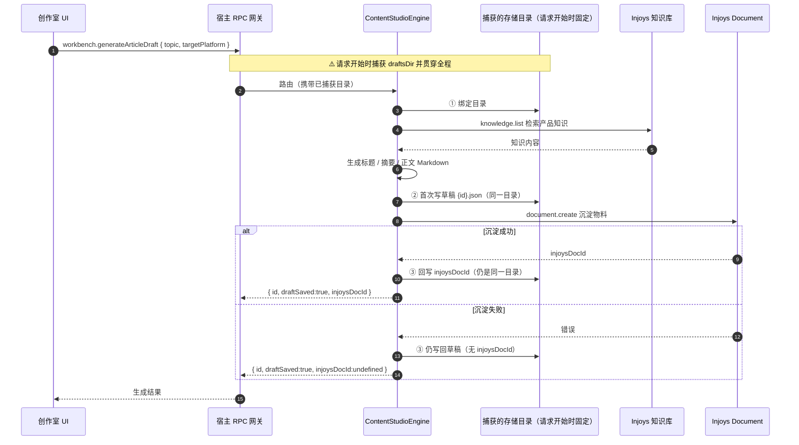
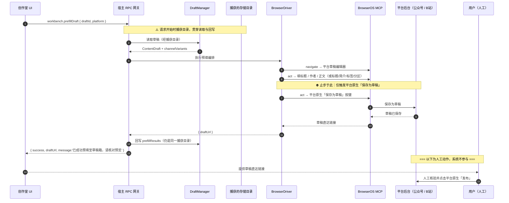
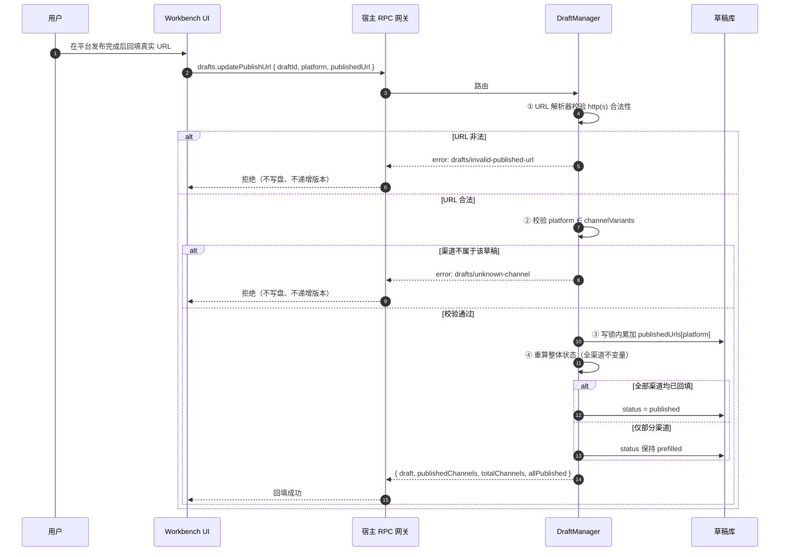
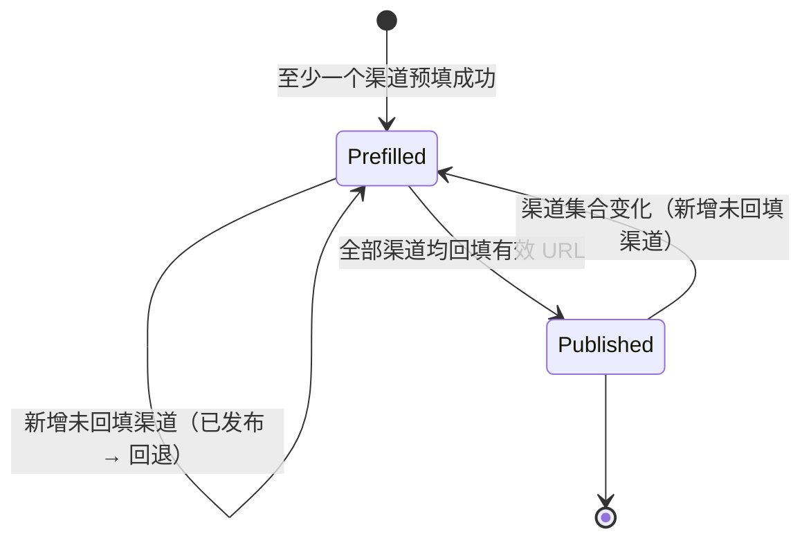
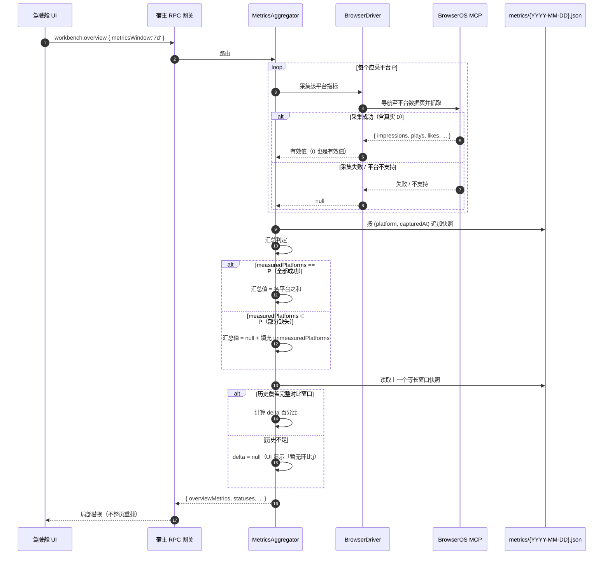
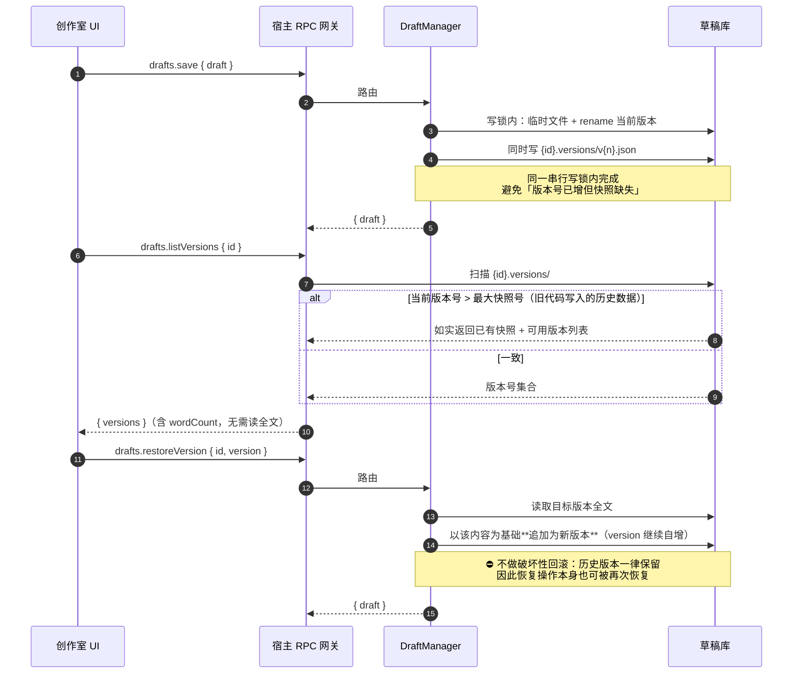
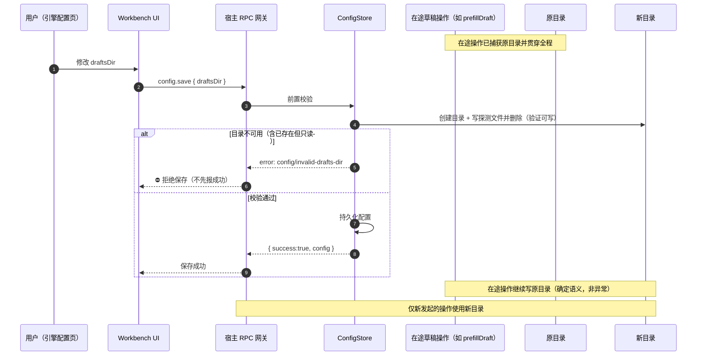
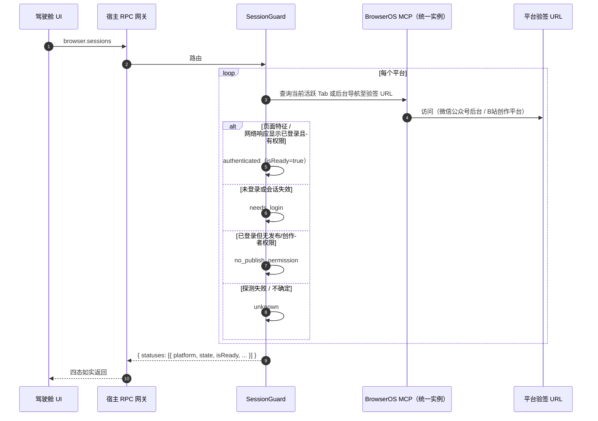

# 运行时视图 (Runtime View)

> **Metadata**
> - **Source**: `.context/architecture/source/technical_architecture.md`（TAD v1.2.0 §3、§4.2、§5）
> - **Generated At**: `2026-10-16 09:44`
> - **Generator**: `Context-Agent v1.0`

---

## 🎯 场景选择原则

仅记录具有**架构显著性**的运行时场景：

- 核心业务链路（排期 → 创作 → 预填 → 发布 → 复盘）
- 复杂交互逻辑（跨进程 / 跨 `await` 的复合 RPC）
- 异常与恢复流程（采集失败、存储不可用）
- **契约守卫的关键路径**（发布 URL 回填闭环）

---

## 📊 场景 1: 排期生成与单向导出

**对应接口**：`workbench.generateCalendar` / `workbench.exportCalendar`

### 关键决策点

| 步骤 | 决策 | 失败处理 |
|------|------|---------|
| 4 | 本地落盘为**黄金主数据源** | 落盘失败 → 如实抛错，不谎报成功 |
| 7 | `exportToSheet` **默认 false** | 导出应为用户**显式确认**的动作（PRD §5.1.2 快速行动为「生成 7 天排期日历」） |
| 11 | 幂等判定依据 `externalRowId` | 存在则更新而非重复插入 |
| — | Injoys 未配置 / 网络错误 | 返回 `exportError` 与 `sheetExported: false`，**不谎报** |

---

## 📊 场景 2: 内容创作落盘（跨 await，**两次写入须绑定同一目录**）

**对应接口**：`workbench.generateArticleDraft` / `workbench.generateVideoMeta`

### 关键决策点

| 步骤 | 决策 | 失败处理 |
|------|------|---------|
| Note | **目录在请求开始时捕获** | 中途配置切换**不影响**本次请求（否则一次请求会在两个库各留一份同 ID 副本，且实际看到的那份还缺少远端文档关联） |
| ② / ③ | **请求内每一次落盘**都必须绑定同一目录 | 违反则产生跨库副本 |
| 6-7 | 自动存盘只写**本地草稿库** | 与「沉淀至 Injoys」是**两个独立动作** |
| 9 | 沉淀失败不阻断存盘 | `draftSaved:true` 与 `injoysDocId:undefined` 并存，**不谎报** |

> **视频元数据一致行为**：`workbench.generateVideoMeta` 同样返回 `id` 与 `draftSaved`；
> 未成功落盘时 `draftSaved: false` 且 `id` **仍返回**（便于前端重试保存）。
> `titleCandidates` **数量恒为 3**。

---

## 📊 场景 3: 草稿预填（跨 await 复合 RPC + Human-in-the-Loop 边界）

**对应接口**：`workbench.prefillDraft`（客户端工具封装 `ops_push_drafts`）

### 关键决策点

| 步骤 | 决策 | 失败处理 |
|------|------|---------|
| Note | **目录在请求开始时捕获**（本 RPC 会等待 Adapter 很久） | 中间配置切换**不得**把结果写进另一个库的同 ID 草稿 |
| 8 | 分区字段映射：`partition` → 平台控件 | **平台不支持分区时跳过该项而不报错** |
| 11 | **止步于平台原生「保存为草稿」** | ⛔ 不得触发或越过正式发布步骤 |
| 16 | 回写预填结果 | 写盘失败 → `drafts/storage-unavailable`（统一错误边界） |
| Note | 人工发布**完全在系统之外** | 系统唯一可观测信号是随后的 URL 回填 |

---

## 📊 场景 4: 发布 URL 回填闭环（**契约守卫的核心路径**）

**对应接口**：`drafts.updatePublishUrl`

### 关键决策点

| 步骤 | 决策 | 失败处理 |
|------|------|---------|
| ① | **须用 URL 解析器校验**，禁止宽松正则 | `drafts/invalid-published-url` |
| ② | 渠道成员校验 | `drafts/unknown-channel`，**不写盘、不递增版本** |
| ③ | 回填是**按渠道**累加写入 | 写盘失败 → `drafts/storage-unavailable` |
| ④ | `ContentDraft.status` 是**整体**状态 | 判定依据恒为「`publishedUrls` 覆盖全部渠道」，**不依赖**调用顺序或次数 |
| — | **不引入** `partially_published` | UI 用 `publishedChannels` / `totalChannels` 派生文案 |

### 全渠道不变量（须在同一写锁内维持）

**孤儿清理**：删除或替换渠道后，不再对应任何当前渠道的 URL 会被**剪除**，
因此移除渠道**不会**让草稿凭残留 URL 继续维持「已发布」假象。

**为什么阻挡 `drafts.save` 写 `published`**

> `published` 代表「已在平台真实发布」，其**唯一可信证据**是用户回填的真实 URL。
> 若允许通用保存入口直接写 `published`，则发布闭环可被绕过，**状态会失去真实性**。
> 该守卫是**服务端**职责，**不得**仅依赖客户端不传该值。

---

## 📊 场景 5: 指标采集与环比计算（**可空语义**）

**对应接口**：`workbench.overview` / `ops_fetch_metrics`

### 关键决策点

| 步骤 | 决策 | 失败处理 |
|------|------|---------|
| 5 | 真实返回 `0` 是**有效值** | 参与求和；`0` 与 `null` 语义**严格区分** |
| 8 | 采集失败 / 不支持 → `null` | **不得**按 0 或估算值伪造填充 |
| 11 | 部分缺失 → 汇总 **`null`** | **不得**只汇总已成功平台冒充全网总量；须填充 `measuredPlatforms` / `unmeasuredPlatforms` |
| 13 | 互动汇总 | `totalEngagements` 在点赞/评论/转发/收藏**任一为 null 时为 null** |
| 16 | 历史不足 → delta `null` | **不得**用不完整历史算近似百分比 |
| 18 | UI 局部替换 | 同一卡片并发刷新须做 **in-flight 去重** |

> **首次使用时全部 delta 为 `null` 属预期行为，不是缺陷。**

---

## 📊 场景 6: 草稿版本恢复（**非破坏性回滚**）

**对应接口**：`drafts.save` / `drafts.listVersions` / `drafts.getVersion` / `drafts.restoreVersion`

### 关键决策点

| 步骤 | 决策 | 失败处理 |
|------|------|---------|
| 5-6 | 当前版本与快照在**同一串行写锁内**完成 | 避免「版本号已增但快照缺失」 |
| 6 | 快照同样「临时文件 + rename」 | 与当前版本文件保持一致的原子保证 |
| 12 | 版本号与快照不一致时 | **如实返回已有快照**，**不得伪造缺失版本** |
| 17 | **不做破坏性回滚** | 恢复 = 追加新版本；历史一律保留，恢复本身可再恢复 |
| — | Phase 0 **保留全部版本** | **不自动淘汰**；若需上限须先在 PRD 定义 |
| — | `drafts.delete` **级联删除** | `{id}.json` 与整个 `{id}.versions/` 目录一并清除 |

---

## 📊 场景 7: `draftsDir` 切换与在途操作

**对应接口**：`config.save` / 所有写入口

### 关键决策点

| 步骤 | 决策 | 失败处理 |
|------|------|---------|
| 5 | **仅检查「目录存在」不够** | 已存在但只读的目录会让 `mkdir` 成功却在首次写入时失败 |
| 5 | 校验方式 | 在目标目录创建并删除一个**唯一命名**的探测文件 |
| 7 | 失败**拒绝保存** | 返回 `config/invalid-drafts-dir`；**不得**先返回成功、再让 `drafts.save` 以 `ENOENT` 失败 |
| 10 | 在途操作写原目录是**确定行为** | **不引入** `dirChangedDuringSave` 告警标记，不当作错误上报 |
| — | 配置页提示文案（须覆盖三件事实） | 「新目录对后续操作生效；正在进行的保存仍写入原目录。旧草稿不会自动迁移。」 |
| — | 旧目录草稿 | **不做自动迁移**（避免大目录复制与部分失败风险） |

### 目录固定范围（易错点）

> **贯穿范围包括「请求内的每一次落盘」**。
> 反例：`workbench.generateArticleDraft` 在等待知识库后才首次写草稿、再等远端文档后写 `injoysDocId`；
> 若两次写入绑定不同目录，一次请求会在两个库里**各留一份同 ID 副本**（实际看到的那份还缺少远端文档关联）。

---

## 📊 场景 8: 统一 BrowserOS 实例的会话探测

**对应接口**：`browser.sessions`

### 关键决策点

| 步骤 | 决策 | 失败处理 |
|------|------|---------|
| 4 | **统一实例绑定** | 登录态探测、草稿箱预填与大屏指标采集由**同一个** BrowserOS MCP 实例调度 |
| 5 | **轻量探测**（存在性 / 状态判定） | 不导出 Cookie 内容 |
| 6-9 | **四态流转** | 严格返回四态，**严禁退化为 boolean，杜绝假阳性** |
| — | UI 表现 | 未登录平台一律提供 `去登录 ↗` 快捷外链；`unknown` 时引导用户在当前 BrowserOS 实例中直接扫码登录 |

### 原方案缺陷（已被否决）

| # | 问题 | 后果 |
|---|------|------|
| 1 | **实例不一致** | 日用 Chrome 与 BrowserOS MCP 是完全不同的浏览器环境与用户目录；在 Chrome 探测到 Cookie **根本不能保证** BrowserOS 执行预填时已登录 → 工作台呈现「就绪」**假象** |
| 2 | **SQLite WAL 不完整** | 直接复制 `Cookies` 主文件未同步 `Cookies-wal` / `Cookies-shm`；Chrome 处于活跃写状态时容易**漏检最新 Cookie** |
| 3 | **隐私与安全** | 拷贝并挂载整个 SQLite 库会使**所有个人 Cookie 进入内存**，与「仅存在性探测」的隐私承诺存在落差 |

---

## ⚠️ 异常与恢复

| 异常场景 | 触发条件 | 恢复策略 |
|---------|---------|---------|
| **草稿目录不可写** | 目录只读 / 创建失败 | 统一错误边界返回 `drafts/storage-unavailable`（**所有写入口一致**）；**不吞异常、不谎报成功** |
| **`config.save` 目标目录不可用** | 已存在但只读 / 无法创建 | 前置探测文件校验失败 → **拒绝保存** `config/invalid-drafts-dir` |
| **配置在操作中途切换** | 用户在复合 RPC 期间改 `draftsDir` | 在途操作**继续写原目录**（确定语义）；新操作才用新目录 |
| **Injoys 未配置** | 无令牌 | `injoys.test` 返回「尚未配置令牌」提示，**不得**发出请求并谎报「认证失败」 |
| **Injoys 沉淀失败** | 网络 / 服务错误 | `sinkToInjoysDoc` 返回 `success:false` 与真实错误；**不得**谎报成功或写本地假 ID |
| **平台采集失败** | 页面结构变化 / 未登录 | 该平台指标为 `null`；汇总为 `null` 并填充 `unmeasuredPlatforms` |
| **排期导入部分失败** | 远端行冲突 / 网络错误 | **不回滚已成功项**，如实返回已导入计数与 `conflicts`，**不谎报全量成功** |
| **工具被禁用** | `enabled === false` | 宿主侧拒绝并返回 `tools/disabled`；**不得**依赖前端隐藏按钮 |
| **版本快照缺失** | 历史数据由旧版本代码写入 | `listVersions` **如实返回已有快照**与可用版本列表，**不得伪造缺失版本** |
| **会话状态不确定** | 探测失败 | 返回 `unknown`（**不猜测**），UI 引导用户手工登录 |
| **并发刷新** | 用户连点同一卡片 | in-flight 合并去重，避免会话探测与指标采集重复执行 |

---

## 🔗 相关文档

| 文档 | 关系 |
|------|------|
| `api_strategy.md` | 场景涉及的接口契约与错误码 |
| `data_architecture.md` | 状态机与持久化布局 |
| `security_policy.md` | 场景中的契约守卫语义 |
| `container_component_view.md` | 场景参与者的组件归属 |
| `risks_and_debt.md` | 异常场景对应的风险条目 |
| `source/technical_architecture.md` | **源文档（冲突时以此为准）** |

---

## AI 引用指南

当 AI 实现运行时逻辑时：
1. 涉及**跨 `await`** 的复合 RPC，必须在**请求开始时**捕获存储目录并贯穿**每一次落盘**
2. 预填流程**止步于平台原生「保存为草稿」**，绝不可越过发布步骤
3. `published` 状态只能经 `drafts.updatePublishUrl` 推进，且须在**同一写锁内**维护全渠道不变量
4. 指标缺失一律 `null`；真实 `0` 是有效值；历史不足时 delta 为 `null`
5. 写盘失败统一经**统一 RPC 错误边界**映射为 `drafts/storage-unavailable`
6. 会话状态必须四态返回，**严禁退化为 boolean**
7. 目录切换期间的在途操作写原目录是**预期语义**，不得作为错误上报
