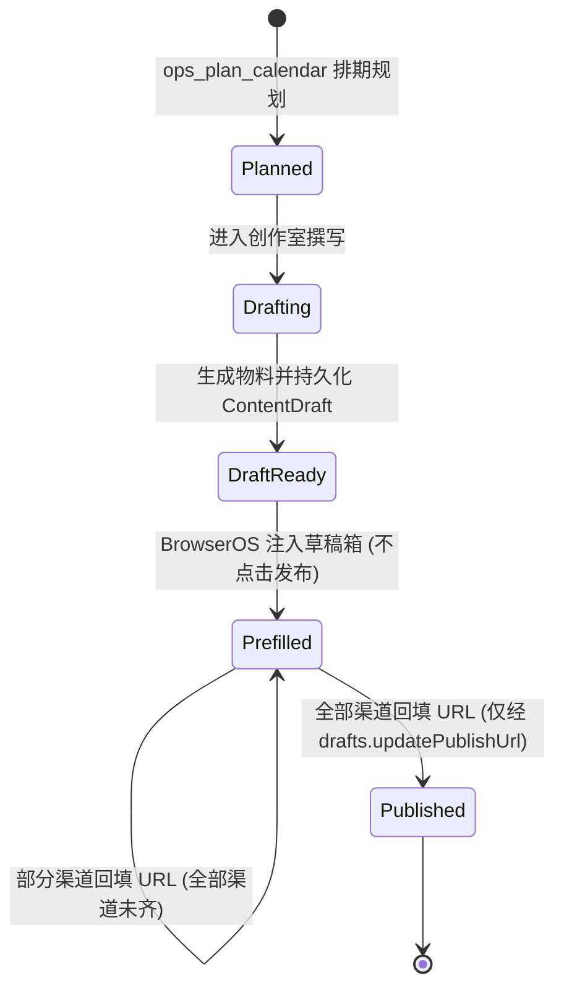

# 个人产品增长推广工坊（Growth Studio / dsh-growth-studio）技术架构设计说明书

> **文档元数据**
>
> | 属性 | 值 |
> | :--- | :--- |
> | **文档版本** | v1.2.0 |
> | **对应 PRD 基线** | `docs/product_requirements.md` **v1.1.0**（评审整改基线版 Approved Baseline） |
> | **状态** | 评审整改版 |
> | **初次编写** | 2026-10-13 |
> | **本次修订** | 2026-10-15（PRD ↔ TAD 双向追溯评审整改：生命周期裁决、发布 URL 守卫、排期/版本/指标/物料契约补齐、配置与工具治理契约、文档元数据） |
>
> **本次修订相对 v1.1.0 的关键决策**：
> 1. `ItemStatus` 收敛为 PRD §5.3.1 的**五态**，移除未经 PRD 授权的 `approved` / `archived`（详见 §4.1）。
> 2. `published` 状态**只能**在渠道全部回填发布 URL 后由回填操作推进，禁止经通用保存入口写入（详见 §3.2.3、§3.2.5）。
> 3. 产品切换的语义边界明确为**仅切换生成上下文**，不做数据隔离（详见 §3.10）。
>
> **范围声明**：本文档描述架构契约与已确认的阶段性设计，不等同于实现完成度。文中对具体模块的实现状态描述仅供参考，**实现核查须以源码与测试为准**（实现基线状态见 `docs/development_plan.md` §二）。

---

## 一、 系统架构全景

### 1.1 分层架构模型

`dsh-growth-studio` (Growth Studio) 采用基于 Cordis 的全插件式微内核分层架构，自顶向下由**客户端视图层**、**宿主 RPC 协议网关层**、**业务领域服务层**、**外部 MCP 驱动中台层**及**本地持久化基础设施**构成：

```mermaid
graph TD
    subgraph ClientLayer ["1. 客户端视图展示层 (DSH Desktop Client)"]
        Nav["Settings 导航注入 (Slots: settings.section)"]
        Icon["专属 Megaphone 矢量图标 (DOM 观察器)"]
        UI["Ops Workbench 响应式工作台 (React 18)"]
        Tabs["6 大业务 Tab: 驾驶舱 / 排期日历 / 创作室 / AI工具中枢 / 舆情复盘 / 引擎配置"]
        Simulators["多平台 Feed 模拟器 (微信公众号/视频元数据/推文串/PH)"]
        UI --> Tabs
        Tabs --> Simulators
    end

    subgraph RpcLayer ["2. 宿主 RPC 协议网关层 (DSH Connection RPC)"]
        RpcFetch["HTTP POST /api/ops 网关处理器"]
        RpcEnvelope["RPC 信封序列化器: server-response"]
        RpcRouter{"RPC 方法路由器"}
        RpcFetch --> RpcEnvelope --> RpcRouter
    end

    subgraph DomainLayer ["3. 业务领域服务层 (Domain Services)"]
        WorkbenchAggregator["工作台总览聚合器 (Overview Service) [Phase 0]"]
        DraftManager["本地草稿治理服务 (DraftStore Service) [Phase 0]"]
        SessionGuard["会话哨兵 (SessionGuard: BrowserOS 统一实例探测) [Phase 0]"]
        BrowserDriver["浏览器执行驱动 (BrowserDriver 任务编排) [Phase 0: 公号+B站]"]
        ToolHubManager["AI 工具治理与沙箱引擎 (ToolHubManager) [Phase 0]"]
        CalendarEngine["内容排期规划引擎 (Calendar Engine) [Phase 0: 单向导出]"]
        ContentStudioEngine["多端内容创作引擎 (Content Studio) [Phase 0]"]
        MetricsAggregator["跨平台指标聚合器 (MetricsCollector) [Phase 0: 区分曝光/播放]"]
        FeedbackIntelligence["舆情需求提炼智能 (Crawler & IssueExtractor) [Phase 1]"]
        SkillEngine["场景技能工坊引擎 (SkillEngine) [Phase 2]"]
        OverseasManager["出海增长与时区引擎 (OverseasStrategyManager) [Phase 2]"]
    end

    subgraph IntegrationLayer ["4. 外部 MCP 协议集成层"]
        InjoysClient["Injoys MCP 客户端代理 (JSON-RPC 2.0 / HTTP)"]
        KBAdapter["知识库接口 (knowledge.list / ingest)"]
        SheetAdapter["排期表接口 (spreadsheet.read / applyOperations)"]
        DocAdapter["文档接口 (document.create)"]
        BrowserOSClient["BrowserOS MCP 浏览器控制驱动 (CDP/Playwright)"]
    end

    subgraph InfraLayer ["5. 本地运行与持久化基础设施层"]
        ConfigStore["配置存储: $DSH_HOME/ops-manager/config.json"]
        DraftStore["本地草稿库: $DSH_HOME/growth-studio/drafts/"]
        BrowserOSProfile["BrowserOS 独立用户环境 Profile"]
    end

    UI -->|客户端 RPC 协议请求| RpcFetch
    RpcRouter --> WorkbenchAggregator
    RpcRouter --> DraftManager
    RpcRouter --> SessionGuard
    RpcRouter --> CalendarEngine
    RpcRouter --> ContentStudioEngine
    RpcRouter --> MetricsAggregator
    RpcRouter --> FeedbackIntelligence
    RpcRouter --> OverseasManager
    RpcRouter --> ConfigStore

    WorkbenchAggregator --> SessionGuard
    WorkbenchAggregator --> MetricsAggregator
    WorkbenchAggregator --> DraftManager
    CalendarEngine --> InjoysClient
    ContentStudioEngine --> DraftManager
    ContentStudioEngine --> InjoysClient
    MetricsAggregator --> BrowserDriver
    SessionGuard --> BrowserOSClient
    BrowserDriver --> BrowserOSClient
    DraftManager --> DraftStore

    InjoysClient --> KBAdapter
    InjoysClient --> SheetAdapter
    InjoysClient --> DocAdapter
```



---

## 二、 客户端与通信机制设计

### 2.1 DSH Desktop 插件容器加载机制

DSH Desktop 客户端通过 Cordis `slots` 注入扩展机制工作：
1. **打包规范**：客户端源码位于 `plugin-src/client/`，通过 `plugin-src/client/build.mjs` 中的 `esbuild` 编译，封装为：
   ```javascript
   window.__ModuleLoader__.load(
     '@deepseek-ai/dsh-ops-manager/client',
     ['@deepseek-ai/dsh-core/client'],
     function(core) { ... }
   );
   ```
2. **槽位挂载**：在 `settings.section` 槽位注入 `id: 'ops'`，`order: 60`（排布于 `Jet Hub` 之后），挂载 Ops Workbench。

### 2.2 宿主 RPC 通信机制与协议封装

客户端与后端服务通过标准 HTTP RPC 管道通信：
* **URL 路由**：`POST /api/ops`
* **协议信封格式**：
  ```typescript
  interface RpcEnvelopeRequest {
    method: string
    params?: Record<string, unknown>
  }

  interface RpcEnvelopeResponse<T = unknown> {
    ok: boolean
    result?: { value: T }
    error?: { code: string; message: string; details?: unknown }
  }
  ```

---

## 三、 宿主 RPC 接口定义 (RPC API Reference)

### 3.1 `workbench.overview`（工作台总览聚合接口） `[Phase 0 首版]`

* **请求参数**：
  ```typescript
  interface WorkbenchOverviewRequest {
    /** 指标统计窗口，默认 '7d'。决定采集口径与环比基准（见下方「指标口径」） */
    metricsWindow?: '7d' | '30d'
  }
  ```
* **响应数据结构 (`result.value`)**：
  ```typescript
  interface WorkbenchOverviewResponse {
    productName: string
    /**
     * 指标口径（本区块为权威定义，解决「采集时刻 ≠ 指标所属周期」的歧义）：
     * - 窗口：metricsWindow 指定的时间跨度，统计**该窗口内新增**的曝光/播放/互动（增量口径，非历史总量）；
     * - 采集时刻：capturedAt 表示数据**抓取时间**，与窗口是两个独立概念，不得互相替代；
     * - 缺失语义：任一平台采集失败或平台不支持该指标时，该平台贡献为「未知」；
     *   汇总值只在**全部应采平台均成功**时才给出数字，否则为 null（详见「部分缺失汇总规则」）。
     */
    overviewMetrics: {
      totalImpressions: number | null  // 全网图文/推文曝光阅读 (无法获取为 null)
      totalPlays: number | null        // 全网视频播放量 (无法获取为 null)
      totalLikes: number | null        // 全网点赞数
      totalComments: number | null     // 全网评论数
      totalShares: number | null       // 全网分享/转发数
      totalFavorites: number | null    // 全网收藏数 (PRD §5.1.2「互动与线索转化」含收藏)
      totalFollowersDelta: number | null // 净增关注数
      /** 互动汇总 = 点赞 + 评论 + 转发 + 收藏（任一为 null 则整体为 null） */
      totalEngagements: number | null
      scheduledCount: number           // 待发流水数
      /**
       * 本周排期进度（PRD §5.1.2 的「6 / 7 篇」口径）。
       * 统计范围：本周（自然周，周一起算）的全部排期项，按 ItemStatus 分组计数。
       * 分母是本周排期项总数，分子是已完成数（prefilled + published）。
       */
      weeklyPipeline: {
        total: number                  // 本周排期项总数
        completed: number              // prefilled + published
        byStatus: Record<ItemStatus, number>  // 各状态计数，便于 UI 展示「3 篇已预填，1 篇待发」
      }
      readyChannelsCount: number       // 已认证就绪平台数 (state === 'authenticated')
      totalChannelsCount: number       // 当前阶段支持平台数 (Phase 0 为 2)
      /** 本窗口内成功采集到指标的平台（用于判断汇总覆盖范围） */
      measuredPlatforms: PlatformId[]
      /** 本窗口内采集失败 / 不支持的平台，其贡献未计入汇总 */
      unmeasuredPlatforms: PlatformId[]
      metricsAnnotation: string        // "全网非去重曝光与播放累计人次"
      /**
       * 环比走势（PRD §5.1.2 要求指标卡配备「副标题 + 环比走势 + 轻量化渐变进度条」）。
       * 每项为相对上一对比周期的变化率（百分比，正数=上涨，负数=下跌）。
       * 与指标本身一致遵循可空语义：无可比历史数据时必须为 null，不得用 0 冒充「无变化」。
       */
      comparison: {
        period: '7d' | '30d' | null       // 对比周期基准；无历史数据时为 null
        impressionsDeltaPercent: number | null
        playsDeltaPercent: number | null
        engagementsDeltaPercent: number | null  // 点赞+评论+转发+收藏 汇总环比
        followersDeltaPercent: number | null
      }
    }
    statuses: Array<{
      id: PlatformId
      name: string
      kind: 'article' | 'video' | 'post'
      draftEditorUrl: string
      state: SessionState              // 'unknown' | 'needs_login' | 'authenticated' | 'no_publish_permission'
      isReady: boolean                 // 辅助计算字段: state === 'authenticated'
      accountName?: string
      scanRequired: boolean
      message: string
      lastCheckedAt: string
    }>
    trends: Array<{
      keyword: string
      platform: PlatformId | 'general'
      heatScore: number
      sampleTopic: string
      relevanceToProduct: string
    }>
    calendarItems: CalendarItem[]
    feedbackItems: UserFeedbackItem[]
    injoysConnected: boolean
  }
  ```

**部分缺失汇总规则（服务端强制口径）**：

> 核心原则：**绝不用不完整的数据冒充全网总量**（PRD §5.1.2「不粗暴按 0 计算」的延伸）。

1. 设应采平台集合为 `P`（`totalChannelsCount` 对应的平台），成功采集集合为 `measuredPlatforms`。
2. **`measuredPlatforms == P`**：汇总值为各平台之和，正常给出数字。
3. **`measuredPlatforms ⊂ P`（部分缺失）**：汇总值为 **`null`**，不得只汇总已成功平台后当成全网总量。
   同时必须填充 `measuredPlatforms` / `unmeasuredPlatforms`，供 UI 明确标注覆盖范围。
4. **零值 vs 缺失**：平台真实返回 0 时，作为**有效值 0** 计入求和（`0` 与 `null` 语义严格区分）；
   只有「采集失败 / 平台不支持」才是 `null`。
5. **互动汇总**：`totalEngagements` 在点赞、评论、转发、收藏四项中任一为 `null` 时为 `null`。

**环比基准来源（已明确）**：

* 基准取自本地**历史指标快照**：每次 `ops_fetch_metrics` / `workbench.overview` 采集成功后，
  将 `PlatformMetrics` 按 `(platform, capturedAt)` 追加写入本地指标历史
  `$DSH_HOME/growth-studio/metrics/{YYYY-MM-DD}.json`。
* `comparison.period` 表示用于对比的**上一个等长窗口**（`7d` 对上一个 7 天，`30d` 同理）。
* 若历史快照不足以覆盖完整上一个窗口 → 对应 delta 为 **`null`**（UI 显示「暂无环比」），
  **不得**用不完整历史算出一个近似百分比。
* 因此环比是**基于本地留存的次级指标**，其可用性取决于用户已积累的历史采集次数；
  首次使用时全部 delta 为 `null` 属**预期行为**，不是缺陷。

---

### 3.2 `drafts.*`（本地草稿管理接口） `[Phase 0 首版]`

针对内容生成、本地持久化与版本流转，提供草稿存储完整 CRUD：

#### 3.2.1 `drafts.list`（获取本地草稿列表）
* **请求参数**：`{}`
* **响应数据**：
  ```typescript
  interface DraftsListResponse {
    drafts: ContentDraft[]
  }
  ```

#### 3.2.2 `drafts.get`（获取指定草稿详情）
* **请求参数**：`{ id: string }`
* **响应数据**：`{ draft: ContentDraft }`

#### 3.2.3 `drafts.save`（创建或更新草稿，版本自增）
* **请求参数**：
  ```typescript
  interface SaveDraftRequest {
    draft: {
      id?: string
      title: string
      topic: string
      targetAudience?: string
      channelVariants: Array<{
        platform: PlatformId
        kind: 'article' | 'video' | 'post'
        title: string
        body: string
        tags: string[]
        mediaPaths?: string[]
        coverPath?: string
        /** 平台分区（如 B站）；见 §3.5 */
        partition?: string
      }>
      status?: 'draft' | 'ready_for_review' | 'prefilled'
      // ⛔ 注意：本入口**不接受** 'published'。见下方「published 守卫」。
      injoysDocId?: string
    }
  }
  ```
* **响应数据**：`{ draft: ContentDraft }`
* **published 守卫（服务端强制）**：
  * `drafts.save` 传入 `status: 'published'` 时，服务端**必须拒绝**并返回
    `{ ok: false, error: { code: 'drafts/published-requires-url' } }`；
  * 唯一可写入 `published` 的入口是 `drafts.updatePublishUrl`（§3.2.5）；
  * 理由：`published` 代表「已在平台真实发布」，其**唯一可信证据**是用户回填的真实 URL。
    若允许通用保存入口直接写 `published`，则发布闭环（§5.2）可被绕过，状态会失去真实性；
  * 该守卫是**服务端**职责，不得仅依赖客户端不传该值。

#### 3.2.4 `drafts.delete`（删除草稿）
* **请求参数**：`{ id: string }`
* **响应数据**：`{ success: boolean }`
* **级联语义**：删除草稿时**同时删除**其版本快照（§4.4）；`success: true` 表示草稿与快照均已清除。

#### 3.2.5 `drafts.updatePublishUrl`（人工发布后回填 URL 闭环）

* **请求参数**：
  ```typescript
  interface UpdatePublishUrlRequest {
    draftId: string
    platform: PlatformId
    publishedUrl: string
  }
  ```
* **响应数据**：
  ```typescript
  interface UpdatePublishUrlResponse {
    draft: ContentDraft
    publishedChannels: number   // 已回填渠道数
    totalChannels: number       // 该草稿的渠道总数
    allPublished: boolean       // 是否已全部发布（status === 'published' 的判定依据）
  }
  ```
* **校验（服务端强制）**：
  * `publishedUrl` 必须为合法 `http(s)://` URL，否则返回
    `{ ok: false, error: { code: 'drafts/invalid-published-url' } }`；
  * `platform` 必须存在于该草稿的 `channelVariants` 中，否则返回
    `{ ok: false, error: { code: 'drafts/unknown-channel' } }`。
* **部分发布时整体状态规则（已裁决）**：
  回填是**按渠道**累加写入 `publishedUrls[platform]`，而 `ContentDraft.status` 是**整体**状态：
  1. 只有当草稿的**全部** `channelVariants` 渠道都已回填 URL 时，`status` 才推进为 `published`；
  2. 仅部分渠道回填时，`status` **保持 `prefilled`**，已发布渠道明细由 `publishedUrls` 键集合体现；
  3. **不引入** `partially_published` 中间态（避免状态枚举膨胀）；UI 用
     「已发布 1/2 渠道」这类由 `publishedChannels` / `totalChannels` 派生的文案展示；
  4. 判定依据恒为「`publishedUrls` 覆盖全部渠道」，**不依赖**调用顺序或次数；
  5. **状态优先级（对普通编辑入口同样生效）**：状态按下列顺序判定，前面的分支优先：
     ① 全部渠道有效回填 → `published`；
     ② 存在有效回填但未齐全（部分完成）→ **固定 `prefilled`**，普通保存**不得**将其降级为 `draft`
     （发布凭据仍在，若允许降级，UI 状态会与已存 URL 自相矛盾）；
     ③ 完全没有发布凭据 → 使用调用方请求的编辑态（`draft` / `ready_for_review` / `prefilled`）。
     若产品确需「重新编辑后降级」，**必须先定义发布证据的保留或失效规则**，再修改本条；
  6. 删除或替换渠道后，不再对应任何当前渠道的 URL 会被剪除（孤儿清理），
     因此移除渠道不会让草稿凭残留 URL 继续维持「已发布」假象。

#### 3.2.6 `drafts.listVersions`（草稿版本历史列表） `[Phase 0 首版]`

> 对应 PRD §5.4.1「支持草稿历史查看、手动编辑正文、标题/标签微调与多版本存盘」。
> `version` 自增**只表示当前版本号，不等于保存了历史内容**，因此需要独立的版本快照存储（见 §4.4）。

* **请求参数**：`{ id: string }`
* **响应数据**：
  ```typescript
  interface DraftVersionsResponse {
    versions: Array<{
      version: number
      title: string
      status: ContentDraft['status']
      savedAt: string
      wordCount: number        // 便于 UI 列表展示，无需读取全文
    }>
  }
  ```

#### 3.2.7 `drafts.getVersion`（读取指定历史版本全文）

* **请求参数**：`{ id: string; version: number }`
* **响应数据**：`{ draft: ContentDraft }`
* **错误**：版本不存在返回 `{ ok: false, error: { code: 'drafts/version-not-found' } }`

#### 3.2.8 `drafts.restoreVersion`（以历史版本为基础生成新版本）

* **请求参数**：`{ id: string; version: number }`
* **响应数据**：`{ draft: ContentDraft }`
* **语义**：**不做破坏性回滚**。恢复操作把目标版本内容作为基础，**追加为新版本**（`version` 继续自增），
  历史版本一律保留，因此恢复操作本身也可被再次恢复。

---

### 3.3 `workbench.generateCalendar`（排期生成与导出接口） `[Phase 0 首版]`

> **持久化职责**：生成的排期行落盘至 `$DSH_HOME/growth-studio/calendar/{id}.json`（与草稿库同级），
> 本地为**排期黄金主数据源**，Injoys Spreadsheet 是单向导出目标（见 §5.3）。
> `CalendarItem` 结构见 §4.1。

* **请求参数**：
  ```typescript
  interface GenerateCalendarRequest {
    period: 'week' | 'month'
    focusVersion?: string
    platforms?: PlatformId[]
    /**
     * 是否在生成后立即单向导出至 Injoys Spreadsheet。
     * 默认 false：PRD §5.1.2 的快速行动为「生成 7 天排期日历」，导出应为用户显式确认的动作。
     */
    exportToSheet?: boolean
  }
  ```
* **响应数据**：
  ```typescript
  interface GenerateCalendarResponse {
    period: string
    totalItems: number
    items: CalendarItem[]
    sheetExported: boolean   // 本次是否已单向导出至 Injoys Spreadsheet
    /** 导出失败时的原因（如 Injoys 未配置 / 网络错误）；未导出或成功时为 undefined */
    exportError?: string
  }
  ```

---

### 3.3.1 `calendar.list`（读取本地排期）

* **请求参数**：
  ```typescript
  interface CalendarListRequest {
    period?: 'week' | 'month' | 'all'   // 默认 'week'
    platform?: PlatformId               // 可选：按平台过滤
    status?: ItemStatus                 // 可选：按状态过滤
  }
  ```
* **响应数据**：`{ items: CalendarItem[] }`（按 `date` 升序）

---

### 3.3.2 `calendar.updateStatus`（人工推进排期项状态）

* **请求参数**：
  ```typescript
  interface CalendarUpdateStatusRequest {
    itemId: string
    status: ItemStatus
  }
  ```
* **响应数据**：`{ item: CalendarItem }`
* **约束（服务端强制校验）**：
  * 只允许 PRD §5.3.1 的**前向**推进（`planned` → `drafting` → `draft_ready` → `prefilled` → `published`），禁止回退；
  * **`published` 不可经本接口写入**，只能由 `drafts.updatePublishUrl` 的回填闭环推进（见 §3.2.5）；
  * 越级或非法流转返回 `{ ok: false, error: { code: 'calendar/invalid-transition' } }`。

---

### 3.3.3 `workbench.exportCalendar`（导出至 Injoys 表格）

* **请求参数**：
  ```typescript
  interface ExportCalendarRequest {
    period: 'week' | 'month'
    /** 指定则导出这些项，缺省导出该周期全部 */
    itemIds?: string[]
  }
  ```
* **响应数据**：`{ exportedCount: number; skippedCount: number; sheetExported: boolean }`
* **幂等规则**：以 `CalendarItem.externalRowId` 为准做**更新而非重复插入**；导出成功后在本地回写 `externalRowId`，
  因此重复导出同一周期为幂等操作，不产生重复行。

---

### 3.3.4 `workbench.importCalendar`（从 Injoys 表格导入已有排期）

* **请求参数**：
  ```typescript
  interface ImportCalendarRequest {
    /** 单向读取 Injoys Spreadsheet 的排期行（InjoysClient → spreadsheet.read） */
    period?: 'week' | 'month' | 'all'   // 默认 'all'
  }
  ```
* **响应数据**：
  ```typescript
  interface ImportCalendarResponse {
    importedCount: number   // 新增的排期项数
    updatedCount: number    // 依据 externalRowId 匹配并更新的项数
    skippedCount: number    // 因与本地冲突而跳过的项数
    conflicts: Array<{ externalRowId: string; reason: string }>
  }
  ```
* **冲突与重复导入规则（明确定义）**：
  1. 远端行携带 `externalRowId` 且本地已存在同 ID → **更新**该本地项（`updatedCount`），**不新增行**；
  2. 远端行无 `externalRowId` → 按 `(date, platform, topic)` 三元组匹配；
     命中则更新，未命中则新增并补写 `externalRowId`；
  3. 远端行与本地项在 `date`/`platform` 上冲突但 `topic` 不同 → 视为**不同排期项**，新增并记入 `conflicts` 供用户核对；
  4. 导入**不覆盖**本地已 `prefilled` / `published` 的项的状态与 `publishedUrl`（本地状态优先，避免抹掉真实发布结果）；
  5. 导入过程失败时**不回滚已成功项**，如实返回已导入计数与错误，不谎报全量成功。

---

### 3.4 `workbench.generateArticleDraft`（图文内容生成与预览接口） `[Phase 0 首版]`

* **请求参数**：
  ```typescript
  interface GenerateArticleRequest {
    topic: string
    targetPlatform: 'wechat_mp' | 'product_hunt'
    tone?: 'technical' | 'viral' | 'concise'
  }
  ```
* **响应数据**：
  ```typescript
  interface GenerateArticleResponse {
    id: string
    title: string
    digest: string
    contentMarkdown: string
    wordCount: number
    draftSaved: boolean
    injoysDocId?: string
  }
  ```

---

### 3.5 `workbench.generateVideoMeta`（视频元数据生成接口） `[Phase 0 首版]`

* **请求参数**：
  ```typescript
  interface GenerateVideoMetaRequest {
    topic: string
    platform: 'bilibili' | 'douyin' | 'youtube' | 'wechat_channels'
    /** 本地成片路径；B站预填需实际上传，故生成时即可关联（PRD §5.4.1） */
    mediaPath?: string
    /** B站分区（如 '科技/数码'）。仅 bilibili 有效，用于预填映射；见下方「分区字段」 */
    partition?: string
  }
  ```
* **响应数据**：
  ```typescript
  interface GenerateVideoMetaResponse {
    /** 与图文生成对齐：返回已落盘草稿的身份，供 UI 定位与后续预填（PRD §5.4.1 自动存盘） */
    id: string
    draftSaved: boolean
    /** 三套候选爆款标题（PRD §5.4.2）。数量恒为 3，UI 依赖此固定数量，不得返回其他个数 */
    titleCandidates: Array<{
      title: string
      angle: string
      estimatedCtr: string
    }>
    description: string
    tags: string[]
    /** 分区：B站为实质字段，其他平台为 undefined */
    partition?: string
    coverPromptSuggestion: string
    injoysDocId?: string
  }
  ```
* **草稿关联规则**：视频生成与图文生成**行为一致** —— 响应必须返回 `id` 与 `draftSaved`，
  表明物料已自动落盘为 `ContentDraft`（`channelVariants[platform].kind === 'video'`）。
  未成功落盘时 `draftSaved: false`，且 `id` 仍返回（便于前端重试保存），**不得**谎报已保存。
* **分区字段映射**：`partition` 存入 `channelVariants[].partition`（§4.1），
  预填时由 `workbench.prefillDraft` 经 Adapter 映射到平台对应控件（B站投稿页分区选择）。
  平台不支持分区时该字段为 `undefined`，预填流程跳过该项而**不报错**。

---

### 3.5.1 `workbench.sinkToInjoysDoc`（主动沉淀物料至 Injoys 知识文档） `[Phase 0 首版]`

> 对应 PRD §5.4.3 的「💾 沉淀至 Injoys 知识文档」操作条。
> 该动作**独立于自动存盘**：自动存盘只写本地草稿库，本接口才写入 Injoys。
> 链路：宿主 → `InjoysClient` → `document.create`（架构图 §1.1 的 DocAdapter）。

* **请求参数**：
  ```typescript
  interface SinkToInjoysDocRequest {
    draftId: string
    /** 指定渠道则只沉淀该渠道变体；缺省沉淀全部渠道变体 */
    platform?: PlatformId
    /** 文档标题；缺省使用草稿标题 */
    title?: string
  }
  ```
* **响应数据**：
  ```typescript
  interface SinkToInjoysDocResponse {
    success: boolean
    injoysDocId?: string
    docUrl?: string
    message: string
  }
  ```
* **语义与约束**：
  * 成功后把 `injoysDocId` 回写至本地草稿（`ContentDraft.injoysDocId`）；
  * Injoys 未配置或调用失败时返回 `success: false` 与真实错误信息，
    **不得**谎报成功，也**不得**静默写本地假 ID；
  * 重复沉淀同一草稿为**幂等**：已存在 `injoysDocId` 时默认**更新**该文档而非新建，
    避免产生多份重复知识文档。

---

### 3.6 `workbench.prefillDraft`（调用 BrowserOS 执行预填） `[Phase 0: 公号+B站]`

* **请求参数**：
  ```typescript
  interface PrefillDraftRequest {
    draftId: string
    platform: PlatformId
  }
  ```
* **响应数据**：
  ```typescript
  interface PrefillDraftResponse {
    success: boolean
    platform: PlatformId
    draftId: string
    draftUrl: string           // 平台后台草稿直达链接
    message: string            // "已成功预填至草稿箱，请核对预览"
    requiresUserAction?: boolean
  }
  ```

---

### 3.7 `browser.sessions`（BrowserOS 统一实例会话诊断接口） `[Phase 0 首版]`

* **请求参数**：`{}`
* **响应数据**：
  ```typescript
  interface BrowserSessionsResponse {
    statuses: Array<{
      platform: PlatformId
      state: SessionState      // 'unknown' | 'needs_login' | 'authenticated' | 'no_publish_permission'
      isReady: boolean
      accountName?: string
      lastCheckedAt: string
      message: string
    }>
  }
  ```

---

### 3.8 浏览器交互式登录端点 `[Phase 2 愿景 / 需 PoC 验证]`

> 注：以下接口为 Phase 2 计划中的前台交互窗与二维码推流设计，需依赖 BrowserOS CDP 高级 API 验证。Phase 0 阶段工作台采用引导用户在当前 BrowserOS 实例中直接扫码登录。

* `browser.login.startQr`（启动扫码登录并提取二维码 Base64）
* `browser.login.pollQr`（轮询扫码状态）
* `browser.login.openHeadful`（拉起 BrowserOS 可视前台认证窗）
* `browser.login.cancel`（取消登录会话）

---

### 3.9 AI 工具中枢与沙箱 RPC 端点 `[Phase 0 首版]`

> 工具治理的最小可实施契约。核心原则：**沙箱执行必须与服务端白名单同源校验**，
> 前端传入的工具名一律不可信。

```typescript
/** 工具描述（catalog 返回项） */
interface OpsToolDescriptor {
  name: string                 // 如 'ops_draft_article'
  description: string
  category: 'planning' | 'creative' | 'publishing' | 'analytics' | 'system'
  /** 驱动类型：原生 / Injoys MCP / BrowserOS MCP */
  driver: 'native' | 'injoys' | 'browseros'
  /** 入参 JSON Schema，供沙箱渲染表单 */
  paramsSchema: Record<string, unknown>
  enabled: boolean             // 当前白名单开关状态
  /** 是否属于危险动作（如任何发布类）；Phase 0 恒为 false，因发布工具已移除 */
  dangerous: boolean
}
```

* **`tools.catalog`** → `{ tools: OpsToolDescriptor[] }`
* **`tools.toggle`**（`{ name: string; enabled: boolean }`）→ `{ tool: OpsToolDescriptor }`
  * 启停状态**持久化**到本地配置，重启后保持；
* **`tools.executeSandbox`**（`{ name: string; params: Record<string, unknown>; dryRun?: boolean }`）
  → `{ ok: boolean; result?: unknown; error?: { code: string; message: string }; durationMs: number; logs?: string[] }`
  * **白名单强制校验在宿主侧**：`enabled === false` 的工具必须拒绝执行并返回
    `{ ok: false, error: { code: 'tools/disabled' } }`，**不得**依赖前端隐藏按钮；
  * `ops_publish_now` 等发布类工具**不存在于 catalog**，因此无法构造调用；
  * 失败必须返回真实错误与 `durationMs`，**不得**以成功形状返回失败结果；
* **`tools.telemetry`**（`{ limit?: number }`）
  → `{ entries: Array<{ toolName: string; startedAt: string; durationMs: number; ok: boolean; errorCode?: string }> }`
  * 遥测记录用于性能审计；**必须脱敏**（不得记录令牌、Cookie 或完整正文）。

* *(注：正式发布工具 ops_publish_now 彻底移除，杜绝误触发)*

---

---

### 3.10 基础配置接口 `[Phase 0 首版]`

#### 3.10.1 配置结构契约

```typescript
interface OpsConfig {
  /** 默认产品名：决定 Injoys 知识库检索范围与生成上下文的产品身份（见 3.10.3 产品切换语义） */
  defaultProduct: string
  /** 生成基调（PRD §5.7「调性基调」） */
  tone: 'technical' | 'viral' | 'concise'
  /** Injoys MCP 接入配置 */
  injoys: {
    endpoint: string
    /** 访问令牌。⛔ 无内置默认值；仅来自用户配置或 INJOYS_MCP_TOKEN 环境变量 */
    token: string
  }
  /** 本地草稿存储目录（PRD §5.7）。缺省 $DSH_HOME/growth-studio/drafts/ */
  draftsDir: string
  /** 是否复用宿主浏览器 Profile 进行会话探测 */
  reuseHostBrowserProfile: boolean
  /** 是否自动将排期与复盘同步至 Injoys */
  autoSyncToInjoys: boolean
}
```

#### 3.10.2 方法契约

> **契约形态说明（重要）**：本节各方法标注**当前形态**与待实现字段，避免把设计意图误当作已实现接口。
> 契约的权威定义在 `src/ops-rpc.ts` + `src/types.ts`（criterion §7.1，手写 TS 契约）。

* `config.get` → **当前形态**：配置字段**平铺**在 `result.value` 上，并附环境变量回退标记：

  ```typescript
  // 当前实现（客户端按此消费，不得擅自改为嵌套结构）
  interface ConfigGetValue extends OpsConfig {
    hasEnvEndpoint: boolean
    hasEnvToken: boolean
  }
  ```

  * 早期草案曾写作 `{ config: OpsConfig; ... }` 的嵌套形态，**从未实现**；因其会破坏既有客户端读取，
    现统一以平铺为正式契约。若未来要改为嵌套，属于**破坏性变更**，须走版本化迁移方案（新旧字段并存至少一个版本）
    并同步更新客户端后，方可移除旧字段。
  * **令牌返回策略**：当前返回明文 `token`，用于客户端表单回填与显隐切换。
    该接口仅在**宿主内 RPC**（本机进程内）暴露，不作为对外网络端点。若未来 RPC 可被非本机访问，
    必须先改为「只回 `hasToken: boolean`，明文另走回填专用通道」。
* `config.save`（参数为 `Partial<OpsConfig>`）→ `{ success: boolean; config: OpsConfig }`
  * 持久化后**实时热更新**运行中的 `InjoysClient`（`endpoint` / `token`），无需重启；
  * 保存 `injoys` 配置后须清理按目标隔离的缓存，避免跨服务状态污染；
  * 修改 `draftsDir` 后**立即生效**，无需重启（见 §3.10.4）。
* `injoys.test` → `{ connected: boolean; latencyMs: number; message: string }`
  * 执行 `knowledge.list` 探活并返回延迟与文档数；
  * **未配置令牌**时不得发出请求并谎报「认证失败」，须返回明确的「尚未配置令牌」提示。

> **既有方法的待实现/差异清单**（不属于 §3 新增接口的范围，须按 criterion §6–§7 先落 TS 契约再实现）：
> `config.get` 已按上表对齐（含 `tone` / `draftsDir`）；`workbench.generateVideoMeta` 已补齐
> `id` / `draftSaved` / `partition`；`tools.*`、`calendar.*`、`drafts.*Versions`、`workbench.sinkToInjoysDoc`
> 等仍为**未实现**（仅在本文档定义）。

#### 3.10.3 产品切换语义（已裁决）

> PRD §5.1.1「显示当前正在运营的个人产品名，支持快速切换」。

**裁决结果：产品切换仅切换「生成上下文」，不做数据隔离。** 具体边界如下：

| 维度 | 是否随产品切换 | 说明 |
| :--- | :---: | :--- |
| Injoys 知识库检索范围 | ✅ 切换 | 按 `defaultProduct` 检索对应产品的卖点/调性/Changelog |
| AI 生成上下文与默认产品名 | ✅ 切换 | 生成物料的身份与口吻随之变化 |
| 指标（`PlatformMetrics`） | ❌ 不切换 | 指标属于**平台账号**而非产品，全局共享 |
| 排期（`CalendarItem`） | ❌ 不切换 | 与草稿同为全局工作区，不做按产品分区 |
| 草稿库（`ContentDraft`） | ❌ 不切换 | 同上；草稿已通过 `topic`/`title` 表达其所属产品 |
| 会话状态（`SessionState`） | ❌ 不切换 | 会话属于 BrowserOS 实例与平台账号，与产品无关 |

* 因此 `ContentDraft` / `CalendarItem` **不新增 `productId` 字段**，不引入多租户隔离；
* 理由：本项目定位为**个人开发者多产品推广**的轻量场景，产品切换的核心痛点是
  「生成时用错产品的卖点与口吻」，而非数据越权隔离。引入强制隔离会显著增加目录与同步复杂度而无对应收益。
* **若未来需要数据隔离**，须先在 PRD 定义多产品数据模型与切换后的数据可见性规则，再扩展本表与实体。

#### 3.10.4 `draftsDir` 变更语义

* `config.save` 修改 `draftsDir` 后**立即生效**，新建/读取草稿均使用新目录；
* **保存前必须准备并校验目标目录**：`config.save` 需先创建/验证新目录，失败时**拒绝保存并返回
  `config/invalid-drafts-dir`**。不得先返回成功、再让后续 `drafts.save` 以 `ENOENT` 失败
  ——用户应在此刻得知目录不可用，而不是在下一次保存草稿时才发现；
* **目录必须在单次操作内固定**：一次草稿操作（加锁 → 读取 → 版本校验 → 临时文件 → rename）
  必须始终针对**同一个**目录。若中途发生配置切换，本次操作继续使用原目录，
  切换只对**新发起**的操作生效（否则会出现「从 A 库读取、写入 B 库」并覆盖 B 库同 ID 草稿）。
  写锁也按**绝对文件路径**而不是 ID 归属，使不同库中的同 ID 草稿互不阻塞、互不覆盖；
* **这是确定行为，不是异常**（已裁决）：在途操作写入原目录属于预期语义，
  **不引入** `dirChangedDuringSave` 之类的告警标记，也不在响应中把它当错误上报；
* **配置页切换提示文案**（实现时照此展示，须同时覆盖三件事实）：
  > 新目录对后续操作生效；正在进行的保存仍写入原目录。旧草稿不会自动迁移。
* **已存在于旧目录的草稿不做自动迁移**（避免大目录复制与部分失败风险）；
* **写入失败必须如实抛错**：目录不可写或创建失败返回 `drafts/storage-unavailable`，
  不得吞掉异常后谎报保存成功；
* 草稿库的「当前生效目录」由 `config.get` 返回，UI 据此展示实际存储位置，避免用户误判数据丢失。
* **未来可选增强（本轮不实现）**：若后续需要帮助用户定位某次保存**实际落到哪里**，
  优先在写入类响应中返回本次真实使用的 `storageDirectory`（字符串），而**不是**布尔标记 ——
  它同时覆盖「目录已切换」与「目录未变」两种情形，信息量更大且无需额外语义约定。
  该字段属于契约变更，须先更新本节与 `src/types.ts` 再实现，本轮不预先添加。

---

### 3.11 周期性巡检注册接口 `[Phase 0 首版]`

> 对应 PRD §5.5.1「系统与调度」中的 `ops_setup_schedule`：向 DSH 自动化任务中心注册定时巡检。

* **调用形态**：宿主内**工具调用**（`ops_setup_schedule`），非 `POST /api/ops` 的 RPC 方法 ——
  它需要 DSH 自动化任务系统的宿主能力，与工作台配置接口不属于同一调用面。
* **入参**：
  ```typescript
  interface SetupScheduleParams {
    actionType: 'weekly_review' | 'publish_calendar' | 'metrics_inspection'
    title?: string
    cronExpression?: string   // 缺省 '0 9 * * 1'（每周一 09:00）
    timeZone?: string         // 缺省 'Asia/Shanghai'
  }
  ```
* **行为**：在 DSH 自动化任务系统中注册周期性任务，到点唤醒会话执行对应巡检动作。
* **约束**：
  * 注册失败必须如实返回错误，**不得**谎报已注册；
  * 该能力与「Phase 0 禁止后台定时轮询」（§5.5）**不冲突**：前者是 DSH 宿主的任务调度（到点唤起会话），
    后者禁止的是工作台为刷新大盘而自建常驻连接或轮询。二者不可混为一谈；
  * 巡检任务自身的执行仍受「仅预填、不自动发布」铁律（§5.2）约束。

---

## 四、 核心技术与数据模型

### 4.1 核心数据模型契约 (Domain Entities)

```typescript
export type PlatformId =
  | 'wechat_mp'
  | 'wechat_channels'
  | 'bilibili'
  | 'douyin'
  | 'youtube'
  | 'twitter_x'
  | 'product_hunt'
  | 'tiktok'

export type ContentKind = 'article' | 'video' | 'post'

/**
 * 排期项（本地持久化单一排期行）。
 * 本地 `$DSH_HOME/growth-studio/calendar/{id}.json` 为排期黄金主数据源（见 §5.3）。
 * 与 ContentDraft 经 documentId 关联，状态映射见 §4.3。
 */
export interface CalendarItem {
  id: string                    // 唯一排期项标识
  date: string                  // 计划发布日期 YYYY-MM-DD
  platform: PlatformId
  kind: ContentKind
  topic: string                 // 选题 / 主题
  targetAudience?: string
  status: ItemStatus            // 五态，见 §4.1
  documentId?: string           // 关联的 ContentDraft.id（未开始撰写时为空）
  mediaPath?: string            // 本地视频 / 图片绝对路径
  draftUrl?: string             // 平台后台草稿直达链接（预填成功后写入）
  publishedUrl?: string         // 人工发布后回填的平台真实 URL
  /** 外部来源行标识：由 Injoys 表格导入的行携带，用于重复导入去重（见 §3.3） */
  externalRowId?: string
  createdAt: string
  updatedAt: string
}

/**
 * 排期项（CalendarItem）生命周期状态。
 *
 * 溯源说明（PRD ↔ TAD 一致性，2026-10-15 裁决）：
 * 本枚举与 PRD §5.3.1 的五个状态胶囊**严格一一对应**，不引入 PRD 未授权的额外状态。
 *
 * 裁决记录：早期版本曾包含 `approved`（工作台核验）与 `archived`（归档）两态。
 * 因 PRD 全文未定义「额外审核关口」与「归档」概念、两者均无触发条件与验收口径，
 * 且实现中从未被赋值，**已移除**，改为由技术手段覆盖其原有意图：
 * - 原 `approved` 的「人工核验」意图 → 由 §5.2 的 Human-in-the-Loop 铁律 + 发布 URL 回填守卫承担，
 *   不设独立状态（核验是动作，不是状态）；
 * - 原 `archived` 的「归档留存」意图 → 由发布后指标采集与 `drafts.delete` 承担（Phase 0 不做独立归档态）。
 * 若未来确需引入归档，须先在 PRD §5.3 定义触发条件、保留策略与 UI 展示，再同步本枚举与 §4.2 状态机。
 */
export type ItemStatus =
  | 'planned'        // 已纳入计划
  | 'drafting'       // 文案/脚本撰写中
  | 'draft_ready'    // 物料准备就绪
  | 'prefilled'      // 已推入平台草稿箱（等待人工发布）
  | 'published'      // 平台人工发布后回填 URL 确认（终态）

export type SessionState =
  | 'unknown'                 // 未知或探测中
  | 'needs_login'             // 明确未登录或会话已失效
  | 'authenticated'           // 具备有效发布/草稿权限
  | 'no_publish_permission'   // 账号已登录但无发布/创作者权限

/** 本地持久化草稿实体 ($DSH_HOME/growth-studio/drafts/{id}.json) */
export interface ContentDraft {
  id: string
  title: string
  topic: string
  targetAudience?: string
  channelVariants: Array<{
    platform: PlatformId
    kind: ContentKind
    title: string
    body: string
    tags: string[]
    mediaPaths?: string[]
    coverPath?: string
    /** 平台分区（如 B站 科技/数码）；不支持的平台为 undefined。见 §3.5 */
    partition?: string
  }>
  status: 'draft' | 'ready_for_review' | 'prefilled' | 'published'
  version: number
  injoysDocId?: string
  prefillResults?: Partial<Record<PlatformId, { draftId?: string; draftUrl?: string; prefilledAt: string }>>
  publishedUrls?: Partial<Record<PlatformId, string>>
  createdAt: string
  updatedAt: string
}

/** 跨平台真实指标实体 (可空语义) */
export interface PlatformMetrics {
  platform: PlatformId
  /** 数据抓取时刻（不等于指标所属周期；周期由 windowStart/windowEnd 表达） */
  capturedAt: string
  /** 本指标所属统计窗口（闭区间，ISO 8601）。口径见 §3.1「指标口径」 */
  windowStart: string
  windowEnd: string
  impressions: number | null   // 曝光/阅读人次 (图文主要指标)，窗口内增量
  plays: number | null         // 播放人次 (视频主要指标)，窗口内增量
  likes: number | null
  comments: number | null
  shares: number | null
  favorites?: number | null
  followerDelta?: number | null
  topPostTitle?: string
  views: number                // 兼容性字段: impressions ?? plays ?? 0（仅向后兼容，不得作为缺失指标的真实值）
}
```

### 4.2 内容生命周期状态机与数据流转

> **状态维度说明**：系统存在两套**不同**的状态枚举，二者不可互换，必须经 §4.3 的映射规则转换：
> - `ItemStatus`（排期项 `CalendarItem`，§4.1）：`planned` → `drafting` → `draft_ready` → `prefilled` → `published`
> - `ContentDraft.status`（草稿实体）：`draft` | `ready_for_review` | `prefilled` | `published`



* **核验不是状态**：`prefilled` → `published` 之间的「人工核验并发布」是**人工动作**（在平台后台完成），
  系统不为此设独立状态；系统可观测的唯一信号是用户回填的发布 URL。
* **终态**：`published` 为当前 Phase 0 的终态。归档不在 Phase 0 范围内，若引入须先更新 PRD（见 §4.1 裁决记录）。

### 4.3 排期项与草稿的关联与状态映射

`CalendarItem`（排期视角）与 `ContentDraft`（内容视角）通过 `documentId` 关联，状态按以下规则单向映射：

| CalendarItem.status | 触发来源 | 对应 ContentDraft.status |
| :--- | :--- | :--- |
| `planned` | 排期创建 | 无草稿（`documentId` 为空） |
| `drafting` | 用户在创作室开始撰写 | `draft` |
| `draft_ready` | 物料生成并落盘 | `ready_for_review` |
| `prefilled` | 至少一个渠道预填成功 | `prefilled` |
| `published` | 全部渠道回填发布 URL | `published` |

> ⚠️ `draft_ready` 与 `ready_for_review` 语义等价但**命名不同**，属于两套枚举的历史差异。
> 二者**不得**在代码或接口中直接互换赋值，必须经本表映射；新增状态时必须同时更新本表。

### 4.4 草稿版本快照存储设计 (Version Snapshot Storage)

对应 PRD §5.4.1「多版本存盘」与接口 §3.2.6–3.2.8。

**存储布局**（与 `{id}.json` 当前版本并列）：

```text
$DSH_HOME/growth-studio/drafts/
├── {id}.json                    # 当前版本（含 version 字段，读路径不变）
└── {id}.versions/
    ├── v1.json                  # 版本 1 的完整内容快照
    ├── v2.json                  # 版本 2 的完整内容快照
    └── ...
```

**设计要点**：

1. **写入时机**：`drafts.save` 每次成功写入新版本时，**同时**将该版本的完整 `ContentDraft` 写入
   `{id}.versions/v{version}.json`。当前版本文件与快照在同一串行写锁内完成，避免出现「版本号已增但快照缺失」。
2. **原子性**：快照同样采用「临时文件 + rename」写入（§3.5 约束），与当前版本文件保持一致的原子保证。
3. **保留策略**：Phase 0 **保留全部版本**（个人开发者场景单草稿版本量有限），不自动淘汰。
   若后续需要上限，应在关闭前先在 PRD 定义保留条数与用户可见的淘汰提示，再引入。
4. **读取路径**：`drafts.get` 语义不变（返回当前版本），历史读取走 `drafts.getVersion`，二者互不影响，
   因此本设计对既有接口**向后兼容**。
5. **删除语义**：`drafts.delete` 级联删除 `{id}.json` 与整个 `{id}.versions/` 目录。
6. **一致性校验**：`drafts.listVersions` 的版本号集合应等于 `v{n}.json` 文件集合；
   若发现当前版本号高于最大快照号（说明历史数据由旧版本代码写入），应**如实返回已有快照**
   并给出可用版本列表，不得伪造缺失版本。

> 注：`{id}.versions/` 为目录，不参与 `drafts.list` 的 `.json` 收集（`list` 只扫描目录下的文件，
> 实现时须避免把版本子目录误当作草稿项）。

---

## 五、 关键工程与技术实现方案

### 5.1 会话管理与统一 BrowserOS 实例方案 (Unified BrowserOS Session Model)

#### 5.1.1 架构取舍与原方案缺陷
原设计试图从日常 Chrome 的 SQLite 数据库（`~/.config/google-chrome/Default/Cookies`）探测 Cookie。但静态评审与源码分析揭示了三大根本问题：
1. **实例不一致**：日用 Chrome 与 BrowserOS MCP 是两个完全不同的浏览器环境与用户目录。在 Chrome 探测到 Cookie 根本不能保证 BrowserOS 执行预填时已登录，导致工作台呈现“就绪”假象。
2. **SQLite WAL 不完整**：直接复制 `Cookies` 主文件未同步拷贝 `Cookies-wal` 与 `Cookies-shm`，当 Chrome 处于活跃写状态时容易漏检最新 Cookie。
3. **隐私与安全**：拷贝并挂载整个 SQLite 库会使所有个人 Cookie 进入内存，与“仅存在性探测”的隐私承诺存在落差。

#### 5.1.2 统一实例方案 (Phase 0 基线)
在 Phase 0 中，**彻底收敛为统一的 BrowserOS 浏览器实例**：
1. **单一实例绑定**：登录态探测、草稿箱预填与大屏指标采集，统一由同一个 BrowserOS MCP 实例调度执行；
2. **轻量探测**：`SessionGuard` 通过 BrowserOS MCP 查询当前活跃 Tab 或后台导航至目标平台验签 URL（如微信后台与 B站创作平台），通过页面特征或网络响应判定会话状态；
3. **四态流转**：严格向前端返回 `unknown` / `needs_login` / `authenticated` / `no_publish_permission` 四态，杜绝假阳性。

---

### 5.2 草稿箱预填与 Human-in-the-Loop 发布闭环

#### 5.2.1 铁律：始终仅预填，严禁自动确认发布
为彻底消除 AI 幻觉引发的不可控群发风险：
1. **移除 `ops_publish_now`**：从所有工具白名单、RPC 端点和文档中彻底删除正式发布工具；
2. **预填止步于草稿**：
   * 微信公众号：将标题、作者、正文富文本填入草稿编辑器并点击平台原生的「保存为草稿」按键；
   * B站创作者中心：填入标题、简介、标签并保存草稿；
3. **人工确认与回填闭环**：
   * 预填完成后向工作台返回草稿直达链接；
   * 用户在浏览器中完成最终人工核验并点击发布；
   * 用户将正式发布后的 URL 回填至工作台，工作台将草稿状态变更为 `published` 并关联指标追踪。
4. **闭环的契约守卫（不可省略）**：铁律不能只写在文档里，必须由接口契约强制：
   * `published` **只能**经 `drafts.updatePublishUrl` 写入，`drafts.save` 传入该状态一律拒绝（§3.2.3）；
   * 回填 URL 必须为合法 `http(s)` 地址（§3.2.5），避免用空值或占位符「骗过」状态推进；
   * 多渠道草稿仅在**全部渠道**回填后才整体 `published`（§3.2.5），防止把部分发布当成全部完成；
   * 上述校验位于**宿主侧**，不依赖客户端自觉。

---

### 5.3 Injoys 资产协同与分阶段同步策略

1. **Phase 0 降级策略（本地主数据 + 单向导出）**：
   * 本地 `$DSH_HOME/growth-studio/` 充当排期与草稿的黄金主数据源（Single Source of Truth）；
   * 通过 `InjoysClient` 调用 `spreadsheet.applyOperations` 将排期单向写入 Injoys Spreadsheet；
   * 支持通过 `spreadsheet.read` 导入已存在的排期；
   * 不做复杂的实时双向冲突解决，避免数据覆盖。

2. **本地数据布局**（各实体的持久化位置，供实现对齐）：

   ```text
   $DSH_HOME/growth-studio/
   ├── drafts/
   │   ├── {draftId}.json              # ContentDraft 当前版本
   │   └── {draftId}.versions/         # 版本快照（§4.4）
   │       └── v{n}.json
   ├── calendar/
   │   └── {itemId}.json               # CalendarItem 排期项（§4.1）
   └── metrics/
       └── {YYYY-MM-DD}.json           # 指标历史快照，供环比计算（§3.1）
   ```

   > 配置另存于 `$DSH_HOME/ops-manager/config.json`（§3.10）。

3. **导入/导出的冲突与幂等规则**：见 §3.3.3（导出幂等）与 §3.3.4（导入去重与冲突处理）。

4. **Phase 3 双向同步演进**：
   * 引入行级 ID 映射表与更新时间戳版本；
   * 采用“最后修改者胜出 (LWW)”与冲突行拆分标记策略。

---

### 5.4 响应式设计系统与 DSH 视觉令牌对齐 (Design Tokens)

工作台样式深度适配 DSH 主题系统，避免硬编码色值：
* **背景层级**：`var(--dsw-alias-bg-layer-1)` (页面底色)、`var(--dsw-alias-bg-layer-2)` (卡片底色)、`var(--dsw-alias-bg-layer-3)` (输入框底色)；
* **边框层级**：`var(--dsw-alias-border-l1)`、`var(--dsw-alias-border-l2)`；
* **文字阶梯**：`var(--dsw-alias-label-primary)`、`var(--dsw-alias-label-secondary)`、`var(--dsw-alias-label-tertiary)`；
* **交互点缀色**：主操作蓝 `#1677ff`，安全绿 `#15803d`，告警橙 `#b45309`，活力紫 `#7c3aed`。
  > 上述四色为**交互点缀色**（按钮、状态强调、图标着色）的权威取值，PRD §六「视觉基调」与本表对齐。

---

### 5.5 数据刷新与状态同步策略 (Refresh Strategy)

对应 PRD §六「数据卡片支持即时刷新，无需强制重载页面」：

* **Phase 0 基线**：刷新由用户在卡片/驾驶舱上**手动触发**对应的 RPC 调用（如 `workbench.overview`、`browser.sessions`、`injoys.test`），前端仅做局部状态替换，不整页重载；
* **不引入持久连接**：Phase 0 不使用 WebSocket / SSE，也不做后台定时轮询，避免在宿主内进程引入常驻连接与额外资源占用；
* **单飞约束**：同一张卡片的并发刷新请求应做去重（in-flight 合并），避免用户连点导致会话探测与指标采集重复执行；
* **远期演进**：若后续确需准实时大盘，须先在架构文档中补充连接生命周期、断线重连与令牌校验方案，再行实施。

---

## 六、 安全与隐私考量 (Security & Governance)

1. **凭证隔离与数据安全**：
   * Injoys MCP 访问令牌在前端支持显隐切换，网络传输使用标准 Bearer 规范；
   * 本地草稿存储于用户目录 `$DSH_HOME/growth-studio/drafts/`，系统文件权限仅限当前操作系统用户。
2. **会话数据零外发**：
   * BrowserOS 会话在本地沙箱运行，不向任何第三方服务上报 Cookie 数据。
3. **分发防误触（Human Confirmation）**：
   * 自动发帖始终采取“预填至草稿箱（Draft Prefill）”策略，保留平台原生确认发布步骤，彻底杜绝误发布。
