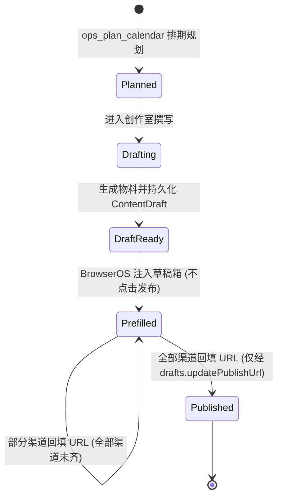

# 个人产品增长推广工坊（Growth Studio / dsh-growth-studio）技术架构设计说明书

> **文档元数据**
>
> | 属性 | 值 |
> | :--- | :--- |
> | **文档版本** | v1.4.5 |
> | **对应 PRD 基线** | `.context/domain/source/product_requirements.md` **v1.2.2**（MVP 简化裁决版 Approved Baseline） |
> | **状态** | 评审整改版 |
> | **初次编写** | 2026-10-13 |
> | **本次修订** | 2026-10-20（按已归档提案 `fix-config-save-error-swallow` 同步 §3.10.2/§3.10.4：配置文件失败如实上报、热更新先于写盘、非空字段一致与失败不回滚；此前 v1.4.5 修订记录见下） |
>
> **v1.4.5 的修订（2026-10-17，A1/A2/A3 源契约澄清）**：A1 排期库无乐观锁（`CalendarItem` 无 `version`）；A2 `browseros.capabilities` 只列实时暴露工具（删除 `available`/`unavailableReason`，消失的工具就消失）；A3 生成落盘失败（存储类）统一走 `drafts/storage-unavailable` 错误信封，`draftSaved:false` 仅表「已生成未落盘」、不包装存储错误。
>
> **v1.4.4 的修订（2026-10-17，U1/U2 契约补齐）**：§4.1 `PlatformId` 补 `xiaohongshu`（9 值，与 criterion §5.5 对齐）；§3.2.3 `SaveDraftRequest` 补可选 `expectedVersion?: number`（乐观锁，与 `ops/concurrency-conflict` 冲突响应一致）。
>
> **v1.4.3 的修订（2026-10-17，P2-5 映射表收口）**：§3.13 映射表将「领域服务/外部依赖/主数据位置」三列明确为**目标口径**，并在「当前实现差距」逐条写清现状（`ops_inspect_sessions` 未注册、`ops_draft_article`/`ops_draft_launch_kit` 存在未授权 Injoys 写入、`ops_discover_trends` 用本地模板未接真实搜索、`ops_generate_review` 假编号回退等）；同步 §3.1 指标卡注释由「互动与线索转化」改为「互动与关注增长」。
>
> **v1.4.2 的修订（2026-10-17，P2 语义澄清收口）**：P2-2 删除状态灯「工作目录」要求；P2-6 指标卡改「互动与关注增长」（不新增 leads）；P2-3 明确「复用当前连接实例、Profile 由 BrowserOS/宿主管理」，`reuseHostBrowserProfile` 标记待废弃并登记实现偏差（§5.1.3，需后续提案移除 Cookie 探测分支）；P2-5 新增 §3.13 `ops_*` ↔ RPC 映射表，并明确「外部依赖 ≠ 主数据位置 ≠ 自动写入授权」。
>
> **v1.4.1 的修订（2026-10-17，PRD↔TAD 双向追溯核对）**：补齐契约缺口——`injoys.test` 增 `documentCount`（§3.10.2）、新增 `browseros.capabilities` 能力清单读接口（§3.12.3）、`overview.statuses` 与 `browser.sessions.statuses` 增 `loginUrl`（§3.1/§3.7）、补 `UserFeedbackItem` 实体（§4.1）、标注接口枚举先定义按阶段开放（§3.4/§3.5）、标注「一键复制物料」为客户端本地操作（§3.5.1）。以上均为文档契约修订，实现状态见 §3.10.2「待实现/差异清单」，不宣称已实现。
>
> **v1.4.0 的 MVP 裁决（2026-10-16，用户已确认）**：新增「BrowserOS 浏览器引擎 → 能力管理」——将固定四动作限制调整为「复用现有 BrowserOS 工具清单、默认启用八项、全部实际能力可开关、宿主统一检查」。详见 §3.12 与 §6。本文本次只同步文档，不声明实现已对齐。
>
> **v1.3.0 的 MVP 裁决（2026-10-16，用户已确认）**：生成只保存本地；生成物料写入 Injoys 必须由用户明确触发。MVP 只保留当前草稿，不提供历史查看、恢复与版本快照；`version` / `expectedVersion` 保留用于并发控制。本文本次只同步文档，不声明实现已对齐。
>
> **v1.2.0 相对 v1.1.0 的既有关键决策**：
> 1. `ItemStatus` 收敛为 PRD §5.3.1 的**五态**，移除未经 PRD 授权的 `approved` / `archived`（详见 §4.1）。
> 2. `published` 状态**只能**在渠道全部回填发布 URL 后由回填操作推进，禁止经通用保存入口写入（详见 §3.2.3、§3.2.5）。
> 3. 产品切换的语义边界明确为**仅切换生成上下文**，不做数据隔离（详见 §3.10）。
>
> **范围声明**：本文档描述架构契约与已确认的阶段性设计，不等同于实现完成度。文中对具体模块的实现状态描述仅供参考，**实现核查须以源码与测试为准**（实现基线状态见 `.context/domain/source/development_plan.md` §二）。

---

## 一、 系统架构全景

### 1.1 分层架构模型

`dsh-growth-studio` (Growth Studio) 采用基于 Cordis 的全插件式微内核分层架构，自顶向下由**客户端视图层**、**宿主 RPC 协议网关层**、**业务领域服务层**、**外部 MCP 驱动中台层**及**本地持久化基础设施**构成：

```mermaid
graph TD
    subgraph ClientLayer ["1. 客户端视图展示层 (DSH Desktop Client)"]
        Nav["Settings 导航注入 (Slots: settings.section)"]
        Icon["专属 Megaphone 矢量图标 (DOM 观察器)"]
        UI["Ops Workbench 响应式工作台 (React 18)"]
        Tabs["6 大业务 Tab: 驾驶舱 / 排期日历 / 创作室 / AI工具中枢 / 舆情复盘 / 引擎配置"]
        Simulators["多平台 Feed 模拟器 (微信公众号/视频元数据/推文串/PH)"]
        UI --> Tabs
        Tabs --> Simulators
    end

    subgraph RpcLayer ["2. 宿主 RPC 协议网关层 (DSH Connection RPC)"]
        RpcFetch["HTTP POST /api/ops 网关处理器"]
        RpcEnvelope["RPC 信封序列化器: server-response"]
        RpcRouter{"RPC 方法路由器"}
        RpcFetch --> RpcEnvelope --> RpcRouter
    end

    subgraph DomainLayer ["3. 业务领域服务层 (Domain Services)"]
        WorkbenchAggregator["工作台总览聚合器 (Overview Service) [Phase 0]"]
        DraftManager["本地草稿治理服务 (DraftStore Service) [Phase 0]"]
        SessionGuard["会话哨兵 (SessionGuard: BrowserOS 统一实例探测) [Phase 0]"]
        BrowserDriver["浏览器执行驱动 (BrowserDriver 任务编排) [Phase 0: 公号+B站]"]
        ToolHubManager["AI 工具治理与沙箱引擎 (ToolHubManager) [Phase 0]"]
        CalendarEngine["内容排期规划引擎 (Calendar Engine) [Phase 0: 单向导出]"]
        ContentStudioEngine["多端内容创作引擎 (Content Studio) [Phase 0]"]
        MetricsAggregator["跨平台指标聚合器 (MetricsCollector) [Phase 0: 区分曝光/播放]"]
        FeedbackIntelligence["舆情需求提炼智能 (Crawler & IssueExtractor) [Phase 1]"]
        SkillEngine["场景技能工坊引擎 (SkillEngine) [Phase 2]"]
        OverseasManager["出海增长与时区引擎 (OverseasStrategyManager) [Phase 2]"]
    end

    subgraph IntegrationLayer ["4. 外部 MCP 协议集成层"]
        InjoysClient["Injoys MCP 客户端代理 (JSON-RPC 2.0 / HTTP)"]
        KBAdapter["知识库接口 (knowledge.list / ingest)"]
        SheetAdapter["排期表接口 (spreadsheet.read / applyOperations)"]
        DocAdapter["文档接口 (document.create)"]
        BrowserOSClient["BrowserOS MCP 浏览器控制驱动 (CDP/Playwright)"]
    end

    subgraph InfraLayer ["5. 本地运行与持久化基础设施层"]
        ConfigStore["配置存储: $DSH_HOME/ops-manager/config.json"]
        DraftStore["本地草稿库: $DSH_HOME/growth-studio/drafts/"]
        BrowserOSProfile["BrowserOS 独立用户环境 Profile"]
    end

    UI -->|客户端 RPC 协议请求| RpcFetch
    RpcRouter --> WorkbenchAggregator
    RpcRouter --> DraftManager
    RpcRouter --> SessionGuard
    RpcRouter --> CalendarEngine
    RpcRouter --> ContentStudioEngine
    RpcRouter --> MetricsAggregator
    RpcRouter --> FeedbackIntelligence
    RpcRouter --> OverseasManager
    RpcRouter --> ConfigStore

    WorkbenchAggregator --> SessionGuard
    WorkbenchAggregator --> MetricsAggregator
    WorkbenchAggregator --> DraftManager
    CalendarEngine --> InjoysClient
    ContentStudioEngine --> DraftManager
    ContentStudioEngine --> InjoysClient
    MetricsAggregator --> BrowserDriver
    SessionGuard --> BrowserOSClient
    BrowserDriver --> BrowserOSClient
    DraftManager --> DraftStore

    InjoysClient --> KBAdapter
    InjoysClient --> SheetAdapter
    InjoysClient --> DocAdapter
```



---

## 二、 客户端与通信机制设计

### 2.1 DSH Desktop 插件容器加载机制

DSH Desktop 客户端通过 Cordis `slots` 注入扩展机制工作：
1. **打包规范**：客户端源码位于 `plugin-src/client/`，通过 `plugin-src/client/build.mjs` 中的 `esbuild` 编译，封装为：
   ```javascript
   window.__ModuleLoader__.load(
     '@deepseek-ai/dsh-ops-manager/client',
     ['@deepseek-ai/dsh-core/client'],
     function(core) { ... }
   );
   ```
2. **槽位挂载**：在 `settings.section` 槽位注入 `id: 'ops'`，`order: 60`（排布于 `Jet Hub` 之后），挂载 Ops Workbench。

### 2.2 宿主 RPC 通信机制与协议封装

客户端与后端服务通过标准 HTTP RPC 管道通信：
* **URL 路由**：`POST /api/ops`
* **协议信封格式**：
  ```typescript
  interface RpcEnvelopeRequest {
    method: string
    params?: Record<string, unknown>
  }

  interface RpcEnvelopeResponse<T = unknown> {
    ok: boolean
    result?: { value: T }
    error?: { code: string; message: string; details?: unknown }
  }
  ```

---

## 三、 宿主 RPC 接口定义 (RPC API Reference)

### 3.1 `workbench.overview`（工作台总览聚合接口） `[Phase 0 首版]`

* **请求参数**：
  ```typescript
  interface WorkbenchOverviewRequest {
    /** 指标统计窗口，默认 '7d'。决定采集口径与环比基准（见下方「指标口径」） */
    metricsWindow?: '7d' | '30d'
  }
  ```
* **响应数据结构 (`result.value`)**：
  ```typescript
  interface WorkbenchOverviewResponse {
    productName: string
    /**
     * 指标口径（本区块为权威定义，解决「采集时刻 ≠ 指标所属周期」的歧义）：
     * - 窗口：metricsWindow 指定的时间跨度，统计**该窗口内新增**的曝光/播放/互动（增量口径，非历史总量）；
     * - 采集时刻：capturedAt 表示数据**抓取时间**，与窗口是两个独立概念，不得互相替代；
     * - 缺失语义：任一平台采集失败或平台不支持该指标时，该平台贡献为「未知」；
     *   汇总值只在**全部应采平台均成功**时才给出数字，否则为 null（详见「部分缺失汇总规则」）。
     */
    overviewMetrics: {
      totalImpressions: number | null  // 全网图文/推文曝光阅读 (无法获取为 null)
      totalPlays: number | null        // 全网视频播放量 (无法获取为 null)
      totalLikes: number | null        // 全网点赞数
      totalComments: number | null     // 全网评论数
      totalShares: number | null       // 全网分享/转发数
      totalFavorites: number | null    // 全网收藏数 (PRD §5.1.2「互动与关注增长」含收藏)
      totalFollowersDelta: number | null // 净增关注数
      /** 互动汇总 = 点赞 + 评论 + 转发 + 收藏（任一为 null 则整体为 null） */
      totalEngagements: number | null
      scheduledCount: number           // 待发流水数
      /**
       * 本周排期进度（PRD §5.1.2 的「6 / 7 篇」口径）。
       * 统计范围：本周（自然周，周一起算）的全部排期项，按 ItemStatus 分组计数。
       * 分母是本周排期项总数，分子是已完成数（prefilled + published）。
       */
      weeklyPipeline: {
        total: number                  // 本周排期项总数
        completed: number              // prefilled + published
        byStatus: Record<ItemStatus, number>  // 各状态计数，便于 UI 展示「3 篇已预填，1 篇待发」
      }
      readyChannelsCount: number       // 已认证就绪平台数 (state === 'authenticated')
      totalChannelsCount: number       // 当前阶段支持平台数 (Phase 0 为 2)
      /** 本窗口内成功采集到指标的平台（用于判断汇总覆盖范围） */
      measuredPlatforms: PlatformId[]
      /** 本窗口内采集失败 / 不支持的平台，其贡献未计入汇总 */
      unmeasuredPlatforms: PlatformId[]
      metricsAnnotation: string        // "全网非去重曝光与播放累计人次"
      /**
       * 环比走势（PRD §5.1.2 要求指标卡配备「副标题 + 环比走势 + 轻量化渐变进度条」）。
       * 每项为相对上一对比周期的变化率（百分比，正数=上涨，负数=下跌）。
       * 与指标本身一致遵循可空语义：无可比历史数据时必须为 null，不得用 0 冒充「无变化」。
       */
      comparison: {
        period: '7d' | '30d' | null       // 对比周期基准；无历史数据时为 null
        impressionsDeltaPercent: number | null
        playsDeltaPercent: number | null
        engagementsDeltaPercent: number | null  // 点赞+评论+转发+收藏 汇总环比
        followersDeltaPercent: number | null
      }
    }
    statuses: Array<{
      id: PlatformId
      name: string
      kind: 'article' | 'video' | 'post'
      draftEditorUrl: string
      loginUrl?: string               // 登录入口外链；needs_login 时供「去登录 ↗」（PRD §5.2.1 / §六.3）
      state: SessionState              // 'unknown' | 'needs_login' | 'authenticated' | 'no_publish_permission'
      isReady: boolean                 // 辅助计算字段: state === 'authenticated'
      accountName?: string
      scanRequired: boolean
      message: string
      lastCheckedAt: string
    }>
    trends: Array<{
      keyword: string
      platform: PlatformId | 'general'
      heatScore: number
      sampleTopic: string
      relevanceToProduct: string
    }>
    calendarItems: CalendarItem[]
    feedbackItems: UserFeedbackItem[]
    injoysConnected: boolean
  }
  ```

> **当前实现说明（`fix-overview-metrics-null-semantics` 已归档）**：上方响应形状已由 `src/types.ts` 的 `OverviewMetrics` / `MetricsComparison` / `WeeklyPipeline` 与宿主汇总实现承载。请求的 `metricsWindow` 贯穿调用；`windowStart` / `windowEnd` 为该请求的闭区间边界，不构成原始数值属于该周期的证明。
> `PlatformMetricsOutcome` 是基础 `PlatformMetrics` 之外的宿主采集结果扩展，使用 `source` / `windowScope` / `note` 标注来源与周期可证性。当前 `measuredPlatforms` 仅含应采集合 `P` 中 `source !== 'unmeasured'` 且 `windowScope === 'verified'` 的平台，`unmeasuredPlatforms = P - measuredPlatforms`；不是只凭抓取成功就计入。当前生产 `live` 页面数值属于累计/单日口径，标为 `unverified`，保留原始值但不进入窗口汇总；显式 `mock` 仅用于测试。
> `weeklyPipeline` 按既有 Injoys 返回列表的本周行派生，筛选后集合为空时返回全零，原始非空列表不能被无条件清空。当前代码以 UTC 推导周一起算的自然周；用户本地周边界的时区对齐尚未实现，此说明记录实现边界，不新增产品时区承诺。
> 当前尚无本地指标快照读写，`comparison` 五键均为 `null`；下方环比基准来源是 `feat-storage-metrics-snapshot` 待实现的目标契约。本地排期主数据、真实窗口化采集与驾驶舱 UI 均不由本提案新增。

**部分缺失汇总规则（服务端强制口径）**：

> 核心原则：**绝不用不完整的数据冒充全网总量**（PRD §5.1.2「不粗暴按 0 计算」的延伸）。

1. 设应采平台集合为 `P`（`totalChannelsCount` 对应的平台），成功采集集合为 `measuredPlatforms`。
2. **`measuredPlatforms == P`**：汇总值为各平台之和，正常给出数字。
3. **`measuredPlatforms ⊂ P`（部分缺失）**：汇总值为 **`null`**，不得只汇总已成功平台后当成全网总量。
   同时必须填充 `measuredPlatforms` / `unmeasuredPlatforms`，供 UI 明确标注覆盖范围。
4. **零值 vs 缺失**：平台真实返回 0 时，作为**有效值 0** 计入求和（`0` 与 `null` 语义严格区分）；
   只有「采集失败 / 平台不支持」才是 `null`。
5. **互动汇总**：`totalEngagements` 在点赞、评论、转发、收藏四项中任一为 `null` 时为 `null`。

**环比基准来源（已明确）**：

* 基准取自本地**历史指标快照**：每次 `ops_fetch_metrics` / `workbench.overview` 采集成功后，
  将 `PlatformMetrics` 按 `(platform, capturedAt)` 追加写入本地指标历史
  `$DSH_HOME/growth-studio/metrics/{YYYY-MM-DD}.json`。
* `comparison.period` 表示用于对比的**上一个等长窗口**（`7d` 对上一个 7 天，`30d` 同理）。
* 若历史快照不足以覆盖完整上一个窗口 → 对应 delta 为 **`null`**（UI 显示「暂无环比」），
  **不得**用不完整历史算出一个近似百分比。
* 因此环比是**基于本地留存的次级指标**，其可用性取决于用户已积累的历史采集次数；
  首次使用时全部 delta 为 `null` 属**预期行为**，不是缺陷。

---

### 3.2 `drafts.*`（本地草稿管理接口） `[Phase 0 首版]`

针对内容生成、本地持久化与版本流转，提供草稿存储完整 CRUD：

#### 3.2.1 `drafts.list`（获取本地草稿列表）
* **请求参数**：`{}`
* **响应数据**：
  ```typescript
  interface DraftsListResponse {
    drafts: ContentDraft[]
  }
  ```

#### 3.2.2 `drafts.get`（获取指定草稿详情）
* **请求参数**：`{ id: string }`
* **响应数据**：`{ draft: ContentDraft }`

#### 3.2.3 `drafts.save`（创建或更新草稿，版本自增）
* **请求参数**：
  ```typescript
  interface SaveDraftRequest {
    /** 乐观锁：期望的当前版本号，用于并发控制（criterion §3.5）。缺省时不校验；与当前版本不一致返回 ops/concurrency-conflict */
    expectedVersion?: number
    draft: {
      id?: string
      title: string
      topic: string
      targetAudience?: string
      channelVariants: Array<{
        platform: PlatformId
        kind: 'article' | 'video' | 'post'
        title: string
        body: string
        tags: string[]
        mediaPaths?: string[]
        coverPath?: string
        /** 平台分区（如 B站）；见 §3.5 */
        partition?: string
      }>
      status?: 'draft' | 'ready_for_review' | 'prefilled'
      // ⛔ 注意：本入口**不接受** 'published'。见下方「published 守卫」。
      injoysDocId?: string
    }
  }
  ```
* **响应数据**：`{ draft: ContentDraft }`
* **published 守卫（服务端强制）**：
  * `drafts.save` 传入 `status: 'published'` 时，服务端**必须拒绝**并返回
    `{ ok: false, error: { code: 'drafts/published-requires-url' } }`；
  * 唯一可写入 `published` 的入口是 `drafts.updatePublishUrl`（§3.2.5）；
  * 理由：`published` 代表「已在平台真实发布」，其**唯一可信证据**是用户回填的真实 URL。
    若允许通用保存入口直接写 `published`，则发布闭环（§5.2）可被绕过，状态会失去真实性；
  * 该守卫是**服务端**职责，不得仅依赖客户端不传该值。

#### 3.2.4 `drafts.delete`（删除草稿）
* **请求参数**：`{ id: string }`
* **响应数据**：`{ success: boolean }`
* **MVP 删除语义**：删除当前草稿 `{id}.json`；`success: true` 表示当前草稿已清除。MVP 不创建版本快照，也不承诺历史文件清理或远端文档联动删除（§4.4）。

#### 3.2.5 `drafts.updatePublishUrl`（人工发布后回填 URL 闭环）

* **请求参数**：
  ```typescript
  interface UpdatePublishUrlRequest {
    draftId: string
    platform: PlatformId
    publishedUrl: string
  }
  ```
* **响应数据**：
  ```typescript
  interface UpdatePublishUrlResponse {
    draft: ContentDraft
    publishedChannels: number   // 已回填渠道数
    totalChannels: number       // 该草稿的渠道总数
    allPublished: boolean       // 是否已全部发布（status === 'published' 的判定依据）
  }
  ```
* **校验（服务端强制）**：
  * `publishedUrl` 必须为合法 `http(s)://` URL，否则返回
    `{ ok: false, error: { code: 'drafts/invalid-published-url' } }`；
  * `platform` 必须存在于该草稿的 `channelVariants` 中，否则返回
    `{ ok: false, error: { code: 'drafts/unknown-channel' } }`。
* **部分发布时整体状态规则（已裁决）**：
  回填是**按渠道**累加写入 `publishedUrls[platform]`，而 `ContentDraft.status` 是**整体**状态：
  1. 只有当草稿的**全部** `channelVariants` 渠道都已回填 URL 时，`status` 才推进为 `published`；
  2. 仅部分渠道回填时，`status` **保持 `prefilled`**，已发布渠道明细由 `publishedUrls` 键集合体现；
  3. **不引入** `partially_published` 中间态（避免状态枚举膨胀）；UI 用
     「已发布 1/2 渠道」这类由 `publishedChannels` / `totalChannels` 派生的文案展示；
  4. 判定依据恒为「`publishedUrls` 覆盖全部渠道」，**不依赖**调用顺序或次数；
  5. **状态优先级（对普通编辑入口同样生效）**：状态按下列顺序判定，前面的分支优先：
     ① 全部渠道有效回填 → `published`；
     ② 存在有效回填但未齐全（部分完成）→ **固定 `prefilled`**，普通保存**不得**将其降级为 `draft`
     （发布凭据仍在，若允许降级，UI 状态会与已存 URL 自相矛盾）；
     ③ 完全没有发布凭据 → 使用调用方请求的编辑态（`draft` / `ready_for_review` / `prefilled`）。
     若产品确需「重新编辑后降级」，**必须先定义发布证据的保留或失效规则**，再修改本条；
  6. 删除或替换渠道后，不再对应任何当前渠道的 URL 会被剪除（孤儿清理），
     因此移除渠道不会让草稿凭残留 URL 继续维持「已发布」假象。

#### 3.2.6 草稿历史接口（MVP 不提供）

`drafts.listVersions`、`drafts.getVersion`、`drafts.restoreVersion` 不在 MVP（Phase 0）接口范围内，撤下原先的请求、响应和错误码设计，不作为待补齐的首版功能。
MVP 使用 `drafts.get` 读取当前内容、`drafts.save` 覆盖保存当前内容；`version` 自增与 `expectedVersion` 乐观锁仅用于防止并发覆盖。
历史查看、恢复与发布凭据恢复规则如需引入，须另行提案，不沿用旧的恢复契约。

---

### 3.3 `workbench.generateCalendar`（排期生成与导出接口） `[Phase 0 首版]`

> **持久化职责**：生成的排期行落盘至 `$DSH_HOME/growth-studio/calendar/{id}.json`（与草稿库同级），
> 本地为**排期黄金主数据源**，Injoys Spreadsheet 是单向导出目标（见 §5.3）。
> `CalendarItem` 结构见 §4.1。

* **请求参数**：
  ```typescript
  interface GenerateCalendarRequest {
    period: 'week' | 'month'
    focusVersion?: string
    platforms?: PlatformId[]
    /**
     * 是否在生成后立即单向导出至 Injoys Spreadsheet。
     * 默认 false：PRD §5.1.2 的快速行动为「生成 7 天排期日历」，导出应为用户显式确认的动作。
     */
    exportToSheet?: boolean
  }
  ```
* **响应数据**：
  ```typescript
  interface GenerateCalendarResponse {
    period: string
    totalItems: number
    items: CalendarItem[]
    sheetExported: boolean   // 本次是否已单向导出至 Injoys Spreadsheet
    /** 导出失败时的原因（如 Injoys 未配置 / 网络错误）；未导出或成功时为 undefined */
    exportError?: string
  }
  ```

---

### 3.3.1 `calendar.list`（读取本地排期）

* **请求参数**：
  ```typescript
  interface CalendarListRequest {
    period?: 'week' | 'month' | 'all'   // 默认 'week'
    platform?: PlatformId               // 可选：按平台过滤
    status?: ItemStatus                 // 可选：按状态过滤
  }
  ```
* **响应数据**：`{ items: CalendarItem[] }`（按 `date` 升序）

---

### 3.3.2 `calendar.updateStatus`（人工推进排期项状态）

* **请求参数**：
  ```typescript
  interface CalendarUpdateStatusRequest {
    itemId: string
    status: ItemStatus
  }
  ```
* **响应数据**：`{ item: CalendarItem }`
* **约束（服务端强制校验）**：
  * 只允许 PRD §5.3.1 的**前向**推进（`planned` → `drafting` → `draft_ready` → `prefilled` → `published`），禁止回退；
  * **`published` 不可经本接口写入**，只能由 `drafts.updatePublishUrl` 的回填闭环推进（见 §3.2.5）；
  * 越级或非法流转返回 `{ ok: false, error: { code: 'calendar/invalid-transition' } }`。

---

### 3.3.3 `workbench.exportCalendar`（导出至 Injoys 表格）

* **请求参数**：
  ```typescript
  interface ExportCalendarRequest {
    period: 'week' | 'month'
    /** 指定则导出这些项，缺省导出该周期全部 */
    itemIds?: string[]
  }
  ```
* **响应数据**：`{ exportedCount: number; skippedCount: number; sheetExported: boolean }`
* **幂等规则**：以 `CalendarItem.externalRowId` 为准做**更新而非重复插入**；导出成功后在本地回写 `externalRowId`，
  因此重复导出同一周期为幂等操作，不产生重复行。

---

### 3.3.4 `workbench.importCalendar`（从 Injoys 表格导入已有排期）

* **请求参数**：
  ```typescript
  interface ImportCalendarRequest {
    /** 单向读取 Injoys Spreadsheet 的排期行（InjoysClient → spreadsheet.read） */
    period?: 'week' | 'month' | 'all'   // 默认 'all'
  }
  ```
* **响应数据**：
  ```typescript
  interface ImportCalendarResponse {
    importedCount: number   // 新增的排期项数
    updatedCount: number    // 依据 externalRowId 匹配并更新的项数
    skippedCount: number    // 因与本地冲突而跳过的项数
    conflicts: Array<{ externalRowId: string; reason: string }>
  }
  ```
* **冲突与重复导入规则（明确定义）**：
  1. 远端行携带 `externalRowId` 且本地已存在同 ID → **更新**该本地项（`updatedCount`），**不新增行**；
  2. 远端行无 `externalRowId` → 按 `(date, platform, topic)` 三元组匹配；
     命中则更新，未命中则新增并补写 `externalRowId`；
  3. 远端行与本地项在 `date`/`platform` 上冲突但 `topic` 不同 → 视为**不同排期项**，新增并记入 `conflicts` 供用户核对；
  4. 导入**不覆盖**本地已 `prefilled` / `published` 的项的状态与 `publishedUrl`（本地状态优先，避免抹掉真实发布结果）；
  5. 导入过程失败时**不回滚已成功项**，如实返回已导入计数与错误，不谎报全量成功。

---

### 3.4 `workbench.generateArticleDraft`（图文内容生成与预览接口） `[Phase 0 首版]`

* **请求参数**：
  ```typescript
  interface GenerateArticleRequest {
    topic: string
    /** 目标平台。接口先定义全部平台枚举、能力按阶段开放；Phase 0 仅 wechat_mp 可执行预填（PRD §5.2.1 / §5.4.2）。 */
    targetPlatform: 'wechat_mp' | 'product_hunt'
    tone?: 'technical' | 'viral' | 'concise'
  }
  ```
* **响应数据**：
  ```typescript
  interface GenerateArticleResponse {
    id: string
    title: string
    digest: string
    contentMarkdown: string
    wordCount: number
    draftSaved: boolean
    injoysDocId?: string // 兼容可选字段；本地生成不创建远端文档，不因生成而填充
  }
  ```

* **写入边界**：只保存本地草稿，不调用 Injoys 文档写入；仅用户明确触发 §3.5.1 后才沉淀。
* **落盘失败语义（与 §3.5 视频生成一致）**：`draftSaved: true` 表示已成功落盘；`draftSaved: false` 表示**物料已生成但尚未落盘**（供前端重试），**不得**谎报已保存。存储类写盘失败须在**统一 RPC 错误边界**返回 `drafts/storage-unavailable`（§3.10.4 / §4.4），**不得**以 `{ ok:true, draftSaved:false }` 包装存储错误。

---

### 3.5 `workbench.generateVideoMeta`（视频元数据生成接口） `[Phase 0 首版]`

* **请求参数**：
  ```typescript
  interface GenerateVideoMetaRequest {
    topic: string
    /** 目标平台。接口先定义全部平台枚举、能力按阶段开放；Phase 0 仅 bilibili 可执行预填（PRD §5.2.1 / §5.4.2）。 */
    platform: 'bilibili' | 'douyin' | 'youtube' | 'wechat_channels'
    /** 本地成片路径；B站预填需实际上传，故生成时即可关联（PRD §5.4.1） */
    mediaPath?: string
    /** B站分区（如 '科技/数码'）。仅 bilibili 有效，用于预填映射；见下方「分区字段」 */
    partition?: string
  }
  ```
* **响应数据**：
  ```typescript
  interface GenerateVideoMetaResponse {
    /** 与图文生成对齐：返回已落盘草稿的身份，供 UI 定位与后续预填（PRD §5.4.1 自动存盘） */
    id: string
    draftSaved: boolean
    /** 三套候选爆款标题（PRD §5.4.2）。数量恒为 3，UI 依赖此固定数量，不得返回其他个数 */
    titleCandidates: Array<{
      title: string
      angle: string
      estimatedCtr: string
    }>
    description: string
    tags: string[]
    /** 分区：B站为实质字段，其他平台为 undefined */
    partition?: string
    coverPromptSuggestion: string
    injoysDocId?: string
  }
  ```
* **写入边界**：视频生成同样只保存本地；不得自动创建或更新 Injoys 文档。响应中的可选 `injoysDocId` 不构成自动沉淀授权。
* **草稿关联规则**：视频生成与图文生成**行为一致** —— 响应必须返回 `id` 与 `draftSaved`，
  表明物料已自动落盘为 `ContentDraft`（`channelVariants[platform].kind === 'video'`）。
  `draftSaved: true` 表示已成功落盘；`draftSaved: false` 表示**物料已生成但尚未落盘**（供前端据此重试保存），**不得**谎报已保存。
  ⛔ **落盘失败（存储类）不返回成功信封**：目录不可写 / 创建失败等写盘错误，须按 §3.10.4 / §4.4 在**统一 RPC 错误边界**返回 `drafts/storage-unavailable`，**不得**以 `{ ok:true, draftSaved:false }` 包装存储失败；`draftSaved:false` 仅表达「生成成功、落盘未执行或待重试」的语义，不与存储错误码混用。
* **分区字段映射**：`partition` 存入 `channelVariants[].partition`（§4.1），
  预填时由 `workbench.prefillDraft` 经 Adapter 映射到平台对应控件（B站投稿页分区选择）。
  平台不支持分区时该字段为 `undefined`，预填流程跳过该项而**不报错**。

---

### 3.5.1 `workbench.sinkToInjoysDoc`（主动沉淀物料至 Injoys 知识文档） `[Phase 0 首版]`

> 对应 PRD §5.4.3 的「💾 沉淀至 Injoys 知识文档」操作条。
> 该动作**独立于自动存盘**：自动存盘只写本地草稿库，本接口才写入 Injoys。
> **触发条件**：用户点击沉淀操作或明确要求写入 Injoys；生成、预览、本地保存以及自动同步配置均不能替代这次明确要求。读取产品知识库仍可用于生成。
> 链路：宿主 → `InjoysClient` → `document.create`（架构图 §1.1 的 DocAdapter）。

* **请求参数**：
  ```typescript
  interface SinkToInjoysDocRequest {
    draftId: string
    /** 指定渠道则只沉淀该渠道变体；缺省沉淀全部渠道变体 */
    platform?: PlatformId
    /** 文档标题；缺省使用草稿标题 */
    title?: string
  }
  ```
* **响应数据**：
  ```typescript
  interface SinkToInjoysDocResponse {
    success: boolean
    injoysDocId?: string
    docUrl?: string
    message: string
  }
  ```
* **语义与约束**：
  * 成功后把 `injoysDocId` 回写至本地草稿（`ContentDraft.injoysDocId`）；
  * Injoys 未配置或调用失败时返回 `success: false` 与真实错误信息，
    **不得**谎报成功，也**不得**静默写本地假 ID；
  * 重复沉淀同一草稿为**幂等**：已存在 `injoysDocId` 时默认**更新**该文档而非新建，
    避免产生多份重复知识文档。

> **客户端本地操作（无需 RPC）**：PRD §5.4.3 的「📋 一键复制物料」为纯客户端剪贴板行为，
> 由前端直接复制对应渠道变体文本，不经过 `POST /api/ops`，故本节不定义对应 RPC 方法。

---

### 3.6 `workbench.prefillDraft`（调用 BrowserOS 执行预填） `[Phase 0: 公号+B站]`

* **请求参数**：
  ```typescript
  interface PrefillDraftRequest {
    draftId: string
    platform: PlatformId
  }
  ```
* **响应数据**：
  ```typescript
  interface PrefillDraftResponse {
    success: boolean
    platform: PlatformId
    draftId: string
    draftUrl: string           // 平台后台草稿直达链接
    message: string            // "已成功预填至草稿箱，请核对预览"
    requiresUserAction?: boolean
  }
  ```

---

### 3.7 `browser.sessions`（BrowserOS 统一实例会话诊断接口） `[Phase 0 首版]`

* **请求参数**：`{}`
* **响应数据**：
  ```typescript
  interface BrowserSessionsResponse {
    statuses: Array<{
      platform: PlatformId
      state: SessionState      // 'unknown' | 'needs_login' | 'authenticated' | 'no_publish_permission'
      isReady: boolean
      accountName?: string
      loginUrl?: string        // 登录入口外链；needs_login 时供「去登录 ↗」（PRD §5.2.1 / §六.3）
      lastCheckedAt: string
      message: string
    }>
  }
  ```

---

### 3.8 浏览器交互式登录端点 `[Phase 2 愿景 / 需 PoC 验证]`

> 注：以下接口为 Phase 2 计划中的前台交互窗与二维码推流设计，需依赖 BrowserOS CDP 高级 API 验证。Phase 0 阶段工作台采用引导用户在当前 BrowserOS 实例中直接扫码登录。

* `browser.login.startQr`（启动扫码登录并提取二维码 Base64）
* `browser.login.pollQr`（轮询扫码状态）
* `browser.login.openHeadful`（拉起 BrowserOS 可视前台认证窗）
* `browser.login.cancel`（取消登录会话）

---

### 3.9 AI 工具中枢与沙箱 RPC 端点 `[Phase 0 首版]`

> 工具治理的最小可实施契约。核心原则：**沙箱执行必须与服务端白名单同源校验**，
> 前端传入的工具名一律不可信。

```typescript
/** 工具描述（catalog 返回项） */
interface OpsToolDescriptor {
  name: string                 // 如 'ops_draft_article'
  description: string
  category: 'planning' | 'creative' | 'publishing' | 'analytics' | 'system'
  /** 驱动类型：原生 / Injoys MCP / BrowserOS MCP */
  driver: 'native' | 'injoys' | 'browseros'
  /** 入参 JSON Schema，供沙箱渲染表单 */
  paramsSchema: Record<string, unknown>
  enabled: boolean             // 当前白名单开关状态
  /** 是否属于危险动作（如任何发布类）；Phase 0 恒为 false，因发布工具已移除 */
  dangerous: boolean
}
```

* **`tools.catalog`** → `{ tools: OpsToolDescriptor[] }`
* **`tools.toggle`**（`{ name: string; enabled: boolean }`）→ `{ tool: OpsToolDescriptor }`
  * 启停状态**持久化**到本地配置，重启后保持；
* **`tools.executeSandbox`**（`{ name: string; params: Record<string, unknown>; dryRun?: boolean }`）
  → `{ ok: boolean; result?: unknown; error?: { code: string; message: string }; durationMs: number; logs?: string[] }`
  * **白名单强制校验在宿主侧**：`enabled === false` 的工具必须拒绝执行并返回
    `{ ok: false, error: { code: 'tools/disabled' } }`，**不得**依赖前端隐藏按钮；
  * `ops_publish_now` 等发布类工具**不存在于 catalog**，因此无法构造调用；
  * 失败必须返回真实错误与 `durationMs`，**不得**以成功形状返回失败结果；
* **`tools.telemetry`**（`{ limit?: number }`）
  → `{ entries: Array<{ toolName: string; startedAt: string; durationMs: number; ok: boolean; errorCode?: string }> }`
  * 遥测记录用于性能审计；**必须脱敏**（不得记录令牌、Cookie 或完整正文）。

* *(注：正式发布工具 ops_publish_now 彻底移除，杜绝误触发)*

---

---

### 3.10 基础配置接口 `[Phase 0 首版]`

#### 3.10.1 配置结构契约

```typescript
interface OpsConfig {
  /** 默认产品名：决定 Injoys 知识库检索范围与生成上下文的产品身份（见 3.10.3 产品切换语义） */
  defaultProduct: string
  /** 生成基调（PRD §5.7「调性基调」） */
  tone: 'technical' | 'viral' | 'concise'
  /** Injoys MCP 接入配置 */
  injoys: {
    endpoint: string
    /** 访问令牌。⛔ 无内置默认值；仅来自用户配置或 INJOYS_MCP_TOKEN 环境变量 */
    token: string
  }
  /** 本地草稿存储目录（PRD §5.7）。缺省 $DSH_HOME/growth-studio/drafts/ */
  draftsDir: string
  /** 是否复用宿主浏览器 Profile 进行会话探测。⛔ 待废弃的历史配置：不应再读取宿主浏览器 Cookie 作为 BrowserOS 已认证证据，后续经兼容方案退出，不直接删字段破坏旧配置。 */
  reuseHostBrowserProfile: boolean
  /** 是否自动将排期与复盘同步至 Injoys */
  autoSyncToInjoys: boolean
  /** BrowserOS 工具能力开关（可选）。契约与默认值解析见 §3.12.2。 */
  browserosCapabilities?: Partial<Record<string, boolean>>
}
```

#### 3.10.2 方法契约

> **契约形态说明（重要）**：本节各方法标注**当前形态**与待实现字段，避免把设计意图误当作已实现接口。
> 契约的权威定义在 `src/ops-rpc.ts` + `src/types.ts`（criterion §7.1，手写 TS 契约）。

* `config.get` → **当前形态**：配置字段**平铺**在 `result.value` 上，并附环境变量回退标记：

  ```typescript
  // 当前实现（客户端按此消费，不得擅自改为嵌套结构）
  interface ConfigGetValue extends OpsConfig {
    hasEnvEndpoint: boolean
    hasEnvToken: boolean
  }
  ```

  * 早期草案曾写作 `{ config: OpsConfig; ... }` 的嵌套形态，**从未实现**；因其会破坏既有客户端读取，
    现统一以平铺为正式契约。若未来要改为嵌套，属于**破坏性变更**，须走版本化迁移方案（新旧字段并存至少一个版本）
    并同步更新客户端后，方可移除旧字段。
  * **令牌返回策略**：当前返回明文 `token`，用于客户端表单回填与显隐切换。
    该接口仅面向**本机同一 DSH 实例内的受信任客户端**（客户端在渲染进程，与宿主非同进程），不作为对外网络端点；本机回填例外同样覆盖 `config.save` 返回的完整 `OpsConfig`（含明文 `token`），依据 criterion §3.4，日志与遥测仍须脱敏。若未来 RPC 可被非本机访问，
    必须先改为「只回 `hasToken: boolean`，明文另走回填专用通道」，不得向本机受信任 DSH 客户端之外返回明文令牌。
* `config.save`（参数为 `Partial<OpsConfig>`）→ `{ success: boolean; config: OpsConfig }`
  * **热更新先于持久化**：`draftsDir` 前置预检通过后、配置文件写盘之前完成 `InjoysClient.updateConfig`（`endpoint` / `token`），无需重启；`ConfigStore.save()` 先合并内存再写盘，写盘失败不回滚已合并内存。**适用边界**：仅保证非空字段与运行中客户端一致；空串提交时 Store 仅合并非空值而 Client 对 `!== undefined` 即赋值，既有分裂不在本次修复范围。
  * **配置文件写盘失败**：`mkdirSync` / tmp `writeFileSync` / `renameSync` 任一步失败须抛出，由 `config.save` 包装后经统一 RPC 错误边界返回 `ok:false` + `drafts/storage-unavailable`，不得吞错、报成功或漏出 `ops/internal-error`。`error.message` 为中文用户说明，不拼接 errno/栈；`details.dir` 取构造期配置目录访问器，不在 RPC 层重新解析 home。
  * **成功与失败形状**：成功保持 `ok:true` + `value:{ success:true, config }`，config 为完整 `OpsConfig`；失败不含 `value.success`。草稿目录预检失败仍为 `config/invalid-drafts-dir`，且发生在热更新及配置写盘之前；POSIX 只读文件可被 rename 替换，失败测试使用目录不可写或配置目录路径被普通文件占用。
  * 保存 `injoys` 配置后须清理按目标隔离的缓存，避免跨服务状态污染；
  * 修改 `draftsDir` 后**立即生效**，无需重启（见 §3.10.4）。
* `injoys.test` → `{ connected: boolean; latencyMs: number; documentCount: number | null; message: string }`
  * 执行 `knowledge.list` 探活并返回延迟与文档数（`documentCount` 为文档数；未配置令牌或探活失败时为 `null`，不得按 0 伪造）；
  * **未配置令牌**时不得发出请求并谎报「认证失败」，须返回明确的「尚未配置令牌」提示。

> **既有方法的待实现/差异清单**（不属于 §3 新增接口的范围，须按 criterion §6–§7 先落 TS 契约再实现）：
> `config.get` 已按上表对齐（含 `tone` / `draftsDir`）；`workbench.generateVideoMeta` 已补齐
> `id` / `draftSaved` / `partition`；`tools.*`、`calendar.*`、`workbench.sinkToInjoysDoc`
> 等仍为**未实现**（仅在本文档定义）。
>
> **本轮（v1.4.1）新增契约的实现状态**（文档先行，均不宣称已实现）：
> - `injoys.test` 的 `documentCount` 字段：`src/ops-rpc.ts` 当前仅返回 `{ connected; latencyMs; message }`，**未实现**；
> - `browseros.capabilities`（§3.12.3）：`src/` 全仓无此方法，**未实现**；
> - `overview.statuses` / `browser.sessions.statuses` 的 `loginUrl`：`src/types.ts` `PlatformSessionStatus` 无此字段，**未实现**；
> - `UserFeedbackItem`（§4.1）：该实体**已在 `src/types.ts` 落地**（`category` 五值、`priority` 三值与本节一致），并被 `src/feedback/issue-extractor.ts`、`src/injoys/client.ts` 消费，本次为补文档而非新增实现。

#### 3.10.3 产品切换语义（已裁决）

> PRD §5.1.1「显示当前正在运营的个人产品名，支持快速切换」。

**裁决结果：产品切换仅切换「生成上下文」，不做数据隔离。** 具体边界如下：

| 维度 | 是否随产品切换 | 说明 |
| :--- | :---: | :--- |
| Injoys 知识库检索范围 | ✅ 切换 | 按 `defaultProduct` 检索对应产品的卖点/调性/Changelog |
| AI 生成上下文与默认产品名 | ✅ 切换 | 生成物料的身份与口吻随之变化 |
| 指标（`PlatformMetrics`） | ❌ 不切换 | 指标属于**平台账号**而非产品，全局共享 |
| 排期（`CalendarItem`） | ❌ 不切换 | 与草稿同为全局工作区，不做按产品分区 |
| 草稿库（`ContentDraft`） | ❌ 不切换 | 同上；草稿已通过 `topic`/`title` 表达其所属产品 |
| 会话状态（`SessionState`） | ❌ 不切换 | 会话属于 BrowserOS 实例与平台账号，与产品无关 |

* 因此 `ContentDraft` / `CalendarItem` **不新增 `productId` 字段**，不引入多租户隔离；
* 理由：本项目定位为**个人开发者多产品推广**的轻量场景，产品切换的核心痛点是
  「生成时用错产品的卖点与口吻」，而非数据越权隔离。引入强制隔离会显著增加目录与同步复杂度而无对应收益。
* **若未来需要数据隔离**，须先在 PRD 定义多产品数据模型与切换后的数据可见性规则，再扩展本表与实体。

#### 3.10.4 `draftsDir` 变更语义

* `config.save` 修改 `draftsDir` 后**立即生效**，新建/读取草稿均使用新目录；
* **保存前必须准备并校验目标目录**：`config.save` 需先创建目标目录**并验证其确实可写**
  （实现方式：在目标目录创建并删除一个唯一命名的探测文件），失败时**拒绝保存并返回
  `config/invalid-drafts-dir`**。不得先返回成功、再让后续 `drafts.save` 以 `ENOENT` 失败
  ——用户应在此刻得知目录不可用，而不是在下一次保存草稿时才发现。
  仅检查「目录存在」是不够的：**已存在但只读的目录**会让 `mkdir` 成功却在首次写入时失败；
* **目录必须在单次操作内固定，且覆盖复合 RPC**：一次草稿操作（加锁 → 读取 → 版本校验 → 临时文件 → rename）
  必须始终针对**同一个**目录。若中途发生配置切换，本次操作继续使用原目录，
  切换只对**新发起**的操作生效（否则会出现「从 A 库读取、写入 B 库」并覆盖 B 库同 ID 草稿）。
  写锁也按**绝对文件路径**而不是 ID 归属，使不同库中的同 ID 草稿互不阻塞、互不覆盖。
  **跨 `await` 的复合请求同样适用**：例如 `workbench.prefillDraft` 会「读草稿 → 调用平台 Adapter →
  回写预填结果」，中间可能等待很久；这类 RPC 必须在**请求开始时**捕获存储目录并贯穿全程，
  否则外部调用期间的配置切换会把结果写进另一个库的同 ID 草稿。客户端不得自行指定任意路径。
  ⚠️ **贯穿范围包括「请求内的每一次落盘」**：生成接口在请求开始时捕获目录，等待知识库后仅写本地草稿；
  用户明确触发的 `workbench.sinkToInjoysDoc` 则须在其请求开始时捕获目录，并贯穿读草稿、等待远端写入、回写 `injoysDocId`。
  两者是独立请求，各自使用开始时的目录，禁止自动把生成链路延伸为远端写入；
* **这是确定行为，不是异常**（已裁决）：在途操作写入原目录属于预期语义，
  **不引入** `dirChangedDuringSave` 之类的告警标记，也不在响应中把它当错误上报；
* **配置页切换提示文案**（实现时照此展示，须同时覆盖三件事实）：
  > 新目录对后续操作生效；正在进行的保存仍写入原目录。旧草稿不会自动迁移。
* **已存在于旧目录的草稿不做自动迁移**（避免大目录复制与部分失败风险）；
* **写入失败必须如实抛错，且错误码统一**：目录不可写 / 创建失败 / 配置文件写盘失败返回 `drafts/storage-unavailable`，
  不得吞掉异常后谎报保存成功。该映射须在**统一 RPC 错误边界**完成，使
  `drafts.save`、`drafts.updatePublishUrl`、预填回写、`config.save` 等**所有写入口**返回同一错误码，
  而不是让部分入口漏出 `ops/internal-error`（否则调用方无法一致识别可恢复的存储错误）；
  配置前置校验失败仍单独使用 `config/invalid-drafts-dir`；
* 草稿库的「当前生效目录」由 `config.get` 返回，UI 据此展示实际存储位置，避免用户误判数据丢失。
* **未来可选增强（本轮不实现）**：若后续需要帮助用户定位某次保存**实际落到哪里**，
  优先在写入类响应中返回本次真实使用的 `storageDirectory`（字符串），而**不是**布尔标记 ——
  它同时覆盖「目录已切换」与「目录未变」两种情形，信息量更大且无需额外语义约定。
  该字段属于契约变更，须先更新本节与 `src/types.ts` 再实现，本轮不预先添加。

---

### 3.11 周期性巡检注册接口 `[Phase 0 首版]`

> 对应 PRD §5.5.1「系统与调度」中的 `ops_setup_schedule`：向 DSH 自动化任务中心注册定时巡检。

* **调用形态**：宿主内**工具调用**（`ops_setup_schedule`），非 `POST /api/ops` 的 RPC 方法 ——
  它需要 DSH 自动化任务系统的宿主能力，与工作台配置接口不属于同一调用面。
* **入参**：
  ```typescript
  interface SetupScheduleParams {
    actionType: 'weekly_review' | 'publish_calendar' | 'metrics_inspection'
    title?: string
    cronExpression?: string   // 缺省 '0 9 * * 1'（每周一 09:00）
    timeZone?: string         // 缺省 'Asia/Shanghai'
  }
  ```
* **行为**：在 DSH 自动化任务系统中注册周期性任务，到点唤醒会话执行对应巡检动作。
* **约束**：
  * 注册失败必须如实返回错误，**不得**谎报已注册；
  * 该能力与「Phase 0 禁止后台定时轮询」（§5.5）**不冲突**：前者是 DSH 宿主的任务调度（到点唤起会话），
    后者禁止的是工作台为刷新大盘而自建常驻连接或轮询。二者不可混为一谈；
  * 巡检任务自身的执行仍受「仅预填、不自动发布」铁律（§5.2）约束。

---

### 3.12 BrowserOS 能力管理（Capability Management） `[Phase 0 首版]`

> 对应 PRD §5.7.1「BrowserOS 浏览器引擎 → 能力管理」。本节将历史方案中
> “BrowserOS 驱动仅允许 `tabs / navigate / snapshot / act` 四动作、禁用 `shell`/`cmd`”
> 的固定限制，**替换为**“复用现有 BrowserOS 工具清单、默认启用八项、全部实际能力可开关、宿主统一检查”。
> 旧的四动作白名单与 `shell`/`cmd` 永久禁用表述**已被本节替代**，不再作为当前架构口径。

#### 3.12.1 能力来源与接入方式

* **复用现有集成，不新增连接**：沿用宿主工具注册表（`ctx.tools`）中已有的
  `mcp__browseros__*` 工具清单，经现有 `src/browser/browseros-bridge.ts` 的
  `resolveBrowserOsClient` 解析出当前连接**实际暴露**的工具名称。不新增独立 MCP 连接、
  能力发现服务、后台轮询或常驻进程；也不为 MVP 建设额外的插件系统、权限引擎或复杂策略框架。
* **工具名称以现有连接实际暴露为准**：未暴露的工具不伪造、不承诺支持。能力开关是
  “是否允许调用”，与“该工具当前是否真的可执行”是两个独立判断（见 §3.12.4）。
* **默认八项（默认启用集，不是能力使用上限）**：`tabs` / `navigate` / `snapshot` / `act` /
  `read` / `grep` / `wait` / `upload`。默认规则适用于首次使用、以及旧配置缺少能力字段的情况。
* **全部实际能力均可开关**：除默认八项外，连接暴露的其他工具默认关闭、可手动开启；
  不存在永久禁止、无法通过开关启用的 BrowserOS 工具。若 `shell` / `cmd` 实际暴露，
  同样由用户管理，不再作为不可解除的禁用项。未暴露的工具不伪造、不承诺支持。

#### 3.12.2 最小配置契约

> 沿用现有 `config-store`（`$DSH_HOME/ops-manager/config.json`，criterion §3.5），
> 在 `OpsConfig`（§3.10.1）上新增一个字段承载能力开关，**不建立第二套配置体系**。
> 字段为**可选**，缺失时按默认八项解析（与旧配置向后兼容）。

```typescript
// 在 §3.10.1 的 OpsConfig 上新增（片段，非独立接口）：
interface OpsConfig {
  // …既有字段（defaultProduct / tone / injoys / draftsDir / reuseHostBrowserProfile / autoSyncToInjoys）…
  /**
   * BrowserOS 工具能力开关（可选；缺失时按 DEFAULT_BROWSEROS_CAPABILITIES 解析）。
   * 仅存用户显式保存的显式选择；未出现的工具按默认规则（默认八项开启、其余关闭）解析。
   */
  browserosCapabilities?: Partial<Record<string, boolean>>
}

/** 默认八项，常量集合，不随旧配置缺字段而失效。 */
const DEFAULT_BROWSEROS_CAPABILITIES = new Set([
  'tabs', 'navigate', 'snapshot', 'act',
  'read', 'grep', 'wait', 'upload',
])
```

* **默认值解析（明确规则）**：
  1. 先做空值前置判断，再判断配置**自身**是否拥有该键且值为 boolean：
     `browserosCapabilities != null && Object.prototype.hasOwnProperty.call(browserosCapabilities, name) && typeof browserosCapabilities[name] === 'boolean'`
     三者同时成立才采用该用户值；
  2. 否则按默认集合判断：`DEFAULT_BROWSEROS_CAPABILITIES.has(name)`（默认八项返回 `true`、其余返回 `false`）。
  该规则保证旧配置缺字段（`browserosCapabilities` 为 `undefined` 或 `null`）时，第一步的
  `browserosCapabilities != null` 先短路，`hasOwnProperty.call` 不会收到 `undefined`，故不抛
  `TypeError`；且用户值与默认值判断均不命中原型属性——自有属性用 `hasOwnProperty`，
  默认集合用 `Set.has`，两者都不走 `in` 或普通原型链读取。
* **用户显式保存优先**：用户在能力管理中保存的启停选择写入 `browserosCapabilities` 后，
  优先于默认值；重启不得重置。
* **配置读写路径**：客户端只经 `callOpsRpc` 读写，不直连 BrowserOS；宿主侧经
  `config-store` 持久化（与 `config.get` / `config.save` 现有信封一致）。

#### 3.12.3 能力清单与可用状态读接口

> 支撑 PRD §5.7.1 的「列出实际暴露工具名称、描述、启停开关」展示。
> 与 §3.9 `tools.catalog`（仅覆盖 `ops_*` 运营工具）**不同**：本节只读底层 BrowserOS 工具清单，不含入参 JSON Schema 与沙箱执行。
> 未连接通过顶层 `connected` 表达；未暴露的工具**不列出**（消失的工具就消失，MVP 简化，见 v1.4.5 裁决）。

```typescript
interface BrowserOsCapabilityDescriptor {
  /** 实际暴露的工具名，以现有连接为准（未暴露工具不列出、不承诺） */
  name: string
  /** 现有元数据能提供的描述；无描述时为空字符串，不伪造 */
  description: string
  /** 用户启停开关（含默认值解析，见 §3.12.2） */
  enabled: boolean
}

/** `browseros.capabilities`（只读） → { capabilities: BrowserOsCapabilityDescriptor[]; connected: boolean } */
```

* `browseros.capabilities`（**只读**，Phase 0 首版）：返回**当前 BrowserOS 连接实际暴露**的工具清单，逐项给出
  `name / description / enabled`，以及顶层 `connected`（BrowserOS 是否已接入）。
  工具清单**以实时连接为准**：连接当前未提供的工具**不列出**（即「消失的工具就消失了」），
  不保留历史/配置工具行，不伪造、不承诺支持。MVP 不引入「已启用但当前未提供」的保留行语义。
* 启停写入仍走 `config.save`（§3.10.2），本接口**不**承接写操作；刷新工具清单复用现有连接解析或用户手动刷新，不增加后台轮询（§3.12.5 热更新与复合操作）。

> **实现状态**：`browseros.capabilities` 为 v1.4.1 新增的**文档契约**，`src/` 当前无此方法，**未实现**（实现状态统一见 §3.10.2 待实现清单）。

#### 3.12.4 统一执行检查与错误语义

* **单一调用入口集中检查**：所有 BrowserOS 工具调用必须经过现有
  `BrowserOsMcpClient.callTool`（`browseros-bridge.ts` 解析出的桥接客户端）这一统一入口，
  调用前集中检查「工具是否存在」「是否启用」「连接是否可用」。会话探测、预填、
  指标采集及其他 BrowserOS 调用均受此检查。
* **两层开关同时满足**：经 `ops_*` 工具调用 BrowserOS 时，运营工具（AI 工具中枢开关）与
  所调用的 BrowserOS 能力（引擎能力开关）**必须同时启用**；任一关闭均拒绝执行，二者不是互相替代关系。
  BrowserOS 开关管理底层浏览器工具，`ops_*` 开关管理运营工具，一条调用路径涉及两者时须同时过两道检查。
* **禁止绕过**：Adapter 或任何内部调用路径**不得**绕过该入口直连 BrowserOS；不得伪造“可执行”。
  禁用、工具不存在、连接不可用、执行失败，均须如实返回，不得虚报成功。
* **能力开关 ≠ 实际可用**：已启用但当前连接未提供该工具、或 BrowserOS 未连接时，
  不显示为可执行，按「工具不存在 / 连接不可用」如实返回。
* **错误码（沿用统一 RPC 信封 §2.2，不新建语义重复码）**：在既有错误码基础上新增
  BrowserOS 专用码，与 `tools/disabled`（AI 工具中枢的 `ops_*` 开关）区分：
  * `browser/capability-disabled`：工具存在、但能力开关为关闭；
  * `browser/tool-unavailable`：工具未暴露（连接未提供该工具）；
  * `browser/not-connected`：BrowserOS 未连接 / 未接入。
  * 执行期失败沿用既有失败返回语义，如实返回真实错误与信息。
  > 上述新码仅在实现时落 `src/types.ts` / `src/ops-rpc.ts` 契约，本文仅定义语义，不宣称已实现。

#### 3.12.5 热更新与复合操作

* **保存即生效**：能力配置保存后，对**后续新发起**的 BrowserOS 工具调用生效，无需重启；
  已发出的单次调用不强行中断。
* **复合操作按最新配置检查**：复合操作（如预填流程内的多步 `navigate`/`snapshot`/`act`/`upload`）中，
  尚未发出的后续工具调用按**最新配置**检查；已发出的调用不回溯。
* **不增加后台定时刷新**：如需刷新工具清单，复用现有连接解析（`resolveBrowserOsClient`）
  或用户手动刷新路径，不引入后台定时刷新或常驻轮询（与 §5.5 一致）。

#### 3.12.6 与业务守卫的边界（不可混淆）

* **能力开关只决定“哪些 BrowserOS 工具可调用”**；业务流程与守卫决定“工具可以执行哪些行为”。
* 启用 `act` 或脚本类工具**不等于**允许自动发布，也不等于可以外传 Cookie；
  自动发布禁止、Cookie 零外发、不虚报成功/不伪造指标等约束**不受能力开关影响**，仍由 §5.2 与 §6 的守卫承担。
* 不要宣称「仅靠工具启停检查就能保证不会自动发布或外传 Cookie」：细粒度行为拦截能力（如区分“保存草稿”与“确认发布”按钮）
  目前**尚未确定**，属业务守卫的范围与风险边界，如实记录，不伪造 BrowserOS 已具备该拦截能力。保障机制未确定前保持 MVP 范围。

---

### 3.13 `ops_*` 工具 ↔ RPC 方法映射（追溯关系）

> 对应 PRD §5.5.1。`ops_*` 是 AI 调用入口，RPC 方法是客户端调用入口；二者**可共享领域服务、不必互相调用**。
> 本表记录「工具名 ↔ 业务能力 ↔ 对应 RPC（无则标注）↔ **目标**领域服务 ↔ **目标**外部依赖 ↔ **目标**主数据位置 ↔ 当前实现差距 ↔ 阶段」。
> **下表「领域服务 / 外部依赖 / 主数据位置」三列均为目标设计口径，不代表当前实现已具备该行为**；实际现状以「当前实现差距」列为准，避免把目标误读为已实现。

| 工具（AI 入口） | 业务能力 | 对应 RPC | 目标领域服务 | 目标外部依赖 | 目标主数据位置 | 当前实现差距 | 阶段 |
|---|---|---|---|---|---|---|---|
| `ops_plan_calendar` | 多渠道排期规划 | `workbench.generateCalendar`（§3.3） | CalendarEngine | Injoys 知识库读取 / 排期表显式导出 | 本地 `calendar/`（黄金主数据源） | 工具已注册；`workbench.generateCalendar` RPC **未实现**（§3.10.2 待实现清单） | Phase 0 |
| `ops_discover_trends` | 热点嗅探 | 无对应 RPC | TrendsDiscoverer | 真实搜索 | — | 工具已注册，但 `TrendsDiscoverer` 当前用**本地固定模板**（硬编码 heatScore/sampleTopic），**未接入真实搜索**（§1.1 标注 Phase 0 原型） | Phase 0 原型 |
| `ops_keyword_research` | SEO 关键词挖掘 | 无对应 RPC | — | — | — | **未注册、无实现**（PRD 列出，无契约与工具） | 未定 |
| `ops_draft_article` | 公众号图文生成 | `workbench.generateArticleDraft`（§3.4） | ContentStudioEngine | Injoys 知识库读取 | 本地草稿 `drafts/` | 工具与 RPC 均存在，但当前 execute **无条件调用 `injoys.saveArticleDocument`**，违反「生成只存本地、Injoys 写入须显式触发」（TD-008） | Phase 0 |
| `ops_draft_video_meta` | 视频元数据生成 | `workbench.generateVideoMeta`（§3.5） | ContentStudioEngine | — | 本地草稿 `drafts/` | 工具与 RPC 均存在；工具 execute **无条件调用 `injoys.saveVideoDocument`**，违反「生成只存本地」目标（TD-008）；RPC 当前只保存本地，两个入口行为尚未对齐 | Phase 0 |
| `ops_draft_launch_kit` | PH / X 推文串生成 | 无对应 RPC | OverseasManager | Injoys 知识库读取 | 本地草稿 | 工具已注册，execute **读取 Injoys 知识库并无条件调用 `injoys.saveLaunchKitDocument`**（与「沉淀须显式触发」不符）；无工作台 RPC | Phase 2 |
| `ops_generate_hooks` | 视频前 3 秒钩子 | 无对应 RPC | ContentStudioEngine | — | 本地草稿 | **未注册、无实现**（PRD 列出，无契约与工具） | 未定 |
| `ops_push_drafts` | 批量预填草稿箱 | `workbench.prefillDraft`（§3.6，单草稿入口） | BrowserDriver / Adapter | BrowserOS | 平台后台草稿箱 | 工具已注册；`prefillDraft` RPC 已实现（单草稿）；**批量入口无对应 RPC** | Phase 0 |
| `ops_fetch_metrics` | 多维指标采集 | 与 `workbench.overview`（§3.1）共用采集能力，返回范围不同 | MetricsCollector | BrowserOS | 本地指标快照 `metrics/` | 工具已注册；`overview` RPC 的**部分缺失汇总语义已实现**（TD-007 于 2026-10-20 关闭，`src/analytics/overview-aggregator.ts`）；`live` 采集的窗口可证性待采集能力提案 | Phase 0 |
| `ops_generate_review` | 周/月复盘 | 无对应 RPC | ReviewReporter | Injoys 知识库读取（写入须显式触发） | 本地指标快照 | 工具已注册，但存在**假文档编号回退**（TD-009，`injoysDocId ?? 'doc_review'`）；无工作台 RPC | Phase 1 |
| `ops_fetch_comments` | 跨渠道评论抓取 | 无对应 RPC | CommentsCrawler | BrowserOS | — | 工具已注册；无工作台 RPC（Phase 1） | Phase 1 |
| `ops_extract_feedback` | Bug/Feature 聚类反哺 | 无对应 RPC | IssueExtractor | Injoys 需求池（写入须显式触发） | — | 工具已注册；无工作台 RPC（Phase 1） | Phase 1 |
| `ops_setup_schedule` | 注册定时巡检 | **无对应 RPC**（宿主工具调用，§3.11） | schedule-bridge | DSH 自动化任务中心 | — | 工具已注册；工具调用面，非 `POST /api/ops` | Phase 0 |
| `ops_inspect_sessions` | 会话探活 | `browser.sessions`（§3.7） | SessionGuard | BrowserOS | — | **工具名未注册**；当前已实现的是 `browser.sessions` RPC（含 `reuseHostBrowserProfile` 历史 Cookie 探测路径，见 §5.1.3），二者不是同一入口 | Phase 0 |

> **口径说明**：`目标外部依赖` 仅表示该工具**目标**调用/读取的外部能力，**不代表主数据存储位置，也不代表自动写入授权**（Injoys 写入须显式触发，见 §3.5.1、§3.10.2、PRD §5.4.3）。PRD 可描述目标行为，但不得据此宣称当前工具已具备该行为。

---

## 四、 核心技术与数据模型

### 4.1 核心数据模型契约 (Domain Entities)

```typescript
export type PlatformId =
  | 'wechat_mp'
  | 'wechat_channels'
  | 'bilibili'
  | 'douyin'
  | 'xiaohongshu'
  | 'youtube'
  | 'twitter_x'
  | 'product_hunt'
  | 'tiktok'

export type ContentKind = 'article' | 'video' | 'post'

/**
 * 排期项（本地持久化单一排期行）。
 * 本地 `$DSH_HOME/growth-studio/calendar/{id}.json` 为排期黄金主数据源（见 §5.3）。
 * 与 ContentDraft 经 documentId 关联，状态映射见 §4.3。
 */
export interface CalendarItem {
  id: string                    // 唯一排期项标识
  date: string                  // 计划发布日期 YYYY-MM-DD
  platform: PlatformId
  kind: ContentKind
  topic: string                 // 选题 / 主题
  targetAudience?: string
  status: ItemStatus            // 五态，见 §4.1
  documentId?: string           // 关联的 ContentDraft.id（未开始撰写时为空）
  mediaPath?: string            // 本地视频 / 图片绝对路径
  draftUrl?: string             // 平台后台草稿直达链接（预填成功后写入）
  publishedUrl?: string         // 人工发布后回填的平台真实 URL
  /** 外部来源行标识：由 Injoys 表格导入的行携带，用于重复导入去重（见 §3.3） */
  externalRowId?: string
  createdAt: string
  updatedAt: string
}

/**
 * 排期项（CalendarItem）生命周期状态。
 *
 * 溯源说明（PRD ↔ TAD 一致性，2026-10-15 裁决）：
 * 本枚举与 PRD §5.3.1 的五个状态胶囊**严格一一对应**，不引入 PRD 未授权的额外状态。
 *
 * 裁决记录：早期版本曾包含 `approved`（工作台核验）与 `archived`（归档）两态。
 * 因 PRD 全文未定义「额外审核关口」与「归档」概念、两者均无触发条件与验收口径，
 * 且实现中从未被赋值，**已移除**，改为由技术手段覆盖其原有意图：
 * - 原 `approved` 的「人工核验」意图 → 由 §5.2 的 Human-in-the-Loop 铁律 + 发布 URL 回填守卫承担，
 *   不设独立状态（核验是动作，不是状态）；
 * - 原 `archived` 的「归档留存」意图 → 由发布后指标采集与 `drafts.delete` 承担（Phase 0 不做独立归档态）。
 * 若未来确需引入归档，须先在 PRD §5.3 定义触发条件、保留策略与 UI 展示，再同步本枚举与 §4.2 状态机。
 */
export type ItemStatus =
  | 'planned'        // 已纳入计划
  | 'drafting'       // 文案/脚本撰写中
  | 'draft_ready'    // 物料准备就绪
  | 'prefilled'      // 已推入平台草稿箱（等待人工发布）
  | 'published'      // 平台人工发布后回填 URL 确认（终态）

export type SessionState =
  | 'unknown'                 // 未知或探测中
  | 'needs_login'             // 明确未登录或会话已失效
  | 'authenticated'           // 具备有效发布/草稿权限
  | 'no_publish_permission'   // 账号已登录但无发布/创作者权限

/** 本地持久化草稿实体 ($DSH_HOME/growth-studio/drafts/{id}.json) */
export interface ContentDraft {
  id: string
  title: string
  topic: string
  targetAudience?: string
  channelVariants: Array<{
    platform: PlatformId
    kind: ContentKind
    title: string
    body: string
    tags: string[]
    mediaPaths?: string[]
    coverPath?: string
    /** 平台分区（如 B站 科技/数码）；不支持的平台为 undefined。见 §3.5 */
    partition?: string
  }>
  status: 'draft' | 'ready_for_review' | 'prefilled' | 'published'
  version: number
  injoysDocId?: string
  prefillResults?: Partial<Record<PlatformId, { draftId?: string; draftUrl?: string; prefilledAt: string }>>
  publishedUrls?: Partial<Record<PlatformId, string>>
  createdAt: string
  updatedAt: string
}

/** 跨平台真实指标实体 (可空语义) */
export interface PlatformMetrics {
  platform: PlatformId
  /** 数据抓取时刻（不等于指标所属周期；周期由 windowStart/windowEnd 表达） */
  capturedAt: string
  /** 本指标所属统计窗口（闭区间，ISO 8601）。口径见 §3.1「指标口径」 */
  windowStart: string
  windowEnd: string
  impressions: number | null   // 曝光/阅读人次 (图文主要指标)，窗口内增量
  plays: number | null         // 播放人次 (视频主要指标)，窗口内增量
  likes: number | null
  comments: number | null
  shares: number | null
  favorites?: number | null
  followerDelta?: number | null
  topPostTitle?: string
  views: number                // 兼容性字段: impressions ?? plays ?? 0（仅向后兼容，不得作为缺失指标的真实值）
}

/** 受众反馈条目（评论抓取后聚类提炼，PRD §5.6「用户声音与需求池」，§3.1 feedbackItems 引用） */
export interface UserFeedbackItem {
  id: string
  platform: PlatformId
  /** 分类：bug / feature_request / praise / complaint / question（PRD §5.6 Bug/Feature 聚类） */
  category: 'bug' | 'feature_request' | 'praise' | 'complaint' | 'question'
  /** 原始评论摘录，用于追溯 */
  rawComment: string
  /** 提炼后的需求摘要 */
  summary: string
  priority: 'low' | 'medium' | 'high'
  /** 已在哪个版本处理（未处理时为 undefined） */
  addressedInVersion?: string
}
```

### 4.2 内容生命周期状态机与数据流转

> **状态维度说明**：系统存在两套**不同**的状态枚举，二者不可互换，必须经 §4.3 的映射规则转换：
> - `ItemStatus`（排期项 `CalendarItem`，§4.1）：`planned` → `drafting` → `draft_ready` → `prefilled` → `published`
> - `ContentDraft.status`（草稿实体）：`draft` | `ready_for_review` | `prefilled` | `published`



* **核验不是状态**：`prefilled` → `published` 之间的「人工核验并发布」是**人工动作**（在平台后台完成），
  系统不为此设独立状态；系统可观测的唯一信号是用户回填的发布 URL。
* **终态**：`published` 为当前 Phase 0 的终态。归档不在 Phase 0 范围内，若引入须先更新 PRD（见 §4.1 裁决记录）。

### 4.3 排期项与草稿的关联与状态映射

`CalendarItem`（排期视角）与 `ContentDraft`（内容视角）通过 `documentId` 关联，状态按以下规则单向映射：

| CalendarItem.status | 触发来源 | 对应 ContentDraft.status |
| :--- | :--- | :--- |
| `planned` | 排期创建 | 无草稿（`documentId` 为空） |
| `drafting` | 用户在创作室开始撰写 | `draft` |
| `draft_ready` | 物料生成并落盘 | `ready_for_review` |
| `prefilled` | 至少一个渠道预填成功 | `prefilled` |
| `published` | 全部渠道回填发布 URL | `published` |

> ⚠️ `draft_ready` 与 `ready_for_review` 语义等价但**命名不同**，属于两套枚举的历史差异。
> 二者**不得**在代码或接口中直接互换赋值，必须经本表映射；新增状态时必须同时更新本表。

### 4.4 MVP 单份草稿存储设计

对应 PRD §5.4.1 的 MVP 简化范围（用户裁决 A-2、A-3）。

```text
$DSH_HOME/growth-studio/drafts/
└── {id}.json                    # 只保存当前 ContentDraft，含并发控制用 version
```

1. **范围**：MVP 不创建 `{id}.versions/` 或历史数组，不提供历史查看和恢复。保存成功后覆盖当前内容，不承诺可回溯旧内容。
2. **写入**：在固定目录、按绝对文件路径归属的串行写锁内，读取当前草稿、校验 `expectedVersion`、递增 `version`，写同目录临时文件后 `rename` 替换 `{id}.json`。临时文件仅供本次原子写入，不是历史快照。
3. **失败**：替换前写入失败时不覆盖当前文件、不返回成功；所有草稿写入失败仍在统一 RPC 边界返回 `drafts/storage-unavailable`。不增加双文件提交、历史补偿或恢复协议；也不把单文件原子替换夸大为跨文件事务或断电持久性保证。
4. **读取与删除**：`drafts.get` 读取当前文件；`drafts.delete` 删除当前文件。MVP 不创建或管理草稿历史目录，也不自动清理用户可能已有的历史文件。
5. **发布守卫**：编辑保存仍维护服务端治理字段与全渠道不变量，不能借简化历史功能绕过 URL 回填守卫。
6. **保留边界**：运营指标的历史快照仍按 §3.1 保存，用于环比；此次取消的仅为草稿版本快照。未来若需历史功能，先定义需求与契约再实现。
7. **统一落盘原语**（`fix-storage-file-permissions` 已实施）：`src/storage/local-fs.ts` 为仅依赖 Node 内置模块的叶子模块，提供权限常量、`mkdirWithMode()`、`writeJsonAtomic()`（同目录随机后缀临时文件 + `rename`）与 `createFileWriteLocks()`。草稿与配置 store 复用，后续指标 / 排期存储同样复用，但不表示其业务已实现。锁工厂每次返回独立锁集，由 store 实例持有，锁键与读改写范围保持不变，不新增跨实例 / 跨进程互斥。封装只抛原始 fs 错误；`DraftStorageError`、`ensureDirectory`、`verifyDirectoryWritable` 仍从 `draft-store.ts` 导出，配置侧仍由 `config.save` RPC 分支包装后交统一边界映射。`mkdirWithMode()` 不替代可写性校验；`local-fs` 不加入 `src/index.ts` 公开导出，不修改 RPC 契约。

---

## 五、 关键工程与技术实现方案

### 5.1 会话管理与统一 BrowserOS 实例方案 (Unified BrowserOS Session Model)

#### 5.1.1 架构取舍与原方案缺陷
原设计试图从日常 Chrome 的 SQLite 数据库（`~/.config/google-chrome/Default/Cookies`）探测 Cookie。但静态评审与源码分析揭示了三大根本问题：
1. **实例不一致**：日用 Chrome 与 BrowserOS MCP 是两个完全不同的浏览器环境与用户目录。在 Chrome 探测到 Cookie 根本不能保证 BrowserOS 执行预填时已登录，导致工作台呈现“就绪”假象。
2. **SQLite WAL 不完整**：直接复制 `Cookies` 主文件未同步拷贝 `Cookies-wal` 与 `Cookies-shm`，当 Chrome 处于活跃写状态时容易漏检最新 Cookie。
3. **隐私与安全**：拷贝并挂载整个 SQLite 库会使所有个人 Cookie 进入内存，与“仅存在性探测”的隐私承诺存在落差。

#### 5.1.2 统一实例方案 (Phase 0 基线)
在 Phase 0 中，**彻底收敛为统一的 BrowserOS 浏览器实例**：
1. **单一实例绑定**：登录态探测、草稿箱预填与大屏指标采集，统一由同一个 BrowserOS MCP 实例调度执行；
2. **轻量探测**：`SessionGuard` 通过 BrowserOS MCP 查询当前活跃 Tab 或后台导航至目标平台验签 URL（如微信后台与 B站创作平台），通过页面特征或网络响应判定会话状态；
3. **四态流转**：严格向前端返回 `unknown` / `needs_login` / `authenticated` / `no_publish_permission` 四态，杜绝假阳性。

#### 5.1.3 Profile 归属与实现偏差（待后续实施任务）

* **架构决策（已明确）**：dsh-growth-studio 复用**当前连接的 BrowserOS 实例**；会话探测、预填与指标采集使用同一实例。Profile 的创建、路径及隔离**由 BrowserOS 或宿主管理**，插件**不自行读取日用浏览器 Cookie，也不切换 Profile**。
* **「复用连接实例」≠「读取宿主浏览器 Profile」**：二者必须区分。前者是统一调度同一 BrowserOS 实例；后者是历史配置 `reuseHostBrowserProfile` 曾引入的「读取本机浏览器 Cookie 探测」路径，会制造「Cookie 存在即已认证」的假阳性。
* **实现偏差（需单独提案，文档修订不能等同运行行为已修复）**：当前 `src/ops-rpc.ts` 的 `browser.sessions` 在 `reuseHostBrowserProfile` 开启时会走读取本机浏览器 Cookie 的探测分支。该分支**不能把 Cookie 存在当成 BrowserOS 已认证的证据**，须后续提案移除，并让 `reuseHostBrowserProfile` 经兼容方案退出。此项登记为待办，不在本文档修订中关闭。

---

### 5.2 草稿箱预填与 Human-in-the-Loop 发布闭环

#### 5.2.1 铁律：始终仅预填，严禁自动确认发布
为彻底消除 AI 幻觉引发的不可控群发风险：
1. **移除 `ops_publish_now`**：从所有工具白名单、RPC 端点和文档中彻底删除正式发布工具；
2. **预填止步于草稿**：
   * 微信公众号：将标题、作者、正文富文本填入草稿编辑器并点击平台原生的「保存为草稿」按键；
   * B站创作者中心：填入标题、简介、标签并保存草稿；
3. **人工确认与回填闭环**：
   * 预填完成后向工作台返回草稿直达链接；
   * 用户在浏览器中完成最终人工核验并点击发布；
   * 用户将正式发布后的 URL 回填至工作台，工作台将草稿状态变更为 `published` 并关联指标追踪。
4. **闭环的契约守卫（不可省略）**：铁律不能只写在文档里，必须由接口契约强制：
   * `published` **只能**经 `drafts.updatePublishUrl` 写入，`drafts.save` 传入该状态一律拒绝（§3.2.3）；
   * 回填 URL 必须为合法 `http(s)` 地址（§3.2.5），避免用空值或占位符「骗过」状态推进；
   * 多渠道草稿仅在**全部渠道**回填后才整体 `published`（§3.2.5），防止把部分发布当成全部完成；
   * 上述校验位于**宿主侧**，不依赖客户端自觉。

---

### 5.3 Injoys 资产协同与分阶段同步策略

1. **Phase 0 降级策略（本地主数据 + 单向导出）**：
   * 本地 `$DSH_HOME/growth-studio/` 充当排期与草稿的黄金主数据源（Single Source of Truth）；
   * 通过 `InjoysClient` 调用 `spreadsheet.applyOperations` 将排期单向写入 Injoys Spreadsheet；
   * 支持通过 `spreadsheet.read` 导入已存在的排期；
   * 不做复杂的实时双向冲突解决，避免数据覆盖。

2. **本地数据布局**（各实体的持久化位置，供实现对齐）：

   ```text
   $DSH_HOME/growth-studio/
   ├── drafts/
   │   └── {draftId}.json              # ContentDraft 当前内容；MVP 不写版本快照（§4.4）
   ├── calendar/
   │   └── {itemId}.json               # CalendarItem 排期项（§4.1）
   └── metrics/
       └── {YYYY-MM-DD}.json           # 指标历史快照，供环比计算（§3.1）
   ```

   > 配置另存于 `$DSH_HOME/ops-manager/config.json`（§3.10）。

3. **导入/导出的冲突与幂等规则**：见 §3.3.3（导出幂等）与 §3.3.4（导入去重与冲突处理）。

4. **Phase 3 双向同步演进**：
   * 引入行级 ID 映射表与更新时间戳版本；
   * 采用“最后修改者胜出 (LWW)”与冲突行拆分标记策略。

---

### 5.4 响应式设计系统与 DSH 视觉令牌对齐 (Design Tokens)

工作台样式深度适配 DSH 主题系统，避免硬编码色值：
* **背景层级**：`var(--dsw-alias-bg-layer-1)` (页面底色)、`var(--dsw-alias-bg-layer-2)` (卡片底色)、`var(--dsw-alias-bg-layer-3)` (输入框底色)；
* **边框层级**：`var(--dsw-alias-border-l1)`、`var(--dsw-alias-border-l2)`；
* **文字阶梯**：`var(--dsw-alias-label-primary)`、`var(--dsw-alias-label-secondary)`、`var(--dsw-alias-label-tertiary)`；
* **交互点缀色**：主操作蓝 `#1677ff`，安全绿 `#15803d`，告警橙 `#b45309`，活力紫 `#7c3aed`。
  > 上述四色为**交互点缀色**（按钮、状态强调、图标着色）的权威取值，PRD §六「视觉基调」与本表对齐。

---

### 5.5 数据刷新与状态同步策略 (Refresh Strategy)

对应 PRD §六「数据卡片支持即时刷新，无需强制重载页面」：

* **Phase 0 基线**：刷新由用户在卡片/驾驶舱上**手动触发**对应的 RPC 调用（如 `workbench.overview`、`browser.sessions`、`injoys.test`），前端仅做局部状态替换，不整页重载；
* **不引入持久连接**：Phase 0 不使用 WebSocket / SSE，也不做后台定时轮询，避免在宿主内进程引入常驻连接与额外资源占用；
* **单飞约束**：同一张卡片的并发刷新请求应做去重（in-flight 合并），避免用户连点导致会话探测与指标采集重复执行；
* **远期演进**：若后续确需准实时大盘，须先在架构文档中补充连接生命周期、断线重连与令牌校验方案，再行实施。

---

## 六、 安全与隐私考量 (Security & Governance)

1. **凭证隔离与数据安全**：
   * Injoys MCP 访问令牌在前端支持显隐切换，网络传输使用标准 Bearer 规范；
   * 本地草稿存储于用户目录 `$DSH_HOME/growth-studio/drafts/`，配置存于 `$DSH_HOME/ops-manager/config.json`（含 Injoys 令牌），系统文件权限仅限当前操作系统用户。
   * **创建权限实现与残留**：草稿 / 配置通过 §4.4 的统一原语创建文件 `0o600`、目录 `0o700`，`verifyDirectoryWritable` 的探测文件同样显式设 `0o600`。实际权限为 `mode & ~umask`；不做写后 `chmod`。既有目录不回改，既有文件在再次保存时经原子替换收紧；不再保存的文件可能保持宽权限，一次性收紧另立迁移提案，不能宣称所有既有对象已符合要求。宿主 Cookie 临时副本仍由 `fix-browser-session-cookie-probe` 整体移除，不属于本次权限修复。
   * **验证边界**：上述为 POSIX 权限位保证，不等于 Windows ACL 或特权用户访问控制。`tests/storage-permissions.spec.ts` 使用独立临时文件 `chmod 0o640` 后 `stat` 读回探测文件系统能力，不依赖被测封装；root 不因身份跳过创建位断言，只有访问拒绝类断言依实际 DAC 探针跳过；win32 或文件系统探测失败明确声明未覆盖。位断言为 `(mode & 0o077) === 0`，仅在 umask 不清除 owner 位时追加精确值。测试由收集前隔离与显式 `profileContext.home` 固定临时目录，不能以仓库 git 状态代替隔离证据。
2. **会话数据零外发**：
   * BrowserOS 会话在本地沙箱运行，不向任何第三方服务上报 Cookie 数据。
   * 本约束**不因**「启用 `act` / 脚本类 BrowserOS 工具」而解除：能力开关只决定哪些浏览器工具可调用，Cookie 零外发属于业务守卫，独立生效（§3.12.6）。
3. **分发防误触（Human Confirmation）**：
   * 自动发帖始终采取“预填至草稿箱（Draft Prefill）”策略，保留平台原生确认发布步骤，彻底杜绝误发布。
   * 同理，启用 `act` 等工具**不等于**允许自动确认发布；发布闭环守卫（§5.2）与能力开关（§3.12）是两层不同机制，缺一不可。
