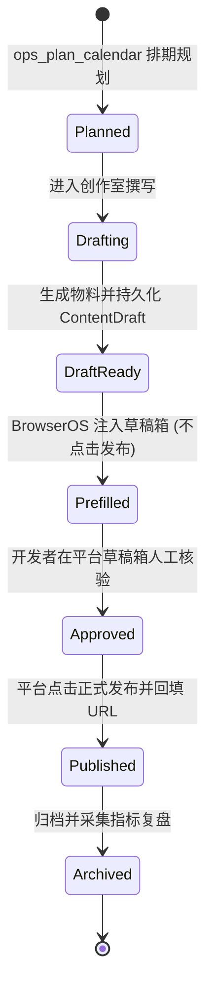

# 个人产品增长推广工坊（Growth Studio / dsh-growth-studio）技术架构设计说明书

## 一、 系统架构全景

### 1.1 分层架构模型

`dsh-growth-studio` (Growth Studio) 采用基于 Cordis 的全插件式微内核分层架构，自顶向下由**客户端视图层**、**宿主 RPC 协议网关层**、**业务领域服务层**、**外部 MCP 驱动中台层**及**本地持久化基础设施**构成：

```mermaid
graph TD
    subgraph ClientLayer ["1. 客户端视图展示层 (DSH Desktop Client)"]
        Nav["Settings 导航注入 (Slots: settings.section)"]
        Icon["专属 Megaphone 矢量图标 (DOM 观察器)"]
        UI["Ops Workbench 响应式工作台 (React 18)"]
        Tabs["6 大业务 Tab: 驾驶舱 / 排期日历 / 创作室 / AI工具中枢 / 舆情复盘 / 引擎配置"]
        Simulators["多平台 Feed 模拟器 (微信公众号/视频元数据/推文串/PH)"]
        UI --> Tabs
        Tabs --> Simulators
    end

    subgraph RpcLayer ["2. 宿主 RPC 协议网关层 (DSH Connection RPC)"]
        RpcFetch["HTTP POST /api/ops 网关处理器"]
        RpcEnvelope["RPC 信封序列化器: server-response"]
        RpcRouter{"RPC 方法路由器"}
        RpcFetch --> RpcEnvelope --> RpcRouter
    end

    subgraph DomainLayer ["3. 业务领域服务层 (Domain Services)"]
        WorkbenchAggregator["工作台总览聚合器 (Overview Service) [Phase 0]"]
        DraftManager["本地草稿治理服务 (DraftStore Service) [Phase 0]"]
        SessionGuard["会话哨兵 (SessionGuard: BrowserOS 统一实例探测) [Phase 0]"]
        BrowserDriver["浏览器执行驱动 (BrowserDriver 任务编排) [Phase 0: 公号+B站]"]
        ToolHubManager["AI 工具治理与沙箱引擎 (ToolHubManager) [Phase 0]"]
        CalendarEngine["内容排期规划引擎 (Calendar Engine) [Phase 0: 单向导出]"]
        ContentStudioEngine["多端内容创作引擎 (Content Studio) [Phase 0]"]
        MetricsAggregator["跨平台指标聚合器 (MetricsCollector) [Phase 0: 区分曝光/播放]"]
        FeedbackIntelligence["舆情需求提炼智能 (Crawler & IssueExtractor) [Phase 1]"]
        SkillEngine["场景技能工坊引擎 (SkillEngine) [Phase 2]"]
        OverseasManager["出海增长与时区引擎 (OverseasStrategyManager) [Phase 2]"]
    end

    subgraph IntegrationLayer ["4. 外部 MCP 协议集成层"]
        InjoysClient["Injoys MCP 客户端代理 (JSON-RPC 2.0 / HTTP)"]
        KBAdapter["知识库接口 (knowledge.list / ingest)"]
        SheetAdapter["排期表接口 (spreadsheet.read / applyOperations)"]
        DocAdapter["文档接口 (document.create)"]
        BrowserOSClient["BrowserOS MCP 浏览器控制驱动 (CDP/Playwright)"]
    end

    subgraph InfraLayer ["5. 本地运行与持久化基础设施层"]
        ConfigStore["配置存储: $DSH_HOME/ops-manager/config.json"]
        DraftStore["本地草稿库: $DSH_HOME/growth-studio/drafts/"]
        BrowserOSProfile["BrowserOS 独立用户环境 Profile"]
    end

    UI -->|客户端 RPC 协议请求| RpcFetch
    RpcRouter --> WorkbenchAggregator
    RpcRouter --> DraftManager
    RpcRouter --> SessionGuard
    RpcRouter --> CalendarEngine
    RpcRouter --> ContentStudioEngine
    RpcRouter --> MetricsAggregator
    RpcRouter --> FeedbackIntelligence
    RpcRouter --> OverseasManager
    RpcRouter --> ConfigStore

    WorkbenchAggregator --> SessionGuard
    WorkbenchAggregator --> MetricsAggregator
    WorkbenchAggregator --> DraftManager
    CalendarEngine --> InjoysClient
    ContentStudioEngine --> DraftManager
    ContentStudioEngine --> InjoysClient
    MetricsAggregator --> BrowserDriver
    SessionGuard --> BrowserOSClient
    BrowserDriver --> BrowserOSClient
    DraftManager --> DraftStore

    InjoysClient --> KBAdapter
    InjoysClient --> SheetAdapter
    InjoysClient --> DocAdapter
```



---

## 二、 客户端与通信机制设计

### 2.1 DSH Desktop 插件容器加载机制

DSH Desktop 客户端通过 Cordis `slots` 注入扩展机制工作：
1. **打包规范**：客户端源码位于 `plugin-src/client/`，通过 `plugin-src/client/build.mjs` 中的 `esbuild` 编译，封装为：
   ```javascript
   window.__ModuleLoader__.load(
     '@deepseek-ai/dsh-ops-manager/client',
     ['@deepseek-ai/dsh-core/client'],
     function(core) { ... }
   );
   ```
2. **槽位挂载**：在 `settings.section` 槽位注入 `id: 'ops'`，`order: 60`（排布于 `Jet Hub` 之后），挂载 Ops Workbench。

### 2.2 宿主 RPC 通信机制与协议封装

客户端与后端服务通过标准 HTTP RPC 管道通信：
* **URL 路由**：`POST /api/ops`
* **协议信封格式**：
  ```typescript
  interface RpcEnvelopeRequest {
    method: string
    params?: Record<string, unknown>
  }

  interface RpcEnvelopeResponse<T = unknown> {
    ok: boolean
    result?: { value: T }
    error?: { code: string; message: string; details?: unknown }
  }
  ```

---

## 三、 宿主 RPC 接口定义 (RPC API Reference)

### 3.1 `workbench.overview`（工作台总览聚合接口） `[Phase 0 首版]`

* **请求参数**：`{}`
* **响应数据结构 (`result.value`)**：
  ```typescript
  interface WorkbenchOverviewResponse {
    productName: string
    overviewMetrics: {
      totalImpressions: number | null  // 全网图文/推文曝光阅读 (无法获取为 null)
      totalPlays: number | null        // 全网视频播放量 (无法获取为 null)
      totalLikes: number | null        // 全网点赞数
      totalComments: number | null     // 全网评论数
      totalShares: number | null       // 全网分享/转发数
      totalFollowersDelta: number | null // 净增关注数
      scheduledCount: number           // 待发流水数
      readyChannelsCount: number       // 已认证就绪平台数 (state === 'authenticated')
      totalChannelsCount: number       // 当前阶段支持平台数 (Phase 0 为 2)
      metricsAnnotation: string        // "全网非去重曝光与播放累计人次"
      /**
       * 环比走势（PRD §5.1.2 要求指标卡配备「副标题 + 环比走势 + 轻量化渐变进度条」）。
       * 每项为相对上一对比周期的变化率（百分比，正数=上涨，负数=下跌）。
       * 与指标本身一致遵循可空语义：无可比历史数据时必须为 null，不得用 0 冒充「无变化」。
       */
      comparison: {
        period: '7d' | '30d' | null       // 对比周期基准；无历史数据时为 null
        impressionsDeltaPercent: number | null
        playsDeltaPercent: number | null
        engagementsDeltaPercent: number | null  // 点赞+评论+转发+收藏 汇总环比
        followersDeltaPercent: number | null
      }
    }
    statuses: Array<{
      id: PlatformId
      name: string
      kind: 'article' | 'video' | 'post'
      draftEditorUrl: string
      state: SessionState              // 'unknown' | 'needs_login' | 'authenticated' | 'no_publish_permission'
      isReady: boolean                 // 辅助计算字段: state === 'authenticated'
      accountName?: string
      scanRequired: boolean
      message: string
      lastCheckedAt: string
    }>
    trends: Array<{
      keyword: string
      platform: PlatformId | 'general'
      heatScore: number
      sampleTopic: string
      relevanceToProduct: string
    }>
    calendarItems: CalendarItem[]
    feedbackItems: UserFeedbackItem[]
    injoysConnected: boolean
  }
  ```

---

### 3.2 `drafts.*`（本地草稿管理接口） `[Phase 0 首版]`

针对内容生成、本地持久化与版本流转，提供草稿存储完整 CRUD：

#### 3.2.1 `drafts.list`（获取本地草稿列表）
* **请求参数**：`{}`
* **响应数据**：
  ```typescript
  interface DraftsListResponse {
    drafts: ContentDraft[]
  }
  ```

#### 3.2.2 `drafts.get`（获取指定草稿详情）
* **请求参数**：`{ id: string }`
* **响应数据**：`{ draft: ContentDraft }`

#### 3.2.3 `drafts.save`（创建或更新草稿，版本自增）
* **请求参数**：
  ```typescript
  interface SaveDraftRequest {
    draft: {
      id?: string
      title: string
      topic: string
      targetAudience?: string
      channelVariants: Array<{
        platform: PlatformId
        kind: 'article' | 'video' | 'post'
        title: string
        body: string
        tags: string[]
        mediaPaths?: string[]
        coverPath?: string
      }>
      status?: 'draft' | 'ready_for_review' | 'prefilled' | 'published'
      injoysDocId?: string
    }
  }
  ```
* **响应数据**：`{ draft: ContentDraft }`

#### 3.2.4 `drafts.delete`（删除草稿）
* **请求参数**：`{ id: string }`
* **响应数据**：`{ success: boolean }`

#### 3.2.5 `drafts.updatePublishUrl`（人工发布后回填 URL 闭环）
* **请求参数**：
  ```typescript
  interface UpdatePublishUrlRequest {
    draftId: string
    platform: PlatformId
    publishedUrl: string
  }
  ```
* **响应数据**：`{ draft: ContentDraft }`

---

### 3.3 `workbench.generateCalendar`（排期生成与导出接口） `[Phase 0 首版]`

* **请求参数**：
  ```typescript
  interface GenerateCalendarRequest {
    period: 'week' | 'month'
    focusVersion?: string
    platforms?: PlatformId[]
  }
  ```
* **响应数据**：
  ```typescript
  interface GenerateCalendarResponse {
    period: string
    totalItems: number
    items: CalendarItem[]
    sheetExported: boolean // Phase 0: 是否已单向导出至 Injoys Spreadsheet
  }
  ```

---

### 3.4 `workbench.generateArticleDraft`（图文内容生成与预览接口） `[Phase 0 首版]`

* **请求参数**：
  ```typescript
  interface GenerateArticleRequest {
    topic: string
    targetPlatform: 'wechat_mp' | 'product_hunt'
    tone?: 'technical' | 'viral' | 'concise'
  }
  ```
* **响应数据**：
  ```typescript
  interface GenerateArticleResponse {
    id: string
    title: string
    digest: string
    contentMarkdown: string
    wordCount: number
    draftSaved: boolean
    injoysDocId?: string
  }
  ```

---

### 3.5 `workbench.generateVideoMeta`（视频元数据生成接口） `[Phase 0 首版]`

* **请求参数**：
  ```typescript
  interface GenerateVideoMetaRequest {
    topic: string
    platform: 'bilibili' | 'douyin' | 'youtube' | 'wechat_channels'
  }
  ```
* **响应数据**：
  ```typescript
  interface GenerateVideoMetaResponse {
    titleCandidates: Array<{
      title: string
      angle: string
      estimatedCtr: string
    }>
    description: string
    tags: string[]
    coverPromptSuggestion: string
  }
  ```

---

### 3.6 `workbench.prefillDraft`（调用 BrowserOS 执行预填） `[Phase 0: 公号+B站]`

* **请求参数**：
  ```typescript
  interface PrefillDraftRequest {
    draftId: string
    platform: PlatformId
  }
  ```
* **响应数据**：
  ```typescript
  interface PrefillDraftResponse {
    success: boolean
    platform: PlatformId
    draftId: string
    draftUrl: string           // 平台后台草稿直达链接
    message: string            // "已成功预填至草稿箱，请核对预览"
    requiresUserAction?: boolean
  }
  ```

---

### 3.7 `browser.sessions`（BrowserOS 统一实例会话诊断接口） `[Phase 0 首版]`

* **请求参数**：`{}`
* **响应数据**：
  ```typescript
  interface BrowserSessionsResponse {
    statuses: Array<{
      platform: PlatformId
      state: SessionState      // 'unknown' | 'needs_login' | 'authenticated' | 'no_publish_permission'
      isReady: boolean
      accountName?: string
      lastCheckedAt: string
      message: string
    }>
  }
  ```

---

### 3.8 浏览器交互式登录端点 `[Phase 2 愿景 / 需 PoC 验证]`

> 注：以下接口为 Phase 2 计划中的前台交互窗与二维码推流设计，需依赖 BrowserOS CDP 高级 API 验证。Phase 0 阶段工作台采用引导用户在当前 BrowserOS 实例中直接扫码登录。

* `browser.login.startQr`（启动扫码登录并提取二维码 Base64）
* `browser.login.pollQr`（轮询扫码状态）
* `browser.login.openHeadful`（拉起 BrowserOS 可视前台认证窗）
* `browser.login.cancel`（取消登录会话）

---

### 3.9 AI 工具中枢与沙箱 RPC 端点 `[Phase 0 首版]`

* `tools.catalog`：获取全量工具目录与驱动类型
* `tools.toggle`：单工具白名单开关
* `tools.executeSandbox`：可视化单步沙箱执行（免会话直接填参运行）
* `tools.telemetry`：获取调用遥测与性能审计流水
* *(注：正式发布工具 ops_publish_now 彻底移除，杜绝误触发)*

---

### 3.10 基础配置接口 `[Phase 0 首版]`

* `config.get`：返回配置与环境变量回退状态
* `config.save`：持久化配置并实时热更新 `InjoysClient`
* `injoys.test`：执行 `knowledge.list` 探活并返回延迟与文档数

---

## 四、 核心技术与数据模型

### 4.1 核心数据模型契约 (Domain Entities)

```typescript
export type PlatformId =
  | 'wechat_mp'
  | 'wechat_channels'
  | 'bilibili'
  | 'douyin'
  | 'youtube'
  | 'twitter_x'
  | 'product_hunt'
  | 'tiktok'

export type ContentKind = 'article' | 'video' | 'post'

/**
 * 排期项（CalendarItem）生命周期状态。
 *
 * 溯源说明（PRD ↔ TAD 一致性）：
 * - `planned` / `drafting` / `draft_ready` / `prefilled` / `published` 五态直接对应 PRD §5.3.1 的状态胶囊。
 * - `approved`：对应 PRD §3.2 用户旅程第 4 步「人工确认」与 §5.4.3 安全约束中的人机协同审核环节，
 *   语义为「草稿已推入平台草稿箱、开发者已在工作台完成核验」，是 `prefilled` 与 `published` 之间的中间态。
 *   ⚠️ PRD §5.3.1 的胶囊文案未显式列出该态，需在 PRD 侧补充确认（见下）。
 * - `archived`：技术侧终态，用于发布后归档与指标复盘留存，对应 §4.2 状态机的 `Archived` 终止节点。
 *   ⚠️ PRD 全文未出现「归档」概念，该状态属技术侧引入，需 PRD 确认归档触发条件与保留策略。
 *
 * ⚠️ 可达性提示：承载本状态的 `CalendarItem` 目前**尚无 RPC 对外暴露**
 * （`workbench.generateCalendar` 仅在本文档定义、未在 `src/ops-rpc.ts` 注册），
 * 因此 `approved` / `archived` 当前均不可通过接口写入。补实现前必须先确认上述溯源。
 */
export type ItemStatus =
  | 'planned'        // 已纳入计划
  | 'drafting'       // 文案/脚本撰写中
  | 'draft_ready'    // 物料准备就绪
  | 'prefilled'      // 已推入平台草稿箱
  | 'approved'       // 人机协同审核通过
  | 'published'      // 平台人工发布后回填确认
  | 'archived'       // 归档

export type SessionState =
  | 'unknown'                 // 未知或探测中
  | 'needs_login'             // 明确未登录或会话已失效
  | 'authenticated'           // 具备有效发布/草稿权限
  | 'no_publish_permission'   // 账号已登录但无发布/创作者权限

/** 本地持久化草稿实体 ($DSH_HOME/growth-studio/drafts/{id}.json) */
export interface ContentDraft {
  id: string
  title: string
  topic: string
  targetAudience?: string
  channelVariants: Array<{
    platform: PlatformId
    kind: ContentKind
    title: string
    body: string
    tags: string[]
    mediaPaths?: string[]
    coverPath?: string
  }>
  status: 'draft' | 'ready_for_review' | 'prefilled' | 'published'
  version: number
  injoysDocId?: string
  prefillResults?: Partial<Record<PlatformId, { draftId?: string; draftUrl?: string; prefilledAt: string }>>
  publishedUrls?: Partial<Record<PlatformId, string>>
  createdAt: string
  updatedAt: string
}

/** 跨平台真实指标实体 (可空语义) */
export interface PlatformMetrics {
  platform: PlatformId
  capturedAt: string
  impressions: number | null   // 曝光/阅读人次 (图文主要指标)
  plays: number | null         // 播放人次 (视频主要指标)
  likes: number | null
  comments: number | null
  shares: number | null
  favorites?: number | null
  followerDelta?: number | null
  topPostTitle?: string
  views: number                // 兼容性字段: impressions ?? plays ?? 0
}
```

### 4.2 内容生命周期状态机与数据流转



---

## 五、 关键工程与技术实现方案

### 5.1 会话管理与统一 BrowserOS 实例方案 (Unified BrowserOS Session Model)

#### 5.1.1 架构取舍与原方案缺陷
原设计试图从日常 Chrome 的 SQLite 数据库（`~/.config/google-chrome/Default/Cookies`）探测 Cookie。但静态评审与源码分析揭示了三大根本问题：
1. **实例不一致**：日用 Chrome 与 BrowserOS MCP 是两个完全不同的浏览器环境与用户目录。在 Chrome 探测到 Cookie 根本不能保证 BrowserOS 执行预填时已登录，导致工作台呈现“就绪”假象。
2. **SQLite WAL 不完整**：直接复制 `Cookies` 主文件未同步拷贝 `Cookies-wal` 与 `Cookies-shm`，当 Chrome 处于活跃写状态时容易漏检最新 Cookie。
3. **隐私与安全**：拷贝并挂载整个 SQLite 库会使所有个人 Cookie 进入内存，与“仅存在性探测”的隐私承诺存在落差。

#### 5.1.2 统一实例方案 (Phase 0 基线)
在 Phase 0 中，**彻底收敛为统一的 BrowserOS 浏览器实例**：
1. **单一实例绑定**：登录态探测、草稿箱预填与大屏指标采集，统一由同一个 BrowserOS MCP 实例调度执行；
2. **轻量探测**：`SessionGuard` 通过 BrowserOS MCP 查询当前活跃 Tab 或后台导航至目标平台验签 URL（如微信后台与 B站创作平台），通过页面特征或网络响应判定会话状态；
3. **四态流转**：严格向前端返回 `unknown` / `needs_login` / `authenticated` / `no_publish_permission` 四态，杜绝假阳性。

---

### 5.2 草稿箱预填与 Human-in-the-Loop 发布闭环

#### 5.2.1 铁律：始终仅预填，严禁自动确认发布
为彻底消除 AI 幻觉引发的不可控群发风险：
1. **移除 `ops_publish_now`**：从所有工具白名单、RPC 端点和文档中彻底删除正式发布工具；
2. **预填止步于草稿**：
   * 微信公众号：将标题、作者、正文富文本填入草稿编辑器并点击平台原生的「保存为草稿」按键；
   * B站创作者中心：填入标题、简介、标签并保存草稿；
3. **人工确认与回填闭环**：
   * 预填完成后向工作台返回草稿直达链接；
   * 用户在浏览器中完成最终人工核验并点击发布；
   * 用户将正式发布后的 URL 回填至工作台，工作台将草稿状态变更为 `published` 并关联指标追踪。

---

### 5.3 Injoys 资产协同与分阶段同步策略

1. **Phase 0 降级策略（本地主数据 + 单向导出）**：
   * 本地 `$DSH_HOME/growth-studio/` 充当排期与草稿的黄金主数据源（Single Source of Truth）；
   * 通过 `InjoysClient` 调用 `spreadsheet.applyOperations` 将排期单向写入 Injoys Spreadsheet；
   * 支持通过 `spreadsheet.read` 导入已存在的排期；
   * 不做复杂的实时双向冲突解决，避免数据覆盖。
2. **Phase 3 双向同步演进**：
   * 引入行级 ID 映射表与更新时间戳版本；
   * 采用“最后修改者胜出 (LWW)”与冲突行拆分标记策略。

---

### 5.4 响应式设计系统与 DSH 视觉令牌对齐 (Design Tokens)

工作台样式深度适配 DSH 主题系统，避免硬编码色值：
* **背景层级**：`var(--dsw-alias-bg-layer-1)` (页面底色)、`var(--dsw-alias-bg-layer-2)` (卡片底色)、`var(--dsw-alias-bg-layer-3)` (输入框底色)；
* **边框层级**：`var(--dsw-alias-border-l1)`、`var(--dsw-alias-border-l2)`；
* **文字阶梯**：`var(--dsw-alias-label-primary)`、`var(--dsw-alias-label-secondary)`、`var(--dsw-alias-label-tertiary)`；
* **交互点缀色**：主操作蓝 `#1677ff`，安全绿 `#15803d`，告警橙 `#b45309`，活力紫 `#7c3aed`。
  > 上述四色为**交互点缀色**（按钮、状态强调、图标着色）的权威取值，PRD §六「视觉基调」与本表对齐。

---

### 5.5 数据刷新与状态同步策略 (Refresh Strategy)

对应 PRD §六「数据卡片支持即时刷新，无需强制重载页面」：

* **Phase 0 基线**：刷新由用户在卡片/驾驶舱上**手动触发**对应的 RPC 调用（如 `workbench.overview`、`browser.sessions`、`injoys.test`），前端仅做局部状态替换，不整页重载；
* **不引入持久连接**：Phase 0 不使用 WebSocket / SSE，也不做后台定时轮询，避免在宿主内进程引入常驻连接与额外资源占用；
* **单飞约束**：同一张卡片的并发刷新请求应做去重（in-flight 合并），避免用户连点导致会话探测与指标采集重复执行；
* **远期演进**：若后续确需准实时大盘，须先在架构文档中补充连接生命周期、断线重连与令牌校验方案，再行实施。

---

## 六、 安全与隐私考量 (Security & Governance)

1. **凭证隔离与数据安全**：
   * Injoys MCP 访问令牌在前端支持显隐切换，网络传输使用标准 Bearer 规范；
   * 本地草稿存储于用户目录 `$DSH_HOME/growth-studio/drafts/`，系统文件权限仅限当前操作系统用户。
2. **会话数据零外发**：
   * BrowserOS 会话在本地沙箱运行，不向任何第三方服务上报 Cookie 数据。
3. **分发防误触（Human Confirmation）**：
   * 自动发帖始终采取“预填至草稿箱（Draft Prefill）”策略，保留平台原生确认发布步骤，彻底杜绝误发布。
