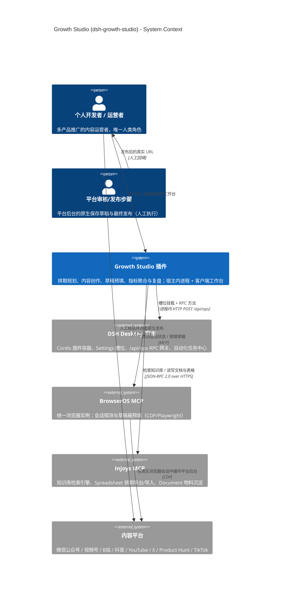
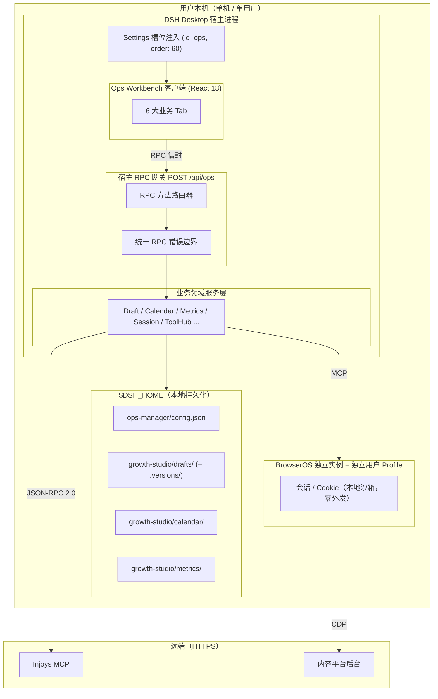

# 系统设计总览 (System Design)

> **Metadata**
> - **Source**: `.context/architecture/source/technical_architecture.md`（TAD v1.2.0）
> - **Generated At**: `2026-10-16 09:44`
> - **Generator**: `Context-Agent v1.0`

> ⚠️ 本文为源文档的**结构化总结**。若与 `.context/architecture/source/` 冲突，**以源文档为准**。
> 约束权威来源为 `.context/criterion.md`；本文涉及实现状态处均引用源文档与 criterion。

---

## 📌 系统概述

`dsh-growth-studio`（Growth Studio / 个人产品增长推广工坊）是构建于 **Cordis 全插件式微内核**之上的 DSH Desktop 插件，为**个人开发者多产品推广**场景提供「排期 → 创作 → 预填 → 人工发布 → 指标复盘」的闭环运营工作台。

一句话描述：**一个把多平台内容运营流程收敛进 DSH 客户端设置页的本地优先插件 —— AI 只负责生成与预填，最终发布永远由人完成。**

### 质量目标

| 质量属性 | 目标描述 | 量化指标 |
|---------|---------|---------|
| **安全（最高优先级）** | 杜绝 AI 幻觉导致的不可控群发 | 发布类工具在 catalog 中**恒不存在**；`published` 仅可由回填合法 URL 推进 |
| **数据真实性** | 绝不伪造/估算指标与状态 | 采集失败或不支持 → `null`；应采平台未全成功 → 汇总 `null` |
| **隐私** | 会话数据零外发 | Cookie/Cookie 库**不出本地沙箱**，0 次第三方上报 |
| **可用性** | 局部刷新，无需整页重载 | 手动触发刷新 + in-flight 去重（无 WebSocket/SSE/轮询） |
| **可恢复性** | 存储失败可被调用方一致识别 | 所有写入口统一返回 `drafts/storage-unavailable` |
| **可维护性** | 契约先行、类型安全 | `pnpm typecheck` + `pnpm test`（vitest）须通过 |

> 源文档**未给出** SLA / P99 / QPS 等对外服务型量化 NFR（本项目为宿主内单用户进程，非网络服务）。
> 上方量化指标取自架构文档的可验证约束，而非编造的服务等级数字。

---

## 🎯 质量场景（架构显著性）

| # | 场景 | 刺激 | 期望响应 | 度量 |
|---|------|------|---------|------|
| QS-1 | **误发布防护** | AI 或前端尝试调用发布工具 | 工具不存在于 catalog，调用无法构造 | 发布类工具数 = 0（恒） |
| QS-2 | **假发布防护** | 通用保存入口传入 `status: 'published'` | 服务端拒绝，返回 `drafts/published-requires-url` | 100% 拒绝，不依赖客户端自觉 |
| QS-3 | **部分发布** | 2 渠道草稿仅 1 个回填 URL | 整体状态固定 `prefilled`，进度由 `publishedUrls` 体现 | 无 `partially_published` 中间态 |
| QS-4 | **指标缺口** | 2 应采平台中 1 个采集失败 | 汇总值为 `null`，并填充 `unmeasuredPlatforms` | 不用部分数据冒充全网总量 |
| QS-5 | **目录切换竞态** | 复合 RPC 执行中途用户改了 `draftsDir` | 本次操作全程沿用**开始时捕获**的目录 | 不出现「读 A 库写 B 库」 |
| QS-6 | **不可写目录** | 目标目录已存在但只读 | `config.save` 前置探测文件校验后**拒绝保存** | 返回 `config/invalid-drafts-dir`，不留 ENOENT 后账 |

---

## 🗺️ 系统上下文 (C4 Level 1)

---

## 🔗 外部依赖

| 依赖系统 | 用途 | 协议 | 失败影响 | 处理要求 |
|---------|------|------|---------|---------|
| **DSH Desktop 宿主** | 插件容器、槽位注入、RPC 网关、自动化任务 | 进程内模块加载 + `POST /api/ops` | 插件无法加载 | 硬依赖；`ops_setup_schedule` 需宿主能力 |
| **BrowserOS MCP** | 会话探测、草稿箱预填 | MCP（CDP/Playwright） | 无法预填 / 会话状态 `unknown` | 4 态如实返回，**严禁假阳性** |
| **Injoys MCP** | 知识库、Spreadsheet、Document | JSON-RPC 2.0 / HTTP + Bearer | 生成降级、导出/沉淀失败 | 未配置令牌不得谎报「认证失败」 |
| **内容平台后台** | 草稿箱终点 | 经 BrowserOS 的 CDP | 预填失败 | 止步于平台原生「保存为草稿」 |
| **本地磁盘 `$DSH_HOME`** | 配置 / 草稿 / 排期 / 指标 | 文件系统 | 数据不可用 | 写入前须**准备并验证可写** |

> **无数据库、无消息队列、无云服务**：本项目为本地优先的单用户桌面插件。

---

## 🏗️ 核心组件

> 分层与组件命名沿用源文档 §1.1。阶段标注（Phase 0/1/2）为源文档定义，非本文推断。

| 层 | 组件 | 职责 | 阶段 |
|----|------|------|:----:|
| **客户端视图层** | Settings 导航注入 + Megaphone 图标 | 在 `settings.section` 槽位（`id: 'ops'`, `order: 60`）挂载工作台 | Phase 0 |
| | Ops Workbench（React 18） | 6 大 Tab：驾驶舱 / 排期日历 / 创作室 / AI工具中枢 / 舆情复盘 / 引擎配置 | Phase 0 |
| | 多平台 Feed 模拟器 | 公众号 / 视频元数据 / 推文串 / Product Hunt 预览 | Phase 0 |
| **RPC 网关层** | HTTP `POST /api/ops` + 信封序列化器 + 方法路由器 | 统一信封入出站、方法分发、**统一错误边界** | Phase 0 |
| **业务领域服务层** | `WorkbenchAggregator` | 工作台总览聚合（指标 + 会话 + 排期 + 舆情） | Phase 0 |
| | `DraftManager` | 本地草稿治理：CRUD、版本快照、原子写、发布 URL 回填守卫 | Phase 0 |
| | `SessionGuard` | 统一 BrowserOS 实例会话探测（四态） | Phase 0 |
| | `BrowserDriver` | 浏览器任务编排（公号 + B站） | Phase 0 |
| | `ToolHubManager` | AI 工具治理与沙箱（白名单宿主侧强制） | Phase 0 |
| | `CalendarEngine` | 内容排期规划与单向导出 | Phase 0 |
| | `ContentStudioEngine` | 多端内容创作（图文 / 视频元数据） | Phase 0 |
| | `MetricsAggregator` | 跨平台指标聚合（区分曝光 / 播放，可空语义） | Phase 0 |
| | `FeedbackIntelligence` | 评论爬取与需求提炼 | Phase 1 |
| | `SkillEngine` | 场景技能工坊 | Phase 2 |
| | `OverseasStrategyManager` | 出海增长与时区策略 | Phase 2 |
| **MCP 集成层** | `InjoysClient` | JSON-RPC 2.0 客户端代理 + 热更新 + 缓存隔离 | Phase 0 |
| | `KBAdapter` / `SheetAdapter` / `DocAdapter` | `knowledge.list` / `spreadsheet.read|applyOperations` / `document.create` | Phase 0 |
| | `BrowserOSClient` | 浏览器控制驱动（CDP/Playwright），动作白名单 | Phase 0 |
| **持久化基础设施层** | `ConfigStore` | `$DSH_HOME/ops-manager/config.json` | Phase 0 |
| | `DraftStore` | `$DSH_HOME/growth-studio/drafts/` + 版本快照 | Phase 0 |

> 组件细节视图见 `container_component_view.md`；接口契约见 `api_strategy.md`。

---

## 💾 数据存储

| 存储 | 用途 | 技术选型 | 一致性模型 |
|------|------|---------|-----------|
| **草稿库** | `ContentDraft` 当前版本 + 版本快照 | 本地 JSON：`growth-studio/drafts/{id}.json`、`{id}.versions/v{n}.json` | 单机强一致（临时文件 + `rename` 原子写 + 串行写锁） |
| **排期库** | `CalendarItem`（排期黄金主数据源） | 本地 JSON：`growth-studio/calendar/{id}.json` | 单机强一致 |
| **指标历史** | 环比计算基准 | 本地 JSON：`growth-studio/metrics/{YYYY-MM-DD}.json` | 追加写（`platform, capturedAt`） |
| **配置** | `OpsConfig` | `$DSH_HOME/ops-manager/config.json` | 单机强一致；`config.save` 后**热更新** |
| **Injoys Spreadsheet** | 排期**单向导出**目标 + 可导入来源 | Injoys MCP `applyOperations` / `read` | 最终一致；以 `externalRowId` 幂等 |
| **Injoys Document** | 物料沉淀 | Injoys MCP `document.create`（幂等更新） | 最终一致 |

> **无数据库 / 无 ORM / 无迁移**（criterion §7.3 判定：数据层 = 未启用）。
> 详细数据模型见 `data_architecture.md`。

---

## ⚡ 关键接口 / 集成点

| 集成点 | 形态 | 协议 | 备注 |
|--------|------|------|------|
| 宿主 RPC 网关 | `POST /api/ops` | HTTP + 自研信封 `{ type:'client-request', rpcId, method:'ops', payload:{ method, payload } }` | **实现口径与文档差异**：入参字段名实现为 `payload`（源文档 §2.2 写作 `params`），以 criterion §5.4 为准 |
| 工具调用面 | `ops_setup_schedule` | **宿主内工具调用**，非 RPC 方法 | 需 DSH 自动化任务中心能力，与工作台配置不同调用面 |
| Injoys | `knowledge.list` / `spreadsheet.read` / `spreadsheet.applyOperations` / `document.create` | JSON-RPC 2.0 over HTTPS + `Authorization: Bearer {token}` | 须校验 HTTP 状态码与 `result.isError` |
| BrowserOS | `tabs` / `navigate` / `snapshot` / `act` | MCP | **动作白名单**；禁用 shell/cmd |
| DSH 自动化任务 | Cron 注册（默认 `0 9 * * 1`, `Asia/Shanghai`） | 宿主能力 | 与「Phase 0 禁止后台轮询」不冲突 |

> 完整方法契约见 `api_strategy.md`。

---

## 🚫 系统边界与范围

### In-Scope（本插件负责）

- 内容排期规划与本地排期主数据管理（含 Injoys 表格单向导出 / 导入）
- 多端内容创作：公众号图文、视频元数据（标题 / 标签 / 分区）
- 经 BrowserOS 将草稿**预填**至平台草稿箱，并回传草稿直达链接
- 统一 BrowserOS 实例的会话状态四态探测
- 跨平台指标采集、聚合、环比与复盘
- AI 工具治理与沙箱执行（宿主侧白名单）
- 周期性巡检在 DSH 自动化任务中心的注册

### Out-of-Scope（本插件不负责）

| 不负责项 | 归属 / 原因 |
|---------|-----------|
| **最终发布动作** | 平台后台人工执行 —— **架构铁律，永不由本插件承担** |
| 数据库 / 迁移 / ORM | 本地 JSON 持久化即契约（criterion §7.3） |
| 多产品**数据隔离** | 已裁决：产品切换仅切换生成上下文（源文档 §3.10.3） |
| 实时双向同步 | Phase 0 为本地主数据 + 单向导出；双向演进属 Phase 3 |
| WebSocket / SSE / 后台定时轮询 | Phase 0 明确禁止（源文档 §5.5） |
| Cookie 探取日用 Chrome | 已被否决（源文档 §5.1.1） |

---

## 🚀 部署拓扑

> 本项目**不是**服务器部署型系统：无容器编排、无 CDN、无负载均衡。
> 部署拓扑即**单机桌面运行时拓扑**。

**环境分层**：源文档未定义 Dev/Staging/Prod 分层 —— N/A – 源文档未提供（本地单机插件无多环境发布形态）。

---

## 🔄 关键运行时场景

| # | 场景 | 描述 | 详见 |
|---|------|------|------|
| RS-1 | **排期生成** | 生成周期排期行并落盘本地，可选单向导出 Injoys | `runtime_view.md` §场景 1 |
| RS-2 | **内容创作落盘** | 生成图文 / 视频元数据并自动存盘为 `ContentDraft` | `runtime_view.md` §场景 2 |
| RS-3 | **草稿预填（跨 await 复合）** | 读草稿 → 平台 Adapter → 回写预填结果，目录须全程固定 | `runtime_view.md` §场景 3 |
| RS-4 | **人工发布回填闭环** | 用户发布后回填 URL，全部渠道齐全才推进 `published` | `runtime_view.md` §场景 4 |
| RS-5 | **指标采集与环比** | 采集失败→`null`；部分缺失→汇总 `null`；历史不足→delta `null` | `runtime_view.md` §场景 5 |
| RS-6 | **草稿版本恢复** | 非破坏性回滚：以历史版本为基础追加新版本 | `runtime_view.md` §场景 6 |
| RS-7 | **`draftsDir` 切换与在途操作** | 在途写原目录（预期语义），新操作才用新目录 | `runtime_view.md` §场景 7 |
| RS-8 | **统一 BrowserOS 实例会话探测** | 四态如实返回，严禁退化为 boolean | `runtime_view.md` §场景 8 |

> 📌 **全渠道不变量重算**（渠道集合变化后重算状态、孤儿 URL 剪除）不是独立场景，
> 它是 **RS-4 发布回填闭环**的核心规则，展开见 `runtime_view.md` §场景 4 与 `data_architecture.md` §状态判定优先级。

---

## 📐 核心领域类型（速览）

> **权威定义在 `src/types.ts`**（criterion §5.5）。此处仅列出与架构决策强相关的语义要点。

| 类型 | 要点 |
|------|------|
| `PlatformId` | 9 个：`wechat_mp` / `wechat_channels` / `bilibili` / `douyin` / `xiaohongshu` / `youtube` / `twitter_x` / `product_hunt` / `tiktok` — ⚠️ 源文档 §4.1 列 8 个，此处以 criterion §5.5（权威）的 9 个为准；`xiaohongshu` 已列入但**尚未注册适配器** |
| `ItemStatus`（排期） | **五态**：`planned` → `drafting` → `draft_ready` → `prefilled` → `published`；`approved` / `archived` 已裁决移除 |
| `ContentDraft.status` | **四态**：`draft` / `ready_for_review` / `prefilled` / `published` —— 与 `ItemStatus` 是**两套枚举**，须经映射表转换（见 `data_architecture.md`） |
| `SessionState` | 四态：`unknown` / `needs_login` / `authenticated` / `no_publish_permission`；**严禁退化为 boolean** |
| `PlatformMetrics` | `impressions`（曝光/阅读）与 `plays`（播放）**独立且可空**；`views` 仅为兼容字段 |
| `CalendarItem` | 与 `ContentDraft` 经 `documentId` 关联（**是草稿 ID，不是 Injoys 文档 ID**） |

---

## 🔗 相关文档

| 文档 | 内容 |
|------|------|
| `tech_stack.md` | 技术栈与 MUST/MUST NOT 约束 |
| `container_component_view.md` | C4 L2/L3 容器与组件视图 |
| `api_strategy.md` | RPC 方法契约与错误码 |
| `data_architecture.md` | 实体模型、状态映射、持久化布局 |
| `runtime_view.md` | 关键场景序列图与状态机 |
| `security_policy.md` | 安全与隐私治理（发布守卫、会话零外发） |
| `risks_and_debt.md` | 技术风险与技术债务 |
| `adr_*.md` | 架构决策记录 |
| `../criterion.md` | **约束权威来源** |
| `source/technical_architecture.md` | **源文档（冲突时以此为准）** |

---

## AI 引用指南

当 AI 生成架构相关代码时：
1. 参考本文档的组件职责划分与分层边界
2. 遵循「仅预填、不自动发布」铁律 —— 不得以任何形式重新引入发布工具
3. 指标与状态遵循**可空语义**，绝不用 0 或估算值伪造缺失数据
4. 修改契约前先读 `../criterion.md` §7（SSoT-first）与源文档对应章节
