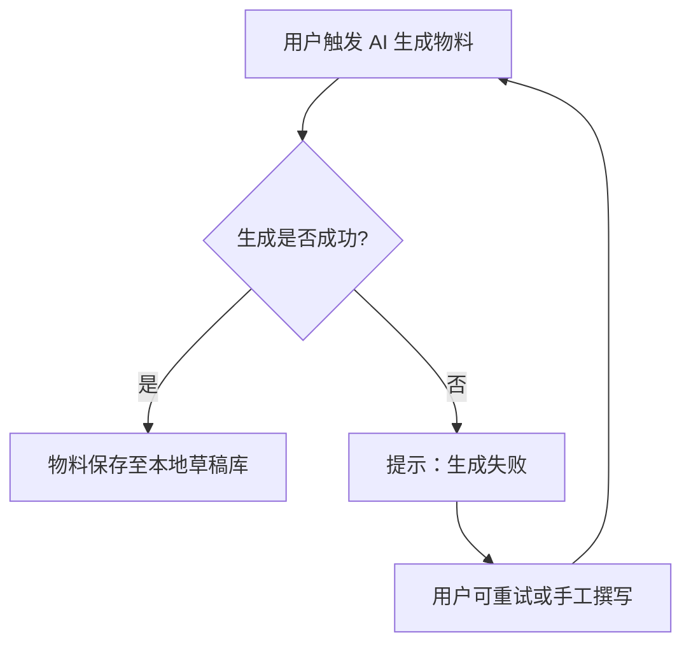
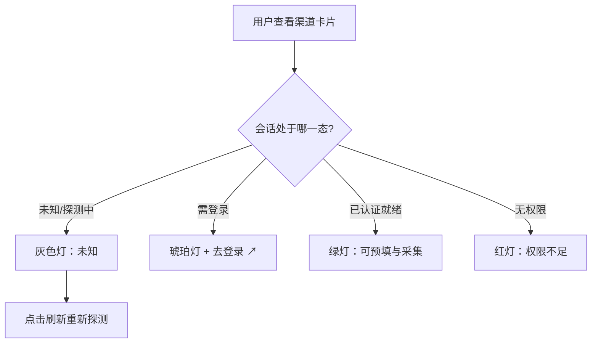
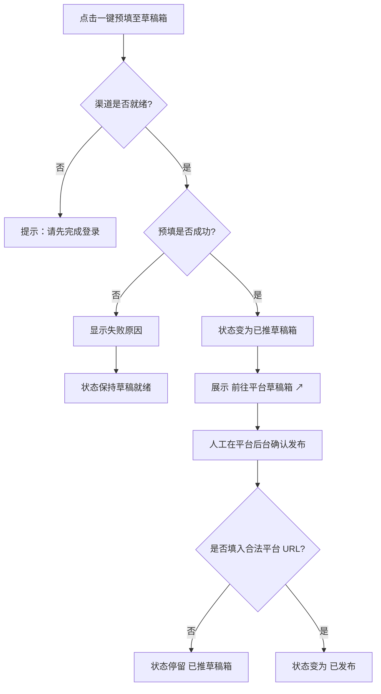
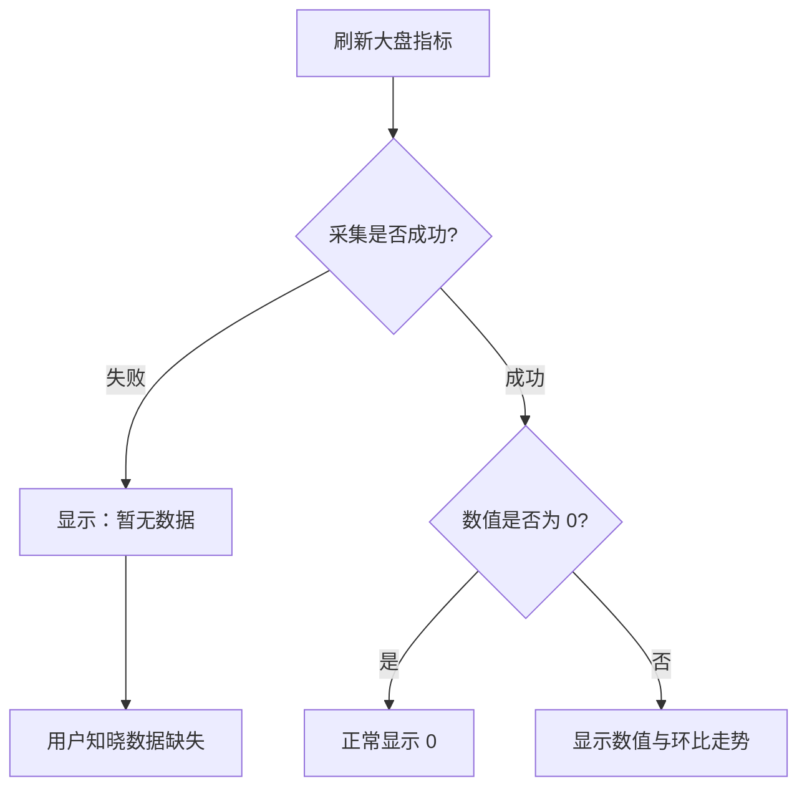
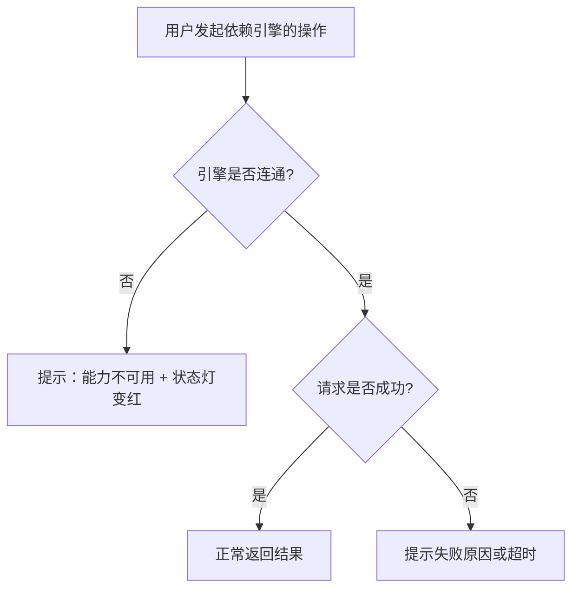

# 异常与边缘情况处理 (Edge Cases & Exception Handling)

> **Metadata**
> - **Source**: `.context/domain/source/product_requirements.md`（PRD v1.1.0）
> - **Generated At**: `2026-10-16 09:00`
> - **Generator**: `Context-Agent v1.0`

---

> **⚠️ 范围说明**
> 本文件记录**用户视角**的异常与边缘场景：触发条件 → 用户看到什么 → 业务结果。
> 只收录 PRD 提到或能直接推出的场景；**与本项目无关的章节整节删除**，不要为凑齐章节而编造。
> 检测方式、重试/退避策略、协议断连、锁与并发机制、错误码、负责模块属于架构，不写在这里。
>
> **已整节删除的模板章节**：§1 使用额度/频次限制、§2 内容安全审查、§3 过期链接处理、§6 支付异常 —— PRD 均未涉及。

---

## 1. AI 生成结果异常

| 场景 | 用户看到什么 | 业务结果 |
|------|-------------|---------|
| **生成内容不完整或无法使用** | 展示已生成内容，用户可重新生成或手工编辑 | 历史版本保留可回溯，不丢失已有草稿 |
| **生成耗时较长** | 进度提示，界面可继续操作 | 生成完成后草稿自动保存至本地草稿库 |
| **AI 生成服务暂时不可用** | 明确提示生成失败 | 不生成空草稿、不虚报成功；用户可稍后重试或手工撰写 |

> 来源：PRD §5.4.1（生成与存盘）、§5.5.3（沙箱可见执行结果）。

---

## 2. 平台会话异常

| 场景 | 用户看到什么 | 业务结果 |
|------|-------------|---------|
| **渠道未登录或会话失效** | 琥珀色指示灯 + `去登录 ↗` 按钮 | 该渠道的预填与指标采集不可执行，其他渠道不受影响 |
| **账号已登录但无创作者权限** | 红色指示灯，提示权限不足 | 渠道标记为不可用，用户需前往平台开通权限 |
| **尚未探测或探测超时** | 灰色指示灯，"未知 / 探测中" | 不误报为就绪，用户可点击刷新重试 |
| **需滑动拼图 / 双因素验证** | 提示需在浏览器实例中手工完成验证 | Phase 0 由用户手工处理；Phase 2 才规划认证小窗 |

> 来源：PRD §5.2.1 四态生命周期、§5.2.3、§六 3。

---

## 3. 草稿预填异常

| 场景 | 用户看到什么 | 业务结果 |
|------|-------------|---------|
| **预填执行失败** | 显示失败原因，不显示成功 | 排期状态保持"草稿就绪"，可修正后重试 |
| **渠道未就绪时点击预填** | 提示需先完成登录 | 不执行预填，不产生草稿 |
| **预填成功但页面未显示草稿** | 提供草稿直达验证链接，用户可自行核对 | 以平台后台的真实状态为准，不单方面宣称成功 |
| **用户未回填平台 URL** | 状态停留在"已推草稿箱" | 不出现"已发布"标记 |
| **用户误填非法 URL** | 提示 URL 不合法 | 状态不推进为"已发布" |

> 来源：PRD §5.3.1 发布确认闭环、§5.4.3 安全约束。

---

## 4. 指标与数据异常

| 场景 | 用户看到什么 | 业务结果 |
|------|-------------|---------|
| **某平台指标采集失败** | 该指标显示"暂无数据" | 不按 0 展示，不估算填充 |
| **某平台暂不支持该指标** | 显示"暂无数据" | 与"真实为零"在界面上可区分 |
| **应采集渠道未全部成功** | 汇总指标显示"暂无数据" | 不只汇总已成功渠道冒充满盘数据 |
| **平台真实返回 0** | 正常显示 `0` | 零值作为有效值参与统计 |
| **历史数据不足以覆盖对比窗口** | 环比走势显示为空 | 不编造环比结论 |
| **评论抓取无结果** | 提示暂无可分析评论 | 不使用示例评论冒充真实数据 |

> 来源：PRD §5.1.2「核心指标卡」、§5.6；实现层口径详见 `criterion §4`。

---

## 5. 网络异常

| 场景 | 用户看到什么 | 业务结果 |
|------|-------------|---------|
| **网络断开** | 提示网络不可用 | 已填写的物料内容不丢失，可恢复后重试 |
| **请求长时间无响应** | 显示超时提示 | 不展示为成功，用户可重新触发 |
| **知识库中枢未连通** | 相关能力明确提示不可用 | 依赖知识库的动作（排期同步、文档沉淀、需求反哺）不执行 |
| **浏览器引擎未连通** | 状态灯变红，相关能力提示不可用 | 依赖引擎的动作（会话探测、预填、指标与评论采集）不执行 |

> 来源：PRD §5.1.1（引擎状态指示）、§5.7（配置与连通性测试）。

---

## 6. 多人 / 多端同时操作

| 场景 | 用户看到什么 | 业务结果 |
|------|-------------|---------|
| **同一草稿被两处同时修改** | 后保存的一方收到"内容已被更新"提示 | 不静默覆盖对方已保存的内容 |
| **用户在 Injoys 表格中修改了排期** | Phase 0–2：工作台数据不变，需手工重新导入 | 以本地排期为准（单向导出/导入）；Phase 3 才支持双向同步 |
| **已发布草稿新增了未回填的渠道** | 状态回到"已推草稿箱" | 不维持假"已发布" |

> 来源：PRD §5.3.2（Phase 3 双向同步与冲突解决）；**具体冲突判定机制属于架构文档，此处仅记录用户可见结果**。

---

## 7. 界面状态文案

| 状态 | 用户看到什么 |
|------|-------------|
| **加载中** | 骨架屏或加载指示，页面其他区域可正常操作 |
| **空数据** | 明确的空状态文案（如"暂无排期"），并提供引导操作入口 |
| **出错** | 友好提示 + 失败原因，提供重试入口；不展示技术错误细节 |
| **超时** | 超时提示 + 重新触发入口 |
| **达到上限** | PRD 未涉及（工具无使用额度限制） |
| **指标缺失** | 显示"暂无数据"，不显示为 `0` |
| **渠道未登录** | 琥珀色指示灯 + `去登录 ↗` 外链 |

> 来源：PRD §六 3 零阻碍操作原则、§5.1.2、§5.2.1。

---

## 变更日志

| 日期 | 版本 | 变更内容 |
|------|------|---------|
| 2026-10-16 | v1.0 | 首次生成（基于 PRD v1.1.0）；删除 PRD 未涉及的额度限制、内容审查、过期链接、支付异常等章节 |
