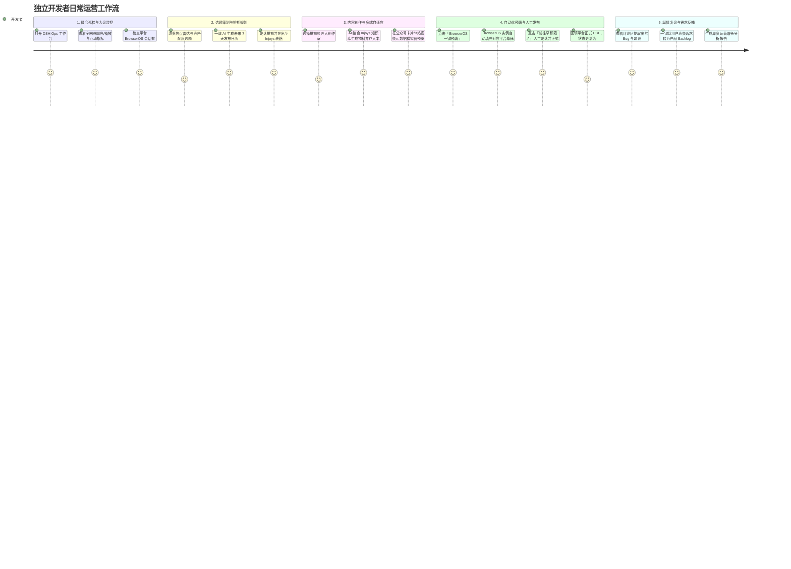

# 个人产品增长推广工坊（Growth Studio / dsh-growth-studio）产品需求文档 (PRD)

## 一、 文档概述

| 文档版本 | 状态 | 编写/修订日期 | 适用系统 |
| :--- | :--- | :--- | :--- |
| **v1.1.0** | 评审整改基线版 (Approved Baseline) | 2026-10-13 | DeepSeek Harness (DSH) 桌面端 / Growth Studio 插件体系 |

---

## 二、 项目背景与产品愿景

### 2.1 现状与痛点

目前 `dsh-growth-studio` (Growth Studio) 虽已具备基础 Injoys MCP 与 BrowserOS MCP 协议驱动及若干 AI 运营工具，但在桌面客户端侧仅体现为一个极简的「配置表单页面」，存在以下显著问题：

1. **界面吸引力弱，工具属性割裂**：用户只能看到几个表单输入框和简单的状态列表，缺乏运营全局视角与沉浸式操作体验。
2. **“策-采-编-发-评”全链路割裂**：
   * **策（排期规划）** 与 **采（知识库检索）** 依赖模型聊天对话中手工调用 Tool，缺乏可视化日历大盘；
   * **编（多渠道文案生成）** 缺少所见即所得的平台真实样式预览与本地持久化草稿；
   * **发（草稿箱预填）** 缺乏一键推送触发与直达审核入口，登录态与预填实例割裂；
   * **评（数据复盘与舆情）** 评论区用户真实反馈散落各处，未能在界面上形成需求池闭环。
3. **缺乏工作台（Workbench）聚合价值**：现代创作者与独立开发者在管理多渠道（国内4大平台 + 海外4大平台）时，需要类似 **Buffer、Hootsuite、飞书工作台、巨量百应/创作者服务平台** 的集成化工作台，能一眼掌握指标、热点、排期与会话状态。

### 2.2 产品愿景

将 `Ops Manager` 升级为 **「独立开发者与个人产品专属的 AI 运营增长工作台（Ops Growth Workbench / dsh-growth-studio）」**。

* **定位**：DeepSeek Harness 桌面端第一方高价值运营生产力中枢。
* **核心价值**：
  * **一屏掌控**：聚合社媒渠道会话状态、核心曝光/播放指标与全网技术热点雷达；
  * **全景流水线**：7 天多渠道排期流水一目了然，与 Injoys 表格互联；
  * **所见即所得**：内置跨平台发布预览模拟器，文案/标题/标签/推文串随心微调并本地持久化存盘；
  * **无感预填发帖**：通过统一的 BrowserOS 浏览器环境，一键将物料推入各大平台后台草稿箱，坚持 Human-in-the-loop 人工最终确认；
  * **需求反哺研发**：自动监听评论区舆情并聚类为 Feature / Bug 反馈，直接沉淀到 Injoys 需求池与知识库。

---

## 三、 用户画像与典型使用旅程

### 3.1 核心用户画像

* **独立开发者 / 个人创作者 (Indie Hackers)**：具备优秀的产品研发能力，但精力被多平台分发、文案撰写、格式排版与评论收集严重分散。
* **小微产研与技术团队 (Micro Tech Teams)**：需要以低成本建立国内外多渠道（微信、B站、抖音、YouTube、X、Product Hunt）的内容矩阵与品牌声量。
* **AI 自动化探索者**：追求完全自治（Autonomous）的“一人公司”运营管线。

### 3.2 典型用户旅程（User Journey Map）



---

## 四、 功能架构全景与分阶段交付定义

工作台采用现代 SaaS “侧边导航 + 顶部驾驶舱 + 多维卡片网格” 的布局设计：

```text
┌────────────────────────────────────────────────────────────────────────────────────────┐
│                        Ops Growth Workbench 运营推广工作台                              │
├────────────────────────────────────────────────────────────────────────────────────────┤
│ 顶部驾驶舱 (Top Cockpit): 产品标识 / Injoys & BrowserOS 引擎连接态 / 快速 AI 运营指令组   │
│ 核心数据看板 (KPI Ribbon): 全网曝光量 / 互动转化数 / 排期履约流水 / 活跃分发渠道就绪度     │
├────────────────────────────────────────────────────────────────────────────────────────┤
│                                  多维工作区切换 Tabs                                   │
│  [🌟 运营驾驶舱]  [📅 排期日历流水]  [✍ 内容创作室]  [🛠 AI工具中枢]  [📊 舆情需求大盘]  [⚙ 引擎策略配置]    │
├────────────────────────────────────────────────────────────────────────────────────────┤
│ 1. 运营驾驶舱 (Overview & Cockpit)                                                     │
│    ├─ [Phase 0] 公众号+B站 渠道矩阵网格 (平台名、形态徽章、四态鉴权灯、去登录/打开后台)     │
│    ├─ [Phase 1] 扩充至国内四大渠道 (视频号、抖音)                                      │
│    ├─ [Phase 2] 扩充至海外四大渠道 (YouTube, X, Product Hunt, TikTok)                  │
│    └─ 全网热点雷达 (实时爆款选题、热度指数、契合平台、一键采用此选题创作)                  │
│                                                                                        │
│ 2. 内容日历与发布流水线 (Calendar & Pipeline)                                          │
│    ├─ [Phase 0] 周/月维度排期流水线卡片视图 (计划中 ➔ 撰写中 ➔ 草稿就绪 ➔ 预填完成 ➔ 已发布)│
│    ├─ [Phase 0] 本地排期持久化 + Injoys Spreadsheet 单向导出/导入                       │
│    └─ [Phase 3] Injoys 复杂双向同步与冲突仲裁机制                                       │
│                                                                                        │
│ 3. 跨平台内容创作室 (Content Studio & Multi-Channel Simulator)                         │
│    ├─ [Phase 0] 本地持久化草稿库 ($DSH_HOME/growth-studio/drafts/)                      │
│    ├─ [Phase 0] 微信公众号图文卡片模拟器 + B站视频元数据模拟器                          │
│    ├─ [Phase 0] BrowserOS 真实一键预填公众号与B站草稿箱                                 │
│    ├─ [Phase 1] 视频号与抖音视频元数据模拟器与预填                                     │
│    └─ [Phase 2] X 推文串 / Product Hunt Launch Kit 模拟器与预填                        │
│                                                                                        │
│ 4. AI 运营工具中枢与技能工坊 (AI Ops Tools Hub & Skill Studio)                         │
│    ├─ [Phase 0] 全景工具目录与可视化单步调试沙箱                                        │
│    ├─ [Phase 2] 官方内置 5 大场景技能包 (白名单工具裁剪)                                │
│    └─ [Phase 3] 自定义技能包可视化编辑器 + 第三方 MCP 热插拔挂载                        │
│                                                                                        │
│ 5. 舆情监控与需求提炼 (Social Listening & User Voice)                                  │
│    ├─ [Phase 0] 真实采集公众号与B站大屏指标 (区分阅读/播放，允许可空)                   │
│    ├─ [Phase 1] 跨平台真实评论抓取与 IssueExtractor 需求聚类反哺                       │
│    └─ [Phase 1] 基于真实数据的增长复盘报告生成                                         │
│                                                                                        │
│ 6. 引擎与平台配置 (Integrations & Governance)                                          │
│    ├─ [Phase 0] Injoys MCP 接入配置 (Endpoint、Token 显隐、连通性探测)                  │
│    ├─ [Phase 0] BrowserOS 统一浏览器实例会话探活                                       │
│    └─ [Phase 0] 运营推广全局策略 (默认产品名、知识库检索范围、本地草稿存储路径)         │
└────────────────────────────────────────────────────────────────────────────────────────┘
```

---

## 五、 详细功能规格说明（Functional Specifications）

### 5.1 顶部运营驾驶舱与 KPI 看板 (Top Cockpit) `[Phase 0 首版]`

#### 5.1.1 驾驶舱头部 (Workbench Header)
* **产品身份识别**：显示当前正在运营的个人产品名（例如 `DeepSeek Harness`），支持快速切换。
* **引擎状态指示**：
  * `Injoys 知识库中枢`：以绿灯/红灯标注 MCP 连通性，悬浮显示延迟与文档数；
  * `BrowserOS 浏览器引擎`：以状态灯标注 BrowserOS 实例连接状态与工作目录。
* **全局快捷行动组 (Quick Action Group)**：
  * `+ 生成 7 天排期日历`：快捷唤起日历规划；
  * `✍ 新建多端物料`：直接切到创作室并聚焦输入框；
  * `🔄 刷新大盘`：实时重新探测全网 BrowserOS 会话与最新指标。

#### 5.1.2 核心指标卡 (KPI Ribbon) `[Phase 0 基础]`
呈现 4 个视觉突出的指标卡片，每个卡片配备副标题、环比走势与轻量化渐变进度条：
1. **全网曝光/播放总量 (Total Impressions & Plays)**：
   * 汇总各平台指标：图文/推文为阅读曝光（`impressions`），视频平台为播放量（`plays`）；
   * 数据来源真实，采集失败或暂未支持平台设为 `null`（不粗暴按 0 计算）；
   * 指标卡下方标注：*全网非去重曝光与播放累计人次*。
2. **互动与线索转化 (Engagements & Leads)**：汇总真实点赞、评论、转发、收藏数与净增关注数。
3. **排期履约流水 (Scheduled Pipeline)**：展示本周规划内容进展（例如 `6 / 7 篇`，3 篇已预填草稿，1 篇待发）。
4. **分发矩阵连通度 (Ready Channels)**：动态统计当前 BrowserOS 实例中已认证就绪的平台数（例如 `2 / 2` 绿色就绪）。

---

### 5.2 模块一：运营总览与矩阵大盘 (Overview & Channel Matrix)

#### 5.2.1 全网分发渠道矩阵 (Channel Matrix Grid)
* `Phase 0 首版支持`：**微信公众号**（📝 图文）、**哔哩哔哩 (B 站)**（🎬 视频）；
* `Phase 1 扩充`：**微信视频号**、**抖音创作者中心**；
* `Phase 2 扩充`：**YouTube Studio**、**X (Twitter)**、**Product Hunt**、**TikTok**。

**会话状态四态生命周期规范**：
平台卡片状态不再采用单一的 true/false，而是严格遵循四态流转：
1. `unknown` (未知 / 探测中)：灰色指示灯，表示尚未向 BrowserOS 查询或查询超时；
2. `needs_login` (需登录)：琥珀色指示灯，表示浏览器会话已失效或未登录，展示 **`去登录 ↗`** 按钮；
3. `authenticated` (已认证就绪)：绿色指示灯，表示在 BrowserOS 实例中持有有效登录凭证，可执行草稿预填与指标抓取；
4. `no_publish_permission` (无权限)：红色指示灯，表示账号虽然已登录，但未开通创作者权限或无发布权限。

#### 5.2.2 全网热点雷达与爆款选题 (Trend & Topic Radar) `[Phase 0 原型 / Phase 1 完善]`
* 从热点发现引擎拉取与当前产品领域（AI智能体、自动化、出海增长）相关的切入点；
* 点击 **「采用此选题创作 ➔」**，直接切入创作室并预填标题与基调。

#### 5.2.3 登录态交互体系 `[产品愿景 / Phase 2 PoC 验证]`
* **首版方案 (Phase 0)**：统一引导用户在当前 BrowserOS 浏览器实例中完成扫码登录；工作台通过统一实例探活与预填，根除实例不一致导致的假就绪问题；
* **演进愿景 (Phase 2 PoC)**：
  * 内嵌扫码浮层 (In-App QR Modal)：通过 CDP 截取二维码 Base64 直送 DSH 客户端；
  * 可视前台认证小窗 (Headful Auth Window)：为需滑动拼图/2FA 的平台拉起独立 800x600 辅助窗；
  * 隔离 Profile：使用 `~/.dsh/browseros-profile/` 保存登录会话。

---

### 5.3 模块二：内容日历与发布流水线 (Calendar & Content Pipeline)

#### 5.3.1 周度/月度排期流水看板 `[Phase 0 首版]`
* 展示未来排期项，支持状态胶囊切换：
  * `📅 计划中 (Planned)` ➔ `✍ 撰写中 (Drafting)` ➔ `📦 草稿就绪 (Draft Ready)` ➔ `🚀 已推草稿箱 (Prefilled)` ➔ `🎉 已发布 (Published)`；
* **发布确认闭环**：
  * 草稿预填完成后，状态变为 `prefilled`，展示 **`前往平台草稿箱 ↗`** 外链；
  * 用户在平台后台人工确认发布后，在工作台填入平台真实 URL，状态变为 `published`。

#### 5.3.2 日历自动化与存储联动
* `[Phase 0 首版]`：本地持久化排期数据 + `📥 导出至 Injoys 表格`（单向写入）；支持从 Injoys 表格导入已有排期行；
* `[Phase 3 规划]`：实时双向同步（基于行 ID 映射表与最后修改者胜出冲突解决规则）。

---

### 5.4 模块三：跨平台内容创作室 (Content Studio & Multi-Channel Simulator)

#### 5.4.1 创作控制台与本地持久化 `[Phase 0 首版]`
* **主题与输入**：输入本次更新特性、目标受众、基调风格；
* **AI 智能生成物料**：结合 Injoys 知识库生成各渠道适配物料；
* **本地草稿存盘 (`ContentDraft`)**：
  * 每次生成自动保存为 `$DSH_HOME/growth-studio/drafts/{id}.json`；
  * 支持草稿历史查看、手动编辑正文、标题/标签微调与多版本存盘。

#### 5.4.2 所见即所得跨平台真实模拟器
1. **微信公众号图文卡片模拟器** `[Phase 0 首版]`：朋友圈分享卡片与公众号文章详情，Markdown 代码高亮；
2. **B站视频元数据卡片模拟器** `[Phase 0 首版]`：3 套候选爆款标题、结构化简介、标签词云、分区选择；
3. **视频号与抖音卡片模拟器** `[Phase 1]`；
4. **X (Twitter) 推文串与 Product Hunt Launch Kit 模拟器** `[Phase 2]`。

#### 5.4.3 物料处理与预填操作条
* **`🚀 BrowserOS 一键预填至草稿箱`** `[Phase 0: 公号+B站]`：调用 BrowserOS 真实注入后台，返回直达验证链接；
* **`📋 一键复制物料`** `[Phase 0 首版]`；
* **`💾 沉淀至 Injoys 知识文档`** `[Phase 0 首版]`。
* **安全约束**：**严禁任何自动点击最终确认发布的行为**，坚持“始终仅预填，人工发布后回填 URL”。

---

### 5.5 模块四：AI 运营工具中枢与技能工坊 (AI Ops Tools Hub & Skill Studio)

#### 5.5.1 工具全景与生命周期分类
1. **策划与选题 (Planning)**：
   * `ops_plan_calendar` *(MCP: Injoys)*：多渠道排期自动规划并同步表格；
   * `ops_discover_trends` *(Native / Search)*：技术热点与爆款切入点动态嗅探；
   * `ops_keyword_research` *(Native)*：SEO 核心词与搜索流量词挖掘；
2. **创意与生成 (Creative)**：
   * `ops_draft_article` *(Native / Injoys)*：微信公众号图文草稿与长文撰写；
   * `ops_draft_video_meta` *(Native)*：视频 AB 测试多候选标题、简介与标签生成；
   * `ops_draft_launch_kit` *(Native)*：Product Hunt 发布物料与 Twitter 极客推文串生成；
   * `ops_generate_hooks` *(Native)*：视频前 3 秒吸睛钩子与分镜生成；
3. **分发与执行 (Publishing & Automation)**：
   * `ops_push_drafts` *(MCP: BrowserOS)*：通过 BrowserOS 统一实例批量预填各平台草稿箱；
   * *(注：彻底废除自动正式发布的 ops_publish_now 工具，坚持草稿箱安全边界)*；
4. **分析与监听 (Analytics & Listening)**：
   * `ops_fetch_metrics` *(MCP: BrowserOS)*：创作者数据大屏多维真实采集；
   * `ops_generate_review` *(Native / Injoys)*：周度/月度曝光、转化复盘报告计算；
   * `ops_fetch_comments` *(MCP: BrowserOS)*：跨渠道受众真实评论抓取；
   * `ops_extract_feedback` *(Native / Injoys)*：用户声音聚类（Bug/Feature）与需求池反哺；
5. **系统与调度 (System & Schedule)**：
   * `ops_setup_schedule` *(Native: DSH Host)*：向 DSH 自动化任务中心注册定时巡检任务；
   * `ops_inspect_sessions` *(Native / BrowserOS)*：BrowserOS 统一实例会话探活。

#### 5.5.2 技能工坊与场景技能包编排
* `[Phase 2 交付]`：提供 5 大官方内置技能包（新版本发布、全球出海、舆情监听、热点排期、多端改编），通过工具白名单（4~6 个工具）切片注入防 Token 膨胀；
* `[Phase 3 交付]`：自定义 Skill 编辑器与第三方 MCP 动态热插拔。

#### 5.5.3 可视化单步调试沙箱 (Playground) `[Phase 0 首版]`
* 在工作台内直接填参运行 Tool，实时查看卡片渲染、返回结果与执行耗时，免去漫长 LLM 对话轮次。

---

### 5.6 模块五：舆情监控与需求提炼 (Social Listening & User Voice)

* **跨平台互动数据大盘** `[Phase 0 基础指标; Phase 1 完善横向对比]`：
  * 真实呈现各大平台近期播放/阅读量、点赞、评论、分享、收藏；
* **用户声音与需求池** `[Phase 1 交付]`：
  * `IssueExtractor` 从真实抓取的评论中提炼 Bug 与功能建议，结构化输出并沉淀至 Injoys 需求表；
  * `ReviewReporter` 基于真实指标生成复盘周报。

---

### 5.7 模块六：引擎与平台配置 (Integrations & Governance) `[Phase 0 首版]`

1. **Injoys MCP 资产中枢**：Endpoint 配置、Token 显隐、一键连通性测试与延迟诊断；
2. **BrowserOS 浏览器执行引擎**：统一会话实例探活指示与路径说明；
3. **本地草稿持久化存储**：配置本地草稿存储目录（默认 `$DSH_HOME/growth-studio/drafts/`）；
4. **全局运营策略**：默认产品名称、调性基调与保存即时生效。

---

## 六、 界面设计与交互规范 (UI/UX Guidelines)

1. **视觉基调 (Design Language)**：
   * 深度对齐 DeepSeek Harness 原生设计令牌（Light / Dark 自适应）；
   * 现代卡片设计：细腻边框、毛玻璃背景、精致主题色（主操作蓝 `#1677ff`、安全绿 `#15803d`、告警橙 `#b45309`、活力紫 `#7c3aed`，色值以架构文档 §5.4 交互点缀色为准）；
2. **图标与状态设计**：
   * 设置菜单主入口采用 Ops 专属 **大喇叭 (Megaphone)** 矢量图标；
   * 状态语义规范：绿色代表就绪与已预填，琥珀色代表待登录与待审核，灰色代表规划中；
3. **零阻碍操作原则 (Zero-friction UX)**：
   * 凡是检测到未登录的平台，一律提供 **`去登录 ↗`** 快捷外链；
   * 数据卡片支持即时刷新，无需强制重载页面。

---

## 七、 实施里程碑规划 (Milestones)

| 阶段 | 里程碑代号 | 核心交付目标 | 验收关键标准 |
| :--- | :--- | :--- | :--- |
| **Phase 0** | **M0: 最小完整闭环** | 公众号+B站双平台，打通“排期 ➔ AI生成 ➔ 本地草稿 ➔ 真实BrowserOS预填 ➔ 人工确认回填 ➔ 真实指标采集” | 真实在公号和B站后台生成草稿，本地JSON持久化正常，无虚假数据 |
| **Phase 1** | **M1: 国内全矩阵与舆情** | 扩充视频号+抖音预填，打通真实评论抓取、Bug/Feature 提炼与周复盘报告 | 真实抓取评论并分类，4大国内平台草稿预填成功 |
| **Phase 2** | **M2: 出海矩阵与技能预设** | 接入 YouTube, X, Product Hunt, TikTok；提供官方 5 大场景技能包；完成 BrowserOS 独立认证窗 PoC | 出海平台草稿生成与预填，PoC 报告确认 CDP/小窗可行性 |
| **Phase 3** | **M3: 高级治理与双向同步** | Injoys 复杂双向同步与冲突解决；批量预填任务队列与进度恢复；自定义 Skill 编辑器 | 多端双向协同零数据冲突，长任务可监控中断重试 |
