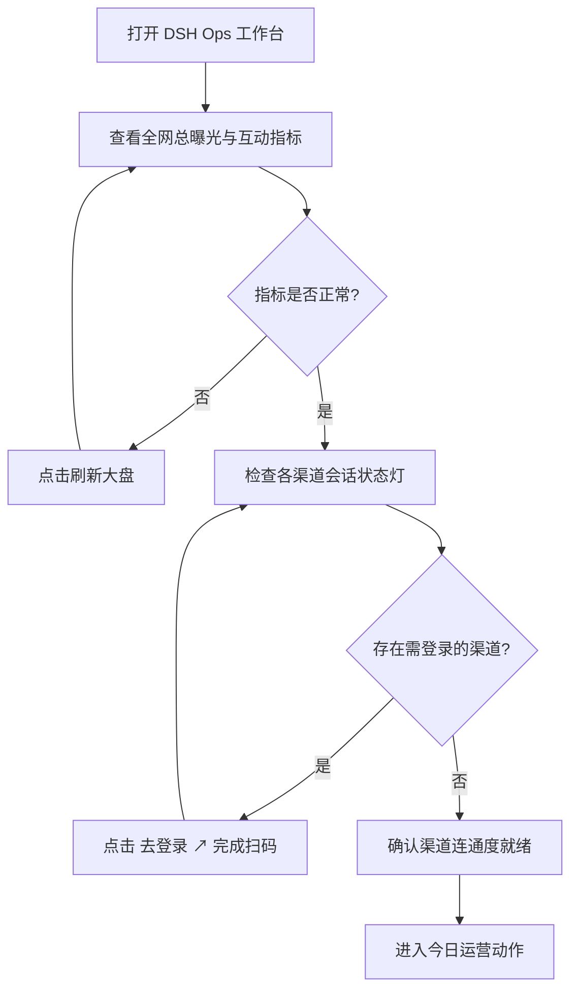
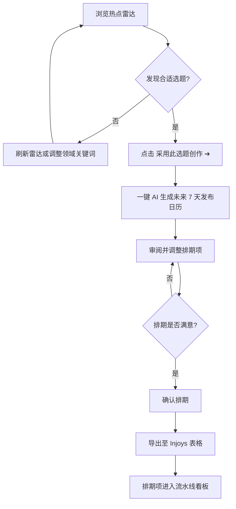
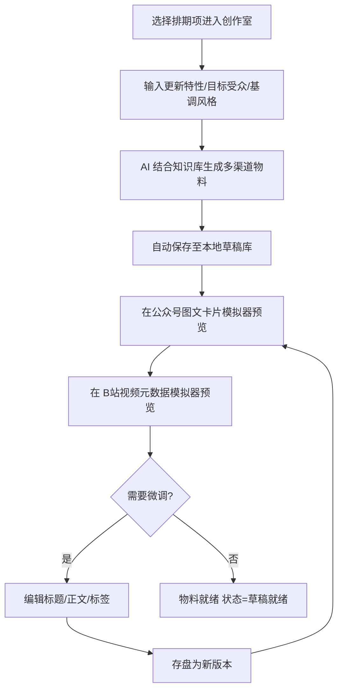
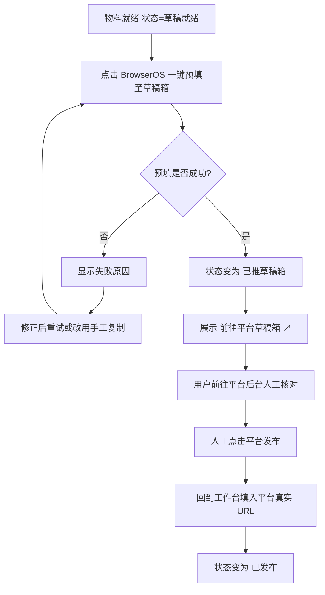
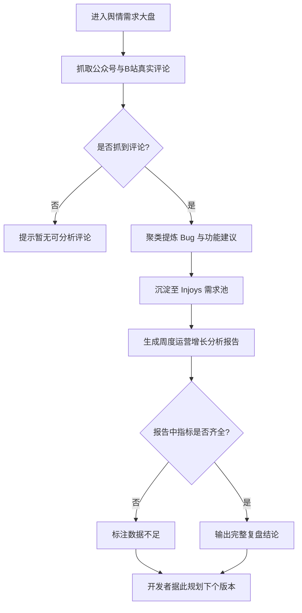

# 用户旅程 (User Journeys)

> **Metadata**
> - **Source**: `.context/domain/source/product_requirements.md`（PRD v1.1.0）
> - **Generated At**: `2026-10-16 09:00`
> - **Generator**: `Context-Agent v1.0`

---

## 用户故事层级

| 层级 | 定义 |
|------|------|
| **Epic** | 跨越多个版本的大型业务目标 |
| **Feature** | 具体的模块功能 |
| **User Story** | 最小可交付的用户价值单元 |

> 开发任务（Task）及工时估算属于提案阶段（`openspec/changes/*/tasks.md`），不写在这里。

**Epic 索引（来源：PRD §3.2 旅程五个环节）**

| Epic | 名称 | 对应 Feature |
|------|------|-------------|
| E1 | 晨会巡检与大盘监控 | 运营驾驶舱、引擎状态、渠道矩阵（BR-070 / BR-010 / BR-012） |
| E2 | 选题策划与排期规划 | 热点雷达、排期日历、Injoys 导出（BR-060 / BR-023 / BR-024） |
| E3 | 内容创作与多端自适应 | 创作室、草稿库、跨平台模拟器（BR-030 / BR-031 / BR-032） |
| E4 | 自动化预填与人工发布 | 一键预填、草稿箱直达、回填 URL（BR-021 / BR-022） |
| E5 | 舆情复盘与需求反哺 | 评论抓取、需求池、复盘报告（BR-054 / BR-055） |

---

## 🗺️ 核心用户旅程

### Journey 1: 晨会巡检与大盘监控（Epic E1）

- **角色**: 独立开发者 / 个人创作者
- **目标**: 一屏掌握全网渠道状态与核心指标
- **用户故事**: 作为独立开发者，我希望打开工作台就能看到所有渠道的登录状态与曝光数据，以便于快速判断今天该做什么

**异常分支**:

| 场景 | 用户看到什么 | 业务结果 |
|------|-------------|---------|
| 指标采集失败 | 该指标显示「暂无数据」 | 不展示 0，用户知晓数据缺失（BR-050） |
| 引擎未连通 | 状态灯变红 | 依赖引擎的能力明确提示不可用（BR-073） |
| 渠道无发布权限 | 红色指示灯 | 用户知晓账号权限不足（BR-010） |

---

### Journey 2: 选题策划与排期规划（Epic E2）

- **角色**: 独立开发者 / 个人创作者
- **目标**: 从热点中发现选题并生成未来 7 天排期
- **用户故事**: 作为独立开发者，我希望浏览热点雷达并一键生成排期，以便于不必每天从零思考发什么

**异常分支**:

| 场景 | 用户看到什么 | 业务结果 |
|------|-------------|---------|
| 知识库中枢未连通 | 导出动作提示不可用 | 排期不写入知识库，明确告知（BR-073） |
| 表格导入无数据 | 导入结果为空并说明 | 本地排期不受影响（BR-023） |

---

### Journey 3: 内容创作与多端自适应（Epic E3）

- **角色**: 独立开发者 / 个人创作者
- **目标**: 将选题加工为多渠道可发布的物料
- **用户故事**: 作为独立开发者，我希望 AI 结合产品知识库生成各渠道物料并随时微调，以便于一次创作覆盖多个平台

**异常分支**:

| 场景 | 用户看到什么 | 业务结果 |
|------|-------------|---------|
| 生成耗时过长 | 进度提示，可继续其他操作 | 生成完成后草稿自动落盘（BR-030） |
| 生成内容不满意 | 可重新生成或手工编辑 | 历史版本保留可回溯（BR-030） |
| 本地草稿目录不可用 | 明确提示保存失败 | 不虚报保存成功（**保存失败须如实提示，实现层详见 `criterion §3.5`**；BR-030 只要求"生成后自动存盘"，未规定失败行为） |

---

### Journey 4: 自动化预填与人工发布（Epic E4）

- **角色**: 独立开发者 / 个人创作者
- **目标**: 一键把物料推进平台草稿箱，人工确认后完成发布
- **用户故事**: 作为独立开发者，我希望一键预填到各平台草稿箱并在手机上人工确认发布，以便于省去重复的复制粘贴

> ⚠️ **铁律**：工作台不会代替用户点击平台的「正式发布 / 群发」按钮；状态停留在「已推草稿箱」直至用户回填真实 URL（BR-021 / BR-022）。

**异常分支**:

| 场景 | 用户看到什么 | 业务结果 |
|------|-------------|---------|
| 渠道会话失效 | 提示需登录并提供 `去登录 ↗` | 预填不执行，状态不变（BR-011） |
| 预填执行失败 | 显示失败原因，不显示成功 | 状态保持「草稿就绪」（BR-022 / BR-073） |
| 平台 URL 未填写 | 状态停留在「已推草稿箱」 | 不出现假「已发布」（BR-021） |

---

### Journey 5: 舆情复盘与需求反哺（Epic E5）

- **角色**: 独立开发者 / 个人创作者
- **目标**: 从评论中提炼真实需求并生成复盘结论
- **用户故事**: 作为独立开发者，我希望自动汇总评论区反馈并聚类成需求，以便于让用户声音直接驱动产品迭代

**异常分支**:

| 场景 | 用户看到什么 | 业务结果 |
|------|-------------|---------|
| 评论抓取失败 | 明确提示失败原因 | 不使用示例评论冒充真实反馈（BR-054） |
| 指标数据不足 | 复盘报告标注数据不足 | 不用估算值补齐结论（BR-055） |

---

## 👤 用户画像

### Persona 1: 独立开发者 "Alex"

| 维度 | 描述 |
|------|------|
| **基础信息** | 个人开发者，独自负责一款 AI 产品的研发与运营 |
| **技术能力** | 具备优秀的产品研发能力，熟悉 AI 工具与自动化，愿意调参和尝试新流程 |
| **核心动机** | 产品做得好但没人知道；希望用最少精力获得稳定的多渠道曝光 |
| **使用场景** | 清晨开电脑先看大盘；白天开发间隙写文案；晚上发布并回复评论 |
| **痛点** | 精力被多平台分发、文案撰写、格式排版与评论收集严重分散 |

### Persona 2: 小微产研与技术团队 "Micro Team"

| 维度 | 描述 |
|------|------|
| **基础信息** | 2~5 人的小团队，含 1~2 名兼做运营的成员 |
| **技术能力** | 技术能力强，但缺少专职运营，倾向于用工具替代重复人力 |
| **核心动机** | 以低成本建立国内外多渠道的内容矩阵与品牌声量 |
| **使用场景** | 版本发布前集中产出物料，日常维持更新频率 |
| **痛点** | 没有专职运营，排期容易断档，多平台文案需要反复改写 |

### Persona 3: AI 自动化探索者 "Autonomous Builder"

| 维度 | 描述 |
|------|------|
| **基础信息** | 深度 AI 工具用户，追求「一人公司」式的自动化运营管线 |
| **技术能力** | 熟悉自动化编排，乐于配置定时任务与技能包 |
| **核心动机** | 追求完全自治的运营管线，把重复劳动交给自动化 |
| **使用场景** | 配置定时巡检任务，定期查看自动生成的排期与复盘 |
| **痛点** | 现有工具在关键环节仍要人工介入，流程断点多 |

---

## ⚠️ 异常流程

> 只写用户操作时遇到的情况，以及用户看到的结果；不写内部机制。

| 场景 | 触发条件 | 用户看到什么 / 如何处理 | BR 引用 |
|------|----------|----------------------|---------|
| 渠道会话失效 | 平台登录态过期 | 琥珀色指示灯与 `去登录 ↗` 按钮，重新扫码后恢复就绪 | BR-010 / BR-011 |
| 账号无发布权限 | 已登录但未开通创作者权限 | 红色指示灯，提示账号权限不足 | BR-010 |
| 引擎未连通 | 知识库或浏览器引擎未接入 | 状态灯变红，相关能力明确提示不可用，不返回假成功 | BR-073 |
| 预填执行失败 | 平台页面结构与预期不符 | 显示失败原因，状态停留在「草稿就绪」 | BR-022 |
| 指标采集失败 | 平台未采集成功或暂不支持 | 指标显示「暂无数据」，不显示 0 | BR-050 |
| 复盘数据不足 | 历史数据未覆盖完整对比窗口 | 报告标注数据不足，环比显示为空 | BR-055 |
| 评论抓取为空 | 内容暂无评论 | 提示暂无可分析评论 | BR-054 |

---

## 🎯 客户旅程地图 (Customer Journey Map)

> 来源：PRD §3.2 典型用户旅程（五环节），痛点与机会点依据 PRD §2.1 现状痛点推导。

| 阶段 | 发现与接入 | 选题与排期 | 创作与预览 | 预填与发布 | 复盘与反哺 |
|------|-----------|-----------|-----------|-----------|-----------|
| **用户行为** | 配置知识库与浏览器引擎，完成各渠道扫码登录 | 浏览热点雷达，采用选题，生成 7 天排期并导出 | 生成多渠道物料，在模拟器中预览微调并存盘 | 一键预填至草稿箱，前往平台后台人工发布，回填 URL | 查看评论提炼、需求池与周度复盘报告 |
| **痛点** | 多个浏览器实例导致"看似就绪实则失效" | 缺乏可视化日历大盘，排期靠聊天手工调用 | 缺少所见即所得的真实样式预览与本地持久化 | 复制粘贴重复劳动，缺少草稿直达入口 | 评论散落各处，未形成需求池闭环 |
| **机会点** | 统一浏览器实例探活，四态状态灯杜绝假就绪 | 热点雷达 + 一键排期 + 表格互联 | 跨平台真实模拟器 + 本地草稿库多版本存盘 | 一键预填 + `前往草稿箱 ↗` 直达链接 | 评论聚类为 Bug / Feature 并沉淀需求池 |
| **成功信号** | 渠道连通度显示 `2 / 2` 就绪 | 排期项完整出现在流水线看板 | 同一主题产出多端物料且可编辑 | 平台后台可见草稿，状态转为「已发布」 | 需求池中出现来自真实评论的诉求 |
