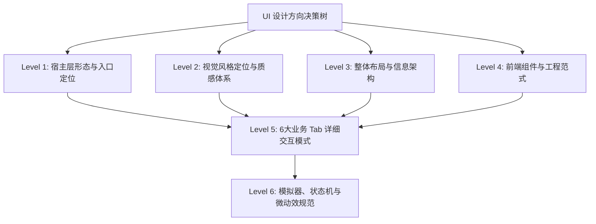

# Growth Studio (dsh-growth-studio) UI 设计方向与交互规格说明书

> **文档状态**：已定稿（Finalized via Context Interview；2026-10-21 按 PRD/BR/criterion MUST 口径修订冲突项）  
> **定稿日期**：2026-10-20  
> **修订日期**：2026-10-21  
> **依据规范**：`.context/criterion.md`、`.context/domain/source/product_requirements.md`、`.context/domain/business_rules.md`  
> **目标**：为 DeepSeek Harness (DSH) 增长运营工作台建立统一、现代、具有 SaaS 质感的 UI 设计方向与前端交互规范。
>
> **权威层级（冲突时）**：
> 1. 工程硬约束 → `.context/criterion.md`（槽位、令牌、禁止客户端写状态机）
> 2. 业务枚举与阶段范围 → PRD / `business_rules.md` / `src/types.ts`
> 3. 视觉与交互细节 → 本文（DEC-UI-*），但不得覆盖上两级 MUST

---

## 1. 背景与技术基线（先查后问查明约束）

根据 `.context/criterion.md` 与当前代码库审计，UI 设计必须遵循以下**不可变硬约束**：

| 约束维度 | 规则定义与要求 | 来源 |
|---------|-------------|------|
| **宿主环境** | DSH Desktop 渲染进程，基于 Cordis 扩展机制 (`window.__ModuleLoader__.load`) | criterion §3.1 / §3.3 |
| **入口槽位** | **当前可实施入口仅为** `settings.section`（`id: 'ops'`，`order: 60`）。DEC-UI-001 的独立主视图是目标形态，**未获 criterion 授权前不得自行注册主侧边栏/主窗口槽位** | criterion §3.1 |
| **前端框架** | React 18 + esbuild 构建打包，外部注入 React/ReactDOM | criterion §3.3 |
| **样式模块** | **当前准则指定** `plugin-src/client/ops-styles.js` 对齐 DSH 令牌。§6 的 `styles/*.css` + JSX 原子目录是目标重构，须先提案更新 criterion §3.3 再落地 | criterion §3.3 |
| **样式与色彩** | 背景 / 边框 / 文字 **必须**绑定 `var(--dsw-alias-*)`（`--dsw-alias-bg-layer-1/2/3`、`--dsw-alias-border-l1/l2`、`--dsw-alias-label-primary/secondary/tertiary`）。交互点缀色是令牌化**唯一例外**，权威取值：主操作蓝 `#1677ff`、安全绿 `#15803d`、告警橙 `#b45309`、活力紫 `#7c3aed`。禁止把未验证的 `--dsw-alias-brand-primary` / `--dsw-alias-status-*` / `--dsw-alias-border-default` 当作宿主已存在，也禁止用未授权 HEX 作 CSS fallback | criterion §3.1 / 架构 §5.4 |
| **通信链路** | 严格通过 `callOpsRpc` 进行网关通信，禁止手写外部 `fetch`，统一 `loading / error / data` 状态域 | criterion §3.3 (MUST) |
| **数据真实性** | 无法获取的指标必须为 `null` 并展示为「暂无数据」，**严禁伪造数据或粗暴显示为 0** | criterion §3.2, §3.3 |
| **发布守卫** | **严禁自动点击正式发布**；客户端**不得**把草稿/排期写成 `published`。回填只调用 `drafts.updatePublishUrl`，由**宿主**用 URL 解析器校验并写状态 | criterion §3.1 / §3.2 / §4 |
| **会话保护** | 零阻碍原则，`needs_login` 显示 `去登录 ↗` 快捷外链，禁止泄露 Cookie | criterion §3.3, §4 |
| **阶段口径** | 本文只用带前缀的阶段名：**UI 批次 1/2** = 客户端界面交付批次（落在路线图**项目 Phase 3**）；**项目 Phase N** = PRD 里程碑。禁止无前缀的「Phase 0」 | PRD §七、BR-002、proposal-roadmap |

---

## 2. UI 决策依赖树 (Decision Tree)



- **第一轮 (Round 1 - 已完成)**：确定 Level 1 ~ Level 4 顶层设计方向（宿主形态、视觉基调、整体布局、工程范式）。
- **第二轮 (Round 2 - 已完成)**：细化 Level 5 六大 Tab（驾驶舱、排期日历、创作室、AI工具、舆情大盘、配置）的卡片与网格交互。
- **第三轮 (Round 3 - 已完成)**：规范 Level 6 模拟器拟真度、草稿预填动画、异常/空状态、无障碍与动效。
- **收尾确认 (Wrap-up - 已完成并通过)**：12 项核心决策达成共识，全面定稿并归档。

---

## 3. 访谈决策记录表 (Decision Matrix)

| 决策编号 | 决策议题 | 当前状态 | 最终结论 | 决策理由 / 备选考量 |
|---------|---------|---------|---------|-------------------|
| **DEC-UI-001** | 工作台在 DSH 中的承载形态与主入口 | **已决策（实施门禁）** | **目标形态**：独立工作台主视图（主侧边栏/主窗口级入口）+ 设置页保留引擎配置与快捷跳转联动。**当前可实施**：仅 `settings.section`（`id: 'ops'` / `order: 60`）；独立主视图须先走 OpenSpec 提案更新 criterion §3.1 后再落地 | 6大Tab信息量大，仅放设置弹窗过窄；但槽位契约以 criterion 为准，不得先斩后奏 |
| **DEC-UI-002** | 视觉风格与质感定位 | **已决策** | **Modern Pro SaaS 风格（Linear/Raycast 质感，高信息密度、精细边框微质感，严格绑定 DSH Token 深浅色）**。**显式不采纳** PRD §六「毛玻璃背景」——与 Linear 平面分层冲突 | 契合专业运营者心智；毛玻璃会破坏信息密度与宿主原生质感 |
| **DEC-UI-003** | 页面主布局与导航组织模式 | **已决策** | **顶部常驻全局驾驶舱状态栏 (Sticky KPI & Engine Ribbon) + 紧凑分段式 Tab**。Tab **顺序与命名对齐 PRD/criterion**：运营驾驶舱 / 排期日历流水 / 内容创作室 / AI工具中枢 / 舆情需求大盘 / 引擎策略配置 | 保证宽屏利用率；导航文案与顺序不得另造 |
| **DEC-UI-004** | 客户端工程与组件构建策略 | **已决策（实施门禁）** | **目标**：JSX 模块化与原子组件分目录。**当前准则**仍指定 `ops-page.js` + `ops-styles.js`；目录重构须先提案更新 criterion §3.3 | 拆分可维护性，但不得绕过现行 SSoT |
| **DEC-UI-005** | 内容创作室与多端拟真预览交互 | **已决策** | **左右双栏响应式分屏（左侧多渠道表单与 AI 润色区，右侧公众号/B站卡片模拟器 + 底部预填与回填栏）** | 边写边预览，直接实现所见即所得与预填闭环 |
| **DEC-UI-006** | 排期日历流水线视图模式 | **已决策** | **双视图架构（默认 5 态看板流水，支持卡片拖拽与阶段跃迁，可一键无缝切换周排期日历视图）** | 兼顾漏斗流转与时间节点管控 |
| **DEC-UI-007** | 运营驾驶舱卡片与热点雷达交互 | **已决策** | **矩阵卡片使用 PRD 会话四态**（`unknown` / `needs_login` / `authenticated` / `no_publish_permission`），原地无刷新探活；`needs_login` 提供 `去登录 ↗`；热点「采用此选题创作 ➔」切入创作室并预填标题与基调。**UI 批次 1 渠道矩阵仅公众号 + B 站两张卡片**，未交付渠道不计入连通度 | 对齐 BR-002 / BR-010 / BR-012；禁止「故障」替代「无权限」 |
| **DEC-UI-008** | AI 运营工具中枢展现形式 | **已决策** | **双层模式（默认运营场景卡片引导，点击展开右侧抽屉式可视化调试沙箱，展示表单、原始 JSON 与耗时日志）** | 降低普通运营者门槛，兼顾高阶排查需求 |
| **DEC-UI-009** | 发布闭环守卫与 Human-in-the-Loop 交互 | **已决策** | **预填成功弹出常驻通知条引导「去平台后台确认发布 ↗」/「前往平台草稿箱 ↗」**；URL 回填仅调用 `drafts.updatePublishUrl`，由**宿主**用 URL 解析器校验并写 `published`。客户端不得本地跃迁状态 | 对齐 criterion §3.1 与 `api_strategy.md` published 守卫 |
| **DEC-UI-010** | 全站空状态与 null 数据展示标准 | **已决策** | **规范化“微图标 + 解释文案 + 行动按钮引导”空状态卡片；指标字段为 null 时统一展示中性灰色「暂无数据」徽章并提供悬浮原因提示** | 避免误判为 0，引导下一步操作 |
| **DEC-UI-011** | 交互微动效与反馈设计标准 | **已决策** | **采用 150ms~200ms 缓动微动效：卡片 Hover 轻量上浮与微光边框、状态徽章呼吸闪烁、操作反馈全局 Toast 5 秒渐隐** | 提升 Modern SaaS 质感，兼顾低耗性能 |
| **DEC-UI-012** | UI 批次 1 交付范围优先级取舍 | **已决策** | **UI 批次 1**（路线图项目 Phase 3 客户端内的首批界面）优先深度打通「运营驾驶舱 + 内容创作室 + 引擎策略配置」；排期日历与 AI 工具中枢提供基础看板与轻量交互，**UI 批次 2** 扩充。业务渠道范围仍是**项目 Phase 0** = 公众号+B站 | 阶段名必须带「UI 批次」或「项目 Phase」前缀 |
| **DEC-UI-013** | 极窄与小屏断点响应式机制 | **已决策** | **设定 960px 响应式折叠断点：小于 960px 时创作室左右双栏自动退化为上下垂直流，KPI Ribbon 网格转为 2x2 布局** | 保障小屏笔记本、分屏平铺窗口下的工作台可用性 |
| **DEC-UI-014** | 全局无障碍与高频快捷键体系 | **已决策** | **支持 Cmd/Ctrl+S（保存草稿）、Cmd/Ctrl+Enter（一键预填）、Cmd/Ctrl+R（刷新大盘）等高频快捷键** | 大幅提升专业创作者与独立开发者的高频物料生产效率 |
| **DEC-UI-015** | 国际化 i18n 文本管理架构 | **已决策** | **首版中文打底**。静态/动态文案键放在仓库根 `locale/zh.json`（及后续 `locale/<locale>.json`），取值优先级：`ctx.i18n.text(key)` → 当前 locale 文件 → `locale/zh.json` 回退。禁止 JSX 深层写死用户可见文案。键名 `ops.<area>.<name>`（例：`ops.header.refresh`） | 现有 `locale/zh.json` 仅有 `meta.title/description`，工作台文案按此契约增量补键 |

---

## 4. 详细视觉与布局规范 (Visual & Layout System)

### 4.1 整体工作台布局骨架 (Desktop Layout Paradigm)

```text
┌────────────────────────────────────────────────────────────────────────────────────────┐
│ [Growth Studio] [当前产品: DeepSeek Harness ▾]  [● Injoys MCP: 连通] [● BrowserOS: 2/2 已认证]│
│ 快捷行动: [+ 生成 7 天排期日历] [✍ 新建多端物料] [🔄 刷新大盘]                            │
├────────────────────────────────────────────────────────────────────────────────────────┤
│ 核心数据看板 (Sticky KPI Ribbon) — 命名与口径对齐 PRD §5.1.2：                           │
│ ┌──────────────────┐ ┌──────────────────┐ ┌──────────────────┐ ┌──────────────────┐   │
│ │ 全网曝光/播放总量 │ │ 互动与关注增长   │ │ 排期履约流水     │ │ 分发矩阵连通度   │   │
│ │ 128.4k   ↑14.2%  │ │ 3,420    ↑8.1%   │ │ 5 / 7 篇  (71%)  │ │ 2 / 2 已认证就绪 │   │
│ └──────────────────┘ └──────────────────┘ └──────────────────┘ └──────────────────┘   │
│ 第 4 项只统计 SessionState=authenticated；unknown / needs_login / no_publish_permission 不计分子 │
├────────────────────────────────────────────────────────────────────────────────────────┤
│ 工作区分段导航 (顺序对齐 PRD/criterion)：                                               │
│ [ 🌟 运营驾驶舱 ]  [ 📅 排期日历流水 ]  [ ✍ 内容创作室 ]  [ 🛠 AI工具中枢 ]  [ 📊 舆情需求大盘 ]  [ ⚙ 引擎策略配置 ] │
├────────────────────────────────────────────────────────────────────────────────────────┤
│ 主工作画布 (Active Workspace Canvas):                                                  │
│                                                                                        │
│ (以「内容创作室」为例：左右双栏响应式分屏)                                                │
│ ┌────────────────────────────────────────┬───────────────────────────────────────────┐ │
│ │ 左栏：多端物料编辑与 AI 润色面板         │ 右栏：真实平台拟真卡片模拟器与发布预填        │ │
│ │ - 本次更新特性 / 目标受众 / 基调风格   │ - [微信公众号：朋友圈卡片 + 文章详情]      │ │
│ │ - 标题候选生成 (带热度评分)            │   ┌─────────────────────────────────────┐ │ │
│ │ - 正文 Markdown / 富文本编辑器         │   │ [微信封面] 标题: 如何用 AI 重塑运营   │ │ │
│ │ - 摘要 / 标签 Tags 提取                │   │ 摘要: 深度解析 DSH 插件机制...       │ │ │
│ │ - 一键调用 AI 工具润色                 │   └─────────────────────────────────────┘ │ │
│ │                                        │ - [B站：3 套标题 / 标签词云 / 分区]         │ │
│ │                                        │ ───────────────────────────────────────── │ │
│ │ [ 💾 保存本地草稿 ]                    │ 底部操作栏:                               │ │
│ │ [ 📋 一键复制物料 ]                    │ [ 🚀 一键预填至草稿箱 (BrowserOS) ]        │ │
│ │ [ 💾 沉淀至 Injoys 知识文档 ]          │ [ 🔗 回填 URL → 调用 drafts.updatePublishUrl ]│ │
│ └────────────────────────────────────────┴───────────────────────────────────────────┘ │
└────────────────────────────────────────────────────────────────────────────────────────┘
```

---

### 4.2 DSH 设计令牌绑定与色彩系统 (Design Tokens & Color Palette)

严格遵从 `criterion.md` §3.1 / 架构 §5.4：**背景 / 边框 / 文字只绑宿主 alias**；交互点缀色是令牌化唯一例外，只用授权的四个 HEX。下表 Light/Dark 列为宿主 token 的观测参考，**禁止写进组件**。

| 语义层 | 实施绑定 | 观测参考（非硬编码） | 适用场景 |
|-------|---------|---------------------|---------|
| **主背景底色** | `var(--dsw-alias-bg-layer-1)` | Light `#f8f9fb` / Dark `#111215` | 工作台外层容器底层背景 |
| **工作区/卡片底色** | `var(--dsw-alias-bg-layer-2)` | Light `#ffffff` / Dark `#18191d` | 模块卡片、工作区主体 |
| **浮层/输入底色** | `var(--dsw-alias-bg-layer-3)` | Light `#f0f2f5` / Dark `#22242a` | Hover 卡片、表单输入框、下拉菜单 |
| **一级主文本** | `var(--dsw-alias-label-primary)` | Light `#1f2329` / Dark `#f5f6f7` | 卡片标题、核心指标数字、主导航 |
| **二级正文** | `var(--dsw-alias-label-secondary)` | Light `#4e5969` / Dark `#c5c8ce` | 描述文案、表单标签、副标题 |
| **三级弱化文本** | `var(--dsw-alias-label-tertiary)` | Light `#86909c` / Dark `#7a808d` | 占位符、时间戳、空状态、`unknown` 灰灯、`null` 徽章 |
| **边框 L1** | `var(--dsw-alias-border-l1)` | 宿主主题 | 分割线、外层描边 |
| **边框 L2** | `var(--dsw-alias-border-l2)` | 宿主主题 | 卡片 / 输入框边框 |
| **主操作蓝** | `#1677ff`（架构 §5.4 例外） | 同左 | 主按钮、选中 Tab、链接、卡片 Hover 描边 |
| **安全绿** | `#15803d`（架构 §5.4 例外） | 同左 | `authenticated`、已预填、连接正常 |
| **告警橙** | `#b45309`（架构 §5.4 例外） | 同左 | `needs_login`、待回填 URL；**无权限若宿主无 error alias，亦用此色 + 文字「无权限」，不得另造红 HEX** |
| **活力紫** | `#7c3aed`（架构 §5.4 例外） | 同左 | 强调点缀（热点采用等），不可替代状态语义 |

> **禁止**：`--dsw-alias-border-default`、`--dsw-alias-brand-primary`、`--dsw-alias-status-*` 及 `#22c55e` / `#f59e0b` / `#ef4444` 作为实施绑定。PRD 对 `no_publish_permission` 写「红色指示灯」，但 criterion 未授权独立红 HEX；实施以文字状态名 + 告警橙（或宿主若已暴露的 error alias，须先在提案中登记）表达，满足「不只靠颜色」。

---

### 4.3 交互微动效规范 (Micro-animations Standard)

- **持续时间**：统一采用 `150ms ~ 200ms` 的加速缓出曲线 `cubic-bezier(0.16, 1, 0.3, 1)`。卡片 Hover、Toast 进入动画与其它微交互**同一曲线**，不以 `ease` 作为卡片例外。
- **卡片 Hover 响应**：
  ```css
  .dim-ops-card {
    transition: transform 180ms cubic-bezier(0.16, 1, 0.3, 1),
                box-shadow 180ms cubic-bezier(0.16, 1, 0.3, 1),
                border-color 180ms cubic-bezier(0.16, 1, 0.3, 1);
  }
  .dim-ops-card:hover {
    transform: translateY(-2px);
    border-color: #1677ff;
    box-shadow: 0 4px 16px -2px rgba(0, 0, 0, 0.08);
  }
  ```
- **呼吸状态指示灯**：
  ```css
  @keyframes dimStatusPulse {
    0%, 100% { opacity: 1; transform: scale(1); }
    50% { opacity: 0.55; transform: scale(0.92); }
  }
  .dim-status-dot[data-status="authenticated"] {
    animation: dimStatusPulse 2.4s ease-in-out infinite;
  }
  ```
- **全局通知 Toast**：顶部滑入动画 `dimOpsSlideDown 200ms cubic-bezier(0.16, 1, 0.3, 1)`，停留 5 秒后自动淡出消失。预填成功的**常驻通知条**（DEC-UI-009）与 5 秒 Toast 是不同组件，不得共用自动淡出。

---

### 4.4 响应式断点与分屏自适应规范 (Responsive Breakpoints & Flow)

为兼容开发者在 13/14 寸笔记本全屏、大屏外接显示器及桌面分屏场景，制定以下断点标准：

| 视口宽度断点 | 布局形态 | 创作室 (Content Studio) 表现 | KPI Ribbon 表现 |
|------------|---------|---------------------------|----------------|
| **≥ 1280px (宽屏)** | 宽松宽屏模式 | 左右 50%/50% 双栏并排，完整显示拟真机型边框 | 4 列等宽单行横向排列 |
| **960px ~ 1279px (标准)** | 紧凑工作台模式 | 左右 55%/45% 双栏并排，紧凑型拟真卡片 | 4 列等宽单行紧凑排列 |
| **< 960px (窄屏/分屏)** | 垂直单列流模式 | **自动折叠为上下堆叠**：上方编辑区，下方预览模拟器 | 自动折叠为 2x2 网格卡片 |

---

### 4.5 全局无障碍与高频键盘快捷键 (Keyboard Shortcuts Map)

支持原生 Mac/Windows 快捷键监听，带有防抖与操作保护：

| 快捷键 (Mac / Win) | 触发范围 | 行为与防呆机制 |
|-------------------|---------|--------------|
| `Cmd + S` / `Ctrl + S` | 创作室编辑区 | 立即触发本地草稿即时保存 (`drafts.save`)，弹出轻量 Toast 提示「草稿已保存」 |
| `Cmd + Enter` / `Ctrl + Enter` | 创作室编辑区 | 触发 BrowserOS「一键预填草稿箱」，执行前弹层提示二次防呆，执行中展示按钮 Loading |
| `Cmd + R` / `Ctrl + R` | 全局工作台 | 触发「刷新大盘」，就地重新探活 BrowserOS 会话与拉取最新数据（阻止浏览器默认硬刷新）。与卡片「原地探活」/「刷新大盘」按钮共用同一 in-flight 去重（见下） |
| `Esc` | 抽屉 / 模态层 | 快速关闭右侧 AI 工具调试抽屉或快捷表单弹层 |

---

### 4.6 国际化多语言文本架构 (i18n Architecture)

- **文件位置**：仓库根 `locale/zh.json`（首版）、后续 `locale/<locale>.json`。
- **键名**：`ops.<area>.<name>`（例：`ops.header.refresh`、`ops.session.needs_login`）。
- **取值优先级**：`ctx.i18n.text(key)` → 当前 locale 文件 → `locale/zh.json`。
- **禁止**：在 JSX 组件深层写死用户可见文案。现有 `locale/zh.json` 仅含 `meta.title` / `meta.description`，工作台文案按本契约增量补键。

### 4.7 刷新入口与 in-flight 去重 (Refresh Dedup)

- **触发入口**（共用同一请求状态，不得各自发独立 RPC）：卡片「原地探活」、Header「🔄 刷新大盘」、`Cmd/Ctrl+R`。
- **去重范围**：以**卡片 / 对应 RPC** 为键（如 `browser.sessions` 与 `workbench.overview` 各自一把 in-flight）。请求未完成时，任一入口的连续点击或快捷键**只执行一次**对应请求；完成后或失败后释放。
- **快捷键防抖不能替代**跨入口在途去重。
- **项目 Phase 0** 不自建 WebSocket / SSE，也不做后台定时轮询（criterion §3.4）。刷新仅用户手动触发 + 局部状态替换。

---

## 5. 六大业务 Tab 详细交互规格 (Feature Workspaces Spec)

### 5.1 运营驾驶舱 (Overview & Cockpit) `[UI 批次 1 核心 / 业务项目 Phase 0]`
- **平台矩阵网格 (Platform Matrix)**：
  - **UI 批次 1 / 项目 Phase 0 只展示两张卡片**：微信公众号、哔哩哔哩。视频号 / 抖音属**项目 Phase 1**，海外四渠道属**项目 Phase 2**，**不得出现在矩阵，也不得计入连通度**（BR-002 / BR-012）。
  - 卡片顶部包含渠道 Logo、名称、**会话四态灯**（键值对齐 `SessionState` / PRD §5.2.1 / BR-010）：
    1. `unknown`（未知 / 探测中）— 灰灯（`--dsw-alias-label-tertiary`）
    2. `needs_login`（需登录）— 告警橙 + **`去登录 ↗`**
    3. `authenticated`（已认证就绪）— 安全绿 + 呼吸灯
    4. `no_publish_permission`（无权限）— 告警橙（或已登记的宿主 error alias）+ 文字「无权限」，**禁止用「故障」替代**
  - 数据区域展示核心指标（曝光/播放、互动与关注）。客户端**只展示宿主汇总结果**，不在前端重算全网总量。
  - 指标 `null` →「暂无数据」中性徽章 + 悬浮原因，**不得显示为 0**。平台真实 `0` 是有效值，须与 `null` 区分。
  - **覆盖范围**：应采平台未全部成功时，汇总值为 `null`（不得只加总已成功平台冒充全网）；须展示宿主下发的 `measuredPlatforms` / `unmeasuredPlatforms`。
  - **环比**：历史不足以覆盖完整对比窗口时 delta 为 `null`，展示「暂无环比」，禁止估算。
  - **KPI-1 注释**（PRD §5.1.2）：副标题固定为「全网非去重曝光与播放累计人次」。
  - 底部操作栏：「🔄 原地探活」无整页刷新；与全局刷新共用 in-flight 去重（§4.7）；`needs_login` 才出现「去登录 ↗」。
- **Sticky KPI Ribbon**：四卡命名对齐 PRD §5.1.2。第 4 项「分发矩阵连通度」只统计 `authenticated`；**项目 Phase 0** 分母为 2。
- **全局快捷行动组**（BR-083）：`+ 生成 7 天排期日历`、`✍ 新建多端物料`（切创作室并聚焦输入）、`🔄 刷新大盘`（走 §4.7 去重）。
- **全网热点雷达 (Trends Radar)**：
  - 展示热点选题（标题、热度指数、建议渠道）。
  - 点击「采用此选题创作 ➔」：切至内容创作室，预填**标题与基调**（PRD §5.2.2）。

### 5.2 内容创作室与多端模拟器 (Content Studio) `[UI 批次 1 核心 / 业务项目 Phase 0]`
- **左右分屏架构**：
  - **左侧编辑面板**：产品上下文；**本次更新特性、目标受众、基调风格**（PRD §5.4.1）；标题；正文富文本/Markdown；一键 AI 润色。
  - **右侧多平台模拟器**（BR-032）：
    - **微信公众号**：朋友圈分享卡片 + 文章详情，Markdown 代码高亮。
    - **B 站**：3 套候选爆款标题、结构化简介、标签词云、分区选择。
- **MVP 草稿边界**（BR-030）：只保留当前草稿；覆盖保存；**不提供**历史查看 / 版本恢复 / 版本快照。`version` 仅并发控制。
- **物料操作条**（BR-033 / PRD §5.4.3）：
  - `📋 一键复制物料`（**项目 Phase 0** 首版，纯客户端剪贴板）。
  - `💾 沉淀至 Injoys 知识文档`（宿主能力属**项目 Phase 2**，本界面按钮接入属**项目 Phase 3**；按已归档提案 `fix-unauthorized-injoys-doc-write` 与路线图调整，原 Phase 0 首版目标尚未交付；**仅用户显式点击后**才写入 Injoys）。
  - `💾 保存本地草稿`（`drafts.save`；不得传 `status: 'published'`）。
- **预填与发布闭环栏 (Human-in-the-loop Guard)**：
  - `🚀 一键预填至草稿箱 (BrowserOS)`：Loading + 成功通知「已成功预填，请前往平台人工审核发布」+ `前往平台草稿箱 ↗`。
  - `真实发布 URL 回填`：客户端只调用 `drafts.updatePublishUrl`；**宿主**用 URL 解析器校验（禁止宽松正则）并写入状态。多渠道时仅全部回填才 `published`，部分回填保持 `prefilled` 并展示「已发布 n/m 渠道」。客户端**禁止**本地把状态设为 `published`。

### 5.3 排期日历流水 (Calendar & Pipeline) `[UI 批次 1 基础看板 / UI 批次 2 深度]`
- **5 态看板泳道**（键值对齐 `ItemStatus` / PRD §5.3.1 / BR-020，**禁止** `writing` / `drafted`）：
  - 列 1：`计划中 (planned)`
  - 列 2：`撰写中 (drafting)`
  - 列 3：`草稿就绪 (draft_ready)`
  - 列 4：`已推草稿箱 (prefilled)`
  - 列 5：`已发布 (published)`
- **卡片内容**：内容标题、平台图标、计划日期、当前操作快捷按钮。`published` 不可经 `calendar.updateStatus` 写入。
- **Injoys 同步（BR-024，项目 Phase 0 首版）**：提供两个独立动作 `📥 导出至 Injoys 表格` 与 `从 Injoys 导入`；单向、以本地为准；不得宣称双向实时同步。
- **视图切换**：`[ 📋 看板流水 ]` 与 `[ 📅 周排期日历 ]`。拖拽深度为 UI 批次 2。

### 5.4 AI 工具中枢与调试沙箱 (AI Ops Tools Hub) `[UI 批次 1 场景卡片 + 抽屉]`
- **场景化卡片引导**：按运营场景分类展示工具集（如：`一键生成复盘报告`、`抓取评论与舆情聚类`、`多端发布物料生成`）。
- **右侧调试抽屉 (Drawer Console)**：
  - 点击任一工具卡片展开右侧抽屉。
  - 上方：可视化参数输入表单（带校验与占位提示）。
  - 下方：可折叠展示**已脱敏**的请求/响应结构化视图、执行耗时（如 `1,240ms`）。
  - **日志与遥测脱敏（criterion §4 / 安全策略）**：
    - 令牌、Cookie **不得**进入调试展示、错误回显、日志或遥测。
    - 完整正文 **不得**进入日志与遥测；工作台正文预览按业务需要显示，不等于记日志或上报遥测。
  - **配置表单明文回填例外**仅适用于本机受信任 DSH 客户端的 `config.get` / `config.save` 显隐切换，**不授权**把明文 token 写入调试抽屉或日志。

### 5.5 舆情需求大盘 (Social Listening) `[UI 批次 1 基础指标 / 项目 Phase 1 聚类]`
- **项目 Phase 0 基础指标**（PRD §5.6，仅公众号+B站）：播放/阅读量、点赞、评论、分享、收藏；采集失败为 `null` →「暂无数据」，禁止 0。
- **项目 Phase 1**：真实评论抓取 + `IssueExtractor` 需求聚类反哺；基于真实数据的复盘报告。

### 5.6 引擎与策略配置 (Integrations & Governance) `[UI 批次 1 核心]`
- **入口图标（宿主导航 chrome，非工作台 Header 控件）**：`settings.section` 导航注入使用 **大喇叭 (Megaphone)** 矢量图标（BR-080 / `plugin-src/client/index.js`）。工作台画布内不再重复放置该图标。
- **信息架构**：引擎策略配置 → BrowserOS 浏览器引擎 → **能力管理**（与 AI 工具中枢的 `ops_*` 开关是两层，必须同时满足）。
- **Injoys MCP 配置卡片**：Endpoint、Token 显隐、连通性测试。
- **BrowserOS 能力管理**（PRD §5.7.1）：列出**当前连接实际暴露**的工具 + 启停开关；**默认八项**（`tabs` / `navigate` / `snapshot` / `act` / `read` / `grep` / `wait` / `upload`）是默认启用集，**不是上限**；其余实际暴露工具默认关、允许手动开；未暴露的不列出、不伪造。
- **本地草稿目录**：可配置（默认 `$DSH_HOME/growth-studio/drafts/`）+ 健康度检查。`config.save` 改 `draftsDir` 前由宿主预检，失败返回 `config/invalid-drafts-dir`，界面展示错误、不得先报成功（BR-030 / criterion §3.2）。
  - **切换成功后必须同时展示三项事实**（criterion §3.5，照原文）：「新目录对后续操作生效；正在进行的保存仍写入原目录。旧草稿不会自动迁移。」不得改写、合并或省略任一句。
- **全局运营策略**：默认产品名、**调性基调**、保存即时生效（PRD §5.7）。

---

## 6. 客户端工程目录结构规范 (plugin-src/client Refactoring)

为支撑上述设计方向，客户端**目标**从单文件 `ops-page.js` 重构为 JSX 模块化组件体系。

> **实施门禁**：criterion §3.3 当前指定 `ops-page.js` + `ops-styles.js`，入口槽位为 `settings.section`。下列目录是目标结构，**落地前须 OpenSpec 提案更新 criterion**；在此之前新增 UI 仍写入现行文件，不得私自改槽位或拆出未授权 CSS 入口。

```text
plugin-src/client/
├── index.js                     # 当前：settings.section id=ops order=60 + Megaphone 导航图标
├── ops-page.js                  # 当前工作台（criterion 现行）
├── ops-styles.js                # 当前样式模块（criterion 现行）
├── build.mjs                    # esbuild 构建配置（支持 JSX/TSX 编译与 CJS 打包）
├── styles/                      # 目标拆分（须提案）
│   ├── base.css                 # 基础 Reset、动画与 DSH Token 映射
│   ├── layout.css               # 工作台外层骨架、Sticky Ribbon、Segmented Tabs 样式
│   └── components.css           # 通用卡片、表单、按钮、徽章与模拟器样式
├── components/
│   ├── ui/                      # 基础原子设计组件 (Atomic UI)
│   │   ├── Button.jsx           # 主/次/告警(危险语义)/图标；危险变体用 #b45309 + 文字，不得另造红 HEX
│   │   ├── Badge.jsx            # 状态徽章（四态灯、null中性徽章）
│   │   ├── Card.jsx             # 标准卡片容器（Hover微动效）
│   │   ├── MetricBox.jsx        # KPI 指标卡（环比、数值、null占位）
│   │   ├── SegmentedTabs.jsx    # 工作区分段切换器
│   │   └── EmptyState.jsx       # 统一空状态组件（图标+文案+CTA）
│   ├── simulators/              # 平台拟真卡片模拟器
│   │   ├── WechatCardSimulator.jsx # 微信公众号图文卡片拟真
│   │   └── BilibiliSimulator.jsx   # B站视频详情元数据拟真
│   └── layout/                  # 顶层布局组件
│       ├── HeaderCockpit.jsx    # 顶部驾驶舱常驻栏
│       └── TopKpiRibbon.jsx     # 4 核心指标条
└── workspaces/                  # 6 大业务工作区（顺序对齐 PRD）
    ├── OverviewCockpitTab.jsx   # 1. 运营驾驶舱
    ├── PipelineCalendarTab.jsx  # 2. 排期日历流水
    ├── ContentStudioTab.jsx     # 3. 内容创作室
    ├── ToolsHubTab.jsx          # 4. AI工具中枢与调试抽屉
    ├── SocialListeningTab.jsx   # 5. 舆情需求大盘
    └── SettingsGovernanceTab.jsx# 6. 引擎策略配置
```

---

## 7. 收尾自查与最终确认 (Wrap-up Checklist)

### 7.1 对照覆盖维度自查结果

- [x] **技术实现**：React 18、esbuild、DSH CSS 变量、`callOpsRpc`；入口维持 `settings.section` 直至提案授权主视图。
- [x] **UI/UX**：现代 Pro SaaS（Linear 质感、精细边框）；**不采纳** PRD 毛玻璃。
- [x] **边缘情况**：`null` →「暂无数据」；空状态三件套；`needs_login` → `去登录 ↗`。
- [x] **风险考量**：仅预填；回填经 `drafts.updatePublishUrl`；零 Cookie 外发。
- [x] **权衡取舍**：UI 批次 1 深度打通驾驶舱、创作室、配置；排期/工具中枢基础态。业务渠道 = 项目 Phase 0 公众号+B站。
- [x] **架构决策**：原子目录为**目标重构**，须先更新 criterion §3.3。
- [x] **迁移与兼容**：现行 `ops-page.js` / `ops-styles.js` 在提案落地前仍是唯一实现面。

### 7.2 次级细节建议采纳情况 (Secondary Details Formalized)

经收尾确认，以下 **3 项建议**已全量采纳并升级为系统标准（见 `DEC-UI-013`、`DEC-UI-014`、`DEC-UI-015` 及 §4.4、§4.5、§4.6）：

1. [x] **响应式极窄断点 (DEC-UI-013)**：960px 折叠；创作室双栏退化为上下流，KPI Ribbon 转为 2x2。
2. [x] **快捷键系统 (DEC-UI-014)**：`Cmd/Ctrl + S` / `Enter` / `R`，`Esc` 关闭抽屉。
3. [x] **国际化多语言 (DEC-UI-015)**：`locale/*.json` + `ops.<area>.<name>` + `ctx.i18n.text` 优先级链。

### 7.3 2026-10-21 修订记录（非访谈建议）

- [x] MUST 对齐：会话四态、内容五态、**项目 Phase 0** 两渠道、KPI 口径、导出/导入、复制/沉淀、Megaphone（宿主导航）、draftsDir 可配置、能力开关非上限、宿主写 `published`。
- [x] 2026-10-21 规格补洞：目录切换三项必示提示；KPI 覆盖范围 / 暂无环比 / 非去重注释；刷新 in-flight 去重；调试抽屉脱敏；卡片缓动统一 cubic-bezier。


