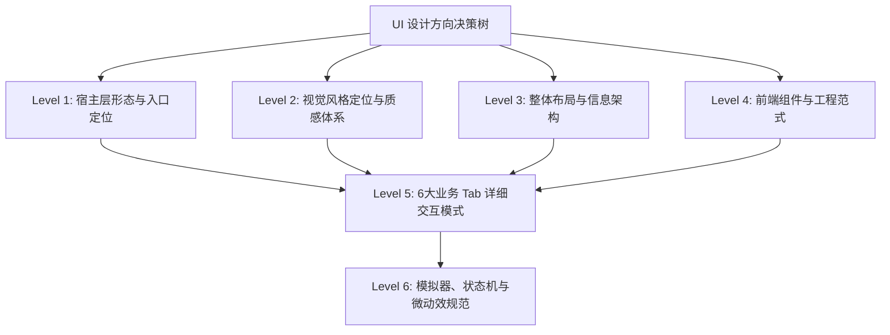

# Growth Studio (dsh-growth-studio) UI 设计方向与交互规格说明书

> **文档状态**：已定稿（Finalized via Context Interview）  
> **定稿日期**：2026-10-20  
> **依据规范**：`.context/criterion.md` §3.3、`.context/domain/source/product_requirements.md`  
> **目标**：为 DeepSeek Harness (DSH) 增长运营工作台建立统一、现代、具有 SaaS 质感的 UI 设计方向与前端交互规范。

---

## 1. 背景与技术基线（先查后问查明约束）

根据 `.context/criterion.md` 与当前代码库审计，UI 设计必须遵循以下**不可变硬约束**：

| 约束维度 | 规则定义与要求 | 来源 |
|---------|-------------|------|
| **宿主环境** | DSH Desktop 渲染进程，基于 Cordis 扩展机制 (`window.__ModuleLoader__.load`) | criterion §3.3 |
| **前端框架** | React 18 + esbuild 构建打包，外部注入 React/ReactDOM | criterion §3.3 |
| **样式与色彩** | **严禁硬编码任何色值**，必须严格绑定 DSH 设计令牌 `var(--dsw-alias-*)`，全面自适应深浅色模式 | criterion §3.3 (MUST NOT) |
| **通信链路** | 严格通过 `callOpsRpc` 进行网关通信，禁止手写外部 `fetch`，统一 `loading / error / data` 状态域 | criterion §3.3 (MUST) |
| **数据真实性** | 无法获取的指标必须为 `null` 并展示为「暂无数据」，**严禁伪造数据或粗暴显示为 0** | criterion §3.2, §3.3 |
| **发布守卫** | **严禁自动点击正式发布**；遵循 Human-in-the-loop 预填与 URL 回填闭环 | criterion §3.2, §4 |
| **会话保护** | 零阻碍原则，未登录平台显示 `去登录 ↗` 快捷外链，禁止泄露 Cookie | criterion §3.3, §4 |

---

## 2. UI 决策依赖树 (Decision Tree)



- **第一轮 (Round 1 - 已完成)**：确定 Level 1 ~ Level 4 顶层设计方向（宿主形态、视觉基调、整体布局、工程范式）。
- **第二轮 (Round 2 - 已完成)**：细化 Level 5 六大 Tab（驾驶舱、排期日历、创作室、AI工具、舆情大盘、配置）的卡片与网格交互。
- **第三轮 (Round 3 - 已完成)**：规范 Level 6 模拟器拟真度、草稿预填动画、异常/空状态、无障碍与动效。
- **收尾确认 (Wrap-up - 已完成并通过)**：12 项核心决策达成共识，全面定稿并归档。

---

## 3. 访谈决策记录表 (Decision Matrix)

| 决策编号 | 决策议题 | 当前状态 | 最终结论 | 决策理由 / 备选考量 |
|---------|---------|---------|---------|-------------------|
| **DEC-UI-001** | 工作台在 DSH 中的承载形态与主入口 | **已决策** | **独立工作台主视图（主侧边栏/主窗口级入口）+ 设置页保留引擎配置与快捷跳转联动** | 6大Tab信息量大，仅放设置弹窗过窄，独立视图赋予宽屏空间 |
| **DEC-UI-002** | 视觉风格与质感定位 | **已决策** | **Modern Pro SaaS 风格（Linear/Raycast 质感，高信息密度、精细边框微质感，严格绑定 DSH Token 深浅色）** | 契合专业运营者心智，兼顾科技美感与原生深浅色一致性 |
| **DEC-UI-003** | 页面主布局与导航组织模式 | **已决策** | **顶部常驻全局驾驶舱状态栏 (Sticky KPI & Engine Ribbon) + 紧凑分段式 Tab (Segmented Workspaces)** | 保证多设备与不同窗口尺寸下的宽屏利用率与关键指标即时可见性 |
| **DEC-UI-004** | 客户端工程与组件构建策略 | **已决策** | **全面启用 JSX 模块化与设计系统原子组件体系（由 esbuild 原生编译，按 Tab 和通用组件分目录维护）** | 利用已有 esbuild 编译能力，拆分原子组件与 6 大业务组件，杜绝单文件 createElement 冗长难维护 |
| **DEC-UI-005** | 内容创作室与多端拟真预览交互 | **已决策** | **左右双栏响应式分屏（左侧多渠道表单与 AI 润色区，右侧公众号/B站卡片模拟器 + 底部预填与回填栏）** | 边写边预览，直接实现所见即所得与预填闭环 |
| **DEC-UI-006** | 排期日历流水线视图模式 | **已决策** | **双视图架构（默认 5 态看板流水，支持卡片拖拽与阶段跃迁，可一键无缝切换周排期日历视图）** | 兼顾漏斗流转与时间节点管控 |
| **DEC-UI-007** | 运营驾驶舱卡片与热点雷达交互 | **已决策** | **矩阵卡片配备四态呼吸状态徽章、原地无刷新探活与“去登录 ↗”快捷外链；热点雷达支持“一键采用”直接流转创作室** | 零摩擦外链与一键选题流转 |
| **DEC-UI-008** | AI 运营工具中枢展现形式 | **已决策** | **双层模式（默认运营场景卡片引导，点击展开右侧抽屉式可视化调试沙箱，展示表单、原始 JSON 与耗时日志）** | 降低普通运营者门槛，兼顾高阶排查需求 |
| **DEC-UI-009** | 发布闭环守卫与 Human-in-the-Loop 交互 | **已决策** | **预填成功弹出常驻通知条引导「去平台后台确认发布 ↗」，并在草稿卡片提供 URL 回填与格式校验，校验通过跃迁为已发布** | 严格符合安全合规，闭环流转顺畅 |
| **DEC-UI-010** | 全站空状态与 null 数据展示标准 | **已决策** | **规范化“微图标 + 解释文案 + 行动按钮引导”空状态卡片；指标字段为 null 时统一展示中性灰色「暂无数据」徽章并提供悬浮原因提示** | 避免误判为 0，引导下一步操作 |
| **DEC-UI-011** | 交互微动效与反馈设计标准 | **已决策** | **采用 150ms~200ms 缓动微动效：卡片 Hover 轻量上浮与微光边框、状态徽章呼吸闪烁、操作反馈全局 Toast 5 秒渐隐** | 提升 Modern SaaS 质感，兼顾低耗性能 |
| **DEC-UI-012** | Phase 0 首版交付范围优先级取舍 | **已决策** | **优先深度打通「运营驾驶舱 + 内容创作室 + 引擎策略配置」，排期日历与 AI 工具中枢提供基础看板与静态/轻量交互，Phase 1 扩充** | 确保端到端闭环可用，降低单期复杂度 |
| **DEC-UI-013** | 极窄与小屏断点响应式机制 | **已决策** | **设定 960px 响应式折叠断点：小于 960px 时创作室左右双栏自动退化为上下垂直流，KPI Ribbon 网格转为 2x2 布局** | 保障小屏笔记本、分屏平铺窗口下的工作台可用性 |
| **DEC-UI-014** | 全局无障碍与高频快捷键体系 | **已决策** | **支持 Cmd/Ctrl+S（保存草稿）、Cmd/Ctrl+Enter（一键预填）、Cmd/Ctrl+R（刷新大盘）等高频快捷键** | 大幅提升专业创作者与独立开发者的高频物料生产效率 |
| **DEC-UI-015** | 国际化 i18n 文本管理架构 | **已决策** | **首版以中文界面打底，但全量静态与动态文案统一挂载至专有字典结构，无缝兼容后续 locale/*.json 多语言** | 为未来海外出海渠道与多语言用户留出免侵入式扩展能力 |

---

## 4. 详细视觉与布局规范 (Visual & Layout System)

### 4.1 整体工作台布局骨架 (Desktop Layout Paradigm)

```text
┌────────────────────────────────────────────────────────────────────────────────────────┐
│ [🚀 Growth Studio] [当前产品: DeepSeek Harness ▾]  [● Injoys MCP: 连通] [● BrowserOS: 4/4 就绪]│ [🔄 刷新大盘] [✍ 新建物料] │
├────────────────────────────────────────────────────────────────────────────────────────┤
│ 核心数据看板 (Sticky KPI Ribbon):                                                       │
│ ┌──────────────────┐ ┌──────────────────┐ ┌──────────────────┐ ┌──────────────────┐   │
│ │ 全网非去重曝光    │ │ 真实互动与关注净增│ │ 本周排期履约流水 │ │ 分发矩阵就绪度   │   │
│ │ 128.4k   ↑14.2%  │ │ 3,420    ↑8.1%   │ │ 5 / 7 篇  (71%)  │ │ 4 / 4 平台就绪   │   │
│ └──────────────────┘ └──────────────────┘ └──────────────────┘ └──────────────────┘   │
├────────────────────────────────────────────────────────────────────────────────────────┤
│ 工作区分段导航 (Segmented Tabs):                                                       │
│ [ 🌟 运营驾驶舱 ]  [ ✍ 内容创作室 ]  [ 📅 排期流水线 ]  [ 🛠 AI工具中枢 ]  [ 📊 舆情大盘 ]  [ ⚙ 引擎配置 ] │
├────────────────────────────────────────────────────────────────────────────────────────┤
│ 主工作画布 (Active Workspace Canvas):                                                  │
│                                                                                        │
│ (以「内容创作室」为例：左右双栏响应式分屏)                                                │
│ ┌────────────────────────────────────────┬───────────────────────────────────────────┐ │
│ │ 左栏：多端物料编辑与 AI 润色面板         │ 右栏：真实平台拟真卡片模拟器与发布预填        │ │
│ │ - 产品定位与主题输入                   │ - [微信公众号图文卡片 ▾]                   │ │
│ │ - 标题候选生成 (带热度评分)            │   ┌─────────────────────────────────────┐ │ │
│ │ - 正文 Markdown / 富文本编辑器         │   │ [微信封面] 标题: 如何用 AI 重塑运营   │ │ │
│ │ - 摘要 / 标签 Tags 提取                │   │ 摘要: 深度解析 DSH 插件机制...       │ │ │
│ │ - 一键调用 AI 工具润色                 │   └─────────────────────────────────────┘ │ │
│ │                                        │ - [B站视频元数据卡片 ▾] (动态切换)          │ │
│ │                                        │ ───────────────────────────────────────── │ │
│ │                                        │ 底部操作栏:                               │ │
│ │ [ 💾 保存本地草稿 ]                    │ [ 🚀 一键预填至草稿箱 (BrowserOS) ]        │ │
│ │                                        │ [ 🔗 回填真实发布 URL: [ http://... ] [确认] ]│ │
│ └────────────────────────────────────────┴───────────────────────────────────────────┘ │
└────────────────────────────────────────────────────────────────────────────────────────┘
```

---

### 4.2 DSH 设计令牌绑定与色彩系统 (Design Tokens & Color Palette)

严格遵从 `criterion.md` §3.3 规范，**100% 杜绝直接硬编码十六进制色值**，全面对齐 DSH 原生 CSS 变量：

| 语义层 | DSH CSS 变量 | Light Mode 回退参考 | Dark Mode 回退参考 | 适用场景 |
|-------|-------------|-------------------|-------------------|---------|
| **主背景底色** | `var(--dsw-alias-bg-layer-1)` | `#f8f9fb` | `#111215` | 工作台外层容器底层背景 |
| **工作区/卡片底色** | `var(--dsw-alias-bg-layer-2)` | `#ffffff` | `#18191d` | 模块卡片、工作区主体容器 |
| **浮层/高亮卡片** | `var(--dsw-alias-bg-layer-3)` | `#f0f2f5` | `#22242a` | Hover 卡片、表单输入框、下拉菜单 |
| **一级主文本** | `var(--dsw-alias-label-primary)` | `#1f2329` | `#f5f6f7` | 卡片标题、核心指标数字、主导航 |
| **二级正文** | `var(--dsw-alias-label-secondary)` | `#4e5969` | `#c5c8ce` | 描述文案、表单标签、副标题 |
| **三级弱化文本** | `var(--dsw-alias-label-tertiary)` | `#86909c` | `#7a808d` | 占位符、辅助时间戳、空状态说明 |
| **标准边框** | `var(--dsw-alias-border-default)` | `#e5e6eb` | `#2c2e36` | 卡片边框、分隔线、输入框边框 |
| **主品牌蓝** | `var(--dsw-alias-brand-primary, #1677ff)` | `#1677ff` | `#3c89ff` | 主行动按钮、选中 Tab、链接 |
| **成功色（绿）** | `var(--dsw-alias-status-success, #22c55e)`| `#22c55e` | `#34d399` | 平台就绪、连接正常、发布完成 |
| **警告色（橙）** | `var(--dsw-alias-status-warning, #f59e0b)`| `#f59e0b` | `#fbbf24` | 需要扫码登录、待补充 URL |
| **危险色（红）** | `var(--dsw-alias-status-error, #ef4444)`  | `#ef4444` | `#f87171` | 连接失败、校验未通过、草稿异常 |
| **中性无数据** | `var(--dsw-alias-status-neutral, #86909c)`| `#86909c` | `#6b7280` | null 暂无数据中性指示徽章 |

---

### 4.3 交互微动效规范 (Micro-animations Standard)

- **持续时间**：统一采用 `150ms ~ 200ms` 的加速缓出曲线 `cubic-bezier(0.16, 1, 0.3, 1)`。
- **卡片 Hover 响应**：
  ```css
  .dim-ops-card {
    transition: transform 180ms ease, box-shadow 180ms ease, border-color 180ms ease;
  }
  .dim-ops-card:hover {
    transform: translateY(-2px);
    border-color: var(--dsw-alias-brand-primary, #1677ff);
    box-shadow: 0 4px 16px -2px rgba(0, 0, 0, 0.08);
  }
  ```
- **呼吸状态指示灯**：
  ```css
  @keyframes dimStatusPulse {
    0%, 100% { opacity: 1; transform: scale(1); }
    50% { opacity: 0.55; transform: scale(0.92); }
  }
  .dim-status-dot[data-status="active"] {
    animation: dimStatusPulse 2.4s ease-in-out infinite;
  }
  ```
- **全局通知 Toast**：顶部滑入动画 `dimOpsSlideDown 200ms ease`，停留 5 秒后自动淡出消失。

---

### 4.4 响应式断点与分屏自适应规范 (Responsive Breakpoints & Flow)

为兼容开发者在 13/14 寸笔记本全屏、大屏外接显示器及桌面分屏场景，制定以下断点标准：

| 视口宽度断点 | 布局形态 | 创作室 (Content Studio) 表现 | KPI Ribbon 表现 |
|------------|---------|---------------------------|----------------|
| **≥ 1280px (宽屏)** | 宽松宽屏模式 | 左右 50%/50% 双栏并排，完整显示拟真机型边框 | 4 列等宽单行横向排列 |
| **960px ~ 1279px (标准)** | 紧凑工作台模式 | 左右 55%/45% 双栏并排，紧凑型拟真卡片 | 4 列等宽单行紧凑排列 |
| **< 960px (窄屏/分屏)** | 垂直单列流模式 | **自动折叠为上下堆叠**：上方编辑区，下方预览模拟器 | 自动折叠为 2x2 网格卡片 |

---

### 4.5 全局无障碍与高频键盘快捷键 (Keyboard Shortcuts Map)

支持原生 Mac/Windows 快捷键监听，带有防抖与操作保护：

| 快捷键 (Mac / Win) | 触发范围 | 行为与防呆机制 |
|-------------------|---------|--------------|
| `Cmd + S` / `Ctrl + S` | 创作室编辑区 | 立即触发本地草稿即时保存 (`drafts.save`)，弹出轻量 Toast 提示「草稿已保存」 |
| `Cmd + Enter` / `Ctrl + Enter` | 创作室编辑区 | 触发 BrowserOS「一键预填草稿箱」，执行前弹层提示二次防呆，执行中展示按钮 Loading |
| `Cmd + R` / `Ctrl + R` | 全局工作台 | 触发「刷新大盘」，就地重新探活 BrowserOS 会话与拉取最新数据（阻止浏览器默认硬刷新） |
| `Esc` | 抽屉 / 模态层 | 快速关闭右侧 AI 工具调试抽屉或快捷表单弹层 |

---

### 4.6 国际化多语言文本架构 (i18n Architecture)

- **当前实现**：首版界面全面使用标准中文文案。
- **扩展规范**：所有按钮文本、表单 Label、错误提示与 Toast 文案统一通过客户端常量字典或 Cordis 多语言机制 (`ctx.i18n.text`) 引用，与根目录 `locale/*.json` 规范无缝契合，严禁在 JSX 组件深层零散写死文案，以便后续随时无缝开启多语言（英文、日文等）。

---

## 5. 六大业务 Tab 详细交互规格 (Feature Workspaces Spec)

### 5.1 运营驾驶舱 (Overview & Cockpit) `[Phase 0 核心]`
- **平台矩阵网格 (Platform Matrix)**：
  - 支持多渠道（微信公众号、B站、视频号、抖音等）卡片展示。
  - 卡片顶部包含渠道 Logo、名称、四态状态灯（`已就绪` / `待扫码` / `未连接` / `故障`）。
  - 数据区域展示核心指标（曝光量/粉丝净增），若接口返回 `null` 则显示「暂无数据」浅灰徽章，悬浮提示「尚未探活或平台未发布」。
  - 底部操作栏：提供「🔄 原地探活」无刷新更新当前卡片状态，以及「去登录 ↗」直达网页后台。
- **全网热点雷达 (Trends Radar)**：
  - 展示实时热点选题榜单（标题、热度指数、建议发帖渠道）。
  - 点击「一键采用此选题 ➔」：自动切换至「内容创作室」Tab，并将该选题标题注入创作室输入框中，实现丝滑联动。

### 5.2 内容创作室与多端模拟器 (Content Studio) `[Phase 0 核心]`
- **左右分屏架构**：
  - **左侧编辑面板**：产品上下文选择器、文章/视频标题输入、正文富文本/Markdown 编辑区、一键调用 AI 工具润色按钮。
  - **右侧多平台模拟器**：
    - **微信公众号模拟器**：手机框架外观，真实还原公众号图文推送封面卡片（大图、居底标题、号名与发布时间），以及正文排版预览。
    - **B站视频元数据模拟器**：桌面端视频详情页外观，展示 16:9 封面预览、主标题、标签 Tag 胶囊、视频简介。
- **预填与发布闭环栏 (Human-in-the-loop Guard)**：
  - 底部常驻双操作区：
    - 按钮一：`一键预填至草稿箱 (BrowserOS)` —— 触发 BrowserOS 自动化填充，执行中显示加载微动效，成功后提示「已成功预填，请前往平台人工审核发布」。
    - 输入组：`真实发布 URL 回填` —— 用户在平台发布后复制链接，在此粘贴并点击确认，系统通过 URL 解析器严格校验合法性，校验通过后草稿状态跃迁为 `published`。

### 5.3 排期流水线与日历 (Calendar & Pipeline) `[Phase 0 基础看板 / Phase 1 深度]`
- **5 态看板泳道**：
  - 列 1：`计划中 (planned)`
  - 列 2：`撰写中 (writing)`
  - 列 3：`草稿就绪 (drafted)`
  - 列 4：`预填完成 (prefilled)`
  - 列 5：`已发布 (published)`
- **卡片内容**：显示内容标题、平台图标、计划日期、负责人与当前操作快捷按钮。
- **视图切换**：右上角提供 `[ 📋 看板流水 ]` 与 `[ 📅 周排期日历 ]` 一键切换。

### 5.4 AI 工具中枢与调试沙箱 (AI Ops Tools Hub) `[Phase 0 场景卡片 + 抽屉]`
- **场景化卡片引导**：按运营场景分类展示工具集（如：`一键生成复盘报告`、`抓取评论与舆情聚类`、`多端发布物料生成`）。
- **右侧调试抽屉 (Drawer Console)**：
  - 点击任一工具卡片展开右侧抽屉。
  - 上方：可视化参数输入表单（带校验与占位提示）。
  - 下方：可折叠展示原始 JSON 请求报文、执行耗时（如 `1,240ms`）、返回值结构化渲染。

### 5.5 舆情需求大盘 (Social Listening) `[Phase 0 基础指标 / Phase 1 聚类]`
- 真实采集的互动大盘与评论列表，保留 null 容错展示，Phase 1 接入 IssueExtractor 需求聚类反哺。

### 5.6 引擎与策略配置 (Integrations & Governance) `[Phase 0 核心]`
- **Injoys MCP 配置卡片**：Endpoint 地址、Token 显隐切换按钮、连通性实时测试按钮。
- **BrowserOS 能力开关卡片**：八项能力开关控制、会话探活与重连机制。
- **全局运营规则**：默认产品名、本地草稿存储路径（只读展示与健康度检查）。

---

## 6. 客户端工程目录结构规范 (plugin-src/client Refactoring)

为支撑上述设计方向，客户端代码将从单文件 `ops-page.js` 体系重构升级为**规范的 JSX 模块化组件体系**：

```text
plugin-src/client/
├── index.js                     # 插件客户端入口（注册导航图标与主工作台/设置页 Slot）
├── build.mjs                    # esbuild 构建配置（支持 JSX/TSX 编译与 CJS 打包）
├── styles/
│   ├── base.css                 # 基础 Reset、动画与 DSH Token 映射
│   ├── layout.css               # 工作台外层骨架、Sticky Ribbon、Segmented Tabs 样式
│   └── components.css           # 通用卡片、表单、按钮、徽章与模拟器样式
├── components/
│   ├── ui/                      # 基础原子设计组件 (Atomic UI)
│   │   ├── Button.jsx           # 主/次/危险/图标按钮
│   │   ├── Badge.jsx            # 状态徽章（四态灯、null中性徽章）
│   │   ├── Card.jsx             # 标准卡片容器（Hover微动效）
│   │   ├── MetricBox.jsx        # KPI 指标卡（环比、数值、null占位）
│   │   ├── SegmentedTabs.jsx    # 工作区分段切换器
│   │   └── EmptyState.jsx       # 统一空状态组件（图标+文案+CTA）
│   ├── simulators/              # 平台拟真卡片模拟器
│   │   ├── WechatCardSimulator.jsx # 微信公众号图文卡片拟真
│   │   └── BilibiliSimulator.jsx   # B站视频详情元数据拟真
│   └── layout/                  # 顶层布局组件
│       ├── HeaderCockpit.jsx    # 顶部驾驶舱常驻栏
│       └── TopKpiRibbon.jsx     # 4 核心指标条
└── workspaces/                  # 6 大业务工作区视图组件
    ├── OverviewCockpitTab.jsx   # 1. 运营驾驶舱
    ├── ContentStudioTab.jsx     # 2. 内容创作室
    ├── PipelineCalendarTab.jsx  # 3. 排期日历流水线
    ├── ToolsHubTab.jsx          # 4. AI工具中枢与调试抽屉
    ├── SocialListeningTab.jsx   # 5. 舆情需求大盘
    └── SettingsGovernanceTab.jsx# 6. 引擎策略配置
```

---

## 7. 收尾自查与最终确认 (Wrap-up Checklist)

### 7.1 对照覆盖维度自查结果

- [x] **技术实现**：React 18、esbuild 原生 JSX、DSH CSS 变量、统一 `callOpsRpc` 错误捕获。
- [x] **UI/UX**：现代 Pro SaaS（Linear 质感）、顶部常驻 Ribbon + 分段 Tab、左右分屏创作室。
- [x] **边缘情况**：缺失指标严格显示中性「暂无数据」徽章，空状态全量配 CTA，未登录提供直达外链。
- [x] **风险考量**：绝不自动点击正式发布（仅预填 + 原地 URL 回填校验），零 Cookie 外发。
- [x] **权衡取舍**：Phase 0 深度打通驾驶舱、创作室、配置三大主链路，日历与工具中枢首版基础态。
- [x] **架构决策**：模块化组件分层目录，支持多端模拟器与可视化抽屉扩展。
- [x] **迁移与兼容**：旧 `ops-page.js` 的配置与探活逻辑平滑迁移入 `SettingsGovernanceTab.jsx`。

### 7.2 次级细节建议采纳情况 (Secondary Details Formalized)

经收尾确认，以下 3 项建议已**全量采纳并正式升级为系统标准规范**（见 `DEC-UI-013`、`DEC-UI-014`、`DEC-UI-015` 及规范 §4.4、§4.5、§4.6）：

1. [x] **响应式极窄断点 (DEC-UI-013)**：确定 960px 折叠断点；小于 960px 时创作室双栏自动退化为上下垂直单列流，KPI Ribbon 网格转为 2x2 紧凑布局。
2. [x] **快捷键系统 (DEC-UI-014)**：正式确立 `Cmd/Ctrl + S`（保存草稿）、`Cmd/Ctrl + Enter`（一键预填）、`Cmd/Ctrl + R`（刷新大盘）、`Esc`（关闭抽屉）全局快捷键体系。
3. [x] **国际化多语言 (DEC-UI-015)**：首版以中文打底，全站组件静态与动态文案集中字典化管理，与 `locale/*.json` 多语言体系完全兼容。


