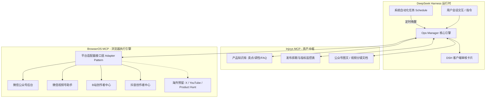

# 个人产品运营推广管理插件（Ops Manager）开发计划

## 一、 项目背景与架构定位

本项目旨在为独立开发者与个人产品打造一套**闭环运营增长引擎**，作为 **DeepSeek Harness (DSH)** 的原生 Cordis 插件运行在 `packages/experimental/ops-manager`。

该插件充当**运营控制中枢（Orchestrator）**：
1. **输入端（Injoys MCP）**：检索产品知识库（卖点/调性/Changelog），管理全局发布排期表与文档草稿；
2. **执行端（BrowserOS MCP）**：复用本地宿主日常浏览器登录态，自动将图文与视频预填至各平台草稿箱；
3. **审核端（DSH Client UI）**：通过富文本卡片呈现各渠道草稿直达链接，实现 Human-in-the-loop 人机协同；
4. **调度端（DSH Schedule）**：无缝挂载系统「自动化任务」，到点定时唤醒会话执行巡检；
5. **数据与反馈端（Analytics & Feedback）**：采集平台数据大屏、提取评论区用户建议，反哺产品迭代。



---

## 二、 代码目录与模块规划

在 `packages/experimental/ops-manager` 下构建标准 ESM 模块：

```
packages/experimental/ops-manager/
├── package.json
├── tsconfig.json
├── README.zh.md
├── cordis.patch.yml
├── plugin-src/                       # DSH Desktop 客户端扩展源码 (esbuild 编译输出至 lib/client/ops.js)
│   ├── management-rpc.mjs            # 客户端管理端 RPC 封装 (connection.rpc.call('/api', 'ops', ...))
│   └── client/
│       ├── build.mjs                 # 客户端产物构建脚本 (window.__ModuleLoader__.load 容器打包)
│       ├── index.js                  # 客户端插件入口 (注册 settings.section 槽位)
│       ├── ops-page.js               # Ops 设置主页面 (Injoys/BrowserOS MCP 配置与连通性测试)
│       └── ops-styles.js             # 对齐 DSH 视觉规范的 CSS 样式 (Light/Dark 主题)
├── src/
│   ├── index.ts                      # Cordis 插件入口 (apply, ctx.tools.register, ctx.inject)
│   ├── types.ts                      # 核心领域实体与接口契约
│   ├── config-store.ts               # MCP 与全局运营配置持久化 ($DSH_HOME/ops-manager/config.json)
│   ├── ops-rpc.ts                    # 宿主 RPC 端点 (/api/ops，处理 config.get/save, injoys.test, browser.sessions)
│   │
│   ├── injoys/                       # Injoys MCP 封装层 (支持动态 updateConfig 与环境变量兜底)
│   │   ├── client.ts                 # Injoys 工具代理 (知识库/表格/文档调用)
│   │   ├── knowledge-base.ts         # 知识库检索与 Grounding 注入
│   │   ├── calendar-sheet.ts         # 发布日历与指标监控表读写
│   │   └── document-draft.ts         # 长文图文与分镜脚本生成沉淀
│   │
│   ├── browser/                      # BrowserOS MCP 执行封装
│   │   ├── session-guard.ts          # 宿主会话连通性与 Cookie 失效检测
│   │   ├── browser-driver.ts         # 浏览器任务调度与草稿预填规划
│   │   └── uploader.ts               # 本地大文件上传底层包装
│   │
│   ├── adapters/                     # 渠道适配器层 (Adapter Pattern)
│   │   ├── base.ts                   # PlatformAdapter 抽象基类与契约
│   │   ├── wechat-article.ts         # 微信公众号 (图文草稿)
│   │   ├── channels-video.ts         # 微信视频号 (视频预填)
│   │   ├── bilibili-video.ts         # B站创作者平台 (视频预填)
│   │   ├── douyin-video.ts           # 抖音创作者平台 (视频预填)
│   │   └── registry.ts               # 适配器注册表 (支持海外无缝扩充)
│   │
│   ├── analytics/                    # 数据分析与指标回流模块
│   │   ├── metrics-collector.ts      # 跨平台创作者大屏数据抓取
│   │   └── review-reporter.ts        # 运营复盘总结报告生成 (对比爆款率与转化)
│   │
│   ├── feedback/                     # 用户互动与社区反馈模块
│   │   ├── comments-crawler.ts       # 评论区抓取与情感聚类
│   │   ├── issue-extractor.ts        # Bug / Feature 提取与需求池沉淀
│   │   └── trends-discoverer.ts      # 行业趋势与竞品嗅探
│   │
│   ├── schedule/                     # DSH 系统自动化任务联动
│   │   └── schedule-bridge.ts        # ctx.schedule 任务预设与定时回调
│   │
│   └── tools/                        # 面向 Agent 的全套 Tool 实现
│       └── index.ts                  # 10 大核心运营工具集合
└── tests/                            # 单元测试与 RPC 契约回放测试
```

---

## 三、 四阶段分步实施里程碑

### 阶段一：插件基础设施、MCP 配置中心与 Injoys 资产闭环 (M1: Foundation & Injoys Assets)
* **目标**：跑通 DSH Cordis 插件骨架与 Desktop 客户端设置页，提供用户可交互的 MCP 配置管理中心，与 Injoys MCP 建立稳定连接，实现“知识库检索 ➔ 排期生成 ➔ 表格/文档沉淀”。
* **开发任务**：
  1. 创建 `packages/experimental/ops-manager`，配置 `package.json`、ESM 导出、TypeScript 配置与客户端打包工具；
  2. **实现 Desktop 设置页与 MCP 配置中心**：
     * 在 DSH Desktop 设置模态框中注册 **Ops** 标签页（槽位 `settings.section`，`id: 'ops'`, `order: 60`，排布在 `Jet Hub` 下方）；
     * 提供 Injoys MCP 服务端 Endpoint 与 Token 动态修改、一键连通性测试与延迟诊断；
     * 提供 BrowserOS 宿主登录态复用开关与各平台登录态检测大屏；
     * 配置持久化写入 `$DSH_HOME/ops-manager/config.json`，并支持环境变量 `INJOYS_MCP_ENDPOINT` 与 `INJOYS_MCP_TOKEN` 兜底，运行时修改即时重载生效无需重启；
  3. 封装 `InjoysClient`：实现产品知识库查询（向量检索/关键词召回）、Injoys 表格读写（追加排期行）、Injoys 文档生成接口；
  4. 实现前 3 个基础内容工具：
     * `ops_plan_calendar`：结合产品阶段生成周/月排期表；
     * `ops_draft_article`：撰写微信公众号深度图文，落地为 Injoys 文档；
     * `ops_draft_video_meta`：解析本地视频文件信息，生成 3 套标题、标签、简介；
  5. 编写针对 Injoys MCP 与配置中心 RPC 的单元测试。
* **验收标准**：
  * 用户在 DSH 客户端左侧「设置」中可看到「Ops」选项卡，可配置和测试 Injoys/BrowserOS MCP 连接；
  * Agent 能在会话中根据知识库中的产品特性，一键在 Injoys 中生成一张格式规范的发布排期表与公众号初稿。
     * `ops_draft_article`：撰写微信公众号深度图文，落地为 Injoys 文档；
     * `ops_draft_video_meta`：解析本地视频文件信息，生成 3 套标题、标签、简介；
  4. 编写针对 Injoys MCP 的单元测试与协议 Mock。
* **验收标准**：
  * Agent 能在会话中根据知识库中的产品特性，一键在 Injoys 中生成一张格式规范的发布排期表与公众号初稿。

---

### 阶段二：BrowserOS 多平台草稿箱预填与审核卡片 (M2: Browser Pre-filling & Review Card)
* **目标**：打通 BrowserOS 与本地浏览器 Profile，实现国内 4 大平台的自动化草稿填充与直达审核卡片。
* **开发任务**：
  1. 封装 `session-guard.ts`：通过 BrowserOS 检测用户在微信公众号、视频号、B站、抖音的当前登录状态，失效时优雅抛出扫码提示；
  2. 实现平台适配器：
     * `WeChatArticleAdapter`：导航至 `mp.weixin.qq.com`，新建图文，填充标题、正文、作者、封面并存入草稿箱，提取草稿预览链接；
     * `ChannelsVideoAdapter`：导航至 `channels.weixin.qq.com`，调用 BrowserOS `upload` 上传本地视频成片，填入文案与标签；
     * `BilibiliVideoAdapter`：导航至 B站创作者中心，上传视频成片并预填简介、分区与标签；
     * `DouyinVideoAdapter`：导航至抖音创作者中心，上传视频并预填标题、话题；
  3. 实现 `ops_push_drafts` 工具；
  4. 编写 DSH 客户端卡片（`presentResult`）：在会话中渲染漂亮的「多渠道草稿箱审核卡片」，附带各平台的直达编辑链接与状态徽章。
* **验收标准**：
  * 用户发出指令后，Agent 自动打开本地浏览器后台填充草稿，并在对话中展示各平台草稿链接；用户点击链接可直接在浏览器中核对。

---

### 阶段三：数据分析、反馈回流与自动化任务联动 (M3: Analytics, Feedback & Schedule)
* **目标**：实现闭环数据追踪，接入评论区需求提炼，并与 DSH 系统「自动化任务」全面打通。
* **开发任务**：
  1. **数据分析模块**：
     * 实现 `ops_fetch_metrics`：通过 BrowserOS 读取各平台后台数据（阅读、播放、互动、新增关注），回写 Injoys 表格；
     * 实现 `ops_generate_review`：基于 Injoys 历史数据计算爆款率与转化漏斗，生成周度/月度复盘报告；
  2. **用户反馈与互动模块**：
     * 实现 `ops_fetch_comments`：抓取图文与视频评论区；
     * 实现 `ops_extract_feedback`：聚类提炼 Bug 与功能建议，自动沉淀至 Injoys 需求池表格并更新知识库 FAQ；
     * 实现 `ops_discover_trends`：检索相关技术热榜与话题热词；
  3. **系统「自动化任务」联动**：
     * 编写 `schedule-bridge.ts`，支持一键在 DSH 的 Schedule 注册周巡检任务；
     * 在左侧「自动化任务」页面中清晰展示当前运营定时巡检规则；到点自动唤醒会话生成物料。
* **验收标准**：
  * 左侧「自动化任务」列表中能看到运营巡检定时器；到点自动提示并生成本周复盘与各渠道待发草稿。

---

### 阶段四：海外扩展与国际化多渠道适配 (M4: Overseas Expansion)
* **目标**：不重构核心管线，通过实现新 Adapter 平滑接入海外主流渠道。
* **开发任务**：
  1. 增加针对海外受众的英文 Prompt 模板（强调 Maker Story、Problem-Solving 逻辑）；
  2. 实现海外适配器：
     * `YouTubeAdapter`（YouTube Studio 视频上传与草稿）；
     * `TwitterXAdapter`（长推文/Thread/视频草稿）；
     * `ProductHuntAdapter`（Launch 准备物料包）；
     * `TikTokAdapter`（海外版短视频创作者中心）；
  3. 支持多时区发帖排期策略。
* **验收标准**：
  * 同一套排期与发布工作流可无缝勾选国内平台或海外平台。

---

## 四、 关键风险与防御机制

1. **平台登录态（Cookie）过期风险**：
   * *防御*：每个适配器在执行 `prefillDraft` 前，必须先执行 `checkLogin()`。一旦检测到重定向至登录页，立即向 DSH 会话返回明确的友好提示卡片（如：“微信公众号登录已失效，请在弹出的浏览器窗口中微信扫码”），避免脚本超时报错。
2. **网页 DOM 结构变动风险**：
   * *防御*：BrowserOS 操作基于关键 Semantic Selector + 兜底 Snapshot 观察，各平台适配器逻辑完全解耦，单一平台的页面变动不会影响其他渠道。
3. **大文件本地视频上传超时风险**：
   * *防御*：利用 BrowserOS 原生 `upload` 工具直接注入文件路径到 `<input type="file">`，避免通过网络中转流式传输，保证秒级选定文件，并监听转码进度条完成事件。
