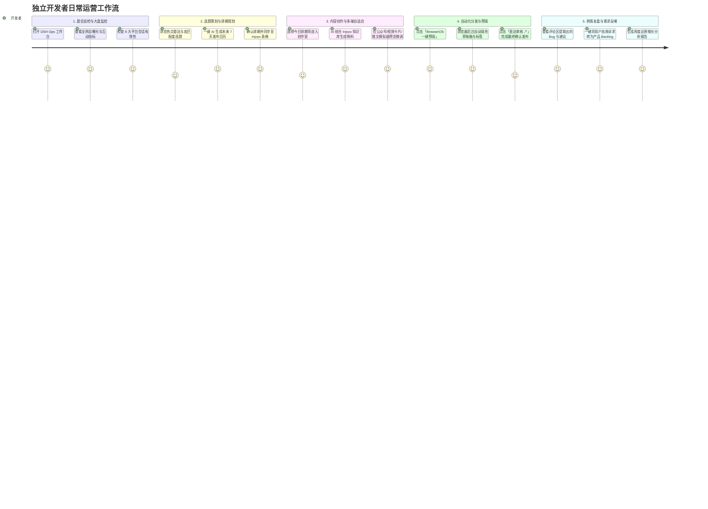
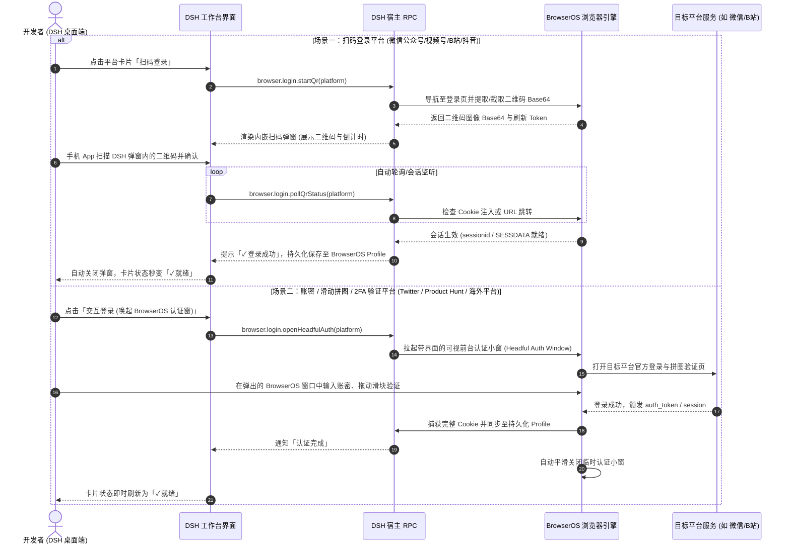
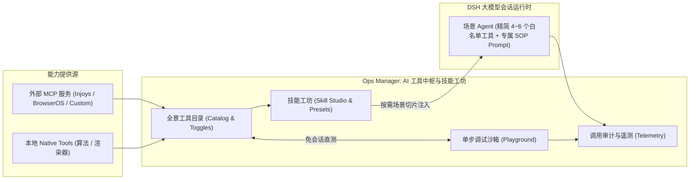

# 个人产品运营推广工作台（Ops Workbench）产品需求文档 (PRD)

## 一、 文档概述

| 文档版本 | 状态 | 编写日期 | 适用系统 |
| :--- | :--- | :--- | :--- |
| **v1.0.0** | 评审初稿 (Draft) | 2026-10-13 | DeepSeek Harness (DSH) 桌面端 / Cordis 插件体系 |

---

## 二、 项目背景与产品愿景

### 2.1 现状与痛点

目前 `deepseek-harness-ops-manager` 虽已实现底层 Injoys MCP 与 BrowserOS MCP 驱动及若干 AI 运营工具，但在桌面客户端侧仅体现为一个极简的「配置表单页面」，存在以下显著问题：

1. **界面吸引力弱，工具属性割裂**：用户只能看到几个表单输入框和简单的状态列表，缺乏运营全局视角与沉浸式操作体验。
2. **“策-采-编-发-评”全链路割裂**：
   * **策（排期规划）** 与 **采（知识库检索）** 必须依赖模型聊天对话中手工调用 Tool，没有可视化日历大盘；
   * **编（多渠道文案生成）** 缺少所见即所得的平台真实样式预览（微信公众号卡片、B站视频元数据、X 推文流等）；
   * **发（草稿箱预填）** 缺少一键推送触发与直达审核入口，无法体现 Human-in-the-loop 人机协同的便捷性；
   * **评（数据复盘与舆情）** 评论区用户真实反馈散落各处，未能在界面上形成需求池闭环。
3. **缺乏工作台（Workbench）聚合价值**：现代创作者与独立开发者在管理多渠道（国内4大平台 + 海外4大平台）时，需要类似 **Buffer、Hootsuite、飞书工作台、巨量百应/创作者服务平台** 的集成化工作台，能一眼掌握指标、热点、排期与会话状态。

### 2.2 产品愿景

将 `Ops Manager` 从单一的“设置配置项”升级为 **「独立开发者与个人产品专属的 AI 运营增长工作台（Ops Growth Workbench）」**。

* **定位**：DeepSeek Harness 桌面端第一方高价值运营生产力中枢。
* **核心价值**：
  * **一屏掌控**：聚合 8 大社媒渠道登录态、核心曝光/互动指标与全网技术热点雷达；
  * **全景流水线**：7 天多渠道排期日历一目了然，支持与 Injoys 表格双向联动；
  * **所见即所得**：内置跨平台发布预览模拟器，文案/标题/标签/推文串随心微调；
  * **无感预填发帖**：复用宿主浏览器 Cookie 会话，免去重复扫码，一键将物料推入各大平台后台草稿箱；
  * **需求反哺研发**：自动监听评论区舆情并聚类为 Feature / Bug 反馈，直接沉淀到 Injoys 需求池与知识库。

---

## 三、 用户画像与典型使用旅程

### 3.1 核心用户画像

* **独立开发者 / 个人创作者 (Indie Hackers)**：具备优秀的产品研发能力，但精力被多平台分发、文案撰写、格式排版与评论收集严重分散。
* **小微产研与技术团队 (Micro Tech Teams)**：需要以低成本建立国内外多渠道（微信、B站、抖音、YouTube、X、Product Hunt）的内容矩阵与品牌声量。
* **AI 自动化探索者**：追求完全自治（Autonomous）的“一人公司”运营管线。

### 3.2 典型用户旅程（User Journey Map）



---

## 四、 功能架构全景与模块规划

工作台采用现代 SaaS “侧边导航 + 顶部驾驶舱 + 多维卡片网格” 的布局设计，拆解为以下五大核心业务模块：

```text
┌────────────────────────────────────────────────────────────────────────────────────────┐
│                        Ops Growth Workbench 运营推广工作台                              │
├────────────────────────────────────────────────────────────────────────────────────────┤
│ 顶部驾驶舱 (Top Cockpit): 产品标识 / Injoys & BrowserOS 引擎连接态 / 快速 AI 运营指令组   │
│ 核心数据看板 (KPI Ribbon): 全网曝光量 / 互动转化数 / 排期履约流水 / 活跃分发渠道就绪度     │
├────────────────────────────────────────────────────────────────────────────────────────┤
│                                  多维工作区切换 Tabs                                   │
│  [🌟 运营驾驶舱]  [📅 排期日历流水]  [✍ 内容创作室]  [🛠 AI工具中枢]  [📊 舆情需求大盘]  [⚙ 引擎策略配置]    │
├────────────────────────────────────────────────────────────────────────────────────────┤
│ 1. 运营驾驶舱 (Overview & Cockpit)                                                     │
│    ├─ 8大分发渠道矩阵网格 (平台名、形态徽章、真实Cookie鉴权灯、去登录/打开后台快捷入口)     │
│    ├─ 全网热点雷达 (实时爆款选题、热度指数、契合平台、一键采用此选题创作)                  │
│    └─ SOP 闭环指引 (策-采-编-发-评 自动化管线状态)                                     │
│                                                                                        │
│ 2. 内容日历与发布流水线 (Calendar & Pipeline)                                          │
│    ├─ 周/月维度排期流水线卡片视图 (按日期规划平台、媒介形态、选题标题、当前所处阶段)      │
│    ├─ 状态流转标识 (计划中 ➔ 撰写中 ➔ 草稿就绪 ➔ 预填完成 ➔ 已发布)                     │
│    └─ Injoys Spreadsheet 实时双向同步状态展示与一键生成新排期                           │
│                                                                                        │
│ 3. 跨平台内容创作室 (Content Studio & Multi-Channel Simulator)                         │
│    ├─ 创作控制台 (主题输入、基调选择、平台勾选、AI 生成全渠道定制物料)                     │
│    ├─ 所见即所得真实平台预览器 (微信公众号图文卡片 / B站&抖音视频元数据 / X推文串 / PH)    │
│    └─ 分发操作条 (BrowserOS 一键预填各平台草稿箱 / 一键复制物料 / 沉淀到 Injoys 知识文档)  │
│                                                                                        │
│ 4. AI 运营工具中枢与技能工坊 (AI Ops Tools Hub & Skill Studio)                         │
│    ├─ 全景工具目录 (策划/创意/分发/分析/调度 5大领域，动态开关与参数详情)                  │
│    ├─ 场景技能包编排 (新版本发布包/日常巡检包/出海冲榜包，按需注入防上下文膨胀)           │
│    ├─ 可视化单步调试沙箱 (无需开会话直接填参运行 Tool，实时查看卡片渲染与耗时)             │
│    └─ 调用审计与遥测日志 (记录调用频次、执行耗时、成功率与入参出参回溯)                   │
│                                                                                        │
│ 5. 舆情监控与需求提炼 (Social Listening & User Voice)                                  │
│    ├─ 全网多渠道互动数据详细横向对比大盘 (播放/点赞/收藏/评论)                           │
│    ├─ 评论区智能提取的用户声音卡片 (需求建议 / Bug报告 / 高频疑问，带优先级与来源)        │
│    └─ 一键同步至 Injoys 需求池与周度增长复盘报告生成                                   │
│                                                                                        │
│ 6. 引擎与平台配置 (Integrations & Governance)                                          │
│    ├─ Injoys MCP 接入配置 (Endpoint、Token 显隐切换、连通性实时测试、知识库文档总数)     │
│    ├─ BrowserOS 浏览器 Profile 复用开关与宿主 Cookie 穿透状态提示                       │
│    └─ 运营推广全局策略 (默认推广产品名、目标受众画像、自动同步配置持久化)                  │
└────────────────────────────────────────────────────────────────────────────────────────┘
```

---

## 五、 详细功能规格说明（Functional Specifications）

### 5.1 顶部运营驾驶舱与 KPI 看板 (Top Cockpit)

#### 5.1.1 驾驶舱头部 (Workbench Header)
* **产品身份识别**：显示当前正在运营的个人产品名（例如 `DeepSeek Harness`），支持快速切换。
* **引擎状态指示**：
  * `Injoys 知识库中枢`：以绿灯/红灯标注 MCP 连通性，悬浮显示延迟与文档数；
  * `BrowserOS 浏览器引擎`：以绿灯标注宿主日常浏览器 Profile 读取状态。
* **全局快捷行动组 (Quick Action Group)**：
  * `+ 生成 7 天排期日历`：快捷唤起日历规划；
  * `✍ 新建多端物料`：直接切到创作室并聚焦输入框；
  * `🚀 出海 Launch 套件`：一键生成 Product Hunt 与 Twitter 发发帖包；
  * `🔄 刷新大盘`：实时重新探测全网 Cookie 与最新指标。

#### 5.1.2 核心指标卡 (KPI Ribbon)
呈现 4 个视觉突出的指标卡片，每个卡片配备副标题、环比走势与轻量化渐变进度条：
1. **全网曝光总量 (Total Impressions)**：汇总各平台浏览量（例如 `128.5K`，`+24.8% 本周`，覆盖 6 大主流渠道）。
2. **互动与线索转化 (Engagements & Leads)**：汇总点赞、评论、转发、收藏数（例如 `6,820` 次，互动率 `5.31%`，新增关注 `+625`）。
3. **排期履约流水 (Scheduled Pipeline)**：展示本周规划内容进展（例如 `6 / 7 篇`，3 篇已预填草稿，1 篇待发）。
4. **分发矩阵连通度 (Ready Channels)**：动态统计当前宿主浏览器中已登录就绪的平台数（例如 `3 / 8` 个就绪，视频号、抖音、YouTube 🟢）。

---

### 5.2 模块一：运营总览与矩阵大盘 (Overview & Channel Matrix)

#### 5.2.1 全网分发渠道矩阵 (Channel Matrix Grid)
覆盖 8 大主流渠道（国内 4 渠道 + 海外 4 渠道），以网格卡片形式排列：
* **微信公众号**（📝 深度长文 / 新闻速递）
* **微信视频号**（🎬 竖屏短视频 / 演示录屏）
* **哔哩哔哩 (B 站)**（🎬 中长视频 / 硬核教程）
* **抖音创作者中心**（🎬 爆款短视频 / 程序员日常）
* **YouTube Studio**（🎬 宽屏横版教程 / 海外技术开发者）
* **TikTok 创作者中心**（🎬 海外短视频 / 视觉震撼）
* **X (Twitter)**（💬 极客推文串 / 产品更新广播）
* **Product Hunt**（📝 黄金发布包 / 全球首发冲榜）

**卡片呈现要素与交互**：
1. **渠道标识与形态徽章**：平台官方色彩微标 + 内容形态标签。
2. **真实登录状态指示灯**：
   * `✓ 就绪`（绿色背景，代表在用户日常 Chrome 中检测到有效鉴权 Cookie）；
   * `⚠ 需登录`（琥珀色背景，代表尚未在日常浏览器中登录或 Cookie 失效）。
3. **动作按钮组**：
   * 若为 `⚠ 需登录`：展示高亮的 **`去登录 ↗`** 按钮，点击即可直接在外置默认浏览器中打开该平台的官方登录页面，方便扫码或密码登录；
   * 若为 `✓ 就绪`：展示 **`打开创作后台 ↗`** 按钮，一键直达平台后台；
   * 卡片右下角提供 **`预填草稿`** 快捷触发入口。

#### 5.2.2 全网热点雷达与爆款选题 (Trend & Topic Radar)
* **动态选题卡片**：从 `TrendsDiscoverer` 引擎拉取与当前产品领域（如 AI智能体、自动化、独立开发、出海增长）强相关的爆款切入点。
* **卡片内容**：
  * 热度指数（如 `热度 97`）；
  * 建议选题标题（例如：“告别重复造轮子：如何用 AI Agent 工作流重塑独立开发者运营”）；
  * 匹配分发平台徽章（例如：微信公众号、B站）；
  * **「采用此选题创作 ➔」**：点击后直接跳转至「内容创作室」，自动将标题与推荐基调填入输入表单。

#### 5.2.3 DSH 桌面端直接操作 BrowserOS 登录态体系（扫码浮层 + 交互认证窗）

为彻底解决开发者在“无头浏览器”与“外部宿主浏览器”之间割裂跳转的痛点，工作台支持**直接在 DSH 桌面端内与 BrowserOS 浏览器完成交互式登录认证**，无需手动切换浏览器：



**核心设计亮点**：
1. **工作台内嵌扫码浮层 (In-App QR Modal)**：
   * 针对公众号、视频号、B站、抖音等典型扫码平台，DSH 工作台原生弹窗直接展示实时高清二维码；
   * 支持扫码状态动态反馈（*等待扫码 ➔ 已扫码待手机确认 ➔ 登录成功 / 二维码已过期一键刷新*）；
   * 全程不跳出 DSH 桌面端，掏出手机一扫即合。
2. **可视前台辅助认证窗 (Headful Auth Window)**：
   * 针对需要人机交互验证（如 Cloudflare 盾、拼图滑块、短信/邮件 2FA）的平台，一键唤起轻量级 BrowserOS 窗口，由开发者完成交互，完成后静默回传登录态并关闭。
3. **独立持久化 Profile 隔离保护**：
   * 登录态独立安全保存在 `~/.dsh/browseros-profile/` 隔离分区中，既支持长期免扫码复用，又避免污染或依赖宿主个人日常浏览器的临时缓存。

### 5.3 模块二：内容日历与发布流水线 (Calendar & Content Pipeline)

#### 5.3.1 周度/月度排期流水看板 (Pipeline Kanban / Timeline)
以时间轴排期流水形式清晰展示即将发布的排期事项：
* **每一条排期项包含**：
  * 规划发布日期与倒计时（如 `2026-10-14 · 明天`）；
  * 目标平台（带平台徽章）与内容形态（图文 / 视频 / 社交动态）；
  * 策划主题标题（如：“深度拆解：为什么全插件式智能体正在颠覆传统工作流？”）；
  * 当前生命周期状态胶囊：
    * `📅 计划中 (Planned)`（浅灰色）
    * `✍ 撰写中 (Drafting)`（蓝色）
    * `📦 草稿就绪 (Draft Ready)`（紫色）
    * `🚀 已推草稿箱 (Prefilled)`（绿色）
    * `🎉 已发布 (Published)`（翡翠绿）
  * **直达动作**：
    * 若已有草稿箱直达链接，展示 **`前往平台草稿箱 ↗`**；
    * 提供 **`在创作室中编辑`** 入口。

#### 5.3.2 日历自动化工具栏
* **`+ AI 规划未来 7 天日历`**：可指定推广周期（周/月）、重点版本特性（如 `v0.2.1 任务调度上线`）和平台范围，一键调用算法生成全新日程并写回。
* **`📥 同步至 Injoys 表格`**：显示与 Injoys Spreadsheet 的实时同步时间戳与双向校验状态。

---

### 5.4 模块三：跨平台内容创作室 (Content Studio & Multi-Channel Simulator)

解决独立开发者“一份核心卖点，多处格式排版”的痛点。

#### 5.4.1 创作控制台 (Composition Bar)
* **选题与特性输入框**：输入本次发帖的核心主题、更新日志或产品特性；
* **基调风格选择器**：`深度硬核技术`、`吸引力爆款`、`极客出海英文`、`新手友好实操`；
* **一键调用 Injoys 知识库**：自动将产品定位、差异化优势与核心架构注入 Prompt 上下文；
* **动作按钮**：`⚡ AI 智能生成全套多渠道物料`。

#### 5.4.2 所见即所得跨平台真实模拟器 (Platform Feed Simulators)
支持分 Tab 切换查看不同平台的最终视觉呈现效果：

1. **微信公众号图文卡片模拟器**：
   * 真实还原微信朋友圈分享卡片与公众号文章详情：包含封面图区域、主标题（<=64字）、摘要 Digest、作者信息、排版优化的 Markdown 正文及代码高亮区。
2. **视频平台元数据卡片模拟器 (B站 / 抖音 / YouTube / 视频号)**：
   * **爆款标题 AB 测试推荐**：提供 3 套高完播率/高点击率候选标题（带推荐理由）；
   * **视频简介与时间轴章节**：自动生成结构化简介与分段章节描述；
   * **标签 Tag 词云**：推荐 5~8 个平台热门垂类标签；
   * **首帧与封面文案建议**：指导封面设计的吸睛文案。
3. **X (Twitter) 极客推文串模拟器**：
   * 采用推文气泡瀑布流渲染 `1/5`、`2/5`、`3/5` 串联推文；
   * 实时统计每条推文字符数（<=280 字符校验）；
   * 模拟点赞、转推、浏览量与互动按钮样式。
4. **Product Hunt 全球首发 Launch Kit 模拟器**：
   * 黄金 Tagline 预览（<=60 字符精炼展示产品核心价值）；
   * 创始人首条置顶评论（Maker First Comment）格式；
   * 核心功能亮点与 Show HN 差异化陈述。

#### 5.4.3 物料处理与推送动作条
* **`🚀 BrowserOS 一键预填至草稿箱`**：点击后触发后台浏览器驱动，将标题、简介与正文无缝写入对应平台草稿箱，并返回直达验证链接；
* **`📋 一键复制物料`**：快捷将渲染后的富文本或纯文本复制至剪贴板；
* **`💾 沉淀至 Injoys 知识库`**：将本次产出的优质图文归档到 Injoys 文档库中长期复用。

---

### 5.5 模块四：AI 运营工具中枢与技能工坊 (AI Ops Tools Hub & Skill Studio)

随着运营工作台的持续演进，AI 调用的工具数量将从初期的十余个快速扩展至数十个（文案仿写、SEO 关键词提炼、分镜生图 Prompt、账号防封轮转、多语言翻译、各平台 OpenAPI 等）。为防止**模型上下文膨胀（Token 消耗暴增）**、**工具选择幻觉（Tool Hallucination）**以及**缺乏人工直接干预机制**，工作台设立专门的「AI 运营工具中枢与技能工坊」模块，构建**“MCP 外部连接层 ➔ Native 本地逻辑层 ➔ Skill 场景认知工坊”**的三层能力体系。

#### 5.5.1 三层能力架构模型 (Three-Tier Capability Architecture)

工具中枢将所有的底层工具与上层场景解耦为清晰的三层模型：

| 层次 | 核心载体 | 扮演角色 | 在工作台中的具体落地 | 管理机制 |
| :--- | :--- | :--- | :--- | :--- |
| **外部连接层** | **MCP**<br/>*(Model Context Protocol)* | **“手和脚” (能力连接器)**<br/>通过标准化 JSON-RPC 协议打通宿主桌面与外部系统 | • **Injoys MCP**：知识库文档检索、资产沉淀、排期表格读写<br/>• **BrowserOS MCP**：浏览器控制、会话探活、多平台草稿预填<br/>• **扩展 MCP**：后续接入的官方 API、第三方数据源、搜索引擎 | 端点配置、认证密钥管理、心跳探活与延迟遥测 |
| **本地逻辑层** | **Native Tools**<br/>*(Cordis 原生工具)* | **“业务骨架” (本地处理与渲染)**<br/>无外部网络依赖的纯本地算法计算与卡片渲染 | • **Card Renderers**：多平台所见即所得卡片实时渲染<br/>• **NLP Helpers**：SEO 关键词提取、文案字数统计、差异对比<br/>• **Schedule Helpers**：本地排期状态计算、发布冲突检测 | 宿主内联运行、毫秒级响应、无外部网络故障风险 |
| **业务认知层** | **Skill**<br/>*(场景技能包 / SOP 预设)* | **“大脑与工作流” (场景编排)**<br/>将特定运营场景的 Prompt 模板、约束规范与精选工具打包 | • `📦 新版本发布推广技能包`<br/>• `🌍 全球出海冷启动技能包`<br/>• `🔍 舆情与数据巡检技能包`<br/>• `💡 热点选题与排期策划技能包`<br/>• `✍️ 跨平台爆款内容改编技能包` | 场景切片激活（4~6 个工具白名单）、Token 过载保护、SOP 流程控制 |



---

#### 5.5.2 全景工具目录与分类架构 (Tool Catalog by Lifecycle)
将所有 AI 运营工具按营销生命周期划分为 5 大领域卡片视图，并明确标注驱动类型：
1. **策划与选题 (Planning)**：
   * `ops_plan_calendar` *(MCP: Injoys)*：多渠道排期自动规划并同步表格；
   * `ops_discover_trends` *(Native / Search)*：技术热点与爆款切入点动态嗅探；
   * `ops_keyword_research` *(Native)*：SEO 核心词与搜索意图流量词挖掘；
2. **创意与生成 (Creative)**：
   * `ops_draft_article` *(Native / Injoys)*：微信公众号图文草稿与长文撰写；
   * `ops_draft_video_meta` *(Native)*：视频 AB 测试多候选标题、简介与标签生成；
   * `ops_draft_launch_kit` *(Native)*：Product Hunt 发布物料与 Twitter 极客推文串生成；
   * `ops_generate_hooks` *(Native)*：视频前 3 秒黄金吸睛钩子与首帧分镜生成；
3. **分发与执行 (Publishing & Automation)**：
   * `ops_push_drafts` *(MCP: BrowserOS)*：通过 BrowserOS 免扫码批量预填各大平台草稿箱；
   * `ops_publish_now` *(MCP: BrowserOS)*：针对已通过审核的平台执行正式一键定时发布；
4. **分析与监听 (Analytics & Listening)**：
   * `ops_fetch_metrics` *(MCP: BrowserOS)*：全网创作者数据大屏多维采集；
   * `ops_generate_review` *(Native / Injoys)*：周度/月度曝光、转化与 ROI 复盘报告计算；
   * `ops_fetch_comments` *(MCP: BrowserOS)*：跨渠道受众真实评论抓取；
   * `ops_extract_feedback` *(Native / Injoys)*：用户问题聚类（Bug/Feature）与需求池反哺；
5. **系统与调度 (System & Schedule)**：
   * `ops_setup_schedule` *(Native: DSH Host)*：向 DSH 自动化任务中心注册定时巡检任务；
   * `ops_inspect_sessions` *(Native / SQLite)*：宿主 Chrome 真实 Cookie 保活与有效性探活。

---

#### 5.5.3 技能工坊与场景技能包编排 (Skill Studio & Preset Architecture)

为彻底解决大模型在面临数十个工具时的“工具选择幻觉”与 Token 资源浪费，工作台引入**技能包（Skill）**作为核心使用单元。

##### 1. Skill 标准规范 (Skill Specification Schema)
每个 Skill 是一个自包含的场景化业务包，包含以下核心维度：
* **元数据定义 (Metadata)**：唯一标识 `id`、展示名称 `name`、图标 `icon`、所属领域 `category`、简要说明 `description`；
* **场景提示词与调性约束 (System Prompt & Guidelines)**：
  * 专长角色定位（如“硅谷 Product Hunt 顶级猎手”、“微信公众号 10w+ 爆款主编”）；
  * 语气风格规则、违禁词规范及格式排版约束；
* **绑定工具白名单 (Bound Tools Whitelist)**：
  * 精确指定该技能允许大模型调用的工具集合（严格限制在 4~6 个）；
  * 阻断无关工具进入 Prompt 上下文；
* **输出规范与卡片渲染 (Output Schema & Card Renderer)**：
  * 约定结构化输出字段，并绑定对应前端 WYSIWYG 卡片组件进行渲染；
* **质量检测门禁 (Quality Gate Rules)**：
  * 生成物料自动化核验准则（如：是否包含版本号、是否包含明确 CTA、标签数量是否在 3~5 个内）。

##### 2. 内置五大官方场景技能包
1. **📦 新版本发布全网推广技能包 (`release_launch`)**：
   * 目标：新版本上线时一站式输出全网宣发物料；
   * 绑定工具：`ops_plan_calendar`、`ops_draft_article`、`ops_draft_video_meta`、`ops_draft_launch_kit`、`ops_push_drafts`；
2. **🌍 全球出海冷启动技能包 (`overseas_growth`)**：
   * 目标：攻坚 Product Hunt、X/Twitter 及 Reddit，贴合欧美极客与海外工程师审美；
   * 绑定工具：`ops_draft_launch_kit`、`ops_keyword_research`、`ops_push_drafts`；
3. **🔍 舆情监听与需求提炼技能包 (`social_listening`)**：
   * 目标：自动抓取多端评论，提取 Bug 与 Feature 建议，沉淀至 Injoys 需求池；
   * 绑定工具：`ops_fetch_comments`、`ops_extract_feedback`、`ops_fetch_metrics`；
4. **💡 热点趋势与周度排期策划技能包 (`trend_planning`)**：
   * 目标：结合行业热点自动规划下周多平台发布日历，避免断更；
   * 绑定工具：`ops_discover_trends`、`ops_keyword_research`、`ops_plan_calendar`；
5. **✍️ 跨平台爆款内容改编技能包 (`omni_adaptation`)**：
   * 目标：将长文快速解构成视频脚本、推文串、小红书图文卡片等不同体裁；
   * 绑定工具：`ops_draft_article`、`ops_generate_hooks`、`ops_draft_video_meta`。

##### 3. 技能工坊界面功能 (Skill Studio UI)
* **技能卡片切换器**：在工作台顶部支持一键切换当前激活技能包，实时变更对话环境与工具白名单；
* **技能包编辑器**：支持运营人员直接在线查看/克隆内置技能包，自定义微调 Prompt 模板与工具勾选；
* **导入与导出**：支持以 JSON/YAML 格式导出自定义技能，方便团队内部沉淀和共享优质运营工作流。

---

#### 5.5.4 可视化单步调试沙箱 (Interactive Tool Playground / Sandbox)
* **无会话直测能力**：运营人员或开发者无需在 AI 聊天框中等待漫长的多轮思考，在工作台界面点击任意工具卡片的 **「在沙箱中运行 ⚡」**：
  * 自动根据 Tool 的 JSON Schema 动态生成参数输入表单（如输入 `period: "week"`, `focusVersion: "v0.2.1"`）；
  * 点击 **「单步运行」**，直接向底层服务发起调用（可直通 MCP 或本地 Native 函数）；
  * 实时展示执行耗时（例如 `248ms`）、结构化 JSON 原始输出以及 DSH 自定义卡片渲染效果（WYSIWYG Card Preview）；
  * 极大降低开发者编写新工具、调试 Prompt 模板或排查 MCP 网络故障的成本。

---

#### 5.5.5 工具调用审计与性能遥测 (Telemetry & Execution Logs)
* **大盘指标统计**：展示今日工具调用总频次、平均响应延迟、成功率（例如 `99.2%`）、MCP 连通探活健康分；
* **调用时间线流水 (Audit Stream)**：
  * 每一条记录包含：触发时间、工具名、驱动类型 (`MCP` / `Native`)、触发来源（`AI 对话自主触发` 或 `工作台沙箱手动调用`）、入参摘要、执行状态、耗时与报错详情（点击可一键重试）。

---

#### 5.5.6 热插拔扩展机制 (Extensibility & Custom Tools/MCP)
* **自定义 MCP 接入**：在设置中心支持动态新增任意标准 MCP 服务器（如第三方社媒 API MCP、SEO 搜索引擎 MCP），工作台自动扫描并挂载其 Tools；
* **自定义 Native 工具**：支持独立开发者通过定义标准的 Tool Schema 与执行函数快速接入新平台（如小红书、知乎、CSDN），即插即用无需重构插件核心包。

---

### 5.6 模块五：舆情监控与需求提炼 (Social Listening & User Voice)

打通从“社媒运营”到“产品研发（Product Backlog）”的完整飞轮。

#### 5.5.1 跨平台互动数据横向对比大盘
以清晰的数据表格呈现各大平台近期表现：
* 列：平台名称、浏览/播放量、点赞数、评论数、分享/转推数、收藏数、新增关注；
* 行：微信公众号、视频号、B站、抖音、YouTube、Twitter、Product Hunt；
* 支持按指标升降序排列，直观发现哪个平台是流量主阵地。

#### 5.5.2 用户声音与需求提炼池 (Extracted Backlog)
展示由 `IssueExtractor` 从评论区全自动挖掘并聚类的真实高价值信息：
* **结构化卡片要素**：
  * 类别标签：`[需求建议 (Feature)]`（蓝色）、`[缺陷报告 (Bug)]`（红色）、`[高频疑问 (FAQ)]`（橙色）、`[好评赞赏 (Praise)]`（绿色）；
  * 来源平台徽章与作者昵称；
  * 原始评论摘录与 AI 提炼概要；
  * 优先级评级（`P0 极高`、`P1 优先`、`P2 建议`）；
  * 状态指示：`✓ 已同步至 Injoys 需求池` / `已更新知识库 FAQ`。
* **动作**：
  * `抓取最新评论`；
  * `📊 生成周度运营复盘总结 (Review Report)`（自动计算各渠道互动率、爆款率与后续 Action Items）。

---

### 5.7 模块六：引擎与策略配置 (Integrations & Governance)

保留并升级系统基础底层参数的配置与诊断能力：
1. **Injoys MCP 资产中枢**：
   * 服务端 Endpoint 配置与环境变量回退状态；
   * Bearer Token 输入与显隐切换；
   * `测试 Injoys 连通性` 实时探测按钮（精确诊断延迟 ms 与远端文档数统计）。
2. **BrowserOS 浏览器执行引擎**：
   * `复用宿主日常浏览器登录态` 开关；
   * 自动探测的本机 Chrome Cookie SQLite 路径与安全性说明。
3. **全局运营策略**：
   * 默认产品名称（用于知识库检索词）；
   * 自动同步至 Injoys 开关；
   * 保存配置按钮并在运行时即时生效。

---

## 六、 界面设计与交互规范 (UI/UX Guidelines)

1. **视觉基调 (Design Language)**：
   * 深度对齐 DeepSeek Harness 原生设计令牌（Design Tokens），完美自适应 Light / Dark 系统主题；
   * 引入现代工作台微质感：`1px` 细腻边框、卡片毛玻璃光晕（`backdrop-filter: blur(8px)`）、平滑的转场动效；
   * 采用有辨识度的运营主题色：科技蓝（`#1677ff`）、生长绿（`#10b981`）、活力橙（`#f59e0b`）、极客紫（`#8b5cf6`）。
2. **图标与状态设计**：
   * 设置菜单主入口采用 Ops 专属 **大喇叭 (Megaphone)** 矢量图标；
   * 状态指示灯遵循通用的语义系统：绿色代表就绪与已预填，琥珀色代表待登录与待审核，灰色代表规划中。
3. **零阻碍操作原则 (Zero-friction UX)**：
   * 凡是检测到未登录的平台，一律提供 **`去登录 ↗`** 快捷外链，拒绝冷冰冰的“登录失败”报错；
   * 核心数据卡片与表格支持一键刷新，避免页面强制重载。

---

## 七、 实施里程碑规划 (Milestones)

| 阶段 | 周期 | 核心交付目标 |
| :--- | :--- | :--- |
| **阶段一：架构与协议契约确立** | 第 1 步 | 输出 PRD 需求文档与系统架构设计书，定义前后端 RPC 协议与数据契约 |
| **阶段二：宿主 RPC 聚合接口升级** | 第 2 步 | 在 `src/ops-rpc.ts` 中实现 `workbench.overview`、`workbench.generateCalendar`、`workbench.generateDraft` 等高密度数据端点 |
| **阶段三：工作台 UI 组件库与样式系统构建** | 第 3 步 | 重构 `plugin-src/client/ops-page.js`，实现 5 大专业 Tab、真实平台模拟器与 KPI 看板 |
| **阶段四：测试验证与全链路端到端联调** | 第 4 步 | 更新测试套件，执行编译并挂载至桌面端验证多平台交互与真实体验 |
