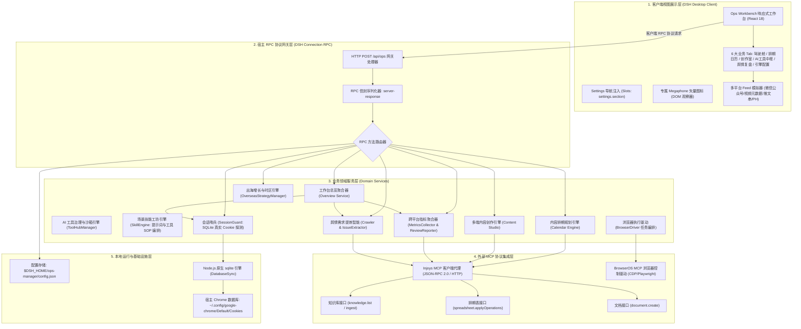
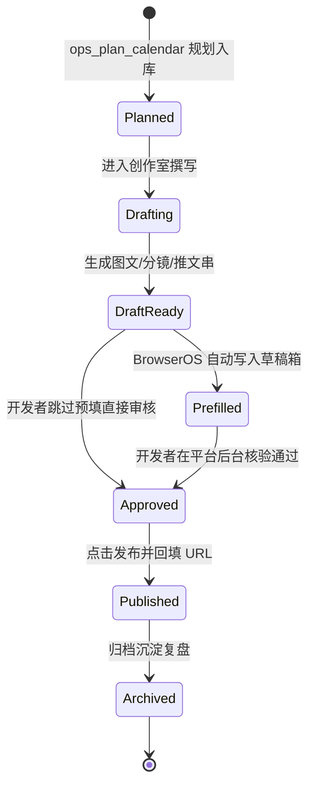
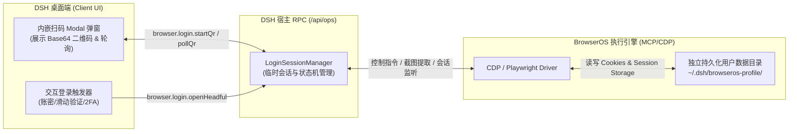
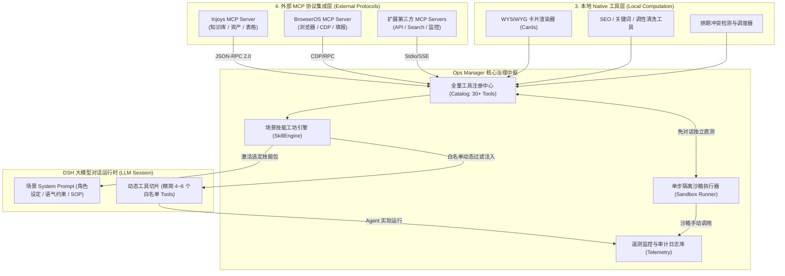
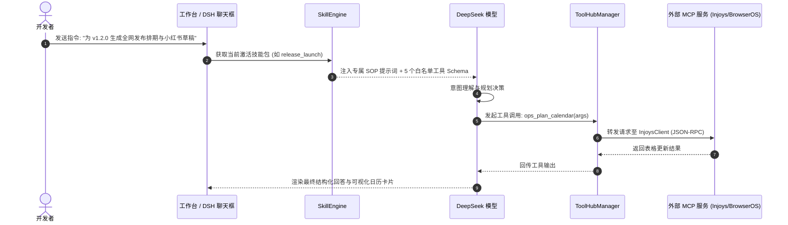
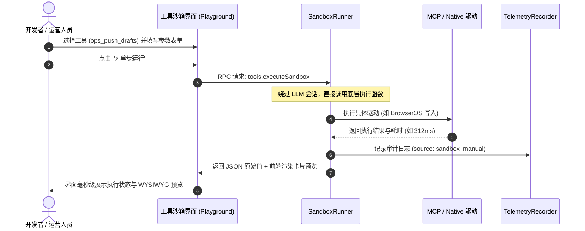

# 个人产品增长推广工坊（Growth Studio / dsh-growth-studio）技术架构设计说明书

## 一、 系统架构全景

### 1.1 分层架构模型

`dsh-growth-studio` (Growth Studio) 采用基于 Cordis 的全插件式微内核分层架构，自顶向下由**客户端视图层**、**宿主 RPC 协议网关层**、**业务领域服务层**、**外部 MCP 驱动中台层**及**本地持久化基础设施**构成：



---

## 二、 客户端与通信机制设计

### 2.1 DSH Desktop 插件容器加载机制

DSH Desktop 客户端通过 Cordis `slots` 注入扩展机制工作：
1. **打包规范**：客户端源码位于 `plugin-src/client/`，通过 `plugin-src/client/build.mjs` 中的 `esbuild` 编译，封装为：
   ```javascript
   window.__ModuleLoader__.load(
     '@deepseek-ai/dsh-ops-manager/client',
     ['slots', 'connection'],
     (ctx) => { /* 应用入口 */ }
   );
   ```
   产物输出至 `lib/client/ops.js`，并在 `package.json` 的 `exports["./client"]` 对外声明。
2. **槽位注册**：
   在 `ctx.slots.inject('settings.section')` 注册标识为 `ops` 的板块，顺序值为 `60`（紧随 Jet Hub 之后）。
3. **图标无感替换**：
   DSH 原生设置菜单默认分配齿轮图标。本插件在客户端注入 `MutationObserver` 观察器，精准定位到含有 `.dim-ops-nav-label` 的菜单按钮，无缝替换为 Ops 专属的大喇叭（Megaphone）SVG 矢量图标，同时在 CSS 中提供伪元素 Mask 兜底，防止网络或渲染抖动时图标丢失。

### 2.2 RPC 通信协议契约 (Connection RPC Envelope)

DSH 前后端通信基于 HTTP POST 单路复用通道，必须严格遵守 DSH 的 RPC 信封格式。

#### 2.2.1 请求信封 (Request Envelope)
* **端点**：`POST /api/ops`
* **Content-Type**：`application/json`
* **载荷结构**：
  ```json
  {
    "type": "client-request",
    "rpcId": "req_1728000000000_abcd",
    "method": "ops",
    "payload": {
      "method": "workbench.overview",
      "payload": {}
    }
  }
  ```

#### 2.2.2 响应信封 (Response Envelope)
DSH 底层 RPC 网关对响应格式要求极为严格，任何非标准结构均会导致客户端抛出 `invalid server-response envelope` 错误：
```json
{
  "type": "server-response",
  "rpcId": "req_1728000000000_abcd",
  "result": {
    "ok": true,
    "value": {
      /* 业务返回数据 */
    }
  }
}
```
当业务异常时：
```json
{
  "type": "server-response",
  "rpcId": "req_1728000000000_abcd",
  "result": {
    "ok": false,
    "error": {
      "code": "ops/handler-failed",
      "message": "错误原因说明"
    }
  }
}
```

---

## 三、 RPC API 接口详细契约定义

宿主 RPC 网关（`src/ops-rpc.ts`）提供全套工作台专用端点：

### 3.1 `workbench.overview`（工作台大盘聚合接口）

一次性返回工作台所需的全局 KPI 指标、8 平台真实会话状态、热门趋势雷达、近期排期流水线及核心用户反馈。

* **请求参数**：
  ```json
  {}
  ```
* **响应数据结构 (`result.value`)**：
  ```typescript
  interface WorkbenchOverviewResponse {
    productName: string
    overviewMetrics: {
      totalViews: number           // 全网曝光量 (如 128450)
      totalLikes: number           // 全网点赞数 (如 6820)
      totalComments: number        // 全网评论数
      totalShares: number          // 全网分享数
      totalFollowers: number       // 净增关注数
      engagementRate: string       // 综合互动率 (如 "5.32%")
      scheduledCount: number       // 待发流水数
      readyChannelsCount: number   // 已就绪平台数 (如 3)
      totalChannelsCount: number   // 总平台数 (8)
    }
    statuses: Array<{
      id: PlatformId
      name: string
      kind: 'article' | 'video' | 'post'
      draftEditorUrl: string
      loggedIn: boolean            // 真实 Cookie 探测状态
      scanRequired: boolean
      message: string
    }>
    trends: Array<{
      keyword: string
      platform: PlatformId | 'general'
      heatScore: number            // 热度分 (如 97)
      sampleTopic: string          // 推荐标题
      relevanceToProduct: string
    }>
    calendarItems: CalendarItem[]  // 未来 7 天排期列表
    feedbackItems: UserFeedbackItem[] // 提取出的高频需求与缺陷
    injoysConnected: boolean       // Injoys 连通状态
  }
  ```

---

### 3.2 `workbench.generateCalendar`（智能排期生成接口）

* **请求参数**：
  ```typescript
  interface GenerateCalendarRequest {
    period: 'week' | 'month'
    focusVersion?: string          // 如 "v0.2.1 任务调度发布"
    platforms?: PlatformId[]       // 指定平台列表
  }
  ```
* **响应数据**：
  ```typescript
  interface GenerateCalendarResponse {
    period: string
    totalItems: number
    items: CalendarItem[]
    sheetSynced: boolean           // 是否已同步至 Injoys 表格
  }
  ```

---

### 3.3 `workbench.generateArticleDraft`（图文内容生成与预览接口）

* **请求参数**：
  ```typescript
  interface GenerateArticleRequest {
    topic: string                  // 选题标题
    targetPlatform: 'wechat_mp' | 'product_hunt'
    tone?: 'technical' | 'viral' | 'concise'
  }
  ```
* **响应数据**：
  ```typescript
  interface GenerateArticleResponse {
    id: string
    title: string                  // 主标题
    digest: string                 // 摘要 (<=120字)
    contentMarkdown: string        // 正文 Markdown
    wordCount: number
    injoysDocId?: string           // 同步的 Injoys 文档 ID
  }
  ```

---

### 3.4 `workbench.generateVideoMeta`（视频多变体元数据生成接口）

* **请求参数**：
  ```typescript
  interface GenerateVideoMetaRequest {
    topic: string
    platform: 'bilibili' | 'douyin' | 'youtube' | 'wechat_channels'
  }
  ```
* **响应数据**：
  ```typescript
  interface GenerateVideoMetaResponse {
    titleCandidates: Array<{
      title: string
      angle: string                // 如 "痛点揭秘型", "硬核教程型", "数据反差型"
      estimatedCtr: string         // 如 "高点击率"
    }>
    description: string
    tags: string[]
    coverPromptSuggestion: string  // 封面图视觉设计建议
  }
  ```

---

### 3.5 `workbench.generateLaunchKit`（出海发布物料生成接口）

* **请求参数**：
  ```typescript
  interface GenerateLaunchKitRequest {
    productName?: string
    focusFeature?: string
  }
  ```
* **响应数据**：
  ```typescript
  interface GenerateLaunchKitResponse {
    productHunt: {
      tagline: string              // <= 60 字符
      makerFirstComment: string    // 创始人发布首评
      description: string
    }
    twitterThread: {
      tweets: string[]             // 1/5, 2/5, 3/5 连续推文
      hashtags: string[]
    }
    recommendedUtcHour: number     // 建议发布 UTC 时间 (如 07:01 UTC)
    timezoneRationale: string      // 时区策略理由
  }
  ```

---

### 3.6 `workbench.runReview`（运营复盘报告生成接口）

* **请求参数**：
  ```typescript
  interface RunReviewRequest {
    timeRange: '7d' | '30d'
  }
  ```
* **响应数据**：
  ```typescript
  interface RunReviewResponse {
    totalViews: number
    totalEngagements: number
    overallEngagementRate: number
    viralRate: number
    topPerformers: Array<{
      platform: PlatformId
      title: string
      metric: string
    }>
    keyLearnings: string[]
    nextActions: string[]
    injoysDocId?: string
  }
  ```

---

### 3.7 `browser.sessions`（平台登录态诊断接口）

* **请求参数**：`{}`
* **响应数据**：
  ```typescript
  interface BrowserSessionsResponse {
    statuses: SessionStatus[]
    reuseHostBrowserProfile: boolean
  }
  ```

---

### 3.8 浏览器交互式登录端点 (Browser Interactive Login RPC)

针对直接在 DSH 桌面端操作 BrowserOS 登录态的需求，提供全套认证生命周期管理接口：

#### 3.8.1 `browser.login.startQr`（启动扫码登录并提取二维码）
* **请求参数**：
  ```typescript
  interface StartQrLoginRequest {
    platform: 'wechat_mp' | 'wechat_channels' | 'bilibili' | 'douyin'
  }
  ```
* **响应数据**：
  ```typescript
  interface StartQrLoginResponse {
    loginSessionId: string       // 临时登录会话 ID
    qrImageBase64: string        // 二维码图像 Base64 数据 (可直接以 data:image/png;base64 渲染)
    expireSeconds: number        // 有效期 (如 180 秒)
    platformName: string
    prompt: string               // 如 "请使用微信扫描上方二维码"
  }
  ```

#### 3.8.2 `browser.login.pollQr`（轮询扫码状态）
* **请求参数**：
  ```typescript
  interface PollQrRequest {
    loginSessionId: string
    platform: PlatformId
  }
  ```
* **响应数据**：
  ```typescript
  interface PollQrResponse {
    status: 'waiting' | 'scanned' | 'confirmed' | 'expired' | 'error'
    message: string
    isLoggedIn: boolean          // 为 true 时代表 Cookie 已捕获生效
  }
  ```

#### 3.8.3 `browser.login.openHeadful`（拉起 BrowserOS 可视前台认证窗）
* **请求参数**：
  ```typescript
  interface OpenHeadfulAuthRequest {
    platform: 'twitter_x' | 'product_hunt' | 'tiktok' | 'youtube'
  }
  ```
* **响应数据**：
  ```typescript
  interface OpenHeadfulAuthResponse {
    loginSessionId: string
    opened: boolean
    message: string              // "已为您拉起 BrowserOS 专属登录小窗，请在窗口中完成登录"
  }
  ```

#### 3.8.4 `browser.login.cancel`（取消登录会话）
* **请求参数**：`{ loginSessionId: string }`
* **响应数据**：`{ success: boolean }`

---

### 3.9 AI 工具中枢、技能工坊与沙箱 RPC 端点 (AI Tool Hub & Skill Studio RPC)

针对工具爆炸式增长带来的管理、沙箱调试、MCP 协议路由与技能场景编排需求，提供全套生命周期治理接口：

#### 3.9.1 `tools.catalog`（获取全量工具目录与驱动类型）
* **请求参数**：`{}`
* **响应数据**：
  ```typescript
  interface ToolsCatalogResponse {
    categories: Array<{
      id: 'planning' | 'creative' | 'publishing' | 'analytics' | 'system'
      name: string
      tools: Array<{
        name: string             // 如 "ops_plan_calendar"
        displayName: string      // 如 "多渠道排期规划"
        description: string
        toolType: 'mcp' | 'native' // 驱动类型：外部 MCP 协议 或 本地 Native
        mcpServer?: string       // 若为 MCP，指定服务源（如 "injoys", "browseros"）
        enabled: boolean         // 当前是否激活注入给模型
        parametersSchema: Record<string, unknown> // JSON Schema 定义
        callCount: number        // 累计调用次数
        avgLatencyMs: number     // 平均调用耗时
      }>
    }>
    activeSkillId: string        // 当前激活的场景技能包 ID (如 "release_launch")
  }
  ```

#### 3.9.2 `tools.toggle`（单工具软开关）
* **请求参数**：
  ```typescript
  interface ToggleToolRequest {
    toolName: string             // 指定单个 Tool 开关
    enabled: boolean
  }
  ```
* **响应数据**：
  ```typescript
  interface ToggleToolResponse {
    success: boolean
    activeToolsCount: number
    activeTools: string[]
  }
  ```

#### 3.9.3 `skills.list`（获取所有预设与自定义技能包）
* **请求参数**：`{}`
* **响应数据**：
  ```typescript
  interface SkillsListResponse {
    skills: Array<{
      id: string                 // 如 "release_launch"
      name: string               // 如 "新版本发布全网推广包"
      icon: string               // 如 "📦"
      category: string           // 如 "launch"
      description: string
      isPreset: boolean          // 是否官方预设
      systemPrompt: string       // 注入的场景 SOP 提示词
      boundTools: string[]       // 绑定的 4~6 个工具名称列表
      outputCardType: string     // 绑定的前端卡片渲染器标识
    }>
    activeSkillId: string        // 当前激活技能包 ID
  }
  ```

#### 3.9.4 `skills.setActive`（切换当前激活技能包）
* **请求参数**：`{ skillId: string }`
* **响应数据**：
  ```typescript
  interface SetActiveSkillResponse {
    success: boolean
    activeSkillId: string
    injectedToolsCount: number
    injectedTools: string[]
  }
  ```

#### 3.9.5 `skills.save`（创建或编辑自定义技能包）
* **请求参数**：
  ```typescript
  interface SaveSkillRequest {
    skill: {
      id?: string
      name: string
      icon: string
      category: string
      description: string
      systemPrompt: string
      boundTools: string[]
      outputCardType?: string
    }
  }
  ```
* **响应数据**：`{ success: boolean; skillId: string }`

#### 3.9.6 `tools.executeSandbox`（可视化单步沙箱执行）
* **请求参数**：
  ```typescript
  interface ExecuteSandboxRequest {
    toolName: string
    args: Record<string, unknown>
  }
  ```
* **响应数据**：
  ```typescript
  interface ExecuteSandboxResponse {
    toolName: string
    driverType: 'mcp' | 'native'
    success: boolean
    latencyMs: number
    rawOutput: unknown           // 结构化返回值
    renderCards?: Array<{ type: string; text?: string; data?: unknown }> // 卡片渲染预览
    error?: string
  }
  ```

#### 3.9.7 `tools.telemetry`（获取调用遥测与审计流水）
* **请求参数**：`{ limit?: number }`
* **响应数据**：
  ```typescript
  interface ToolsTelemetryResponse {
    summary: {
      totalCalls: number
      successRate: string        // 如 "99.4%"
      avgLatencyMs: number
      mcpHealthScore: number     // MCP 服务健康度评分 0-100
    }
    recentLogs: Array<{
      id: string
      timestamp: string
      toolName: string
      driverType: 'mcp' | 'native'
      source: 'agent_auto' | 'sandbox_manual'
      status: 'success' | 'failed'
      latencyMs: number
      inputBrief: string
      errorBrief?: string
    }>
  }
  ```

---

### 3.10 基础配置接口 (`config.get` / `config.save` / `injoys.test`)
* `config.get`：返回持久化配置与环境变量兜底标志；
* `config.save`：持久化配置并实时热更新 `InjoysClient` 实例；
* `injoys.test`：执行 `knowledge.list` 探活，返回响应毫秒数及文档总数。

---

## 四、 核心技术与数据模型

### 4.1 核心数据模型契约 (Domain Entities)

```typescript
export type PlatformId =
  | 'wechat_mp'
  | 'wechat_channels'
  | 'bilibili'
  | 'douyin'
  | 'youtube'
  | 'twitter_x'
  | 'product_hunt'
  | 'tiktok'

export type ContentKind = 'article' | 'video' | 'post'

export type ItemStatus =
  | 'planned'        // 已纳入计划
  | 'drafting'       // 文案/脚本撰写中
  | 'draft_ready'    // 物料准备就绪
  | 'prefilled'      // 已自动推入平台草稿箱
  | 'approved'       // 人机协同审核通过
  | 'published'      // 最终正式发布
  | 'archived'       // 归档

export interface CalendarItem {
  id: string
  date: string       // YYYY-MM-DD
  platform: PlatformId
  kind: ContentKind
  topic: string
  targetAudience?: string
  status: ItemStatus
  documentId?: string
  mediaPath?: string
  draftUrl?: string
  publishedUrl?: string
  createdAt: string
  updatedAt: string
}

export type ToolDriverType = 'mcp' | 'native'

export interface ToolCatalogItem {
  name: string
  displayName: string
  description: string
  category: 'planning' | 'creative' | 'publishing' | 'analytics' | 'system'
  driverType: ToolDriverType
  mcpServer?: string // 'injoys' | 'browseros' | 'custom'
  enabled: boolean
  parametersSchema: Record<string, unknown>
  callCount: number
  avgLatencyMs: number
}

export interface SkillDefinition {
  id: string
  name: string
  icon: string
  category: 'launch' | 'growth' | 'listening' | 'planning' | 'creation' | 'custom'
  description: string
  isPreset: boolean
  systemPrompt: string
  boundTools: string[] // 工具白名单（4~6个）
  outputCardType?: string
  qualityGateRules?: Array<{
    ruleId: string
    description: string
    validator: string // 验证规则表达式或函数名
  }>
}
```

### 4.2 内容生命周期状态机 (Lifecycle State Machine)



---

## 五、 关键工程与底层突破方案

### 5.1 宿主 Chrome 会话无锁穿透技术 (Host Cookie Probe)

#### 5.1.1 挑战与痛点
当用户的日常 Google Chrome 正在运行时，其 Cookie 数据库文件（`~/.config/google-chrome/Default/Cookies`）会被 SQLite 施加独占写锁（WAL 模式锁）。如果直接连接该文件，会导致 `SQLITE_BUSY: database is locked` 报错，导致检测失败。

#### 5.1.2 解决方案
在 `SessionGuard.checkAllRealSessions` 中实施**临时副本安全隔离读取机制**：
1. **智能候选路径定位**：跨平台扫描 Linux、macOS、Windows 各系统常见 Chrome/Chromium Profile 路径；
2. **瞬时快照拷贝**：利用文件系统将 `Cookies` 复制为临时文件 `/tmp/dsh-cookies-${timestamp}-${rand}.db`；
3. **只读挂载**：使用 Node.js 22 内置的 `DatabaseSync(tmp, { readOnly: true })` 进行只读挂载；
4. **关键 Cookie 签名核验**：
   * 微信视频号：检索 `channels.weixin.qq.com` 下的 `sessionid` 与 `wxuin`；
   * 抖音：检索 `.douyin.com` 下的 `sessionid` 与 `passport_assist_user`；
   * YouTube：检索 `youtube.com` 下的 `LOGIN_INFO` 与 `SID`；
   * 微信公众号：检索 `mp.weixin.qq.com` 下的 `slave_sid`；
   * 哔哩哔哩：检索 `bilibili.com` 下的 `SESSDATA`；
   * X (Twitter)：检索 `x.com` 下的 `auth_token`；
5. **立即自清理**：查询完成后立即执行 `db.close()` 并 `unlinkSync(tmp)`，确保零残留、零加锁、零隐私泄漏。

---

### 5.2 跨平台“去登录 ↗”外联与人机协同 (Human-in-the-Loop)

DSH Desktop 运行在 Electron 隔离渲染环境中，普通的超链接如果未做处理，可能在内置 Webview 内误跳转导致应用上下文丢失。

* **解决方案**：
  * 在客户端组件中使用具有语义化属性的超链接：
    ```jsx
    React.createElement('a', {
      className: 'dim-ops-login-link',
      href: platform.draftEditorUrl,
      target: '_blank',
      rel: 'noopener noreferrer',
      onClick: (e) => {
        // 如果宿主提供了 shell.openExternal 则优先使用，否则走浏览器默认外跳
        if (window.electron?.shell?.openExternal) {
          e.preventDefault();
          window.electron.shell.openExternal(platform.draftEditorUrl);
        }
      }
    }, '去登录 ↗')
    ```
  * 确保用户点击后立即在外置日常 Chrome 中打开对应的登录/创作入口，登录完毕后切回 DSH 点击“刷新平台状态”，即可秒级变绿。

---

### 5.3 响应式设计系统与 DSH 视觉令牌对齐 (Design Tokens)

工作台样式深度适配 DSH 主题系统，避免硬编码色值：
* **背景层级**：`var(--dsw-alias-bg-layer-1)` (页面底色)、`var(--dsw-alias-bg-layer-2)` (卡片底色)、`var(--dsw-alias-bg-layer-3)` (输入框底色)；
* **边框层级**：`var(--dsw-alias-border-l1)`、`var(--dsw-alias-border-l2)`；
* **文字阶梯**：`var(--dsw-alias-label-primary)`、`var(--dsw-alias-label-secondary)`、`var(--dsw-alias-label-tertiary)`；
* **交互点缀色**：
  * 主操作蓝：`#1677ff`，聚焦光晕 `color-mix(in srgb, #1677ff 20%, transparent)`；
  * 就绪安全绿：`#15803d`，浅背景 `rgb(34 197 94 / 12%)`；
  * 告警琥珀橙：`#b45309`，浅背景 `rgb(245 158 11 / 12%)`；
  * 趋势活力紫：`#7c3aed`，浅背景 `rgb(139 92 246 / 12%)`。

---

### 5.4 DSH 桌面端直接操作 BrowserOS 登录态技术实现架构

针对用户在 DSH 桌面端直接驱动 BrowserOS 登录的需求，架构采用 **“工作台内嵌扫码反向推流” + “BrowserOS 前台 Headful 交互认证窗”** 双轨技术方案：



#### 5.4.1 扫码登录平台：二维码元素精确截取与反向推流
对于微信公众号、视频号、B站、抖音等**强扫码依赖平台**：
1. **元素级精准定位截屏**：
   * BrowserOS 后台导航至登录页后，通过 CDP / Playwright 选择器精准定位二维码容器（如微信 `#qrcode`、B站 `.qrcode-img`、抖音 `.login-qr-code`）；
   * 调用 `element.screenshot({ type: 'png' })` 截取二维码高清位图，转为 `data:image/png;base64,...`；
   * 通过 RPC 直接返回给 DSH 客户端，在工作台原生 Modal 弹窗内渲染，用户无需打开任何浏览器，掏出手机即可扫码。
2. **免重启状态监听机制**：
   * 后台维持轮询检查 URL 重定向或响应头 `Set-Cookie`；
   * 一旦检测到登录成功，立即通知 DSH 客户端，弹窗展示成功动效并平滑关闭，卡片秒级切换为 `✓ 就绪`。

#### 5.4.2 复杂交互平台：BrowserOS 可视前台认证小窗 (Headful Auth Window)
对于 X (Twitter)、Product Hunt、TikTok 等**需要输入账号密码、接收短信验证码或拖动 Cloudflare / 极验滑块拼图的平台**：
1. **受控前台唤起**：
   * 宿主 RPC 触发 BrowserOS 以 `headless: false` 或独立前台窗口模式启动一个轻量级的 Chrome 认证窗，指定 `--user-data-dir=~/.dsh/browseros-profile/`；
   * 窗口尺寸设定为适合认证的 `800x600`，直接定位在开发者屏幕正中央。
2. **人工操作与自动闭环**：
   * 开发者在窗口内直接输入账号、拖动验证码滑块；
   * 驱动程序监听网络请求中的目标 Cookie（如 X 的 `auth_token`）；
   * 捕获成功后，后台立即将登录态持久化存盘，并优雅关闭临时认证小窗，无缝回传 DSH 工作台。

#### 5.4.3 隔离用户目录 (Isolated Browser Profile)
* BrowserOS 采用专属隔离目录 `~/.dsh/browseros-profile/`，完全独立于开发者个人电脑的日用浏览器配置；
* 既支持直接复用日常浏览器（如果用户开启复用开关），又支持完全独立的“DSH 专享运营浏览器环境”，二者兼容互通。

---

### 5.5 「MCP + Skill + Native Tools」三层动态编排与上下文过载保护机制

当运营工作台工具矩阵扩展至数十个时，若将所有工具定义一次性注入给模型，会导致两大核心隐患：
1. **System Prompt 上下文过载**：数十个 JSON Schema 会消耗数千 Token，不仅成本飙升，更挤占了大模型分析产品卖点与生成长文的核心上下文窗口；
2. **工具选择幻觉（Tool Selection Confusion）**：相似功能的工具（如多个平台的元数据生成、不同排期读写）容易让模型在规划阶段出现幻觉、误选甚至循环调用。

为此，系统确立了**“外部 MCP 协议集成 ➔ 本地 Native 工具库 ➔ Skill 场景认知工坊”**的三层运行架构，由 `ToolHubManager` 与 `SkillEngine` 协同完成动态上下文切片与沙箱治理。

---

#### 5.5.1 三层能力协同架构设计 (Three-Tier Capability Architecture)



1. **外部连接层 (MCP Layer)**：
   * 采用标准 Model Context Protocol（JSON-RPC 2.0 规范），负责跨进程、跨网络与外部系统通信；
   * 屏蔽各平台底层细节，暴露出标准的 Tool Schema。
2. **本地逻辑层 (Native Tools Layer)**：
   * 内联于插件 Node.js 进程中执行，不依赖任何外部网络；
   * 提供毫秒级的文本排版、敏感词检查、多平台卡片预渲染及调度校验。
3. **业务认知层 (Skill Studio Layer)**：
   * 作为面对最终用户的核心抽象，将“冷冰冰的原子工具”转化为“解决具体业务问题的专家技能”；
   * 一个技能包由 **场景 SOP 提示词** + **4~6 个精准工具白名单** + **质量检测规则** 共同构成。

---

#### 5.5.2 Cordis 驱动的动态上下文切片机制 (Contextual Slicing & Injection)

在 DeepSeek Harness 会话建立时，`SkillEngine` 拦截上下文组装流水线：
1. **全局工具阻断**：默认不对大模型注入全部 30+ 个工具定义；
2. **场景白名单激活**：根据当前客户端选中的技能包（例如 `release_launch`），仅取出绑定的 5 个工具 Schema；
3. **提示词融合 (Prompt Augmentation)**：将技能包专有的 `systemPrompt`（角色规则、格式规范、禁忌条款）拼接至系统提示词末尾；
4. **Token 开销压缩**：单次提示词的工具描述从传统的 **~4500 Token 骤降至 ~600 Token**，节约 85% 以上的系统上下文消耗，并杜绝模型选错工具。

---

#### 5.5.3 运行时时序图：Agent 智能调用 vs 沙箱单步直测

##### 1. 大模型在特定 Skill 下的交互链路


##### 2. 开发者在沙箱中的单步调试链路 (无会话直通)


---

#### 5.5.4 自定义 MCP 与 Skill 的热插拔扩展机制 (Extensibility & Hot-Plugging)

1. **第三方 MCP 服务器动态发现与绑定**：
   * 工作台监听 `$DSH_HOME/ops-manager/mcp_servers.json` 或设置界面的动态输入；
   * 当用户新增一个合规 MCP 服务时，`ToolHubManager` 触发 `tools/list` 协议握手，解析出其工具列表；
   * 自动给新增工具打上 `toolType: 'mcp'` 与 `mcpServer: custom_name` 标签，即时纳入全景目录；
2. **用户自定义技能包保存与导出**：
   * 开发者在 Skill Studio 中自定义完成的技能包，直接持久化写入本地配置存储；
   * 支持通过导出为独立的 `.skill.json` 文件在团队不同成员的 DSH 客户端之间快速同步。

---

## 六、 安全与隐私考量 (Security & Governance)

1. **凭证隔离与数据安全**：
   * Injoys MCP 访问令牌在前端支持显隐切换，网络传输使用标准 Bearer 规范；
   * 本地配置文件存储于用户专属 `$DSH_HOME/ops-manager/config.json`，权限为系统当前用户私有。
2. **Cookie 访问合规性**：
   * `SessionGuard` **仅做字段存在性探测（Existence Probe）**，仅仅判断特定 Cookie 名称是否存在，**绝对不提取、不记录、不持久化、不外发任何 Cookie 的具体 Value 内容**；
   * 严格保障用户的社交媒体账号绝对隐私。
3. **分发防误触（Human Confirmation）**：
   * 自动发帖始终采取“预填至草稿箱（Draft Prefill）”策略，保留平台原生确认发布步骤，彻底杜绝因 AI 幻觉引发的内容误发布事故。
