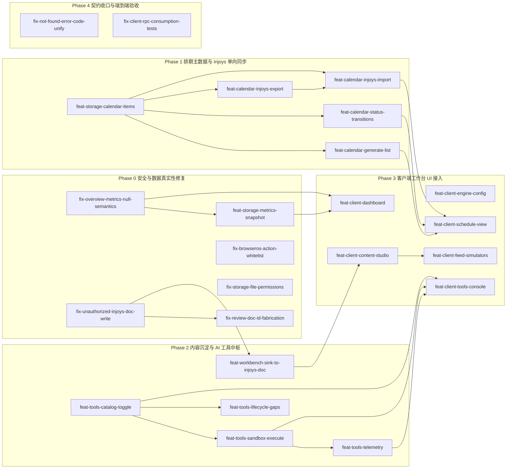

# 提案路线图 (Proposal Roadmap)

> **Metadata**
> - **项目名称**: dsh-growth-studio（Growth Studio / 个人产品增长推广工坊）
> - **项目类型**: **已有实现项目**（依据：`.context/legacy/legacy_system_analysis.md` 不存在，因此不是棕地；但 ① `.context/architecture/risks_and_debt.md` 的 TD-001 ~ TD-014 与 `.context/domain/risks_and_debt.md` 的 PD-001 ~ PD-006 逐条记录了**现状实现**与目标契约的差距；② 仓库内已存在架构文档描述的源码目录与可运行代码 —— `src/index.ts`、`src/ops-rpc.ts`、`src/config-store.ts`、`src/types.ts`、`src/adapters/`、`src/browser/`、`src/storage/`、`src/analytics/`、`src/tools/`、`src/injoys/`、`plugin-src/client/`、`tests/`，与 `criterion.md` §1 仓库结构约束一致）
> - **规划形态**: `总纲+分Phase`
> - **判定依据**: 提案总数 M=24、Phase 数 P=5、单 Phase 最多提案数 K=6（均超出 `单文件` 阈值 M≤10 / P≤3 / K≤6 中的 M 与 P 条件）
> - **当前阶段**: Phase 0（安全与数据真实性修复）
> - **生成日期**: 2026-10-16
> - **基于文档**: `.context/criterion.md`、`.context/context-manifest.json`、`.context/architecture/*`（含 8 篇 ADR）、`.context/domain/*`
> - **任务状态**: proposed

> **规划口径说明**
> - **阶段划分依据**: 本项目 PRD 的 Phase 1–3（舆情需求提炼 / 技能工坊与出海 / Injoys 双向同步）属**未到阶段**，`constraints.md` §组织约束明确「未到阶段的能力不提前实现」，故本路线图**只覆盖 Phase 0（双平台最小完整闭环）的达成**；PRD §七 Phase 1–3 的交付能力**不在本路线图范围**。
> - **修复优先于新增**: 依 `.context/architecture/risks_and_debt.md` 的严重性标注，触碰 `criterion.md` 铁律 / 数据真实性 / 安全边界的缺口（TD-007 / TD-008 / TD-009 / TD-012）全部置于**最前的 Phase 0**；`fix-*` 表示「对现有实现的修复或对齐」，`feat-*` 表示「新增能力」。
> - **预计时间为规划估算**: 源文档与 Context 资产对工作量一律标注 `N/A – 源文档未提供`（见 `risks_and_debt.md` 各 TD 条目），本路线图中的人日数为**规划估算**，不是源文档事实；提案创建时应重新评估。
> - **数量已收窄**: 同一方法 / 同一模块内的缺陷合并为一个提案（如 `workbench.overview` 的汇总语义与硬编码热点数据），避免为同一文件产出互相冲突的并行提案。

---

## 🗺️ 阶段总览

| 阶段 | 名称 | 目标 | 预计周期 | 提案数 | 详情 |
|:----:|------|------|----------|:------:|------|
| Phase 0 | 安全与数据真实性修复 | 消除触碰铁律 2 / 铁律 3、内容写入边界与安全边界的实现缺口，让既有接口先「不说假话」 | ~10 人日 | 6 | [Phase-0](./proposal-roadmap-Phase-0.md) |
| Phase 1 | 排期主数据与 Injoys 单向同步 | 让排期成为本地黄金主数据源，并打通生成 / 状态推进 / 单向导出 / 显式导入 | ~13 人日 | 5 | [Phase-1](./proposal-roadmap-Phase-1.md) |
| Phase 2 | 内容沉淀与 AI 工具中枢 | 补齐「用户显式触发」的唯一沉淀入口，并落地工具目录 / 白名单 / 沙箱 / 遥测 | ~13 人日 | 5 | [Phase-2](./proposal-roadmap-Phase-2.md) |
| Phase 3 | 客户端工作台 UI 接入 | 把宿主侧契约接进 6 大 Tab 中 Phase 0 所需的 5 个 Tab，补齐 PD-004 的界面缺口 | ~17 人日 | 6 | [Phase-3](./proposal-roadmap-Phase-3.md) |
| Phase 4 | 契约收口与端到端验收 | 统一重复错误码、补齐客户端 RPC 消费测试，为 Phase 0 Live 实测与签收做准备 | ~3 人日 | 2 | [Phase-4](./proposal-roadmap-Phase-4.md) |

> Phase 顺序按 **SSoT-first 依赖**而非严重性单独排序：Phase 0 是必须最先做的合规修复；Phase 1 / 2 提供后续 UI 所依赖的宿主契约；Phase 3 的客户端 UI 之所以不在 Phase 0，是因为它**依赖**前序契约（`criterion.md` §6：类型契约 → 宿主 RPC 契约 → 领域实现 → 客户端 UI 与测试）。PD-004（高严重性）的界面缺口在 Phase 3 集中偿还。

---

## 🔗 依赖关系图

> 覆盖全部 24 个提案（含跨 Phase 依赖）。

---

## 📇 提案索引

> 索引只做定位：Change ID、优先级、前置依赖、状态与各 Phase 文件中的提案块**完全一致**，详细内容只写在 Phase 文件里。

| Change ID | Phase | 标题 | 优先级 | 前置依赖 | 状态 | 详情 |
|-----------|:-----:|------|:------:|----------|------|------|
| `fix-overview-metrics-null-semantics` | 0 | 工作台总览的汇总空值语义与真实数据来源 | P0 | 无 | proposed | [Phase-0](./proposal-roadmap-Phase-0.md) |
| `feat-storage-metrics-snapshot` | 0 | 指标历史快照落盘（环比基准） | P1 | `fix-overview-metrics-null-semantics` | proposed | [Phase-0](./proposal-roadmap-Phase-0.md) |
| `fix-unauthorized-injoys-doc-write` | 0 | 移除生成 / 复盘路径未授权的 Injoys 文档写入 | P0 | 无 | proposed | [Phase-0](./proposal-roadmap-Phase-0.md) |
| `fix-review-doc-id-fabrication` | 0 | 复盘工具不得以字面量冒充文档编号 | P0 | `fix-unauthorized-injoys-doc-write` | proposed | [Phase-0](./proposal-roadmap-Phase-0.md) |
| `fix-browseros-action-whitelist` | 0 | BrowserOS 动作白名单契约与实现对齐 | P0 | 无 | proposed | [Phase-0](./proposal-roadmap-Phase-0.md) |
| `fix-storage-file-permissions` | 0 | 落盘文件与目录权限位实现 | P1 | 无 | proposed | [Phase-0](./proposal-roadmap-Phase-0.md) |
| `feat-storage-calendar-items` | 1 | 排期主数据本地落盘服务 | P0 | 无 | proposed | [Phase-1](./proposal-roadmap-Phase-1.md) |
| `feat-calendar-generate-list` | 1 | 排期生成与读取方法 | P0 | `feat-storage-calendar-items` | proposed | [Phase-1](./proposal-roadmap-Phase-1.md) |
| `feat-calendar-status-transitions` | 1 | 排期状态前向推进与校验 | P1 | `feat-storage-calendar-items` | proposed | [Phase-1](./proposal-roadmap-Phase-1.md) |
| `feat-calendar-injoys-export` | 1 | 排期单向导出至 Injoys 表格 | P0 | `feat-storage-calendar-items` | proposed | [Phase-1](./proposal-roadmap-Phase-1.md) |
| `feat-calendar-injoys-import` | 1 | 从 Injoys 表格显式导入排期 | P1 | `feat-storage-calendar-items`、`feat-calendar-injoys-export` | proposed | [Phase-1](./proposal-roadmap-Phase-1.md) |
| `feat-workbench-sink-to-injoys-doc` | 2 | 用户显式触发的物料沉淀入口 | P1 | `fix-unauthorized-injoys-doc-write` | proposed | [Phase-2](./proposal-roadmap-Phase-2.md) |
| `feat-tools-catalog-toggle` | 2 | 工具目录与白名单开关 | P1 | 无 | proposed | [Phase-2](./proposal-roadmap-Phase-2.md) |
| `feat-tools-sandbox-execute` | 2 | 单步调试沙箱执行 | P1 | `feat-tools-catalog-toggle` | proposed | [Phase-2](./proposal-roadmap-Phase-2.md) |
| `feat-tools-telemetry` | 2 | 工具执行遥测（脱敏） | P2 | `feat-tools-sandbox-execute` | proposed | [Phase-2](./proposal-roadmap-Phase-2.md) |
| `feat-tools-lifecycle-gaps` | 2 | 补齐生命周期分类缺失的 3 个工具 | P2 | `feat-tools-catalog-toggle` | proposed | [Phase-2](./proposal-roadmap-Phase-2.md) |
| `feat-client-engine-config` | 3 | 引擎策略配置页接入 | P0 | 无 | proposed | [Phase-3](./proposal-roadmap-Phase-3.md) |
| `feat-client-dashboard` | 3 | 运营驾驶舱接入 | P0 | `fix-overview-metrics-null-semantics`、`feat-storage-metrics-snapshot` | proposed | [Phase-3](./proposal-roadmap-Phase-3.md) |
| `feat-client-content-studio` | 3 | 内容创作室与草稿库接入 | P0 | `feat-workbench-sink-to-injoys-doc` | proposed | [Phase-3](./proposal-roadmap-Phase-3.md) |
| `feat-client-feed-simulators` | 3 | 公众号 / B站 真实样式模拟器 | P1 | `feat-client-content-studio` | proposed | [Phase-3](./proposal-roadmap-Phase-3.md) |
| `feat-client-schedule-view` | 3 | 排期日历流水与回填入口 | P1 | `feat-calendar-generate-list`、`feat-calendar-status-transitions`、`feat-calendar-injoys-import` | proposed | [Phase-3](./proposal-roadmap-Phase-3.md) |
| `feat-client-tools-console` | 3 | AI 工具中枢与沙箱控制台 | P2 | `feat-tools-catalog-toggle`、`feat-tools-sandbox-execute`、`feat-tools-telemetry` | proposed | [Phase-3](./proposal-roadmap-Phase-3.md) |
| `fix-not-found-error-code-unify` | 4 | 统一「未找到」错误码 | P2 | 无 | proposed | [Phase-4](./proposal-roadmap-Phase-4.md) |
| `fix-client-rpc-consumption-tests` | 4 | 客户端 RPC 消费测试覆盖 | P1 | 无 | proposed | [Phase-4](./proposal-roadmap-Phase-4.md) |

---

## 📦 各 Phase 详情

- **Phase 0: 安全与数据真实性修复** — 让既有接口先合规：汇总空值语义、内容写入边界、虚报成功、动作白名单与文件权限 → [Phase-0](./proposal-roadmap-Phase-0.md)
- **Phase 1: 排期主数据与 Injoys 单向同步** — 排期成为本地黄金主数据源并打通生成 / 推进 / 导出 / 导入 → [Phase-1](./proposal-roadmap-Phase-1.md)
- **Phase 2: 内容沉淀与 AI 工具中枢** — 补齐唯一授权沉淀入口与工具目录 / 沙箱 / 遥测 → [Phase-2](./proposal-roadmap-Phase-2.md)
- **Phase 3: 客户端工作台 UI 接入** — 把契约接进驾驶舱 / 创作室 / 排期 / 工具 / 配置 5 个 Tab → [Phase-3](./proposal-roadmap-Phase-3.md)
- **Phase 4: 契约收口与端到端验收** — 错误码统一、客户端消费测试，支撑 Phase 0 Live 实测与签收 → [Phase-4](./proposal-roadmap-Phase-4.md)

---

> 💡 创建单个提案时使用：`.agent/workflows/context-openspec.md proposal <change-id> [roadmap-doc]`
> 💡 本形态下 `roadmap-doc` 可指定对应的 Phase 文件；不指定时也会按总纲索引自动读取。
