# 提案路线图 (Proposal Roadmap)

> **Metadata**
> - **项目名称**: dsh-growth-studio
> - **项目类型**: 绿地项目（无 `.context/legacy/`）
> - **规划形态**: `总纲+分Phase`
> - **判定依据**: 提案总数 M=29、Phase 数 P=6、单 Phase 最多提案数 K=7；满足 `M > 10` 且 `P ≥ 4`（同时 `K > 6`），故采用总纲+分Phase 形态
> - **当前阶段**: Phase 0（契约基线与铁律缺口）
> - **生成日期**: 2026-10-16
> - **基于文档**: `.context/criterion.md`、`.context/architecture/`（21 个资产，含 TAD v1.3.0 / ADR-001~008）、`.context/domain/`（8 个资产，含 PRD v1.2.0）、`.context/openspec/integration.md`
> - **任务状态**: proposed

---

## 🗺️ 阶段总览

| 阶段 | 名称 | 目标 | 预计周期 | 提案数 | 详情 |
|------|------|------|----------|:------:|------|
| Phase 0 | 契约基线与铁律缺口 | 优先补齐触碰铁律（数据真实性 / 内容写入边界 / 虚报成功 / 最小权限）的高严重性缺口，并落地指标历史与显式沉淀能力，为后续阶段提供可信基座 | 约 11.5 人日 | 7 | [Phase-0](./proposal-roadmap-Phase-0.md) |
| Phase 1 | 排期日历与 Injoys 单向同步 | 落地本地排期黄金主数据（`calendar/`）、五态流转与 Injoys 单向导入/导出（幂等 + 冲突可核对） | 约 9 人日 | 5 | [Phase-1](./proposal-roadmap-Phase-1.md) |
| Phase 2 | 客户端工作台 UI 接入 | 将宿主 RPC 能力接入 6 大 Tab 客户端工作台，闭环「草稿管理 → 多变体编辑 → 预填入口」并补齐客户端消费测试 | 约 12 人日 | 6 | [Phase-2](./proposal-roadmap-Phase-2.md) |
| Phase 3 | AI 工具中枢与契约清理 | 交付工具目录 / 白名单启停 / 单步调试沙箱，清理工具登记遗漏与重复错误码 | 约 5 人日 | 3 | [Phase-3](./proposal-roadmap-Phase-3.md) |
| Phase 4 | 舆情复盘与选题反哺 | 打通真实评论抓取 → 需求聚类 → 需求池沉淀 → 周度复盘 → 热点选题反哺创作室闭环 | 约 9 人日 | 4 | [Phase-4](./proposal-roadmap-Phase-4.md) |
| Phase 5 | 出海平台与技能工坊 | 接入海外 4 平台、交付 5 大场景技能包、验证浏览器登录端点 PoC、推进 Injoys 双向同步 | 约 12 人日 | 4 | [Phase-5](./proposal-roadmap-Phase-5.md) |

> 合计 29 个原子提案，约 58.5 人日；周期为内容估算，源文档未提供里程碑日期，实际排期待定。

---

## 🔗 依赖关系图

> 覆盖全部提案（含跨 Phase 依赖）；本图是全局**唯一**依赖图。

```mermaid
graph TD
  subgraph P0[Phase 0 契约基线与铁律缺口]
    metricsHist[feat-metrics-history-persistence]
    sink[feat-workbench-sink-to-injoys-doc]
    overviewAgg[fix-analytics-overview-aggregation]
    genBoundary[fix-studio-generation-write-boundary]
    reviewId[fix-review-honest-doc-id]
    bosWhitelist[fix-browseros-action-whitelist]
    filePerm[fix-storage-file-permissions]
  end

  subgraph P1[Phase 1 排期日历与 Injoys 单向同步]
    calStore[feat-calendar-store]
    calGen[feat-calendar-generation]
    calStatus[feat-calendar-status-flow]
    calExport[feat-calendar-injoys-export]
    calImport[feat-calendar-injoys-import]
  end

  subgraph P2[Phase 2 客户端工作台 UI 接入]
    shell[feat-client-workbench-shell]
    cockpit[feat-client-cockpit-matrix]
    calBoard[feat-client-calendar-board]
    studio[feat-client-studio-preview]
    engineCfg[feat-client-engine-config]
    rpcCoverage[feat-client-rpc-coverage]
  end

  subgraph P3[Phase 3 AI 工具中枢与契约清理]
    toolsHub[feat-tools-hub-sandbox]
    toolCatalog[fix-tool-catalog-registration]
    errDedup[fix-rpc-error-code-dedup]
  end

  subgraph P4[Phase 4 舆情复盘与选题反哺]
    commentCrawl[feat-feedback-comment-crawl]
    needsCluster[feat-feedback-needs-clustering]
    weeklyReport[feat-weekly-review-report]
    trendsRadar[feat-trends-radar]
  end

  subgraph P5[Phase 5 出海平台与技能工坊]
    overseas[feat-overseas-platform-adapters]
    skillPacks[feat-scenario-skill-packs]
    loginPoc[feat-browser-login-poc]
    bidirectional[feat-injoys-bidirectional-sync]
  end

  metricsHist --> overviewAgg
  sink --> genBoundary

  calStore --> calGen
  calStore --> calStatus
  calStore --> calExport
  calStore --> calImport
  calGen --> calExport

  shell --> cockpit
  shell --> calBoard
  shell --> studio
  shell --> engineCfg
  shell --> rpcCoverage
  overviewAgg --> cockpit
  calStatus --> calBoard
  sink --> studio
  genBoundary --> studio

  shell --> toolsHub
  toolsHub --> toolCatalog

  shell --> commentCrawl
  commentCrawl --> needsCluster
  metricsHist --> weeklyReport
  shell --> trendsRadar

  engineCfg --> overseas
  toolsHub --> skillPacks
  overseas --> loginPoc
  calImport --> bidirectional
  calExport --> bidirectional
```

---

## 📇 提案索引

> 索引只做定位：Change ID、优先级、前置依赖、状态与对应 Phase 文件中的提案块**完全一致**，详细内容只写在 Phase 文件里。

| Change ID | Phase | 标题 | 优先级 | 前置依赖 | 状态 | 详情 |
|-----------|-------|------|:------:|----------|------|------|
| `feat-metrics-history-persistence` | 0 | 指标历史快照持久化（环比基准） | P0 | — | proposed | [Phase-0](./proposal-roadmap-Phase-0.md) |
| `feat-workbench-sink-to-injoys-doc` | 0 | 显式沉淀至 Injoys 知识文档（唯一授权入口） | P0 | — | proposed | [Phase-0](./proposal-roadmap-Phase-0.md) |
| `fix-analytics-overview-aggregation` | 0 | `workbench.overview` 部分缺失汇总语义补全 | P0 | `feat-metrics-history-persistence` | proposed | [Phase-0](./proposal-roadmap-Phase-0.md) |
| `fix-studio-generation-write-boundary` | 0 | 生成路径移除未授权 Injoys 文档写入 | P0 | `feat-workbench-sink-to-injoys-doc` | proposed | [Phase-0](./proposal-roadmap-Phase-0.md) |
| `fix-review-honest-doc-id` | 0 | 复盘工具如实返回沉淀状态（不虚报编号） | P0 | — | proposed | [Phase-0](./proposal-roadmap-Phase-0.md) |
| `fix-browseros-action-whitelist` | 0 | BrowserOS 动作白名单契约与实现对齐 | P0 | — | proposed | [Phase-0](./proposal-roadmap-Phase-0.md) |
| `fix-storage-file-permissions` | 0 | 配置与草稿文件权限收敛到当前 OS 用户 | P1 | — | proposed | [Phase-0](./proposal-roadmap-Phase-0.md) |
| `feat-calendar-store` | 1 | 排期黄金主数据持久化（`calendar/`） | P0 | — | proposed | [Phase-1](./proposal-roadmap-Phase-1.md) |
| `feat-calendar-generation` | 1 | 排期日历生成（7 天 / 周 / 月） | P0 | `feat-calendar-store` | proposed | [Phase-1](./proposal-roadmap-Phase-1.md) |
| `feat-calendar-status-flow` | 1 | 排期五态流转与列表读取 | P0 | `feat-calendar-store` | proposed | [Phase-1](./proposal-roadmap-Phase-1.md) |
| `feat-calendar-injoys-export` | 1 | 排期单向导出至 Injoys 表格（幂等） | P1 | `feat-calendar-store`、`feat-calendar-generation` | proposed | [Phase-1](./proposal-roadmap-Phase-1.md) |
| `feat-calendar-injoys-import` | 1 | 从 Injoys 表格单向导入排期（冲突可核对） | P1 | `feat-calendar-store` | proposed | [Phase-1](./proposal-roadmap-Phase-1.md) |
| `feat-client-workbench-shell` | 2 | 客户端工作台外壳与 RPC 消费扩展 | P0 | — | proposed | [Phase-2](./proposal-roadmap-Phase-2.md) |
| `feat-client-cockpit-matrix` | 2 | 运营驾驶舱与渠道矩阵接入 | P0 | `feat-client-workbench-shell`、`fix-analytics-overview-aggregation` | proposed | [Phase-2](./proposal-roadmap-Phase-2.md) |
| `feat-client-calendar-board` | 2 | 排期日历流水看板接入 | P1 | `feat-client-workbench-shell`、`feat-calendar-status-flow` | proposed | [Phase-2](./proposal-roadmap-Phase-2.md) |
| `feat-client-studio-preview` | 2 | 内容创作室与跨平台预览接入 | P0 | `feat-client-workbench-shell`、`feat-workbench-sink-to-injoys-doc`、`fix-studio-generation-write-boundary` | proposed | [Phase-2](./proposal-roadmap-Phase-2.md) |
| `feat-client-engine-config` | 2 | 引擎策略配置 Tab 接入 | P1 | `feat-client-workbench-shell` | proposed | [Phase-2](./proposal-roadmap-Phase-2.md) |
| `feat-client-rpc-coverage` | 2 | 客户端 RPC 消费测试覆盖 | P1 | `feat-client-workbench-shell` | proposed | [Phase-2](./proposal-roadmap-Phase-2.md) |
| `feat-tools-hub-sandbox` | 3 | AI 工具中枢与单步调试沙箱 | P1 | `feat-client-workbench-shell` | proposed | [Phase-3](./proposal-roadmap-Phase-3.md) |
| `fix-tool-catalog-registration` | 3 | 工具全景缺失工具登记或显式移出范围 | P2 | `feat-tools-hub-sandbox` | proposed | [Phase-3](./proposal-roadmap-Phase-3.md) |
| `fix-rpc-error-code-dedup` | 3 | 重复「未找到」错误码收敛 | P2 | — | proposed | [Phase-3](./proposal-roadmap-Phase-3.md) |
| `feat-feedback-comment-crawl` | 4 | 真实评论抓取 | P1 | `feat-client-workbench-shell` | proposed | [Phase-4](./proposal-roadmap-Phase-4.md) |
| `feat-feedback-needs-clustering` | 4 | 评论聚类为需求并沉淀 Injoys 需求池 | P1 | `feat-feedback-comment-crawl` | proposed | [Phase-4](./proposal-roadmap-Phase-4.md) |
| `feat-weekly-review-report` | 4 | 周度运营复盘报告 | P1 | `feat-metrics-history-persistence` | proposed | [Phase-4](./proposal-roadmap-Phase-4.md) |
| `feat-trends-radar` | 4 | 热点选题雷达与一键采用 | P2 | `feat-client-workbench-shell` | proposed | [Phase-4](./proposal-roadmap-Phase-4.md) |
| `feat-overseas-platform-adapters` | 5 | 海外 4 平台适配器接入 | P1 | `feat-client-engine-config` | proposed | [Phase-5](./proposal-roadmap-Phase-5.md) |
| `feat-scenario-skill-packs` | 5 | 5 大官方场景技能包与工具裁剪 | P2 | `feat-tools-hub-sandbox` | proposed | [Phase-5](./proposal-roadmap-Phase-5.md) |
| `feat-browser-login-poc` | 5 | 浏览器交互式登录端点 PoC 验证 | P2 | `feat-overseas-platform-adapters` | proposed | [Phase-5](./proposal-roadmap-Phase-5.md) |
| `feat-injoys-bidirectional-sync` | 5 | Injoys 排期双向同步与冲突仲裁 | P2 | `feat-calendar-injoys-import`、`feat-calendar-injoys-export` | proposed | [Phase-5](./proposal-roadmap-Phase-5.md) |

---

## 📦 各 Phase 详情

### 【总纲+分Phase 形态】

> 本节每个 Phase 只保留一句话目标和链接，**不写提案块**。

- **Phase 0: 契约基线与铁律缺口** — 优先补齐触碰铁律的高严重性缺口，并落地指标历史与显式沉淀能力 → [proposal-roadmap-Phase-0.md](./proposal-roadmap-Phase-0.md)
- **Phase 1: 排期日历与 Injoys 单向同步** — 落地本地排期黄金主数据、五态流转与 Injoys 单向导入导出 → [proposal-roadmap-Phase-1.md](./proposal-roadmap-Phase-1.md)
- **Phase 2: 客户端工作台 UI 接入** — 把宿主 RPC 能力接入 6 大 Tab 客户端工作台并补齐消费测试 → [proposal-roadmap-Phase-2.md](./proposal-roadmap-Phase-2.md)
- **Phase 3: AI 工具中枢与契约清理** — 交付工具目录 / 启停 / 沙箱，清理工具登记与错误码重复 → [proposal-roadmap-Phase-3.md](./proposal-roadmap-Phase-3.md)
- **Phase 4: 舆情复盘与选题反哺** — 打通评论抓取 → 需求聚类 → 需求池 → 复盘 → 选题反哺闭环 → [proposal-roadmap-Phase-4.md](./proposal-roadmap-Phase-4.md)
- **Phase 5: 出海平台与技能工坊** — 接入海外 4 平台、交付技能包、验证登录端点 PoC 与双向同步 → [proposal-roadmap-Phase-5.md](./proposal-roadmap-Phase-5.md)

---

> 💡 创建单个提案时使用：`.agent/workflows/context-openspec.md proposal <change-id> [roadmap-doc]`
> 💡 总纲+分Phase 形态下，`roadmap-doc` 可指定对应的 Phase 文件；不指定时也会按总纲索引自动读取
