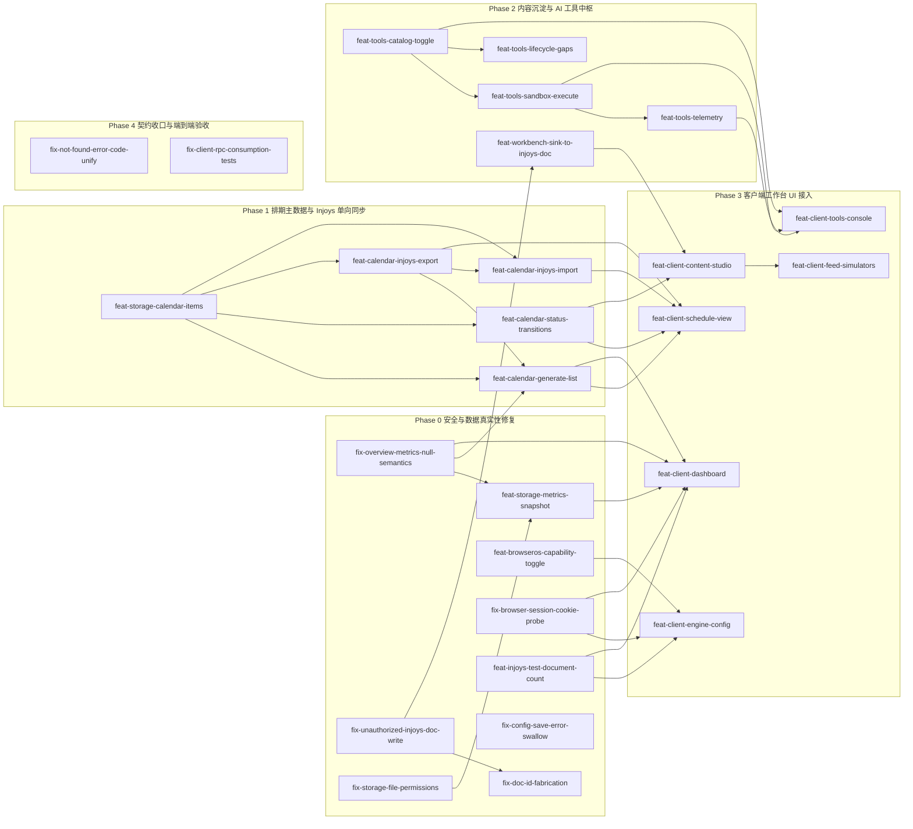

# 提案路线图 (Proposal Roadmap)

> **Metadata**
> - **项目名称**: dsh-growth-studio（Growth Studio / 个人产品增长推广工坊）
> - **项目类型**: **已有实现项目**（依据：`.context/legacy/legacy_system_analysis.md` 不存在，因此不是棕地；但 ① `.context/architecture/risks_and_debt.md` 的 TD-001 ~ TD-015 与 `.context/domain/risks_and_debt.md` 的 PD-001 ~ PD-006 逐条记录了**现状实现**与目标契约的差距；② 仓库内已存在架构文档描述的源码目录与可运行代码 —— `src/index.ts`、`src/ops-rpc.ts`、`src/config-store.ts`、`src/types.ts`、`src/adapters/`、`src/browser/`、`src/storage/`、`src/analytics/`、`src/tools/`、`src/injoys/`、`plugin-src/client/`、`tests/`，与 `criterion.md` §1 仓库结构约束一致）
> - **规划形态**: `总纲+分Phase`
> - **判定依据**: 提案总数 M=27、Phase 数 P=5、单 Phase 最多提案数 K=9（均超出 `单文件` 阈值 M≤10 / P≤3 / K≤6 中的 M、P 与 K 条件）
> - **当前阶段**: Phase 0（安全与数据真实性修复）
> - **生成日期**: 2026-10-17
> - **基于文档**: `.context/criterion.md`、`.context/context-manifest.json`、`.context/architecture/*`（含 9 篇 ADR，含 `adr_009_browseros_capability_management.md`）、`.context/domain/*`
> - **任务状态**: proposed

> **规划口径说明**
> - **阶段划分依据**: 本项目 PRD 的 Phase 1–3（舆情需求提炼 / 技能工坊与出海 / Injoys 双向同步）属**未到阶段**，`.context/architecture/constraints.md`「阶段规划」明确「未到阶段的能力不提前实现」，故本路线图**只覆盖 Phase 0（双平台最小完整闭环）的达成**；PRD §七 Phase 1–3 的交付能力**不在本路线图范围**。
> - **修复优先于新增**: 依 `.context/architecture/risks_and_debt.md` 的严重性标注，触碰 `criterion.md` 铁律 / 数据真实性 / 安全边界的缺口（TD-007 / TD-008 / TD-009 / TD-012，以及登记为「未缓解 / 待修复」的 RISK-003 与 RISK-005 缓解措施 ③「不得吞异常后谎报保存成功」）全部置于**最前的 Phase 0**；`fix-*` 表示「对现有实现的修复或对齐」，`feat-*` 表示「新增能力」。
> - **预计时间为规划估算**: 源文档与 Context 资产对工作量一律标注 `N/A – 源文档未提供`（见 `risks_and_debt.md` 各 TD 条目），本路线图中的人日数为**规划估算**，不是源文档事实；提案创建时应重新评估。
> - **数量已收窄**: 同一方法 / 同一模块内的缺陷合并为一个提案（如 `workbench.overview` 的汇总语义与硬编码热点数据；`browser.sessions` 的 Cookie 探测分支移除与 `ops_inspect_sessions` 按名登记同属会话探测模块），避免为同一文件产出互相冲突的并行提案。

**被移出的能力（阶段边界与依据）**：以下能力**不在 Phase 0 范围**（未到阶段，或阶段未指定），本路线图不为它们排提案，以避免「范围变更」与「遗漏」不可区分。

> **口径说明**：下表「所属 PRD 后续阶段」一列指 **PRD §七 的阶段口径**（PRD Phase 1–3），**与本路线图自身的 Phase 0–4 编号体系不同**，勿混淆（例如「官方内置 5 大场景技能包 | Phase 2」指 PRD Phase 2，并非本路线图的 Phase 2「内容沉淀与 AI 工具中枢」）。

| 被移出的能力 | 所属 PRD 后续阶段 | 依据（资产路径与章节） |
|--------------|:-----------:|------------------------|
| 视频号 / 抖音渠道与视频元数据模拟器、预填 | Phase 1 | `.context/domain/source/product_requirements.md` §四（分阶段交付）、§5.4.2、§七；`.context/architecture/constraints.md`「阶段规划」 |
| `xiaohongshu` 渠道适配器 | 阶段未指定（源文档未提供） | `.context/architecture/risks_and_debt.md` TD-015（`PlatformId` 9 值但适配器未注册）；`.context/criterion.md` §5.5 注；`.context/architecture/container_component_view.md` 平台清单注 |
| `ops_keyword_research`（策划与选题）/ `ops_generate_hooks`（创意与生成） | 阶段未定（源文档未提供） | `.context/domain/risks_and_debt.md` PD-006（偿还计划：阶段未定，需补阶段归属或显式标注移出）；`.context/architecture/api_strategy.md` §3.10（阶段列标「未定」） |
| 跨平台真实评论抓取与需求聚类反哺（`IssueExtractor` → Injoys 需求池） | Phase 1 | `.context/domain/business_rules.md` BR-054；`.context/domain/risks_and_debt.md` PD-005；`.context/domain/source/product_requirements.md` §5.6 |
| 基于真实数据的周 / 月增长复盘报告 | Phase 1 | `.context/domain/business_rules.md` BR-055；`.context/domain/source/product_requirements.md` §5.6、§5.5.1 |
| 海外四大渠道（YouTube / X / Product Hunt / TikTok）模拟与预填 | Phase 2 | `.context/domain/source/product_requirements.md` §5.2.1、§5.4.2、§七；`.context/domain/risks_and_debt.md` RISK-B003 |
| 官方内置 5 大场景技能包（白名单工具裁剪） | Phase 2 | `.context/domain/business_rules.md` BR-042；`.context/domain/risks_and_debt.md` PD-002；`.context/domain/source/product_requirements.md` §5.5.2 |
| 自定义技能包可视化编辑器 + 第三方 MCP 热插拔挂载 | Phase 3 | `.context/domain/risks_and_debt.md` PD-002；`.context/domain/source/product_requirements.md` §5.5.2、§四 |
| BrowserOS 交互式登录端点（`browser.login.startQr` / `pollQr` / `openHeadful` / `cancel`） | Phase 2（需 CDP PoC） | `.context/domain/risks_and_debt.md` PD-001；`.context/architecture/risks_and_debt.md` RISK-012；`.context/domain/source/product_requirements.md` §5.2.3 |
| Injoys 复杂双向同步与冲突仲裁 | Phase 3 | `.context/domain/business_rules.md` BR-024；`.context/domain/risks_and_debt.md` PD-003；`.context/architecture/risks_and_debt.md` TD-006；`.context/domain/source/product_requirements.md` §5.3.2、§七 |
| 架构组件 `FeedbackIntelligence`（评论爬取与需求提炼） | Phase 1 | `.context/architecture/system_design.md` 组件表；`.context/architecture/introduction_and_goals.md`「范围与阶段」 |
| 架构组件 `SkillEngine` / `OverseasStrategyManager` | Phase 2 | `.context/architecture/system_design.md` 组件表；`.context/architecture/context_view.md`「Out-of-Scope（本系统不负责）」 |

> [!NOTE]
> **`ops_draft_launch_kit`（出海 Launch 物料）的阶段边界**：该工具所属**能力**属 Phase 2，但它**当前实现中已存在**且存在越权写入 Injoys 与时间戳伪造编号两处合规缺陷（`docs/implementation-gaps-report.md` §1 / §2）。依「触碰铁律的实现缺口全部置于 Phase 0」，其**减法**合规修复已并入 Phase 0 的 `fix-unauthorized-injoys-doc-write` 与 `fix-doc-id-fabrication`；本路线图**不**提前实现 Phase 2 的出海模拟 / 预填能力。
>
> **`.context` 登记补登**：`architecture/risks_and_debt.md` 的 TD-008 仅登记 4 处写入站点、TD-009 仅登记 `ops_generate_review` 一处假编号（见 `docs/implementation-gaps-report.md` §5 的「已知覆盖缺口」）。上述两个 Phase 0 提案已把「补登第 5 处 / 第 2 处站点」列入 In-scope，实施时须同轮刷新 `.context` 资产、Manifest 与 `history`。

---

## 🗺️ 阶段总览

| 阶段 | 名称 | 目标 | 预计周期 | 提案数 | 详情 |
|:----:|------|------|----------|:------:|------|
| Phase 0 | 安全与数据真实性修复 | 消除触碰铁律 2 / 铁律 3 / 铁律 4、内容写入边界、安全边界与配置落盘真实性的实现缺口，让既有接口先「不说假话、不越界」 | ~17 人日 | 9 | [Phase-0](./proposal-roadmap-Phase-0.md) |
| Phase 1 | 排期主数据与 Injoys 单向同步 | 让排期成为本地黄金主数据源，并打通生成 / 状态推进 / 单向导出 / 显式导入 | ~15 人日 | 5 | [Phase-1](./proposal-roadmap-Phase-1.md) |
| Phase 2 | 内容沉淀与 AI 工具中枢 | 补齐「用户显式触发」的唯一沉淀入口，并落地工具目录 / 白名单 / 沙箱 / 遥测 | ~12.5 人日 | 5 | [Phase-2](./proposal-roadmap-Phase-2.md) |
| Phase 3 | 客户端工作台 UI 接入 | 把宿主侧契约接进 6 大 Tab 中 Phase 0 所需的 5 个 Tab，补齐 PD-004 的界面缺口 | ~19 人日 | 6 | [Phase-3](./proposal-roadmap-Phase-3.md) |
| Phase 4 | 契约收口与端到端验收 | 统一重复错误码、补齐客户端 RPC 消费测试，为 Phase 0 Live 实测与签收做准备 | ~3 人日 | 2 | [Phase-4](./proposal-roadmap-Phase-4.md) |

> Phase 顺序按 **SSoT-first 依赖**而非严重性单独排序：Phase 0 是必须最先做的合规修复；Phase 1 / 2 提供后续 UI 所依赖的宿主契约；Phase 3 的客户端 UI 之所以不在 Phase 0，是因为它**依赖**前序契约（`criterion.md` §6：类型契约 → 宿主 RPC 契约 → 领域实现 → 客户端 UI 与测试）。PD-004（高严重性）的界面缺口在 Phase 3 集中偿还。

---

## 🔗 依赖关系图

> 覆盖全部 27 个提案（含跨 Phase 依赖）。

---

## 📇 提案索引

> 索引只做定位：Change ID、优先级、前置依赖、状态与各 Phase 文件中的提案块**完全一致**，详细内容只写在 Phase 文件里。

| Change ID | Phase | 标题 | 优先级 | 前置依赖 | 状态 | 详情 |
|-----------|:-----:|------|:------:|----------|------|------|
| `fix-overview-metrics-null-semantics` | 0 | 工作台总览的汇总空值语义与真实数据来源 | P0 | 无 | done | [Phase-0](./proposal-roadmap-Phase-0.md) |
| `feat-storage-metrics-snapshot` | 0 | 指标历史快照落盘（环比基准） | P1 | `fix-overview-metrics-null-semantics`、`fix-storage-file-permissions` | in-progress | [Phase-0](./proposal-roadmap-Phase-0.md) |
| `fix-unauthorized-injoys-doc-write` | 0 | 移除生成 / 复盘 / 海外 Launch 路径未授权的 Injoys 文档写入 | P0 | 无 | proposed | [Phase-0](./proposal-roadmap-Phase-0.md) |
| `fix-doc-id-fabrication` | 0 | 工具不得以字面量 / 时间戳冒充文档编号 | P0 | `fix-unauthorized-injoys-doc-write` | proposed | [Phase-0](./proposal-roadmap-Phase-0.md) |
| `feat-browseros-capability-toggle` | 0 | BrowserOS 能力开关契约与统一执行检查 | P0 | 无 | proposed | [Phase-0](./proposal-roadmap-Phase-0.md) |
| `fix-browser-session-cookie-probe` | 0 | 统一 BrowserOS 会话探测并登记会话探活工具 | P0 | 无 | proposed | [Phase-0](./proposal-roadmap-Phase-0.md) |
| `fix-storage-file-permissions` | 0 | 落盘文件与目录权限位实现 | P1 | 无 | done | [Phase-0](./proposal-roadmap-Phase-0.md) |
| `feat-injoys-test-document-count` | 0 | `injoys.test` 补文档数（可空）契约 | P1 | 无 | proposed | [Phase-0](./proposal-roadmap-Phase-0.md) |
| `fix-config-save-error-swallow` | 0 | 配置写盘失败如实上报（不虚报成功） | P0 | 无 | done | [Phase-0](./proposal-roadmap-Phase-0.md) |
| `feat-storage-calendar-items` | 1 | 排期主数据本地落盘服务 | P0 | 无 | proposed | [Phase-1](./proposal-roadmap-Phase-1.md) |
| `feat-calendar-generate-list` | 1 | 排期生成、读取与生成时立即导出 | P0 | `feat-storage-calendar-items`、`feat-calendar-injoys-export`、`fix-overview-metrics-null-semantics` | proposed | [Phase-1](./proposal-roadmap-Phase-1.md) |
| `feat-calendar-status-transitions` | 1 | 排期状态前向推进与校验 | P1 | `feat-storage-calendar-items` | proposed | [Phase-1](./proposal-roadmap-Phase-1.md) |
| `feat-calendar-injoys-export` | 1 | 排期单向导出至 Injoys 表格 | P0 | `feat-storage-calendar-items` | proposed | [Phase-1](./proposal-roadmap-Phase-1.md) |
| `feat-calendar-injoys-import` | 1 | 从 Injoys 表格显式导入排期 | P1 | `feat-storage-calendar-items`、`feat-calendar-injoys-export` | proposed | [Phase-1](./proposal-roadmap-Phase-1.md) |
| `feat-workbench-sink-to-injoys-doc` | 2 | 用户显式触发的物料沉淀入口 | P1 | `fix-unauthorized-injoys-doc-write` | proposed | [Phase-2](./proposal-roadmap-Phase-2.md) |
| `feat-tools-catalog-toggle` | 2 | 工具目录与白名单开关 | P1 | 无 | proposed | [Phase-2](./proposal-roadmap-Phase-2.md) |
| `feat-tools-sandbox-execute` | 2 | 单步调试沙箱执行 | P1 | `feat-tools-catalog-toggle` | proposed | [Phase-2](./proposal-roadmap-Phase-2.md) |
| `feat-tools-telemetry` | 2 | 工具执行遥测（脱敏） | P2 | `feat-tools-sandbox-execute` | proposed | [Phase-2](./proposal-roadmap-Phase-2.md) |
| `feat-tools-lifecycle-gaps` | 2 | 补齐生命周期分类未定阶段的 2 个工具 | P2 | `feat-tools-catalog-toggle` | proposed | [Phase-2](./proposal-roadmap-Phase-2.md) |
| `feat-client-engine-config` | 3 | 引擎策略配置页接入（含 BrowserOS 能力管理） | P0 | `feat-browseros-capability-toggle`、`fix-browser-session-cookie-probe`、`feat-injoys-test-document-count` | proposed | [Phase-3](./proposal-roadmap-Phase-3.md) |
| `feat-client-dashboard` | 3 | 运营驾驶舱接入 | P0 | `fix-overview-metrics-null-semantics`、`feat-storage-metrics-snapshot`、`feat-calendar-generate-list`、`fix-browser-session-cookie-probe`、`feat-injoys-test-document-count` | proposed | [Phase-3](./proposal-roadmap-Phase-3.md) |
| `feat-client-content-studio` | 3 | 内容创作室与草稿库接入 | P0 | `feat-workbench-sink-to-injoys-doc`、`feat-calendar-status-transitions` | proposed | [Phase-3](./proposal-roadmap-Phase-3.md) |
| `feat-client-feed-simulators` | 3 | 公众号 / B站 真实样式模拟器 | P1 | `feat-client-content-studio` | proposed | [Phase-3](./proposal-roadmap-Phase-3.md) |
| `feat-client-schedule-view` | 3 | 排期日历流水与回填入口 | P1 | `feat-calendar-generate-list`、`feat-calendar-status-transitions`、`feat-calendar-injoys-export`、`feat-calendar-injoys-import` | proposed | [Phase-3](./proposal-roadmap-Phase-3.md) |
| `feat-client-tools-console` | 3 | AI 工具中枢与沙箱控制台 | P2 | `feat-tools-catalog-toggle`、`feat-tools-sandbox-execute`、`feat-tools-telemetry` | proposed | [Phase-3](./proposal-roadmap-Phase-3.md) |
| `fix-not-found-error-code-unify` | 4 | 统一「未找到」错误码 | P2 | 无 | proposed | [Phase-4](./proposal-roadmap-Phase-4.md) |
| `fix-client-rpc-consumption-tests` | 4 | 客户端 RPC 消费测试覆盖 | P1 | 无 | proposed | [Phase-4](./proposal-roadmap-Phase-4.md) |

---

## 📦 各 Phase 详情

- **Phase 0: 安全与数据真实性修复** — 让既有接口先合规：汇总空值语义与真实来源、内容写入边界、虚报成功（含复盘 / 海外 Launch 假编号与 `config.save` 配置落盘失败）、BrowserOS 能力开关与会话探测、文件权限、`injoys.test` 可空文档数 → [Phase-0](./proposal-roadmap-Phase-0.md)
- **Phase 1: 排期主数据与 Injoys 单向同步** — 排期成为本地黄金主数据源并打通生成（含生成时立即导出）/ 推进 / 导出 / 导入 → [Phase-1](./proposal-roadmap-Phase-1.md)
- **Phase 2: 内容沉淀与 AI 工具中枢** — 补齐唯一授权沉淀入口与工具目录 / 沙箱 / 遥测，并标注阶段未定的工具缺口 → [Phase-2](./proposal-roadmap-Phase-2.md)
- **Phase 3: 客户端工作台 UI 接入** — 把契约接进驾驶舱 / 创作室 / 排期 / 工具 / 引擎配置 5 个 Tab（含 BrowserOS 能力管理页） → [Phase-3](./proposal-roadmap-Phase-3.md)
- **Phase 4: 契约收口与端到端验收** — 错误码统一、客户端消费测试，支撑 Phase 0 Live 实测与签收 → [Phase-4](./proposal-roadmap-Phase-4.md)

---

## 待决事项

- `xiaohongshu` 渠道适配器是否纳入交付：`PlatformId`（criterion §5.5）与源文档 §4.1（v1.4.4）均含 9 值，但 `AdapterRegistry` 仅注册 8 个适配器（TD-015）。源文档未指明其所属阶段，故本路线图**暂不排提案**；需产品负责人确认后再定（维持现状则不注册适配器，`prefillDraft` 对 `xiaohongshu` 返回 `ops/platform-unsupported`）。
- `ops_keyword_research` / `ops_generate_hooks` 的阶段归属：PRD §5.5.1 列出但未标注交付阶段（PD-006 / `api_strategy.md` §3.10 阶段列标「未定」）。二者是否在 Phase 0 交付（影响 BR-040「每组包含对应工具」的验收）需产品负责人裁决；本路线图在 Phase 2 的 `feat-tools-lifecycle-gaps` 中以「实现或显式标注移出范围」收口，但**具体取舍待定**。
- 热点雷达 Tab 的真实选题来源：PRD 未指定具体渠道（`risks_and_debt.md` 外部依赖），本路线图不安排该 Tab 的选题生成，待来源明确后另行提案。

---

> 💡 创建单个提案时使用：`.agents/workflows/context-openspec.md proposal <change-id> [roadmap-doc]`
> 💡 本形态下 `roadmap-doc` 可指定对应的 Phase 文件；不指定时也会按总纲索引自动读取。
